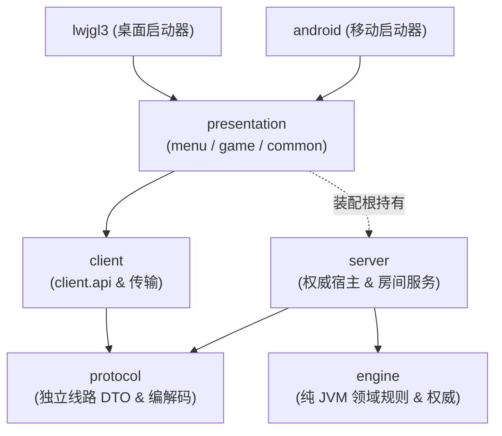

# 🀄 千术麻将 (Mahjong Cheater) - 架构与开发指南 (AGENTS.md)

**2026-10-07 当前架构与迁移状态：**
全系统默认且唯一生产架构为 **V4 架构**（R1–R6 已完成验收，旧 TCP/V3 运行链与兼容壳已按引用审计清理）。连接控制源码（`ConnectionControl.kt` 与 `DisconnectPolicy.kt`）现归属 server 模块的 `com.majiang.server.control` 包，engine 保留领域控制者、代次与投影。本次由 Anti 开发，Codex 独立检视及验收：全量 928 项、独立审查 189 项、双端构建和桌面 GL 冒烟通过，见 [连接控制迁移验收](doc/v4-migration/ACCEPTANCE-CONNECTION-OWNERSHIP.md)。保留全部有效规则、136 张物理守恒、算分、计时、码牌及出千测试。历史迁移细节见 [V4 计划](doc/v4-migration/PLAN.md)、[最终契约](doc/v4-migration/CONTRACT.md)、[R6 验收报告](doc/v4-migration/ACCEPTANCE-R6.md) 及 [历史任务归档](doc/archive/)。

---

## 1. 游戏定位与核心玩法特色

- **游戏类型**：2D 策略心理战日式麻将、千术绝技与出千经济博弈。
- **出千与经济机制**：
  - **三大绝技**：落汗（标记实体牌追踪透视）、袖里藏花（手牌藏匿调换）、偷梁换柱（手牌与牌山/死山等额互换）。
  - **出千账本**：独立出千点账户与 `CheatLedger` 经济系统，出千变动私有同步与局末汇总。
- **物理守恒律**：单副牌 136 张严格闭环物理实体（0..135），出千与牌山操作严禁无中生有。

---

## 2. 跨平台架构与技术规范

- **游戏引擎**：libGDX 1.14.2
- **编程语言**：Kotlin 2.4.10 (JVM 17)
- **桌面后端**：LWJGL 3 (1280x720 视口)
- **移动后端**：Android 沉浸式全屏横屏 (minSdk 21, targetSdk 36)
- **表现层结构**：
  - `presentation.menu`：主菜单、建房/加房/列房、设置、千术秘籍弹窗。
  - `presentation.game`：牌桌渲染、出牌/鸣牌/立直/出千动画流水线、观战画面。
  - `presentation.common`：共享字体、UI 资源与皮肤管理器。
  - 组合根 `MahjongGame`：装配客户端与服务端，负责画面导航与单机 tick 驱动。

---

## 3. 七模块分层与依赖规则

系统由七个 Gradle 模块组成，严格遵守单向编译依赖：



1. **engine**：纯 JVM 领域。负责麻将规则、41 种役种算分、136 张牌物理守恒、单局与整场状态机、出千经济与判定、洗牌码牌算法以及 `TableAuthority`。**严禁依赖 client、server、protocol、libGDX、Gson 或 Socket**。
2. **protocol**：独立线路契约库。包含数据报格式、分片、可靠性窗口、typed DTO、错误码与序列化编解码；**不依赖 engine/client/server/presentation**。
3. **server**：依赖 `engine` + `protocol`。拥有领域模型到协议 DTO 的双向映射、房间生命周期 (`RoomRegistry`/`SharedRoom`)、连接控制 (`com.majiang.server.control.ConnectionControl`)、每桌串行权威队列 (`ServerTableHost`)、本地/UDP 两种传输绑定。
4. **client**：仅依赖 `protocol`。拥有客户端门面 (`GameSession` / `LobbySession` / `SpectatorSession`)、协议到客户端视图的映射 (`ProtocolViewMapper`)、有界缓冲有序同步（客户端接收缓冲 64，已应用游标去重 256）、状态缓存、自动重连与防重放。**严禁引用 engine 或 server 实现**。
5. **presentation**：菜单、对局与共享组件 (`menu` / `game` / `common`) 仅依赖 `client.api`，不接触领域规则或网络实现。`MahjongGame` 作为组合根统一装配客户端与服务端（Gradle 显式依赖 `server`）。
6. **lwjgl3 / android**：平台启动薄壳，调用组合根初始化。

---

## 4. 运行与验证指令

```bash
# 启动桌面版 (默认 V4 单机入口)
./gradlew :lwjgl3:run

# 运行无头全量单元与模块测试
./gradlew test --info

# 构建 Android 调试 APK
./gradlew :android:assembleDebug
```

---

## 5. 生命周期、权威队列与数据流动

### 5.1 三级生命周期分离
- **房间生命周期 (`ProtocolRoomLifecycle` / `RoomLifecycle`)**：`LOBBY → PREPARING(码牌) → PLAYING → SETTLED → FINISHED / CLOSED`。
- **整场生命周期 (`SessionLifecycle` / `MatchSession`)**：串联一整场四人对局（东风战/半庄战），管理局间账本、点棒转移、立直棒存量、本场数与终局排名。
- **单局状态机 (`RoundStateMachine`)**：终态固定；一旦和牌或流局即不可复活。下一局发牌（包括连庄）必须创建全新状态机实例与全新 `roundId`。包含完整的 `CHANKAN_WINDOW` 抢杠判定。

### 5.2 权威调度与串行队列
- **每桌独占串行队列**：`ServerTableHost` 内所有突变操作统一入队串行执行。调用方全异步（`CompletableFuture`），永不阻塞权威锁。
- **串行处理与决策生效**：同桌并发的玩家动作、超时动作与 AI 决策统一入队串行裁决；玩家提交严格校验权威 deadline，tick 先处理超时再调度 AI，不同决策依序生效，响应窗口允许多个座位提交记录；动画仅门控客户端自动推进节奏。
- **AI 推理出队异步计算**：AI 策略计算在权威队列外异步执行；推理结果返回队列提交时，严格校验 `roundId`、`decisionId` 与 `controlEpoch`。
- **权威 Deadline 优先**：默认每座位每局 20 秒储备 + 每次 3 秒思考时间。超时由权威 deadline 强制裁决，不能被玩家优先级或客户端动画无限推迟。单机模式由 `MahjongGame.render` 驱动 `server.tick`，远端服务由独立 Ticker 驱动。

### 5.3 数据映射流水线
领域事件与状态严格单向投递，UI 永不直连引擎内部事件：
`engine 领域状态` → `server EngineProtocolMapper` → `protocol DTO` → `client ProtocolViewMapper` → `client 视图模型 (GameSnapshotView)`。

---

## 6. 连接控制与网络同步机制

1. **连接控制权归属 (`server/control`)**：
   - `ConnectionControl` 负责追踪网络状态（CONNECTED/DISCONNECTED）、掉线宽限期检测、AI 自动托管 (`TAKEOVER`) 与重新收回。
   - `DisconnectPolicy` 提供三种策略：`IMMEDIATE_AI`、`GRACE_THEN_AI`（默认宽限 10 秒）、`TIMEOUT_ONLY`。
   - 真人重连不自动收回控制权，必须显式调用 `claimControl()` 收回；收回时自增 `controlEpoch` 废止接管期间的未决决策。
   - `engine` 仍拥有领域级 `SeatController` 类型（LocalHuman / RemoteHuman / Computer / Takeover）、`ControllerRegistry` 控制代次以及供快照投影使用的 `SeatControlView`。
2. **UDP v4 可靠传输规范**：
   - 22 字节二进制帧头，单报文上限 1200 字节，分片阈值 1090 字节。
   - 3 秒心跳探测，10 秒无入站判死。
   - 服务端推送维护 256 条滑动重传窗口（客户端维护 64 有界接收缓冲与 256 游标去重）；PUSH 始终包含完整快照与可见事件。
   - `isFullSnapshot = true` 明确标记建立或重置基线；每个座位拥有独立递增游标，观战公开流独立游标，与 `(sessionId, syncEpoch)` 强绑定。
   - 不采用增量状态模型、512 窗口、单一桌级游标或旧 TCP/WebSocket 协议。
3. **未实现功能边界声明**：
   - 当前已完成进程内单机与局域网/自建 UDP 权威房间服务。
   - **公网用户账户系统、全自动撮合匹配、三人麻将规则、断电持久化数据库恢复、运行时主机动态迁移、TLS/加密信道**尚未实现，不得作为已具备功能写入文档。

---

## 7. 核心算法设计索引

- **整体架构与物理守恒机制**：[`doc/FRAMEWORK_ARCHITECTURE.md`](doc/FRAMEWORK_ARCHITECTURE.md)
- **日本立直麻将规则与算分全表**：[`doc/RIICHI_RULES_DESIGN.md`](doc/RIICHI_RULES_DESIGN.md)
- **开局码牌算法说明书**：[`STACKING_ALGORITHM.md`](STACKING_ALGORITHM.md)
- **牌型重叠度矩阵算法说明书**：[`TILE_OVERLAP_MATRIX_ALGORITHM.md`](TILE_OVERLAP_MATRIX_ALGORITHM.md)
- **服务端与客户端通信协议**：[`doc/SERVER_CLIENT_API.md`](doc/SERVER_CLIENT_API.md)
- **V4 架构规范**：[`doc/GAME_ARCHITECTURE_V4.md`](doc/GAME_ARCHITECTURE_V4.md)
