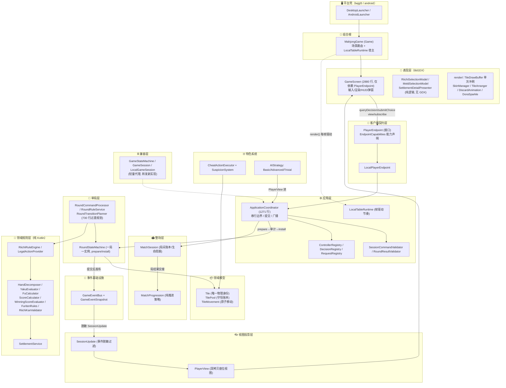
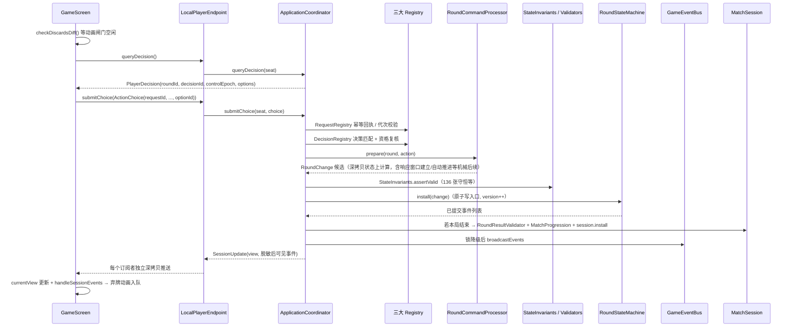
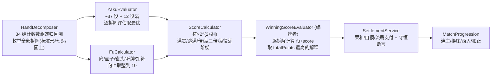

# 🀄 千术麻将 — 整体架构设计文档（现状全景）

> 版本：v1.0（现状分析版）；日期：2026-09-30。
> 本文基于**代码实况**编写：`core` 主源码 78 个 Kotlin 文件（约 18,000 行）+ 72 个测试文件（195 个用例）。
> 与既有文档的关系：[FRAMEWORK_ARCHITECTURE.md](FRAMEWORK_ARCHITECTURE.md) 是早期（V1）总览，[architecture-v2/DESIGN.md](architecture-v2/DESIGN.md) 与 [接口规格 v2](MAHJONG_STATE_MACHINE_API_SPEC.md) 定义了重构契约，[round-session-split/DEVELOPMENT.md](round-session-split/DEVELOPMENT.md) 记录了最近一轮分层迁移。**本文描述这些改造落地后的当前真实架构**，并明确标注"已实现 / 未实现"的边界，避免设计与实况混淆。

---

## 目录

1. [项目定位与技术栈](#一项目定位与技术栈)
2. [工程与模块结构](#二工程与模块结构)
3. [分层架构总览](#三分层架构总览)
4. [运行时数据流：一次动作的完整旅程](#四运行时数据流一次动作的完整旅程)
5. [单局 / 整场 / 应用层职责切割](#五单局--整场--应用层职责切割)
6. [领域模型与 136 张物理守恒](#六领域模型与-136-张物理守恒)
7. [规则与计分管线](#七规则与计分管线)
8. [响应窗口与动作仲裁](#八响应窗口与动作仲裁)
9. [客户端契约与信息脱敏](#九客户端契约与信息脱敏)
10. [线程模型与对局节奏](#十线程模型与对局节奏)
11. [事件系统](#十一事件系统)
12. [表现层与渲染管线](#十二表现层与渲染管线)
13. [千术系统现状](#十三千术系统现状)
14. [AI 系统](#十四ai-系统)
15. [测试体系与架构守护](#十五测试体系与架构守护)
16. [已知技术债与演进方向](#十六已知技术债与演进方向)
17. [文档地图](#十七文档地图)

---

## 一、项目定位与技术栈

《千术麻将》是一款 **2D 策略心理战日式麻将**，核心差异化玩法是**出千绝技与视线防抓包博弈**（袖里乾坤、移花接木、神仙透视、声东击西 + AI 怀疑度/视线系统）。

| 组件 | 版本/选型 | 说明 |
|---|---|---|
| 游戏引擎 | libGDX 1.14.2 | 跨平台（桌面 LWJGL3 + Android） |
| 语言 | Kotlin 2.4.10（JVM 17） | 核心业务与界面纯 Kotlin |
| 构建 | Gradle 9.7.1 wrapper | `org.gradle.parallel/caching/daemon` 开启 |
| AGP | **8.9.3（锁定勿升）** | 更高版本与 Gradle 9.6+ 内部 API 冲突 |
| Android | compileSdk 36 / minSdk 21 / targetSdk 36 | 沉浸式横屏，开启 desugar 2.1.5 |
| 虚拟坐标 | 1280×720 | PC 窗口与手机横屏等比缩放 |
| 测试 | JUnit 5.10.2 + gdx-backend-headless | 无头自动化单测 |

**代码规模**：主源码 78 文件 / 约 18,000 行；测试 72 文件 / 约 9,100 行 / 195 用例。测试与主代码比例约 1:2。

---

## 二、工程与模块结构

```
majiang/
├── core/       ★ 唯一写玩法代码的模块（纯 Kotlin 领域 + libGDX 表现）
│   └── src/main/kotlin/com/majiang/
│       ├── MahjongGame.kt        组合根：Game 状态机 + 场景路由 + 宿主调度
│       ├── model/                领域数据模型（Tile/TilePool/TileMovement/PlayerHand/Meld）
│       ├── state/                旧状态机兼容层 + 合法动作/响应窗口/守恒审计
│       ├── round/                单局状态机 + 单局外部服务（规划/校验/过渡）
│       ├── match/                整场会话（MatchSession）+ 推进策略（MatchProgression）
│       ├── application/          应用协调器 + 注册表 + 验证器 + 本地宿主运行时
│       ├── client/               客户端端点契约（PlayerEndpoint/LocalPlayerEndpoint）
│       ├── session/              视图投影（PlayerView/SessionUpdate）+ 兼容门面
│       ├── event/                事件总线（GameEvent/GameEventBus/GameEventSnapshot）
│       ├── rules/                日麻规则引擎（拆解/役/符/点/振听/杠校验）
│       ├── settlement/           结算服务（纯计算）
│       ├── cheat/                千术执行器 + 怀疑度/视线系统
│       ├── ai/                   AI 策略（Basic/Advanced/Trivial + 适配器）
│       ├── render/               渲染管线（皮肤/布局/绘制缓冲/动画）
│       └── screen/               libGDX 场景（MenuScreen/GameScreen + 纯选择模型）
├── lwjgl3/     Windows 桌面壳（DesktopLauncher，日常开发主力，秒级启动）
├── android/    Android 壳（AndroidLauncher，沉浸式横屏 + APK 打包）
├── assets/     共享资源（fonts/NotoSansSC、skins/wikipedia 38 个 PNG）
└── doc/        设计文档库（本文所在）
```

**核心原则**：玩法代码只写 `core/`；`lwjgl3/` 与 `android/` 是薄壳启动器（各只有一个 Launcher 类）；资源统一放根 `assets/`，通过 `sourceSets.main.resources.srcDirs = ['../assets']` 共享给 core 与各平台模块。

---

## 三、分层架构总览

当前架构是 **V2 重构（round-session-split）落地后** 的形态：旧的 1400 行巨型 `GameStateMachine` 已被拆成"单局状态机 + 整场会话 + 应用协调器 + 独立验证器 + 客户端端点"，旧入口仅作为兼容代理保留。



### 包职责速查表

| 包 | 核心类型 | 职责 | 明确**不做**的事 |
|---|---|---|---|
| `model/` | Tile, TilePool, TileMovement, PlayerHand, Meld, TileLocation | 牌张物理身份、区域账本、原子移动 | 游戏规则判断 |
| `rules/` | RiichiRuleEngine, HandDecomposer, YakuEvaluator, FuCalculator, ScoreCalculator, WinningScoreEvaluator, FuritenRules, RiichiKanValidator | 纯函数规则与计分 | 修改任何权威状态 |
| `settlement/` | SettlementService | 荣和/自摸/流局支付纯计算 | 直接应用分数 |
| `state/` | GameState, GamePhase, GameAction, ActionResult, LegalActionProvider, ResponseWindow, ResponseResolver, StateInvariants, GameStateMachine(兼容), SeatController | 阶段/动作语言、合法动作生成、响应仲裁、守恒审计 | — |
| `round/` | RoundStateMachine, RoundCommandProcessor, RoundRuleService, RoundTransitionPlanner, RoundChange, RoundResult | **一局**的状态转移执行 | 验证、AI、整场推进、事件总线（架构测试强制） |
| `match/` | MatchSession, MatchProgression | **整场**账本、生命周期、局间衔接 | 规则计算、请求验证（架构测试强制） |
| `application/` | ApplicationCoordinator, LocalTableRuntime, 三大 Registry, 两 Validator, ActionDecisionDto | 串行执行、验证组织、提交、广播、AI/自动操作调度 | 自行实现麻将规则 |
| `client/` | PlayerEndpoint, LocalPlayerEndpoint | 客户端统一入口（查询/提交/订阅） | 持有第二份可自行推进的权威牌局 |
| `session/` | PlayerView, SessionUpdate, MeldChoiceProvider, RiichiPreviewProvider, GameSession(兼容), LocalGameSession(兼容) | 座位投影、脱敏、辅助选项计算 | 暴露 GameState |
| `event/` | GameEvent, GameEventBus, GameEventSnapshot | 强类型事件、快照隔离、历史回放 | — |
| `cheat/` | CheatActionExecutor, SuspicionSystem | 四大绝技执行、视线/怀疑度/抓包 | 突破物理守恒 |
| `ai/` | AIStrategy(+Basic/Advanced), TrivialAIStrategy, AIPlayer | 基于 PlayerView 的决策 | 接触 GameState |
| `render/` | TileDrawBuffer, TileSkin, SkinManager, TileArranger, MeldDisplay*, DiscardAnimation, DoraSparkle, GhostHandTexture, AnimationQueue, GameEventRenderer | 绘制指令缓冲、皮肤、布局、特效 | 修改游戏状态 |
| `screen/` | MenuScreen, GameScreen, 各 SelectionModel/Presenter/Formatter | 场景、输入、HUD、弹窗 | 直接依赖领域对象 |

---

## 四、运行时数据流：一次动作的完整旅程

以"人类玩家打出手牌中的一张"为例（当前默认路径）：



**双提交入口、同一校验**：
- **结构化决策通道（主路径）**：`queryDecision()` → `submitChoice(ActionChoice)`。携带 `requestId`（幂等）、`roundId`/`decisionId`/`controlEpoch`（时效），防止过期/重复/越权提交。`GameScreen` 在 `capabilities.decisions == true` 时优先走此通道。
- **兼容通道**：`submit(GameAction)`，经过完全相同的外部校验管线，仅为旧调用者保留。

**拒绝即零副作用**：`Rejected(reason)` 不修改状态、不发事件、不动随机源与响应记录；候选计算全部发生在深拷贝上，`install` 是唯一权威写入口。

---

## 五、单局 / 整场 / 应用层职责切割

这是 2026-09-30 完成（Codex 设计验收 / Antigravity 实现）的 **round-session-split** 重构成果，也是当前架构最重要的边界：

| 层 | 实现 | 负责 | 不负责（由架构验收测试强制） |
|---|---|---|---|
| **单局** | `round/RoundStateMachine` | 保存并应用本局状态转移；终态固定 `ROUND_END`；**每次发牌（含连庄）新实例 + 新 UUID roundId**；单调 `version`；`readState()` 深拷贝 | AI、身份权限、整场推进、守恒审计、事件总线 |
| **单局外部服务** | `RoundCommandProcessor` / `RoundRuleService` / `RoundTransitionPlanner` | 动作验证、候选生成（深拷贝上规划全部机械后续）、规则与算分计算、开局发牌/和了/流局过渡 | 直接改权威状态 |
| **整场** | `match/MatchSession` | 局间账本（分数/本场/供托）、进度（庄家/场风/局号）、活动局引用、单局历史、`SessionLifecycle`（CREATED→ROUND_ACTIVE→ROUND_RESULT→WAITING_DEALER_CHOICE/WAITING_READY→FINISHED） | 规则算法、请求验证、AI |
| **推进策略** | `match/MatchProgression`（纯函数） | 由 `RoundOutcome` 计算连庄/换庄/本场/终局/西入方案；`MatchRuleConfig`（东风/半庄、30000 分目标、飞人、和止） | 修改 GameState |
| **应用层** | `application/ApplicationCoordinator` | 单桌串行边界（读写锁+重入拒绝）、组织验证与提交、单局结果交接、AI 与自动操作调度、共享事件广播 | 自行实现麻将规则 |
| **应用外部组件** | 三大 Registry + 两 Validator + SeatController | 控制代次、决策时效、请求幂等、会话命令前置校验、结果封闭性审计 | — |
| **客户端** | `client/PlayerEndpoint` / `LocalPlayerEndpoint` | 查询投影视图与候选、提交选择、订阅更新；多端点可挂同一协调器；关闭单端点不影响整场 | 推进权威牌局 |
| **兼容层** | `GameStateMachine` / `GameSession` / `LocalGameSession` | 转发新实现，保留旧构造参数与公开 API（`attachLegacyMirror` 双向同步旧可变 GameState 供旧测试使用） | 承载任何新算法 |

**prepare / install 两阶段提交**是单局与整场共用的纪律：`prepare(ApprovedStep)` 在隔离副本上产出 `RoundChange`/`SessionChange` → 外部验证器与守恒审计 → `install(change)` 原子生效。审计失败或被拒绝时权威状态完全不变。

---

## 六、领域模型与 136 张物理守恒

### 6.1 牌的唯一物理身份

`Tile(suit, rank, copyIndex)`：`copyIndex ∈ 0..3` 使 136 张牌**物理上各自唯一**（`tileId = typeIndex*4 + copyIndex`）。身份判断从不依赖对象引用。赤牌规则为"三门各一张红 5"（`rank==5 && copyIndex==3`）。

### 6.2 区域账本（TilePool）

`TileLocation(zone, player)` 精确到座位：`WALL / DEAD_WALL / UNASSIGNED` 无座位；`HAND / DISCARD / MELD / SLEEVE` 必须带 0..3 座位（`SLEEVE` 为千术袖中暗藏区）。所有转移必须走 `TilePool.transfer(tile, from, to)`，先断言源位置再落账。

### 6.3 原子移动服务（TileMovement）

`model/TileMovement`（object）提供具名原子操作：`deal / dealExtra / draw / discard / chi / pon / openKan / closedKan / addedKan / drawRinshan`，以及两个千术原语 `swapHandWithWall`（移花接木）与 `swapHandWithSleeve`（袖里乾坤）。每个方法**完整预校验所有源与目标后才动手**，失败零副作用，同步 TilePool 账本；岭上摸牌自动从活牌山末端补牌保持王牌 14 张。

活牌山/王牌的表示（GameState 内）：
- 活牌山 = `wall[wallPointer, wallEndExclusive)`；
- 王牌 = `deadWall[rinshanPointer, size)` + `deadWallReplacements`（每次岭上摸牌从活牌山尾补入并收缩 `wallEndExclusive`）；
- `HAND = closedTiles + drawnTile`；`DISCARD` = 尚未被叫走的物理弃牌；另立 **`discardHistory`**（不因吃碰杠删除）专供舍张振听判定，不参与物理计数。

### 6.4 守恒审计（StateInvariants）

`StateInvariants.assertValid(state)` 从实际容器**重建**位置清单并检查：合法身份集合恰好 136、每张恰好一次、与 TilePool 账本逐张相等、指针界限、副露结构、阶段对应手牌张数。审计只查不修——不会顺手重建账本掩盖移动遗漏。`RoundResultValidator` 另行审计结果封闭性：`final = start + deltas`、点数+供托总守恒、`resultId` 只消费一次。

---

## 七、规则与计分管线

计分遵循"**同一拆解内取符与役，全局取最优解释**"的原则：



要点：
- `RiichiRuleEngine`（纯函数）：和牌形、听牌、吃碰杠候选、立直条件（门前/≥1000 点/牌山≥4/弃后听牌/排除第 5 张待牌）、途中流局（四风连打/四杠散了/四家立直/九种九牌）、`WinContext`（立直/一发/天和/地和/岭上/海底/河底/抢杠 的单一权威标记）。
- `FuritenRules`：舍张振听 = 待牌 ∩ `discardHistory`；同巡/立直振听由 `RoundTransitionPlanner` 在放弃荣和或无役和牌形时落标。
- `RiichiKanValidator`（WRC 2022 §8.9.1）：立直后暗杠必须摸打不变待牌、且所有和牌拆解含完整刻子。
- `WinningScoreEvaluator.explain()` 产出完整推导链（役明细、Dora 三分计数、符明细、支付行、本场 300×、供托 1000×），供结算详情 UI 展示。

---

## 八、响应窗口与动作仲裁

**`GamePhase` 阶段机**（`allowedTransitions()` 声明合法迁移）：

```
STACKING → DEALING → (DRAW → CHEAT_WINDOW → DISCARD → RESPONSE_WINDOW)* → ROUND_END → MATCH_END
特殊：杠 → KAN_DRAW → CHEAT_WINDOW；加杠 → CHANKAN_WINDOW（抢杠窗口）；自摸/荣和/流局 → ROUND_END
```

- **`CHEAT_WINDOW` 统一作为"已摸牌等待动作"阶段**（人与 AI 无差别）；旧 UI 依赖的 `DISCARD` 语义保持兼容。
- **`LegalActionProvider.legalActions(state, seat, window)`** 按阶段门控：DRAW 只给摸牌；CHEAT_WINDOW/DISCARD 给自摸/杠/立直/打牌（立直后仅摸切 + 经 `RiichiKanValidator` 的暗杠）；弃牌后为其他三家生成 Ron/Pon/OpenKan/Chi(仅下家)+Pass。**校验与 UI 展示用同一规则源**，系统动作不得从客户端放行。
- **`ResponseWindow`** 全座位平权收集（`recordResponse` 幂等，重复响应零副作用）；`ResponseResolver` 仲裁：**Ron(3) > Pon/OpenKan(2) > Chi(1) > Pass(0)**，同级按头跳距离 `(seat - discarder + 4) % 4` 就近者胜；人类不天然优先于 AI。放弃合法 Ron 即记同巡振听（立直后升级为立直振听）。加杠先开抢杠窗口，全部响应结束才提交加杠与岭上摸牌。

---

## 九、客户端契约与信息脱敏

`client/PlayerEndpoint` 是 UI 与（未来的）网络客户端共同面向的契约：

```kotlin
interface PlayerEndpoint : AutoCloseable {
    val viewerSeat: Int
    val capabilities: EndpointCapabilities   // local / remoteTransport / persistence / decisions
    fun view(): PlayerView                    // 深拷贝座位投影视图
    fun legalActions(): List<GameAction>
    fun start(): ActionResult
    fun submit(action: GameAction): ActionResult          // 兼容入口
    fun nextRound(): ActionResult
    fun subscribe(listener: (SessionUpdate) -> Unit): AutoCloseable
    fun queryDecision(): PlayerDecision                    // 结构化候选（含 decisionId/controlEpoch）
    fun submitChoice(choice: ActionChoice): ActionResult   // 幂等提交
    override fun close()
}
```

**脱敏规则**（`SessionUpdate.filterVisibleEvents` + `PlayerView` 投影）：
- 他家暗牌只给数量；他家 `TileDealt/TileDrawn/RinshanDraw` 事件被遮蔽；
- 里宝指示牌仅在终局或该座位的透视授权下可见；
- `CheatAttempted` 仅出千者本人或失败时可见；
- 牌山顺序、他家合法动作、未公开里宝一律不出端点。

`EndpointCapabilities` 显式声明能力（本地端点 `remoteTransport=false, persistence=false`），**不伪装可用**——这是为联机预留的诚实契约。

---

## 十、线程模型与对局节奏

- **单线程渲染循环驱动**：无后台线程、无协程。权威状态变更全部发生在 libGDX 主线程。
- **协调器按多线程安全设计**（为联机做准备）：`ReentrantReadWriteLock` + `isProcessingAction: AtomicBoolean` + 提交线程记录；回调重入被 `tryLock` 立即拒绝，绝不阻塞。
- **AI 节奏 = 帧驱动泵**：`MahjongGame.render()` 每帧调 `LocalTableRuntime.update(delta, presentationBusy)`：
  - `presentationBusy`（弃牌动画播放中）→ 复位累积不推进；
  - 空闲累积 ≥ **0.15s** 才调一次 `coordinator.advanceAutomaticActions()`（单步：一个 AI 窗口响应或一个 AI 回合动作），**不追赶欠账**；
  - 真人的选择、响应等待、自摸与合法暗杠暂停永远保留给玩家，绝不代选或自动 Pass。
- **无头/测试模式**：`ApplicationCoordinator(deferAutomaticActions=false)` 时 `runAutomaticActionLoop` 一次 while 推完，用于确定性断言。

---

## 十一、事件系统

- `GameEvent`：20+ 个**不可变**密封类（摸/打/副露/立直/自摸/荣和/宝牌翻开/千术/怀疑度/抓包/视线/流局 6 种/结算/局终/场终）。
- `GameEventBus`：按 `KClass` 类型订阅 + 优先级，支持通配与 `replayHistory()`（历史回放，为断线重连预留）。
- **快照隔离**（`GameEventSnapshot`）：`newScores/yakuList/meld.tiles/ScoreBreakdown` 等深拷贝 + 不可变包装；publish 入参、历史记录、每个监听者各得一份独立快照；监听者异常被吞掉不影响他人与权威状态。
- **提交后才发布**：事件在 `install` 成功后才进总线；`Rejected` 不产生事件。协调器在锁降级为读锁后统一广播。

---

## 十二、表现层与渲染管线

### 12.1 GameScreen（当前最大的类，2880 行）

只依赖 `PlayerEndpoint` + 深拷贝 `PlayerView`（架构验收测试强制不接触 `GameState/RiichiRuleEngine`）。身兼 InputAdapter（约 30 个硬编码矩形热区）、渲染编排（`render(delta)` 固定管线：桌面 → 牌河 → 各家手牌 → 副露 → 弃牌动画 → 动作按钮 → 冲刷 → 选择浮层 → 结算弹窗 → HUD）、全部弹窗 UI（立直选牌+待牌预览、副露选择分页、结算详情分页 Tab）。

复杂度被刻意压进**无 GDX 的纯侧车**（均可无头单测）：`RiichiSelectionModel`、`MeldSelectionModel`、`SettlementDetailPresenter`、`SettlementBreakdownFormatter`。

### 12.2 渲染管线：生产者-消费者 + 单次冲刷

- `TileSkin` 接口只有 `append*Draw` 追加操作，**不碰 GL**：`WikipediaSkin`（懒加载 37 张 PNG，信封式等比缩放）与 `ClassicSkin`（纯几何+文字）可插拔；`SkinManager` 注册 + 偏好持久化（GDX/内存双实现供无头测试）。
- `TileDrawBuffer` 指令分桶，`flush()` 固定顺序：**一次 Filled 形状 pass → 单次 SpriteBatch 会话（贴图+文字+浮层贴图）→ 浮层 Filled（宝牌辉光）→ 一次 Line pass**，每 pass 重新启用 GL_BLEND（规避 libGDX 坑）。消除逐牌 begin/end 切换，像素结果不变。
- 纯布局：`TileArranger`（万→索→筒→风→三元排序 + 摸牌分离）、`MeldDisplayLayout`（副露右对齐 36×52、暗杠背面、加杠叠加）。
- 特效：`DiscardAnimation`（REACH→GRAB→CARRY→PLACE→RETRACT 五段 0.82s 二次贝塞尔弧线弃牌动画，带牌河一致性调和）、`DoraSparkle`（1.2s 正弦呼吸辉光+四层环+十字星，红五常亮）、`GhostHandTexture`（程序化 Pixmap 白手套）。
- **⚠ 已脚手架未接线**：`AnimationQueue`/`GameEventRenderer`（事件→动画工厂映射）已实现但 `GameScreen` 未使用——GameScreen 用自研的 diff 驱动单槽弃牌动画队列（`checkDiscardsDiff` 对比 `PlayerView.discards`）。见第十六节技术债。

---

## 十三、千术系统现状

> 这是游戏的核心卖点。**域侧实现完整，玩家侧 UI 尚未接线**——如实标注如下。

### 13.1 已实现（域侧，`cheat/` 包）

**CheatActionExecutor**（四大绝技，全部严格物理守恒、零造牌）：

| 绝技 | 实现 | 被直视时怀疑度 | 物理操作 |
|---|---|---|---|
| 袖里乾坤 `sleeveSwap` | 手牌 ↔ 袖中牌互换 | +35（全场环境 +3） | `TileMovement.swapHandWithSleeve` |
| 移花接木 `wallSteal` | 手牌 ↔ 牌山顶牌互换 | +40 | `TileMovement.swapHandWithWall` |
| 神仙透视 `divineSight` | 只读窥探：他家手牌 / 牌山前 3 张 / 王牌区 | +20 | 纯只读，返回 `revealedTiles` |
| 声东击西 `diversion` | 强制全体 AI 视线偏移约 3 秒 | +5 | 不动任何物理牌 |

返回 `CheatResult(success, bustedBy, revealedTiles, message)`，发布 `CheatAttempted` 与 `BustedEvent`。

**SuspicionSystem**（每个 AI 观察者独立）：
- `gazeTarget`（null=看自己手牌，0..3=注视某家）随机游走，权重 = `1 + suspicion/20`；
- 四种性格：迟钝型（4.0s 视线间隔/阈值 90）、普通型（2.5s/75）、敏锐型（1.5s/60）、偏执型（0.8s/**45**），各有怀疑度增长率与自然衰减率；
- **抓包判定**：出千瞬间若某观察者正注视出千者且怀疑度 ≥ 其阈值 → `BustedEvent`，玩法上即"趁没人看你时出手"。

### 13.2 已预留、未打通（如实声明）

- `GameAction.UseCheatTechnique` 与 `GamePhase.CHEAT_WINDOW` 存在，但当前 `RoundRuleService` 对出千动作返回 `UNSUPPORTED_ACTION`——**新架构路径上出千尚不可玩**（旧 `GameStateMachine` 上为可选注入：`suspicionSystem/cheatExecutor` 可空字段）。
- `GameScreen` 中零出千 UI（无出千按钮/怀疑度表/视线指示），仅 `MenuScreen` 的"千术秘籍"弹窗展示机制说明。
- **[STACKING_ALGORITHM.md](../STACKING_ALGORITHM.md) 描述的 `AdaptiveWallStackingEngine`（34 维余弦重叠度衰减的开局码牌引擎）在代码库中不存在**（`com.majiang.algo` 包未创建）。当前 `StartStacking` 为普通洗牌+发牌，带 `stackingPlans` 的开局返回 `UNSUPPORTED_ACTION`。该文档目前是**设计构想**，其"牌山开局后冻结"原则已由 `TileMovement` 事实上遵守。

---

## 十四、AI 系统

- 契约：`AIStrategy.decideAction(view: PlayerView, legalActions: List<GameAction>): GameAction?` —— **策略只看得见脱敏后的本座位视图**，与人类玩家信息对称。
- 实现：`BasicAIStrategy`（贪心：荣和>自摸>流局宣言>立直（听牌+≥1000 分，选最大待牌数弃牌）>暗杠>役牌碰>窗口 Pass>弃牌按可弃性启发（孤张字牌+15/幺九+10/对子−20/刻子−40/邻张−10），立直后摸切）；`AdvancedAIStrategy`（占位，委托 Basic）；`TrivialAIStrategy`（纯摸切，测试用）。
- 接线：`SeatController` 密封类（`LocalHuman / RemoteHuman / Computer(strategy) / Takeover`）+ `ControllerRegistry` 管理逐座位控制权与代次；默认 0 号位人类、1~3 号位 `Computer(BasicAIStrategy)`。AI 动作由协调器的自动推进泵执行，仍走完整 `prepare→审计→install` 管线（错误 AI 有安全兜底：摸切/首个合法弃牌）。

---

## 十五、测试体系与架构守护

72 个测试文件、195 个用例，全部可无头运行（`./gradlew test` / `run_tests.bat`）：

- **架构验收测试**（`architecture/` 8 个文件）：文本级强制依赖边界——如 `RoundStateMachine` 不得 import AI/application/验证/审计/事件总线；`MatchSession` 不得 import 规则/验证/事件总线；GameScreen 不得接触领域对象；协调器并发/重入语义等。**边界即需求，与玩法输出无关地被测试守护**。
- **领域契约测试**：规则（役/符/点/Dora/振听/杠校验/结算明细）、移动（TileMovement 原子性）、会话投影（脱敏/快照）、单局/整场推进、结算守恒等。
- **表现层测试**：皮肤映射/预览、排序、绘制缓冲、弃牌动画、幽灵手纹理、选择模型、GameScreen 会话契约（`GameScreenSkinSmokeTest` 用 headless 后端真实跑渲染循环）。
- **测试基础设施**：`GdxHeadlessTestRunner` + `gdx-backend-headless`；`testing/FakeGameSession`、`TestTableBuilder` 夹具在测试源集内显式构造合法牌桌（生产路径禁止夹具重建账本）。

---

## 十六、已知技术债与演进方向

| # | 事项 | 现状 | 方向 |
|---|---|---|---|
| 1 | **出千玩法未接入新路径** | 域侧完整（执行器/怀疑度/事件），但 `RoundRuleService` 拒绝出千动作、UI 无入口 | 在 `RoundTransitionPlanner` 增加出千过渡 + GameScreen 出千 HUD（怀疑度表/视线指示/绝技轮盘），这是游戏核心卖点，优先级最高 |
| 2 | **开局码牌引擎未实现** | STACKING_ALGORITHM.md 为纯设计文档 | 实现 `AdaptiveWallStackingEngine`（34 维画像/余弦衰减/Jitter/天胡模板），挂到 `StartStacking` 的 plans 参数上 |
| 3 | **事件动画管线双轨** | `AnimationQueue/GameEventRenderer` 脚手架闲置，GameScreen 用自研 diff 弃牌队列 | 统一到事件驱动管线，支撑千术特效（袖中换牌/视线转向/抓包演出） |
| 4 | **GameScreen 体量** | 2880 行，热区/渲染/弹窗内联 | 继续抽纯模型（已有侧车模式可循），或引入 Scene2D 表格化布局 |
| 5 | **联机（设计已备）** | [NETWORK_LOBBY_DESIGN.md](NETWORK_LOBBY_DESIGN.md)：Ktor 权威服 + WebSocket、`core` 拆 `core-domain`+`server`、`EventRedactor` 按座位过滤、resumeToken 重连、iOS RoboVM 预留 | 现有 `PlayerEndpoint/EndpointCapabilities/RequestRegistry 幂等/事件快照` 即为此预留的接缝；P1 起模块拆分 |
| 6 | **版本管理** | 项目当前不在 Git 仓库中 | 建议初始化版本控制（架构重构曾靠 `build/round-session-split/` 基线快照代替） |
| 7 | 兼容层存在成本 | `GameStateMachine/GameSession/LocalGameSession` + `attachLegacyMirror` 双向镜像 | 旧测试迁移完成后逐步收缩 |

---

## 十七、文档地图

| 文档 | 性质 | 说明 |
|---|---|---|
| **本文（ARCHITECTURE_OVERVIEW.md）** | 现状 | 代码实况的全景架构描述 |
| [FRAMEWORK_ARCHITECTURE.md](FRAMEWORK_ARCHITECTURE.md) | 早期总览（部分过时） | 三层分离/守恒/事件驱动的设计初心；入口路径描述已被 V2 取代 |
| [architecture-v2/DESIGN.md](architecture-v2/DESIGN.md) + [REVIEW.md](architecture-v2/REVIEW.md) | 契约+验收 | 守恒/合法性/仲裁结算/表现与 AI 边界的重构规格 |
| [MAHJONG_STATE_MACHINE_API_SPEC.md](MAHJONG_STATE_MACHINE_API_SPEC.md) | 目标规格 | 单局/Session/验证/端点的完整接口语义（v2） |
| [round-session-split/DEVELOPMENT.md](round-session-split/DEVELOPMENT.md) | 实施设计 | 最近一轮分层迁移的任务边界与固定接口 |
| [RIICHI_RULES_DESIGN.md](RIICHI_RULES_DESIGN.md) | 规则规范 | 参照雀魂的日麻规则/发牌/算分全表 |
| [STACKING_ALGORITHM.md](../STACKING_ALGORITHM.md) | **未实现设计** | 开局码牌与牌河时空影响算法（代码中尚无对应实现） |
| [NETWORK_LOBBY_DESIGN.md](NETWORK_LOBBY_DESIGN.md) | **未实现设计** | 联机大厅/自建主机/信息脱敏的完整规划 |
| [doc/ 下各 feature 目录](./) | 已实施特性设计+验收 | riichi-flow、riichi-choice、meld-choice、meld-display、furiten、discard-animation、discard-input-gate、dora-display 等 |

---

*本文由架构分析生成于 2026-09-30；引用的类名/行为均对应当日代码库实况。后续架构变更请同步更新第五、十三、十六节。*
