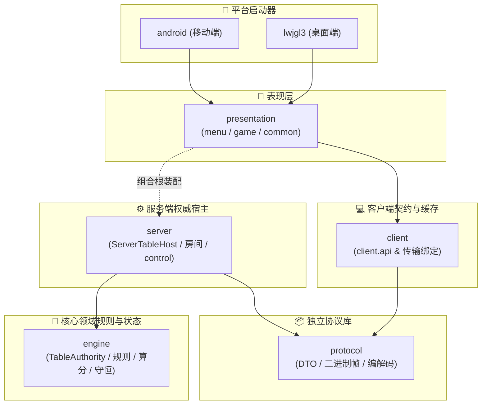
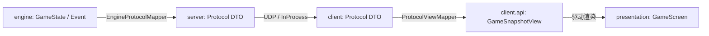
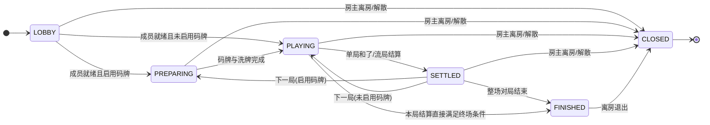
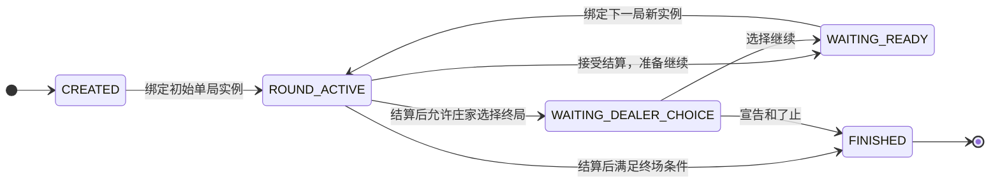
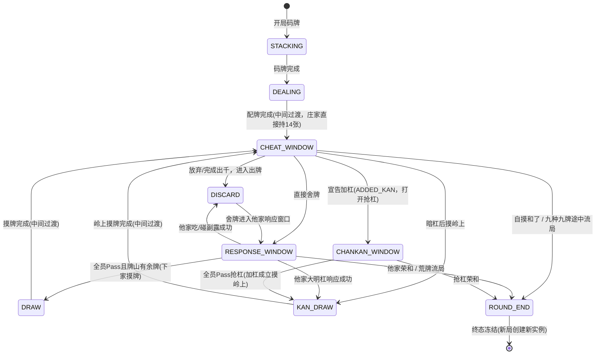

# 🀄 千术麻将 (Mahjong Cheater) — 整体架构与系统设计文档

本文档说明当前 V4 的模块职责、136 张牌物理守恒、数据映射、生命周期和权威调度。2026-10-07 已按当前源码刷新，连接控制归 server，见 [本次验收](v4-migration/ACCEPTANCE-CONNECTION-OWNERSHIP.md)。

---

## 目录

1. [设计目标与核心原则](#一设计目标与核心原则)
2. [七模块分层架构与数据流水线](#二七模块分层架构与数据流水线)
3. [136 张物理守恒机制 (TilePool)](#三136-张物理守恒机制-tilepool)
4. [表现层与事件驱动流水线 (Event & Projection)](#四表现层与事件驱动流水线-event--projection)
5. [三级生命周期与状态机流转 (Lifecycles & FSM)](#五三级生命周期与状态机流转-lifecycles--fsm)
6. [千术系统与视线博弈 (Cheat & Suspicion)](#六千术系统与视线博弈-cheat--suspicion)
7. [AI 策略与异步决策调度 (AI System)](#七ai-策略与异步决策调度-ai-system)
8. [模块源码文件结构与职责索引](#八模块源码文件结构与职责索引)
9. [网络与房间系统概览 (UDP & InProcess)](#九网络与房间系统概览-udp--inprocess)

---

## 一、设计目标与核心原则

本项目旨在打造一款 **2D 策略心理战日式麻将**，核心差异化特色在于**绝技出千与视线防抓包博弈**。系统遵循以下核心原则：

1. **分层严格解耦**：
   - **表现层 (presentation)**：菜单/对局/共享仅依赖 `client.api`，不接触领域逻辑或网络实现；`MahjongGame` 组合根装配服务端与客户端；
   - **客户端 (client)**：维护本地缓存、有序对账与重连，仅依赖 `protocol`；
   - **协议库 (protocol)**：独立线路 DTO 与 UDP 可靠性传输库，无外部业务依赖；
   - **服务端 (server)**：权威串行调度中心，依赖 `engine` + `protocol`，拥有连接控制；
   - **领域层 (engine)**：纯 Kotlin 核心业务与规则，零外部框架依赖，100% 独立单测。
2. **136 张牌物理守恒闭环**：
   - 牌桌上任何时刻、无论经历多少次发牌、摸打、副露或出千（袖里乾坤/移花接木），全场恰好 136 张物理牌（`tileId` 0..135），绝无凭空增删。
3. **单向投递与数据隔离**：
   - 领域事件不直接穿透给 UI。数据严格经：`engine` → `server EngineProtocolMapper` → `protocol DTO` → `client ProtocolViewMapper` → `client 视图模型`。
4. **权威串行裁决与单桌执行**：
   - 每桌维护独占串行队列，统一入队串行裁决；玩家提交严格校验 deadline，tick 先处理超时再调度 AI，不同决策按序生效，响应窗口允许多个座位提交记录；权威 Deadline（20s + 3s）优先执行，不受客户端动画推迟。

---

## 二、七模块分层架构与数据流水线

### 2.1 模块依赖拓扑



### 2.2 数据流动与投影流水线



UI 不直接订阅 engine 内的 `GameEventBus`，而是通过 `client.api.GameSession` 接收完整快照与本次可见事件，不维护第二套增量状态。

---

## 三、136 张物理守恒机制 (TilePool)

### 3.1 物理守恒定律与实体定义

单副麻将包含 34 种牌型，每种牌型对应 4 张不可替代的物理副本（`tileId` 范围 0..135）。
在 `engine` 模块中，每张牌在任何时刻均处于唯一的**物理区域 (Zone)**：

- `WALL`：牌山可摸牌区；
- `HAND`：玩家暗牌手牌区；
- `DISCARD`：牌河弃牌堆；
- `MELD`：明牌副露区（吃碰明杠）；
- `DEAD_WALL`：王牌区（14 张：岭上牌 + Dora 指示牌）；
- `SLEEVE`：袖中暗藏牌（千术专用空间）；
- `UNASSIGNED`：初始化中间态。

### 3.2 转移防穿帮规范与守恒断言

所有牌的位置变更均通过原子转移执行，严禁直接构造或丢失牌：
- **袖里乾坤 (`SLEEVE_SWAP`)**：手牌与袖中牌原地 1:1 双向置换所有权；
- **移花接木 (`WALL_STEAL`)**：手牌与牌山指定槽位 1:1 等额置换；
- **神仙透视 (`DIVINE_SIGHT`)**：纯只读内存投影，无任何物理移动；
- **声东击西 (`DIVERSION`)**：仅改变观察者视线向量，不接触物理牌。

每次阶段流转或出千完成后，调用物理守恒审计：
`TilePool` 绑定 `GameState` 时，调用 `StateInvariants.assertValid` 执行真实各区域容器、唯一实体归属（0..135）和账本强一致审计；未绑定状态时执行 136 张标准合法身份全覆盖断言。

---

## 四、表现层与事件驱动流水线 (Event & Projection)

1. **逻辑与表现彻底解耦**：
   - 领域计算不包含任何 LibGDX 绘制调用或 sleep 延迟；
   - 牌桌场景 `GameScreen` 消费 `GameUpdateView` 的完整 `snapshot + visibleEvents`，由 `DiscardAnimation`、`TileDrawBuffer` 等驱动显示；动画仅门控客户端自动推进节奏，不阻塞底层网络与协议心跳（未宣称实现所有千术/鸣牌动画）。
2. **脱敏与信息不对称安全**：
   - 玩家快照与事件经过按席位投影及协议映射，不下发未经授权的他家暗牌、他人出千余额和私人账本原因；
   - 观战流经 `PublicProtocolMapper` 构造独立公开快照。规则允许的终局公开信息与私人信息分别处理。

---

## 五、三级生命周期与状态机流转 (Lifecycles & FSM)

系统清晰分离三套独立生命周期状态机：

### 5.1 房间生命周期 (`ProtocolRoomLifecycle` / `RoomLifecycle`)


### 5.2 整场账本生命周期 (`SessionLifecycle` / `MatchSession`)


图示为当前领域提交的主要路径：初始单局可尚未发牌，大厅是否开赛由房间层控制。接受单局结算时直接提交等待准备、庄家选择或终场状态，不经过独立的 `ROUND_RESULT` 中间提交。

`WAITING_START`、`ROUND_RESULT` 等仍在枚举中保留，但不应据此画成当前必经状态。产品暂停由 `TableAuthority` 冻结 `DecisionClock`，房间关闭由 server 管理；二者不等于整场生命周期必然切到同名枚举。

### 5.3 单局流转状态机 (`RoundStateMachine`)


- **单局不可复用**：`RoundStateMachine` 达到 `ROUND_END` 即永久冻结，无任何回退边。下一局（包含连庄）均由 `ApplicationCoordinator` 创建全新的状态机实例与新 `roundId`；
- **中间过渡与原子推进**：`DEALING`、`DRAW` 与 `KAN_DRAW` 在单次动作执行中可能为瞬时中间阶段。例如开局发牌在单步操作中经过 `DEALING` 立即抵达庄家 `CHEAT_WINDOW`（庄家已持 14 张牌）；
- **加杠与抢杠仲裁**：加杠（`ADDED_KAN`）由当前摸牌/出千玩家在 `CHEAT_WINDOW` 主动宣告并直接打开 `CHANKAN_WINDOW`；若全员放弃抢杠，则摸岭上牌（`KAN_DRAW`）继续；大明杠响应则经 `RESPONSE_WINDOW` 裁决胜出后进入 `KAN_DRAW`。

---

## 六、千术系统与视线博弈 (Cheat & Suspicion)

### 6.1 四大绝技机制

| 绝技名称 | 代码 | 机制 | 风险与代价 |
|:---|:---|:---|:---|
| **袖里乾坤** | `SLEEVE_SWAP` | 手牌 ↔ 袖牌等额互换 | 消耗出千点，直视时怀疑度剧增 |
| **移花接木** | `WALL_STEAL` | 手牌 ↔ 牌山指针顶牌互换 | 消耗出千点，高抓包风险 |
| **神仙透视** | `DIVINE_SIGHT` | 只读窥探暗牌/牌山/王牌 | 风险适中，不改变物理状态 |
| **声东击西** | `DIVERSION` | 制造响动吸引全场视线偏转 3 秒 | 制造响动吸引全场视线偏转，但出千合法性与判定仍由领域规则裁决 |

### 6.2 怀疑度与抓包判定 (SuspicionSystem)

- **视线目标 (`gazeTarget`)**：`null` 表示低头看自己牌，`0..3` 表示注视对应座位；
- **抓包组件 (Busted)**：`SuspicionSystem` 检查注视与怀疑度阈值，`CheatActionExecutor` 被抓包时发布 `GameEvent.BustedEvent` 并返回失败结果。组件产生事件不等于已实现整局判负及重罚结算，产品接线与结算行为以权威动作处理链为准。

---

## 七、AI 策略与异步决策调度 (AI System)

1. **异步推理脱离权威临界区**：
   - AI 启发式搜索在权威串行执行器之外的独立线程池异步执行，不占用权威单桌锁；
   - 决策计算完成提交时，严格比对 `(roundId, decisionId, controlEpoch)`，确保因真人收回或超时导致的过期决策直接作废。
2. **策略实现**：
   - `BasicAIStrategy`：向听数最小化、孤张幺九优先切出、和了/立直贪心判定；
   - `TsumogiriAIStrategy`：摸切托管策略。

---

## 八、模块源码文件结构与职责索引

```
majiang/
├── engine/                       // 纯 JVM 核心领域逻辑
│   └── src/main/kotlin/com/majiang/
│       ├── authority/           // TableAuthority 纯同步权威入口
│       ├── application/         // ApplicationCoordinator, ControllerRegistry
│       ├── model/               // Tile, Meld, TilePool, PlayerHand
│       ├── rules/               // RiichiRuleEngine, 役种, 算分
│       ├── round/               // RoundStateMachine (单局 FSM)
│       ├── match/               // MatchSession, SessionLifecycle
│       └── access/              // SeatControlView, PlayerSnapshot 领域模型
├── protocol/                     // 独立通信协议库 (无业务实现)
│   └── src/main/kotlin/com/majiang/
│       ├── server/api/          // LobbyApi, SessionApi, SpectatorApi, ServerConnection, RoomBinding, SpectatorBinding
│       └── transport/           // Protocol DTOs, UdpFrame, PushSequencer, 编解码
├── server/                       // 权威宿主与房间服务
│   └── src/main/kotlin/com/majiang/server/
│       ├── control/             // ConnectionControl, DisconnectPolicy (连接控制实现)
│       ├── host/                // ServerTableHost (每桌串行队列)
│       ├── room/                // RoomRegistry, SharedRoom (传输中立房间)
│       ├── mapping/             // EngineProtocolMapper, PublicProtocolMapper
│       ├── inprocess/           // InProcessServer, InProcessBinding (单机模式)
│       └── udp/                 // UdpTableServer, UdpRoom (联机模式)
├── client/                       // 客户端门面与传输适配
│   └── src/main/kotlin/com/majiang/client/
│       ├── api/                 // GameSession, LobbySession, SpectatorSession, ProtocolViewMapper, ServerConnectionSession, ClientModels, ClockInfo
│       └── transport/           // udp/ ScheduledExecutorUdpScheduler, UdpClient
├── presentation/                 // libGDX 展示层
│   └── src/main/kotlin/com/majiang/
│       ├── MahjongGame.kt       // 组合根与画面切换器 (装配 client 与 server)
│       └── presentation/
│           ├── menu/            // MenuScreen (主菜单/房间UI)
│           ├── game/            // GameScreen (牌桌渲染/动画)
│           └── common/          // 字体、UI资源、皮肤管理
├── lwjgl3/                       // 桌面启动器
└── android/                      // 移动端沉浸式启动器
```

---

## 九、网络与房间系统概览 (UDP & InProcess)

1. **单机与联机双绑定**：
   - **单机 (`InProcessServer`)**：内存异步调度，零网络开销，由 `MahjongGame.render` 驱动 `server.tick`；
   - **联机 (`UdpTableServer`)**：可靠二进制 UDP，独立 50ms Ticker 驱动 `tick`。
2. **UDP v4 传输协议**：
   - 22 字节二进制帧头，最大 1200 字节，1090 字节分片阈值；
   - 3 秒心跳探测，10 秒入站判死；
   - 服务端推送维护 256 条滑动重传窗口（客户端维护 64 有界接收缓冲与 256 游标去重）；PUSH 始终为全量快照 + 可见事件，`isFullSnapshot` 标识建立或重置基线；
   - 独立座位游标与观战独立流，强绑定 `(sessionId, syncEpoch)`。
3. **未实现功能边界声明**：
   - 公网用户账号体系、全自动撮合匹配、三人麻将玩法、断电持久化恢复、动态主机迁移与 TLS/DTLS 加密信道尚未实现，不得作为已具备功能写入文档。
