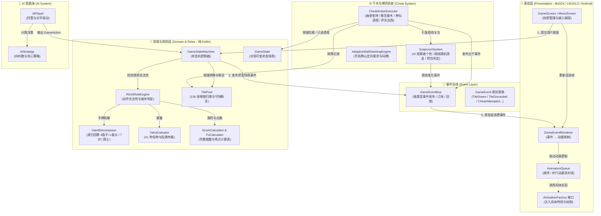
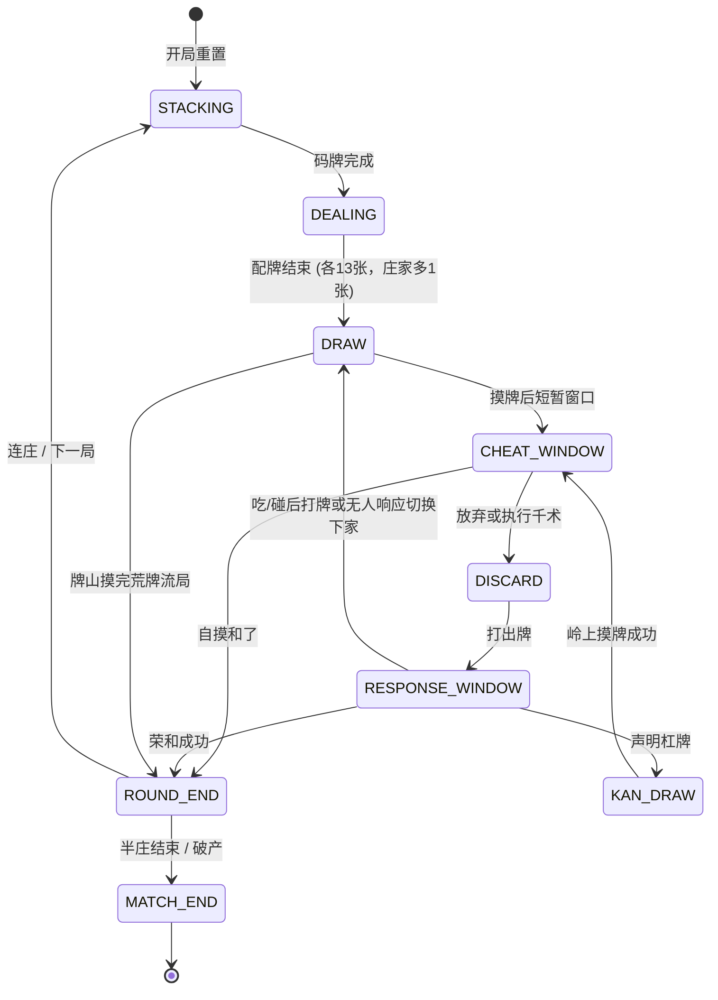
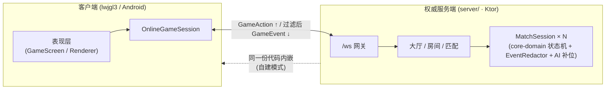

# 🀄 千术麻将 (Mahjong Cheater) — 整体架构与系统设计文档

本文档详细阐述《千术麻将》的游戏整体框架设计、三层分离架构、136张牌物理守恒律、事件驱动特效解耦机制、状态机流转及千术系统实现。

> 2026-09-29 架构 V2：当前对局实现契约以 [DESIGN.md](architecture-v2/DESIGN.md) 为准，独立验收见 [REVIEW.md](architecture-v2/REVIEW.md)。实际入口为 `GameScreen → GameSession → GameStateMachine`，UI/AI 使用座位视图与合法动作；真实容器守恒由 `StateInvariants` 审计，移动、结算、响应裁决和场次推进分别交给专用服务。本文后续动画、千术完整交互、拆分模块和联机章节包含后续设计，不代表均已接入本轮实现。

> 立直交互补充契约：[自动摸切、自摸暂停与严格暗杠](riichi-flow/DESIGN.md)，验收状态见 [REVIEW.md](riichi-flow/REVIEW.md)。

> 宣言前的表现层选择：[立直选牌与待牌预览](riichi-choice/DESIGN.md)。`RiichiPreviewProvider` 仅从 `PlayerView` 与合法动作计算方案，`RiichiSelectionModel` 保存临时选择；UI 确认前不修改领域状态。

---

## 目录

1. [设计目标与核心原则](#一设计目标与核心原则)
2. [分层架构设计](#二分层架构设计)
3. [136 张物理守恒机制 (TilePool)](#三136-张物理守恒机制-tilepool)
4. [特效与实现分离机制 (Event-Driven FX)](#四特效与实现分离机制-event-driven-fx)
5. [游戏状态机与流转模型 (FSM)](#五游戏状态机与流转模型-fsm)
6. [千术系统与视线博弈 (Cheat & Suspicion)](#六千术系统与视线博弈-cheat--suspicion)
7. [AI 策略与决策系统 (AI System)](#七ai-策略与决策系统-ai-system)
8. [源码文件清单与职责索引](#八源码文件清单与职责索引)
9. [联网与大厅系统概览 (Online & Lobby)](#九联网与大厅系统概览-online--lobby)

---

## 一、设计目标与核心原则

本项目旨在打造一款 **2D 策略心理战日式麻将**，核心差异化特色在于**绝技出千与视线防抓包博弈**。整体系统架构遵循以下四大核心设计原则：

1. **三层严格解耦**：
   - **表现层 (Presentation)**：只负责根据事件播放动画与渲染 UI，**严禁直接修改游戏状态**。
   - **领域层 (Domain)**：纯 Kotlin 编写，**零 libGDX 依赖**，具备 100% 独立单测能力。
   - **千术层 (Cheat System)**：作为领域层的扩展，操纵牌桌与视线博弈，但**绝对不突破物理守恒边界**。
2. **136 张牌物理守恒闭环**：
   - 牌桌上任何时刻、无论经历多少次发牌、摸打、副露或出千（袖里乾坤/移花接木），**全场恰好 136 张物理牌**，无任何牌凭空产生或消失。
3. **特效与逻辑彻底分离 (Event-Driven)**：
   - 逻辑层产生不可变的 `GameEvent` 快照推送到 `GameEventBus`；表现层 `subscribe` 事件并转化为动画入队 (`AnimationQueue`)，支持通过接口无缝替换皮肤与特效实现。
4. **状态机严格约束时序 (State Machine)**：
   - 基于 `GamePhase` 与 `GameAction` 驱动，响应窗口具备严格的吃/碰/杠/荣优先级仲裁。

---

## 二、分层架构设计

### 2.1 架构拓扑图



---

## 三、136 张物理守恒机制 (TilePool)

### 3.1 物理守恒定律

单副麻将包含 34 种牌型，每种牌型对应 4 张不可替代的物理副本（`copyIndex` 从 0 到 3）。
在代码中，[`TilePool`](file:///d:/majiang/core/src/main/kotlin/com/majiang/model/TilePool.kt) 负责全程追踪每张牌所处的唯一**物理区域 (Zone)**：

```kotlin
enum class Zone {
    WALL,       // 牌山（可摸牌区）
    HAND,       // 玩家暗牌区
    DISCARD,    // 牌河（各家弃牌堆）
    MELD,       // 明牌副露区（吃碰杠）
    DEAD_WALL,  // 王牌区（14 张：岭上牌 + Dora 指示牌）
    SLEEVE,     // 袖中暗藏牌（千术专用口袋）
    UNASSIGNED  // 初始化中间态
}
```

### 3.2 转移防穿帮规范

所有针对牌的操作必须通过 `transfer` 方法，**严禁直接 `add` 或 `new`**：

```kotlin
fun transfer(tile: Tile, fromZone: Zone, toZone: Zone, playerIndex: Int = -1) {
    val currentInfo = tileMap[tile]
    require(currentInfo != null) { "Tile $tile not found in pool" }
    require(currentInfo.first == fromZone) { 
        "Tile $tile is in ${currentInfo.first}, but expected in $fromZone" 
    }
    tileMap[tile] = Pair(toZone, playerIndex)
}
```

每次发牌、摸牌、打牌、吃碰杠、以及千术执行完毕后，均执行：
```kotlin
fun assertConservation() {
    require(tileMap.size == 136) { "Pool must contain exactly 136 tiles" }
    val duplicates = tileMap.keys.groupingBy { it }.eachCount().filter { it.value > 1 }
    require(duplicates.isEmpty()) { "Pool contains duplicate tiles: $duplicates" }
}
```
**出千防抓包保证**：
- **袖里乾坤**：手中一张牌放入袖子，袖中一张牌放入手中（两张牌原地互换所有权，总牌数严格不变）。
- **移花接木**：手中一张牌与当前牌山指针指向的顶牌交换（牌山与手牌等额置换）。
- **神仙透视**：纯只读操作，不触发任何状态与区域流转。
- **声东击西**：仅影响 AI 的视线状态机，不涉及任何物理牌。

---

## 四、特效与实现分离机制 (Event-Driven FX)

### 4.1 为什么要特效分离？
若将“播放摸牌动画”、“显示吃碰特效”、“屏幕闪烁”等代码直接混杂在麻将逻辑状态机中，会导致：
1. 逻辑无法独立进行无界面的单元测试。
2. 跨平台适配成本高（桌面 LWJGL 与 Android 绘制管线差异）。
3. 难以切换主题皮肤或动画风格。

### 4.2 事件总线 (GameEventBus)
逻辑状态机只负责计算并发布事件快照：
- [`GameEvent.TileDrawn`](file:///d:/majiang/core/src/main/kotlin/com/majiang/event/GameEvent.kt)
- [`GameEvent.TileDiscarded`](file:///d:/majiang/core/src/main/kotlin/com/majiang/event/GameEvent.kt)
- [`GameEvent.ChiDeclared`](file:///d:/majiang/core/src/main/kotlin/com/majiang/event/GameEvent.kt)
- [`GameEvent.CheatAttempted`](file:///d:/majiang/core/src/main/kotlin/com/majiang/event/GameEvent.kt)
- [`GameEvent.BustedEvent`](file:///d:/majiang/core/src/main/kotlin/com/majiang/event/GameEvent.kt)
- [`GameEvent.GazeShifted`](file:///d:/majiang/core/src/main/kotlin/com/majiang/event/GameEvent.kt)

### 4.3 动画队列 (AnimationQueue)
表现层通过 [`GameEventRenderer`](file:///d:/majiang/core/src/main/kotlin/com/majiang/render/GameEventRenderer.kt) 订阅感兴趣的事件，将其转换为动画对象放入队列：

```kotlin
// 表现层接口：外部可自由注入不同风格的特效实现
interface AnimationFactory {
    fun createDrawAnimation(player: Int, wallRemaining: Int): AnimationQueue.GameAnimation?
    fun createDiscardAnimation(player: Int, isRiichiDiscard: Boolean): AnimationQueue.GameAnimation?
    fun createBustedAnimation(player: Int, caughtBy: Int): AnimationQueue.GameAnimation?
    fun createCheatSuccessAnimation(technique: CheatTechnique): AnimationQueue.GameAnimation?
    // ...
}
```

队列支持：
- **顺序动画**（如：先打牌动画 0.3s → 再触发振听警告 0.2s）
- **并行动画组**（如：四位玩家视线同时转向 + 桌面震动特效）
- **非阻塞更新**：每帧传入 `delta` 时间驱动进度更新。

---

## 五、游戏状态机与流转模型 (FSM)

### 5.1 对局阶段定义 (GamePhase)



### 5.2 响应窗口仲裁法
当玩家打出一张牌后，进入 `RESPONSE_WINDOW`，系统向其他三家发起广播，按如下优先级仲裁：
1. **荣和 (Ron)**：优先级最高。支持头跳（上家优先）或多响结算。
2. **杠 (Kan)** / **碰 (Pon)**：高于吃。若一人要碰，一人要吃，碰牌者胜出。
3. **吃 (Chi)**：仅限打牌者的下家有效。
4. **全员放弃 (Pass)**：进入下一位玩家的 `DRAW` 阶段。

---

## 六、千术系统与视线博弈 (Cheat & Suspicion)

### 6.1 四大绝技的运行时实现

| 绝技名称 | 枚举代码 | 物理实现机制 | 风险与代价 |
|:---|:---|:---|:---|
| **袖里乾坤** | `SLEEVE_SWAP` | `hand.closedTiles` ↔ `state.sleeveTiles` 双向置换 | 被注视时怀疑度 +35%，超阈值立即抓包 |
| **移花接木** | `WALL_STEAL` | `state.wall[wallPointer]` ↔ `hand.closedTiles` 置换 | 被注视时怀疑度 +40%，超阈值立即抓包 |
| **神仙透视** | `DIVINE_SIGHT` | 只读拷贝：对手暗牌 / 牌山前 N 张 / 王牌区 | 只读不换牌，被注视怀疑度 +20% |
| **声东击西** | `DIVERSION` | 强制改变全体 AI 观察者的 `gazeTarget` 持续 3.0s | 风险极低（轻微增加 5% 疑惑度），为后续出千制造绝对安全期 |

### 6.2 AI 怀疑度与视线系统 (SuspicionSystem)

每个 AI 玩家拥有独立的注视状态与性格属性：
```kotlin
enum class SuspicionPersonality(
    val gazeShiftInterval: Float,   // 视线切换平均间隔（秒）
    val suspicionGrowthRate: Float,  // 怀疑度增长系数
    val bustThreshold: Float,        // 抓包爆发阈值 (如偏执型 45% 即抓包)
    val naturalDecayRate: Float      // 每秒怀疑度自然衰减
) {
    OBLIVIOUS("迟钝型", 4.0f, 0.5f, 90f, 0.5f),
    NORMAL("普通型",    2.5f, 1.0f, 75f, 0.3f),
    SHARP("敏锐型",     1.5f, 1.5f, 60f, 0.2f),
    PARANOID("偏执型",  0.8f, 2.0f, 45f, 0.1f)
}
```

- **视线目标 (`gazeTarget`)**：`null` 代表低头看自己的手牌，`0~3` 代表注视对应玩家。
- **权重计算**：某玩家的怀疑度越高，AI 视线随机切换到该玩家的权重越大。
- **抓包判定 (Busted)**：当出千动作发生且有 AI 正在直视出千者，且累计怀疑度 ≥ `bustThreshold`，立即触发 `GameEvent.BustedEvent`，直接中止对局并予以极刑惩罚。

---

## 七、AI 策略与决策系统 (AI System)

- **接口抽象**：[`AIStrategy`](file:///d:/majiang/core/src/main/kotlin/com/majiang/ai/AIStrategy.kt) 定义了打牌、吃、碰、杠、立直、和了的纯计算决策。
- **基本策略 (`BasicAIStrategy`)**：
  - 遇到和了机会（自摸/荣和）100% 声明。
  - 门前清满足听牌条件且无振听时，宣告立直。
  - 遇到可碰的役牌（白、发、中、圈风、门风）进行副露。
  - 打牌采用**向听数最小化 + 孤张幺九优先切出**的贪心策略。

---

## 八、源码文件清单与职责索引

全部核心逻辑已落地至 `core/src/main/kotlin/com/majiang/` 目录下（共 24 个源文件，零编译错误，零警告）：

```
com.majiang
├── MahjongGame.kt                  // 游戏全局上下文与屏幕管理器
├── model/                          // 领域数据模型
│   ├── Tile.kt                     // 34维牌值对象、花色、属性判断、Dora目标推导
│   ├── TilePool.kt                 // 136张牌物理守恒池、Zone区域流转、守恒断言
│   ├── Meld.kt                     // 吃/碰/大明杠/暗杠/加杠副露结构
│   └── PlayerHand.kt               // 玩家手牌、副露、牌河、立直与一发状态
├── state/                          // 状态机
│   ├── GamePhase.kt                // 对局阶段枚举与合法转移校验
│   ├── GameAction.kt               // 玩家与系统意图操作密封类
│   ├── GameState.kt                // 完整可变状态快照容器
│   └── GameStateMachine.kt         // 核心状态机驱动与仲裁引擎
├── rules/                          // 日麻规则与计分引擎
│   ├── HandDecomposer.kt           // 递归回溯手牌拆解（标准形/七对/国士）与听牌计算
│   ├── YakuEvaluator.kt            // 41 种役种判定与役满仲裁
│   ├── FuCalculator.kt             // 符数完整计算器（底符/面子/雀头/听牌/和了加符）
│   ├── ScoreCalculator.kt          // 翻符算点、满贯阶梯分级与支付分割
│   └── RiichiRuleEngine.kt         // 吃碰杠立直合法性、振听判定与规则校验
├── cheat/                          // 千术与视线博弈
│   ├── SuspicionSystem.kt          // AI 观察者视线游走、怀疑度衰减与抓包判定
│   └── CheatActionExecutor.kt      // 四大绝技的运行时物理交换实现
├── event/                          // 事件驱动基础设施
│   ├── GameEvent.kt                // 20+ 不可变游戏事件密封类
│   └── GameEventBus.kt             // 强类型事件总线与历史录像回放
├── render/                         // 表现层抽象
│   ├── AnimationQueue.kt           // 顺序与并行动画队列
│   └── GameEventRenderer.kt        // 事件到动画的映射器与工厂接口
├── ai/                             // AI 智能体
│   ├── AIStrategy.kt               // AI 决策策略接口与贪心实现
│   └── AIPlayer.kt                 // AI 操作转换器
└── screen/                         // libGDX 场景
    ├── MenuScreen.kt               // 主菜单、出千秘籍弹窗
    └── GameScreen.kt               // 牌桌游戏场景
```

---

## 九、联网与大厅系统概览 (Online & Lobby)

游戏支持**三种模式**，采用 **Ktor 权威服务端 + WebSocket(JSON)** 的统一联机架构，详细设计见 [`doc/NETWORK_LOBBY_DESIGN.md`](file:///d:/majiang/doc/NETWORK_LOBBY_DESIGN.md)：

| 模式 | 形态 | 网络要求 |
|:---|:---|:---|
| **单机模式** | 本地 `GameStateMachine` + AI 对手（现有路径原样保留） | 无 |
| **大厅模式** | 连接官方部署的 Ktor 服务端：房间制 / 快速匹配 / AI 补位混合局 | 公网 |
| **自建服务模式** | 桌面客户端**内嵌主机**（房主即服务器，回环连接自入），朋友 IP 直连 | 局域网 / 点对点 |

> 平台覆盖：PC（lwjgl3）与 Android 先行落地，PC 桌面端额外承担内嵌主机角色；**iOS 已按 RoboVM 路线预留为纯客户端**——共享代码须遵守 JDK API 水位、`NetworkClient` 纯接口等兼容契约（详见联网设计文档 7.5 节），P7 启动时只增不改。

与本三层架构的关系：

1. **一套服务端，两种部署**：`core` 拆分为 `core-domain`（纯 Kotlin 领域层）与 `core`（libGDX 表现层）两个模块；`server` 模块既可独立部署为官方大厅服，也可作为库内嵌进 lwjgl3 客户端做自建主机。服务端直接运行 `GameStateMachine` + `RiichiRuleEngine`，规则单一来源，杜绝双端漂移。
2. **表现层零改动**：三种模式共用事件驱动渲染管线——联机时 `GameEventBus` 的生产者从本地状态机换成 `OnlineGameSession`（网络层），`GameEventRenderer` / `AnimationQueue` 不感知网络存在，更不感知模式差异；房主也是通过回环 WebSocket 连入内嵌服务端的普通客户端，联机代码路径唯一。
3. **信息不对称即安全**：他家暗牌、牌山序列、袖中牌、里 Dora 等隐藏信息绝不下发给无权客户端；神仙透视结果由服务端定向下发给出千者本人（`EventRedactor` 按座位过滤每个事件，两种部署形态共用同一套规则）。
4. **千术抓包语义**：`BustedEvent` 仅由 AI 观察者的视线/怀疑度系统触发，真人对战不设抓包操作（设计决策，详见联网设计文档第六节）。



---

## 相关文档
- 联网与大厅系统设计：[`doc/NETWORK_LOBBY_DESIGN.md`](file:///d:/majiang/doc/NETWORK_LOBBY_DESIGN.md)
- 雀魂规则与发牌计分详细设计：[`doc/RIICHI_RULES_DESIGN.md`](file:///D:/majiang/doc/RIICHI_RULES_DESIGN.md)
- 开局码牌算法设计：[`STACKING_ALGORITHM.md`](file:///D:/majiang/STACKING_ALGORITHM.md)
