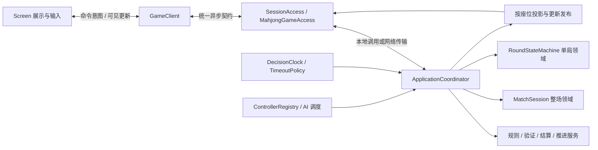
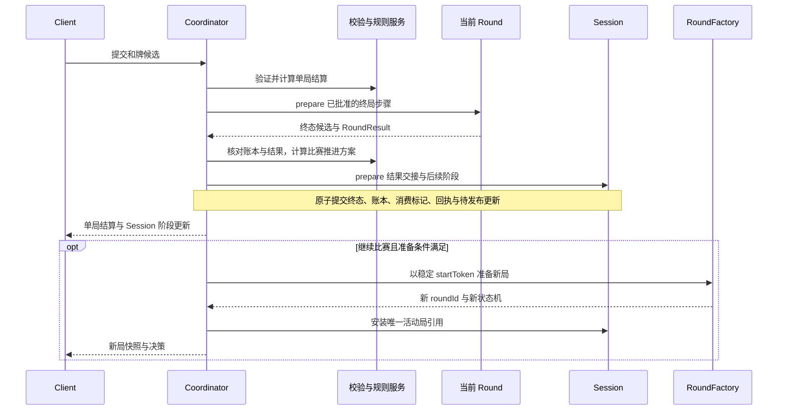

# 千术麻将游戏方案 v3：整场、单局、客户端与展示

日期：2026-10-01  
状态：待实施的目标设计；本文档不代表所列功能均已开发。  
范围：本地单机、大厅对局、玩家自建房；包含赛制、积分、出千点数、决策计时、AI 接管、事件同步和展示。  
本次交付：仅更新设计文档，不修改游戏代码或启动开发任务。

## 1. 设计依据与约定

保留并明确四个用户可理解的概念：

- **Session**：一整场比赛，从开赛到最终排名，串联多个单局。
- **Mahjong Game**：从一次发牌到和牌、流局或其他终止的单局服务；内部使用单局状态机。
- **Client**：某个玩家访问比赛的客户端，提交选择，维护可见信息与连接。
- **Screen**：牌桌、皮肤、动画、交互和结算展示。

每次重新发牌，包括连庄，都创建新的单局状态机和 `roundId`。同一整场同时最多存在一个可接受动作的活动单局。结束的单局不可重新激活。

Session 与单局状态机保存并应用已批准的状态变化。规则判断、计分算法、请求验证、计时调度、网络和 AI 实现为独立组件，由应用协调器调用。“Mahjong Game 保证规则正确”是对外服务契约，不意味着把所有功能塞入状态机类。

当前 libGDX 应用入口已名为 `MahjongGame`。实现时继续使用 `RoundStateMachine` 表示单局领域对象、`MahjongGameAccess` 表示单局访问接口，避免与应用入口重名。

本文作为下一阶段重设计基线。与 [接口规格 v2](MAHJONG_STATE_MACHINE_API_SPEC.md) 和 [联网与大厅设计](NETWORK_LOBBY_DESIGN.md) 冲突的职责、命名、计时和同步约定，以本文为准；未冲突的麻将规则与已验证实现继续复用。不重新定义完整的役种、符番和支付表，相关算法参见 [规则设计](RIICHI_RULES_DESIGN.md)。

### 1.1 本文采用的默认方案

以下是可配置的产品默认建议，实施时应集中编码为配置，不能散落在界面或规则分支中。

| 项目 | 默认方案 |
|---|---|
| 人数与赛制 | 四人半庄；支持四人东风战及明确配置的短赛程 |
| 决策用时 | 每座位每单局 20 秒储备，每个决策 3 秒免费时间 |
| 储备重置 | 每次重新发牌重置，包括连庄；可另配整场共用模式 |
| 自动立直摸切 | 启用；有自摸或合法暗杠选择时暂停 |
| 超时自动和牌 | 不启用；超时按本阶段的默认动作处理 |
| 击飞 | 启用，积分小于 0，在完整结算边界检查 |
| 掉线处理 | 默认立即交给房间预先选定的 AI；也可配置宽限后接管或仅超时默认动作 |
| 重连接管 | 完成认证和同步后可请求收回控制；不撤销已提交动作、不重置用时 |
| 出千点数 | 独立于麻将积分；启用出千模式时必须显式提供初始值、费用与奖励规则 |
| 出千点数与排名 | 默认只展示和统计，不参与麻将名次计算 |
| 自建房主退出 | 首期不承诺主机迁移；不能恢复时比赛中止，保留已完成局记录 |

## 2. 总体结构与唯一权威



- 单桌只有一个权威执行者，同桌玩家操作、超时、AI 返回、控制切换与局间交接串行处理。
- 不同比赛可以并行运行；同一牌局的并发请求必须经过统一排序与裁决。
- Client、Screen、AI 都不能直接写入领域状态。AI 也仅接收其座位有权查看的信息。
- 领域逻辑不依赖 libGDX、网络连接、壁钟或动画完成回调。
- 单机与联网复用相同规则、结算、状态转移、结果交接和候选操作生成逻辑。

### 2.1 职责清单

| 组件 | 负责 | 不负责 |
|---|---|---|
| MatchSession | 整场配置引用、座位、局间账本、进度、历史、整场终态 | 算番、手牌移动、连接、AI 决策、请求验证 |
| RoundStateMachine | 单局牌面、牌张流转、响应记录、局内账本、单局终态 | 网络、计时线程、AI、整场推进、验证与算法实现 |
| ApplicationCoordinator | 串行执行、组织验证与计算、原子提交、结果交接、发布更新 | 自行维护另一套麻将规则 |
| Rule / Calculation Services | 合法候选、响应优先级、计分、赛制推进与排名方案 | 直接写领域状态 |
| DecisionClock / TimeoutPolicy | 决策计时、储备扣减、超时默认选择 | 根据客户端动画完成决定联网超时 |
| ControllerRegistry / AI Scheduler | 控制代次、托管策略、调度指定 AI | 更换玩家身份、积分归属或绕过合法性检查 |
| Connection / Lobby / Room Services | 连接、重连认证、房间、准备、匹配、宿主分配 | 裁决吃碰杠和、计算单局积分 |
| ViewProjector / UpdatePublisher | 脱敏快照、可见事件、同步游标与更新发布 | 让客户端接收完整秘密后自行隐藏 |
| GameClient | 通信、请求回执、候选预检查、同步、去重与重连 | 权威计分、超时裁决、洗牌和自动摸牌 |
| Screen | 展示状态、动画、皮肤、交互、结算详情 | 直接访问 Round/Session、裁决规则、控制联网宿主进度 |

## 3. 三种模式与同一接口

### 3.1 部署与适配

| 模式 | 产品访问层名称 | 权威对象位置 | 连接方式 |
|---|---|---|---|
| 本地单机 | LocalSession / LocalMahjongGameAccess | 本机 LocalTableHost | 进程内调用 |
| 大厅对局 | MallSession / MallMahjongGameAccess | 大厅分配的 GameServerHost | 网络传输 |
| 玩家自建房 | RemoteSession / RemoteMahjongGameAccess | 指定房主 HostedTableHost，或约定服务器 | 房主可进程内调用，客人网络调用 |

`MallSession` 保留用户提出的名称，对应大厅接入；内部基础设施使用 `Lobby` 表示大厅。上述 Session 名称表示访问适配器，领域整场对象统一命名为 `MatchSession`。三个 Mahjong Game 访问适配器背后也是同一个 `RoundStateMachine` 实现，不建立三份规则代码。

大厅与自建房可复用同一个网络访问适配器，通过连接配置区分，不要求为了三个名称创建六套重复类。两类网络宿主也复用相同桌面服务逻辑。

统一接口只承诺相同业务语义，不承诺相同延迟、离线恢复能力或部署能力。通过 `Capabilities` 显式声明协议版本、规则版本、支持人数、断线恢复、暂停和持久化等能力。不支持的配置在开赛前拒绝。

### 3.2 大厅、房间和比赛

- Lobby：发现房间、匹配、分配游戏宿主。
- Room：成员与座位、AI 补位、规则选择、准备状态、开赛权限。
- MatchSession：开赛后配置冻结的比赛。Room 可在一场结束后创建另一场 Session。
- 客户端关闭连接不等于关闭比赛；退出房间、退出比赛与终止比赛是不同操作。
- 房主的客户端接口不获得其他人的手牌视图。自建房主进程仍实际持有权威秘密，因此不能宣称具备官方服务器相同的防房主篡改保证。

### 3.3 身份与控制者

```text
playerId       玩家身份与历史归属
seatId         本场固定座位；不会因为掉线或换庄而改变
connectionId   当前网络连接，可替换
controller     HUMAN / COMPUTER / TAKEOVER
controlEpoch   控制权代次，替换控制者时递增
```

风位随庄家变化，不能拿风位当稳定玩家标识。AI 接管只改变 controller，不改变 playerId、seatId、积分、出千点数或时间储备。

## 4. Session：整场生命周期与赛制

### 4.1 配置模型

```text
MatchConfig
  configVersion / ruleSetVersion
  playerCount
  tileSetProfile / ruleProfile
  schedule { winds[], handsPerWind, dealerOrder[], extensionPolicy }
  progression { dealerContinuation, honbaPolicy, dealerEndPolicy }
  startingScores[]
  bankruptcy { enabled, threshold, comparison, checkPoint }
  ranking { tieBreakPolicy, remainingPotPolicy, optionalPlacementBonus }
  timeControl { baseSeconds, reserveSeconds, reserveScope, chargedDecisionKinds[] }
  disconnect { mode, graceSeconds, aiProfileId, aiFailurePolicy, reclaimPolicy }
  cheatEconomy { enabled, initialPoints[], costs, rewards, carryPolicy, visibility }
  pacing { localPlaybackPolicy, networkDecisionDelay }
```

预设只是完整配置的命名，不把赛制语义写死在枚举或按钮文字中。

| 预设 | 人数 | 场风 | 每场正常局号数 | 说明 |
|---|---:|---|---:|---|
| 四人东风 | 4 | 东 | 4 | 东一至东四，是否延长由规则配置 |
| 四人半庄 | 4 | 东、南 | 4 | 东一至南四，是否延长由规则配置 |
| 三人东风 | 3 | 东 | 3 | 必须同时具备三人麻将牌集、动作与支付规则 |
| 三人半庄 | 3 | 东、南 | 3 | 同上，不能仅将循环次数从 4 改成 3 |
| 自定义短赛 | 显式指定 | 显式指定 | 显式指定 | 四人三局等必须明确坐庄安排与结束政策 |

默认将“东三局、南三局”归入三人赛制需求；若产品需要四人短赛，使用独立预设名称避免歧义。当前先落地四人配置化，三人能力未实现前明确拒绝启动相应预设。

### 4.2 赛程推进

区分正常局号和实际发牌次数：连庄增加新的 `roundId` 和发牌计数，但不必推进正常局号。最终局也可能连庄，不能以“累计创建了八个状态机”作为半庄结束条件。

`MatchProgressionPolicy` 根据已结算结果计算连庄、换庄、本场、后续场风、击飞、延长战与庄家终了资格；Session 应用结果。击飞默认在完整单局结算及该规则明确的处罚结算点检查，不能在多家支付尚未完成时读取中间积分提前结束比赛。

同分默认按预先固定的起家座次优先；是否使用顺位奖励另行配置。单局支付、终场剩余供托处理和排名换算分别记录，避免把“持有点数”与“排名奖励”混成一个数。

### 4.3 生命周期

```text
CREATED → WAITING_START → ROUND_ACTIVE → ROUND_RESULT
ROUND_RESULT → WAITING_DEALER_CHOICE → WAITING_READY / FINISHED
ROUND_RESULT → WAITING_READY → ROUND_ACTIVE（全新单局）
ROUND_RESULT → FINISHED
可批准的暂停：当前阶段 → PAUSED → 原阶段
无法恢复的比赛中止：非终态 → ABORTED
资源关闭：FINISHED / ABORTED → CLOSED
```

`FINISHED` 有合法终场结果和排名；`ABORTED` 保存中止原因与已完成局，未结算局不伪装成正常最终排名。暂停/中止由有权限的外部命令经验证产生，不因某个 Client 关闭而默认触发。

### 4.4 数据与结果

```text
SessionState
  sessionId / sessionVersion / lifecycle
  configSnapshot / seats[]
  progress { dealerSeat, wind, handNumber, honba, dealtRoundCount }
  betweenRoundLedger { scores[], riichiPot, cheatPoints[] }
  activeRoundId? / roundRecords[]
  pendingProgression? / readiness? / finalResult?

SessionResult
  resultId / sessionId / finalVersion / reason
  finalScores[] / rankings[] / finalSettlementBreakdown
  cheatPointBalances[] / cheatPointStatistics[]
  completedRoundIds[] / ruleSetVersion
```

## 5. 积分、供托与出千点数

### 5.1 唯一账本与交接

1. 开局时 Session 的局间账本作为单局起始基线。
2. 活动局期间，Round 持有实时麻将积分、供托和本局出千资源账本；Session 不平行维护另一份实时可写副本。
3. 查询门面在局中返回活动局账本，在局间返回 Session 基线。Client 不把两份账本相加。
4. 单局输出包含本局全部变化的 `RoundResult`，包括立直扣款、处罚、奖励与最终支付。
5. Session 接收已验证的最终余额作为新基线。`totalDeltas` 用于解释与审计，不能在覆盖余额后再累加一次。
6. 外部事务记录 `(sessionId, resultId)` 的消费；相同结果重试不重复入账，不重复创建下一局。
7. 终场供托分配等另生成 `SessionSettlementPlan`，只应用一次，再输出最终名次。

在没有显式外部增减的普通麻将积分账本中，必须保持 `各座位积分之和 + 供托点数` 守恒。出千点数允许奖励生成或费用销毁，但每次增减必须有明确的账务原因与规则版本。

### 5.2 出千经济

出千是权威规则允许的游戏能力，仍需检查余额、时机、目标、合法效果与牌张守恒。成功、失败、被识破分别如何收费或处罚由 `CheatEconomyPolicy` 定义。

```text
CheatLedgerEntry
  entryId / sourceCommandId / roundId? / seatId
  reason / amount / balanceAfter / ruleVersion / visibility
```

局内效果与费用在一次提交中生效；请求重试不重复扣费；非法请求不收费。余额、已消费点数、累计获得点数是三个不同统计量。跨局是否恢复、奖励何时发放、公开哪些统计由规则配置。

整场开始后的外部购买或大厅账户充值不直接写入活动局账本。本期不包含真实货币或跨比赛账户系统；如以后需要，应设计独立账户服务和可审计的比赛资源转入流程。

## 6. Mahjong Game：单局服务与状态机

### 6.1 初始上下文与状态

```text
RoundStartContext
  sessionId / roundId / startToken
  dealerSeat / wind / handNumber / honba
  seatRoster / startingLedger
  ruleSetVersion / preparedWallReference

RoundState
  roundVersion / phase / currentSeat / turnNumber
  wall / deadWall / hands / drawnTiles / discards / melds
  riichi / furiten / ippatsu / dora / kanContext
  responseWindow? / pendingKan?
  roundLedger / cheatEffects / roundResult?
```

牌山与随机源由权威宿主准备。完整牌山与全体暗牌仅留在权威侧。初始化先完成审计，再建立按座位投影的快照，不能把内部 `RoundState` 直接作为网络 DTO。

### 6.2 生命周期与操作

```text
CREATED → DEALING → TURN
TURN → RESPONSE_WINDOW → TURN
TURN → KAN_RESPONSE_WINDOW → TURN
TURN / RESPONSE_WINDOW / KAN_RESPONSE_WINDOW → ENDED
```

TURN 可细分为摸牌、千术窗口、弃牌、岭上摸牌等内部阶段。发牌和必要摸牌是宿主机械推进，不要求 Client 提交系统命令。吃碰后进入必须弃牌的阶段，不额外摸牌。

玩家动作包括弃牌、立直、吃、碰、各种杠、荣和、自摸、过，以及规则启用的千术与主动流局选择。由独立规则服务生成完整候选，状态机仅应用批准的变更。

### 6.3 决策与响应窗口

- 自家摸打阶段只开放当前座位的候选；别人弃牌时，可响应座位仍有合法操作资格。
- 以 `decisionId`、响应窗口和候选动作判断操作资格，不能简单使用“不是你的回合就拒绝”。
- 每个吃碰杠候选包含具体物理牌组合；立直候选包含弃牌与可见听牌详情。
- 荣和优先于碰/明杠，碰/明杠优先于吃；多家和与同级竞争由规则配置裁决。
- 低优先级选择可以先记录，但不能在尚有高优先级响应未决时提前执行。
- 只有当未响应玩家不可能改变结果时，才允许提前结束响应窗口并取消剩余计时。
- 自摸与合法立直暗杠存在时保留决策，不自动跳过；禁止的杠不会生成可选项。

### 6.4 单局结束结果

```text
RoundResult
  resultId / sessionId / roundId / finalRoundVersion
  outcome / winners[] / loser? / drawReason? / tenpaiSeats[]
  startingLedger / finalLedger / totalDeltas
  scoreBreakdown / cheatLedgerSummary / roundFacts
  ruleSetVersion / archiveReference
```

`scoreBreakdown` 必须包含命中的全部役种、各自番数、宝牌/里宝牌/赤宝牌数量与命中依据、符数、基本点与封顶、支付与取整、本场与供托处理。受可见性限制的信息在允许的结算时点公开。

RoundResult 不含下一局庄家、下一场风或最终比赛排名。单局终态冻结后，由外部协调器将结果交给 Session；单局不能自行调用 Session 或创建下一局。

## 7. 决策计时：20 秒储备＋3 秒单步

### 7.1 精确语义

默认每个座位每单局拥有独立的 20 秒储备，不是四名玩家共用一池。每个需要选择的决策先提供 3 秒免费时间，超出的时间才扣储备。

```text
reserveAtOpen = 当前座位剩余储备
elapsed = max(0, 权威接受操作或超时的时刻 - opensAt)
reserveSpent = min(reserveAtOpen, max(0, elapsed - 3 秒))
reserveAfter = reserveAtOpen - reserveSpent
deadline = opensAt + 3 秒 + reserveAtOpen
```

例如：第一次操作用 5 秒，储备剩 18 秒；下一次用 2 秒，仍剩 18 秒。储备用完后，每个新决策仍有 3 秒。允许把储备作用域改为整场，但必须写入开赛配置并向玩家展示。

### 7.2 计时对象与启动条件

`DecisionClock` 由权威应用层管理，采用可注入的单调时钟。时间消耗、截止与超时提交纳入同桌串行命令流程。状态机不持有操作系统计时器，重放也不重新读取当前时间。

```text
DecisionTiming
  sessionId / roundId / seatId / decisionId / timerGeneration
  opensAt / deadline / baseRemaining / reserveAtOpen
  status: SCHEDULED / ACTIVE / CLOSED / PAUSED
```

- 只对确实需要玩家决策的座位计时；等待别人摸打不扣时。
- 多人响应同一弃牌，各自开启计时，同一座位默认最多一个阻塞决策。
- 决策起点由宿主确定，可晚于事件提交一个固定展示间隔。客户端动画完成不作为联网开表条件。
- 早于 opensAt 到达的有效选择可受理并记为耗时 0，避免快客户端被迫等待；不得提前执行会绕过响应优先级的结果。
- 已知无需用户选择的机械动作、自动立直摸切，不生成虚假的 3 秒思考窗口。
- 局间准备、庄家终了和暂停投票使用独立时限，不消耗单局储备。
- 可选千术动作不重置所在弃牌决策的截止；创建新免费时间必须对应真实的新强制决策，防止反复操作刷时间。

### 7.3 并发与截止裁决

可信入口为格式及身份有效的命令标记单调接收时间并串行入队；以该入口接收时刻判定是否到期，不采用客户端自报时间。截止前已进入队列的有效请求先于该截止任务裁决；等于或晚于 deadline 的新请求按超时处理。

同桌实现应确保接收时间登记、入队与超时排序有一致顺序，不能仅比较工作线程实际开始处理的时间。重放记录该裁决顺序。

无效请求不重置计时；重复的已受理 requestId 返回原回执，不再次扣时。一个决策关闭时只结算一次用时。超时任务携带 decisionId 与 timerGeneration，旧窗口、已关闭窗口或旧代次任务一律无副作用。

合法暂停冻结剩余免费时间与储备，恢复时只调整剩余期限，不重新发放 3 秒。断线和控制切换默认不暂停计时、不补充储备。持久化恢复不能直接复用旧进程的单调时钟数值，必须保存剩余时长与明确的恢复政策。

### 7.4 超时默认动作

| 当前决策 | 默认动作 | 必须保留的约束 |
|---|---|---|
| 吃碰杠、荣和或抢杠响应 | 提交合法 Pass | 按规则处理过和、振听及窗口完成 |
| 普通摸牌后的弃牌 | 优先摸切，否则选择一个合法弃牌 | 不直接按手牌数组末尾出牌 |
| 吃碰后的必须弃牌 | 从合法候选中确定性选择 | 无摸入牌，遵守食替等限制 |
| 自摸或暗杠与弃牌并存 | 放弃可选动作，执行合法弃牌 | 不默认和牌或开杠 |
| 仅有系统推进 | 无玩家计时，由宿主推进 | 不等待不存在的玩家命令 |
| 无合法强制默认动作 | 报告内部异常并按恢复策略处理 | 不能伪造非法动作或悄悄卡死 |

`TimeoutPolicy` 选择候选后通过统一验证提交，使用稳定的系统请求标识，确保重试只执行一次。默认动作的具体候选排序必须确定且可测试。

## 8. 掉线、AI 接管与重新接管

### 8.1 可选政策

| 政策 | 行为 |
|---|---|
| IMMEDIATE_AI | 掉线确认后立即转给配置的 AI |
| GRACE_THEN_AI | 宽限期结束后转 AI；宽限期内原决策计时继续，超时执行默认动作 |
| TIMEOUT_ONLY | 不启用 AI，掉线期间继续按超时默认动作执行 |

掉线检测、宽限任务和 AI 实例位于连接及应用层。Session 记录座位与比赛事实，不管理 socket；Round 不执行 AI 策略。单机可按同样接口显式开启或关闭托管。

### 8.2 接管流程

1. 连接服务确认掉线，应用配置政策；不能由一次晚到心跳直接改写比赛结果。
2. 在桌内串行队列切换 controller，递增 controlEpoch，并废弃旧控制者未提交的决策凭据。
3. 保留当前决策的已耗时、截止和储备；如果已超时，先按截止规则处理。
4. AI 获取该座位投影及当前合法候选，在权威期限内选择，并通过同一入口提交。
5. AI 异常、超时或返回非法动作，不得阻塞整桌；由既有 TimeoutPolicy 在期限到达时兜底。

AI 计算可以异步，但结果提交必须重新验证 roundId、decisionId、controlEpoch。不同 AI 难度和策略由 aiProfileId 配置；策略不能读取未经授权的完整牌山或对手手牌。

### 8.3 重连与主机故障

重连先验证玩家与席位归属，恢复当前快照和游标，再申请收回控制。切换在串行命令边界生效，重新发放当前代次的候选；旧 AI 返回值失效。已经提交的 AI 动作不可撤销，重连不能复原成旧牌面或刷新储备时间。

普通 Client 掉线由上述政策继续比赛。权威宿主进程故障是另一类问题：大厅服务器要继续比赛需具备持久化与恢复能力；自建房首期不实现无缝主机迁移。不能恢复时标记 ABORTED，保留已完成局账本与原因，不能用某个 Client 的展示状态冒充权威恢复点。

## 9. 统一访问接口与命令契约

所有接口采用统一异步语义。本地实现可立即完成，网络实现可稍后完成；Screen 不依赖调用必须同步返回。订阅回调经 Client 切换到展示线程，不能从网络线程直接操作 libGDX 对象。

### 9.1 SessionAccess

| 方法 | 输入与结果 | 行为 |
|---|---|---|
| queryCapabilities | 返回协议、规则与运行能力 | 未支持的人数、恢复或暂停能力明确声明 |
| querySession | 返回本座位可见 SessionView | 阶段、配置、比分、进度、出千资源可见统计 |
| querySessionDecision | 返回 SESSION 范围候选 | 开赛、准备、庄家终了等本人有权进行的选择 |
| submitSessionChoice | SessionChoice → Receipt | 统一权限、幂等与决策时效校验 |
| activeGame | 返回当前 roundId 的 MahjongGameAccess 或无活动局 | 换局获得新绑定，旧局访问保留只读或返回已结束 |
| queryRoundRecords | 分页返回历史结果摘要 | 不暴露未授权的历史暗牌 |
| queryFinalResult | 返回 SessionResult 或尚未终场 | 不将 ABORTED 冒充正常排名 |
| updatePreferences | 自动摸切、托管偏好等 → Receipt | 仅允许本场规则认可的偏好 |
| requestControl | 请求接管/收回 → Receipt | 权限校验后更新代次，不绕过当前截止 |
| leaveMatch | 离场原因 → Receipt | 执行预设托管/离场政策 |
| subscribe | 从同步游标订阅 → Subscription | 一个整场统一更新流，包含局间与当前单局更新 |
| resume | 认证凭据与游标 → ResumeResult | 恢复身份、投影、时间与控制状态 |
| close | 释放端点资源 | 不等价于关闭比赛 |

房间创建、搜索、加入与赛前规则变更属于 `LobbyAccess / RoomAccess`。对外公开 start/ready 等方法必须有身份权限；内部 `Session.prepare/install` 和宿主推进方法绝不暴露给一般 Client。

### 9.2 MahjongGameAccess

| 方法 | 输入与结果 | 行为 |
|---|---|---|
| querySnapshot | 返回 RoundView 与同一提交点的 cursor | 自家牌面、公开牌面、账本、轮次与计时视图 |
| queryDecision | 返回本人 RoundDecision | 具体候选、可见详情、起始时刻、截止、控制代次 |
| queryOptionDetail | decisionId + optionId → 详情 | 吃碰杠组合、立直待牌、自摸等说明；仅解释已有候选 |
| submitChoice | RoundChoice → Receipt | 单局玩家选择入口 |
| queryReceipt | requestId → Receipt | 处理网络结果不确定，重试不换 requestId |
| queryResult | 返回已公开 RoundResultView | 全部计分明细与允许公开的牌面 |
| subscribe | 复用整场更新流并按 roundId 过滤 | 不创建另一条独立且重复应用的事件流 |

域内 prepare/install、自动摸牌、洗牌、超时推进与完整状态查询都属于可信宿主接口。普通 Client 只查询投影、提交候选、订阅更新。

### 9.3 决策、命令与回执

```text
Decision
  sessionId / scope: SESSION | ROUND / roundId?
  decisionId / seatId / controlEpoch / basisVersion
  options[] { optionId, kind, visibleParameters, explanation }
  timing? { opensAtServer, deadlineServer, reserveRemaining }

ChooseAction
  protocolVersion / sessionId / scope / roundId?
  requestId / decisionId / optionId / controlEpoch

Receipt
  requestId / status / reasonCode?
  committedVersion? / eventCursor? / resolutionId?
```

seatId 由已认证连接与席位绑定导出，不能相信请求中任意自报的座位。optionId 在当前决策作用域内对应完整且不可变的操作，包含实体牌身份；不能用“同种牌”替换成另一张赤牌或物理副本。

回执状态：

- `REJECTED`：未记录该操作，不改变牌局；给出稳定错误码。
- `RECORDED`：响应选择已记录，尚待其他座位或优先级裁决。
- `APPLIED`：对应状态变化已经提交。

请求去重键绑定 Session、身份/座位和 requestId。同一键同一载荷返回原回执，不再次执行；同一键不同载荷拒绝。原请求回执可保持 RECORDED，最终窗口结果通过关联 resolutionId 的事件查询；Client 不把 RECORDED 当成最终吃碰成功。

典型拒绝原因包括：未授权、非当前控制者、单局已结束、决策已失效、候选不存在、决策已过期、请求载荷冲突、规则或协议不兼容。重试与重连不能绕过这些检查。

## 10. Snapshot、Event 与恢复协议

### 10.1 对外数据与保密

初次加入、进入新局或重同步，发送对应玩家的完整可见快照。后续变化发送有序的可见事件及投影变化，必要时附完整快照。

```text
PlayerSnapshot
  protocolVersion / sessionId / roundId? / syncEpoch / cursor
  sessionVersion / roundVersion?
  sessionView / roundView? / decisions[] / clockView / controlView

PlayerUpdate
  sessionId / roundId? / syncEpoch
  fromCursor / toCursor
  sourceVersion / targetVersion
  visibleEvents[] / projectionDelta 或完整 PlayerSnapshot

VisibleEvent
  eventId / kind / visiblePayload / presentationHint?
```

具体编码采用何种序列化或传输库属于实现选型，不改变上述契约。

- 内部完整事件与对外可见事件分开建模。内部事件即使最终需要归档，也不得直接广播。
- 自家暗牌可见；对手摸牌可发布不含牌面身份的 `OpponentDrew` 等公共事实，供动画使用。
- 透视等技能只下发当前授权范围与有效期内的信息；不把整个权威快照交给 Client。
- 私密千术事件、隐私字段和隐藏牌不出现在无权玩家的事件中。对外游标使用每个可见流自己的连续序列，避免隐藏事件数量造成虚假缺口或泄漏。
- 单次命令可能产生多项事件，按因果顺序作为一个已提交更新批次发布。Client 不观察或操作批次中间的半提交状态。

### 10.2 快照与订阅的一致性

快照与 cursor 必须来自同一提交点。提供原子的“快照＋从该游标继续订阅”握手，或先缓存后查询的等价方案，避免查询快照与建立订阅之间漏掉事件。

同一更新的事件与投影视图必须描述同一目标版本。不能先推送新事件却附旧视图，也不能只用最终快照推断跨多轮弃牌的顺序。

### 10.3 有序应用、补发与重连

1. Client 只按连续 cursor 应用更新，相同事件或批次去重。
2. 收到乱序批次先缓冲；发现缺口请求补发，不越过缺口开放交互。
3. 游标过旧、缓存超限或版本不匹配时返回 `RESYNC_REQUIRED`，重新安装快照。
4. 新快照包含当前所有可见账本、公开结算、控制者状态、候选与计时，不能只恢复手牌。
5. 重同步产生新的 syncEpoch 或等价流绑定，清除旧动画与旧请求显示；迟到的旧轮次、旧同步代次更新不再污染新牌面。
6. 重连成功不要求从头播放旧动画。默认直接展示新快照，再播放其后的新事件。
7. 慢客户端采用队列上限与重同步策略，不无限积压内存，也不阻塞其他玩家。

事件不保证网络层只投递一次。系统通过去重、版本验证和幂等达到“业务效果只应用一次”。发布失败不撤销已提交动作；客户端可以查回执和补发更新。需要崩溃恢复的部署应将状态、回执、结果消费标记与待发布事件放入同一事务或等效恢复协议。

## 11. Client 与 Screen 的交互设计

### 11.1 GameClient

GameClient 面向统一访问接口，不根据模式复制业务判断。其职责包括：

- 维护最新权威投影视图、同步游标、当前候选、控制代次和待确认请求。
- 将 Screen 的意图映射到当前 optionId；做快速预检查，但不替代权威验证。
- 请求未确认期间标记按钮等待，防止误连点；不提前把吃碰杠和显示成已成功。
- 处理 Receipt、裁决事件、超时、断线、重连、补发和重同步。
- 将网络回调转为展示线程上的可消费消息。
- 保留相同 requestId 查询或重试结果不确定的提交；不以新请求再次执行同一意图。

### 11.2 Screen 的双状态模型

| 状态 | 用途 | 更新来源 |
|---|---|---|
| AuthorityView | 最新可见事实、版本、候选与截止 | Client 连续应用的已提交更新 |
| PresentationState | 当前动画帧、手牌位置、选中牌、显示中的牌河 | 动画队列与快照安装 |

Screen 输入转换为“选择弃牌候选、选择副露组合、确认立直、过、自摸”等意图，再由 Client 发出命令。理牌、悬停、未提交选择的取消、皮肤切换均为纯本地操作。

动画严格按 VisibleEvent 因果顺序排队，不能按座位遍历最终牌河来重建跨多轮动作顺序。客户端显示落后于候选所依赖的版本时，先追赶到该决策相关画面再开放操作；提交前仍使用当前决策标识预检查。

摸牌、弃牌、副露、立直、宝牌公开、和牌与结算各有动画事件。结算弹窗在相关局末动画完成或按明确快进政策处理后出现。快进只能丢弃过渡表现，不能丢失结算事实与必要提示。

计时显示依据宿主提供的截止及客户端估算的时间偏差；本地倒计时归零只是展示信息，最终是否超时由权威端决定。

### 11.3 单机与联网的播放节奏

**单机**：宿主可使用本地播放状态安排下一个自动动作。维持现有“动画忙时不推进、空闲后最多一步”的策略；人类有自摸、合法暗杠或响应选择时保持暂停。暂停、最小化是否暂停比赛由本地政策统一处理。

**联网**：宿主采用固定或规则配置的展示缓冲，给出统一的 opensAt 与 deadline，不等待任一 Screen 确认动画完成。慢客户端缩短动画或跳至目标快照，确保尽快显示仍有效的决策。网络断开时游戏仍依配置进行。

AI 动作也经过宿主节奏控制，不能因运算很快而瞬间连跑几十步后只广播一张最终牌面。本地播放门控与联网时间节奏是 HostPolicy 的差异，不是规则状态机的差异。

## 12. 一局结束与下一局启动的事务流程



- 和牌与流局均走同一结果交接机制。
- 下一局准备可在终局交接后进行；失败可以重试，但不能回滚已经完成的结算。
- 新局 startToken 关联来源结果和下一局计划。重复启动请求返回同一已创建局，不能重复发牌。
- 新局发布后，旧 roundId 的玩家操作拒绝；旧局结算仍可查询。
- 如果击飞、赛程结束或批准的庄家终了使 Session 结束，则只发布最终结算，不创建下一局。
- 内存实现用单桌提交边界保证查询看不到半交接；持久化实现必须提供事务或可恢复提交，不能假定多个对象方法调用天然原子。

## 13. 与当前代码的映射和迁移

以下依据 2026-10-01 本次检查的代码列出，不把已有设计文档当成已实现能力。

| 目标能力 | 当前基础 | 后续工作 |
|---|---|---|
| 单局/整场领域分离 | RoundStateMachine、MatchSession 已有 | 保留边界，扩展必要结果字段 |
| 外部规则、校验与结算 | RoundRuleService、RoundCommandProcessor、RoundTransitionPlanner 与结算组件已有 | 扩展赛制及新配置校验，不复制规则 |
| 整场推进 | MatchProgression 支持四人东风/半庄相关规则 | 从固定局数抽出 Schedule 与 Policy；三人规则单独实现 |
| 本地访问 | PlayerEndpoint、LocalPlayerEndpoint 已有 | 演进为统一异步访问契约；兼容已有调用 |
| 候选、幂等与控制代次 | ActionChoice、DecisionRegistry、RequestRegistry、ControllerRegistry 已有 | 增加范围、时间与恢复语义，保持旧请求保护 |
| 自动动作节奏 | LocalTableRuntime 已支持逐步执行及动画门控 | 保留单机策略，新增联网宿主节奏政策 |
| 事件与投影 | PlayerView、SessionUpdate、GameEvent 已有 | 增加对外事件模型、游标、版本与重同步握手 |
| 决策计时 | 未见完整的 20＋3 决策时间系统 | 新增 DecisionClock、储备账本和 TimeoutPolicy |
| 网络与大厅接入 | 有设计，当前端点声明 remoteTransport=false | 实现传输、房间、认证、心跳、重连与宿主 |
| 掉线接管 | 已有座位控制者与 AI 基础 | 增加掉线检测、政策、代次交接与重连流程 |
| 出千点数跨局账本 | 当前 MatchSession 没有完整的该账本 | 定义经济配置、局内消费与结果交接 |
| Screen 展示 | 已有牌桌、动作选择、动画、结算与输入门控 | 分离 AuthorityView/PresentationState，接入同步状态 |

旧 `GameSession / LocalGameSession / GameStateMachine` 继续作为过渡兼容入口，新增功能不回填到兼容类中。新访问层的 Session 命名不能混淆领域 MatchSession 与玩家连接。

模块依赖建议按“领域 → 应用 → 本地/服务器宿主与传输适配 → 客户端 → 展示”组织；这里的箭头表示能力被后层使用。领域和应用不能反向依赖 Screen 或 libGDX。是否马上拆成多个 Gradle 模块不影响职责边界，可先按包验证依赖后再拆构建模块。

## 14. 分阶段实施与任务边界

本文不启动开发。后续实施遵循用户既有分工：Codex 设计、编写验收与检视，Antigravity 实现生产代码。

| 阶段 | 交付 | 依赖与边界 |
|---|---|---|
| P0 契约冻结 | 配置、DTO、时间政策、事件协议、错误码与假实现 | 先冻结跨任务公共接口，明确尚不支持能力 |
| P1 核心能力 | 赛制配置与账本；决策计时与超时；Client 同步与展示模型 | 三项可按文件所有权并行，复用同一契约，不共同改 Coordinator |
| P2 本地整合 | LocalSession/单局访问、宿主调度、AI 切换、完整单机流程 | 集成任务串行修改组合根和协调器，运行全量回归 |
| P3 联网宿主 | 协议序列化、服务器桌服务、网络访问、身份与连接 | 权威路径复用 P2，明确持久化能力开关 |
| P4 房间与恢复 | MallSession、RemoteSession、房间/匹配、断线接管、补发与重同步 | 两种联网模式共用业务与协议测试 |
| P5 三人及额外赛制 | 三人牌集、座位循环、规则、计分、布局等完整支持 | 通过能力校验后才开放对应预设 |

P1 建议的独立开发边界：

- A：MatchConfig、赛程策略、Session 账本和结果 DTO。
- B：DecisionClock、TimeoutPolicy、掉线与控制切换政策。
- C：Client 同步器、展示模型和快照/事件消费。
- 集成任务：协调器、组合根、统一访问适配与最终接线，待 A/B/C 契约交付后进行。

避免让多个并行开发任务同时编辑 ApplicationCoordinator、共享 DTO 或 GameScreen 的同一处理链。测试由 Codex 独立维护，生产开发不得通过删除测试、降低断言或修改期望掩盖回归。

## 15. 必要验收用例

测试应使用可控时钟、固定牌山与可控 AI，时间边界测试不依赖真实 sleep。网络异常用故障注入验证；展示层另用少量真实 GL 冒烟确认接线和动画。

| 编号 | 场景 | 必须证明 |
|---|---|---|
| S01 | 东风/半庄、尾局连庄、延长战 | 正常局号与实际发牌次数分离；结束政策正确 |
| S02 | 三人预设尚未实现 | 开赛前明确拒绝，不能四人牌局假装三人 |
| S03 | 单局结果重复、重复下一局启动 | 入账一次、创建新局一次，旧局保持终态 |
| S04 | 击飞、同分、终场供托 | 完整结算后判定，余额与最终排名一致 |
| S05 | 重试、失败或被识破的千术 | 按配置收支且仅一次，局内余额与跨局账本一致 |
| R01 | 别人弃牌时提交吃碰杠和 | 按窗口资格接受，不能被“非本人回合”误拒绝 |
| R02 | 碰先到、荣和后到及多人响应 | 到达顺序不改变规则优先级，RECORDED 不提前副露 |
| R03 | 非法、过期、跨局、错误代次请求 | 无副作用，拒绝原因明确 |
| T01 | 第一次思考 5 秒，第二次 2 秒 | 20 秒储备变为 18，再保持 18 |
| T02 | 储备用尽、连庄新局、整场储备配置 | 保留单步 3 秒，按正确作用域重置或延续 |
| T03 | 多人响应、重复推送、无效提交 | 只计有资格座位，不能刷新免费时间或重复扣时 |
| T04 | 截止前、正好截止、截止后、旧定时任务 | 以权威时间与串行顺序唯一裁决，不影响新决策 |
| T05 | 吃碰后超时、立直自摸/暗杠超时 | 选择合法弃牌，遵守食替；不假设一定有摸入牌 |
| T06 | 荣和机会超时与振听 | 提交合法 Pass 并产生正确规则后果 |
| T07 | 可选千术、控制切换、暂停恢复 | 不刷新储备或免费时间，合法暂停保留精确余量 |
| A01 | 三种掉线政策与指定 AI | 触发时机正确；身份、积分、时间不丢失 |
| A02 | 重连与 AI 返回竞争 | 新代次生效后旧动作失效，已提交动作不回滚 |
| A03 | AI 卡住、异常、非法选择 | 到期默认动作兜底，不阻塞整桌 |
| E01 | 快照获取与订阅之间同时发生操作 | 不漏事件，不重复应用 |
| E02 | 更新重复、乱序、缺失、旧同步代次 | 去重、有序补发或重同步；不显示错误牌面 |
| E03 | 暗牌、里宝牌、私密出千与透视权限 | 无权 Client 的快照、事件和序号均不泄漏秘密 |
| E04 | 发送失败但状态已提交 | 查回执或重试恢复，不再执行同一动作 |
| U01 | 两轮以上立直自动摸切 | 按真实事件顺序播放，不能座位分组或连续批量推进 |
| U02 | 自摸、合法暗杠与真人响应出现 | 保留候选直到有效选择或权威超时 |
| U03 | 本地动画忙、联网某客户端卡动画 | 单机宿主可等待，联网整桌不受该 Client 阻塞 |
| U04 | 重连到新局或结算、动画中补发 | 清除旧动画，直接恢复一致状态与有效交互 |
| L01 | 关闭一个端点、离场、房主进程退出 | 不混淆断线、托管、比赛中止与正常终场 |
| X01 | 相同规则、初始牌山与已裁决命令日志跨三模式重放 | 领域状态、账本与结果一致，传输与播放不改变规则 |

配置、时间和控制事件也必须进入可重放输入日志，不能仅比较玩家弃牌序列就宣称跨模式结果一致。

## 16. 完成标准与暂不包含的能力

完成本方案的四人本地与联网阶段，至少需要：同一套领域实现、统一异步访问接口、每座位 20＋3 用时、确定性超时动作、可选 AI 掉线接管、按权限投影的快照与事件、可靠重同步、局内与跨局账本交接，以及三种模式的共同验收。

三人麻将属于独立完整规则能力，未通过 P5 前不能宣称支持。自建主机无缝迁移、跨比赛经济账户、所有部署的崩溃恢复不作为默认已具备能力；是否启用均由能力声明和对应验收决定。

现有本地功能与回归测试必须保留。新方案实施过程中，设计文档、能力声明与实际可运行功能分别标记，不能以已有接口名称代替功能完成证明。
