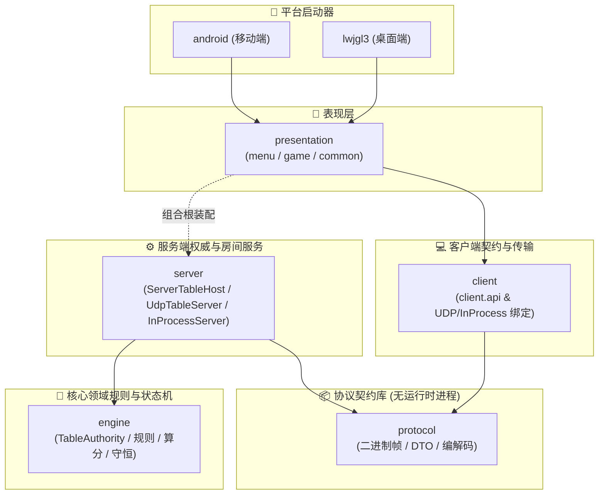
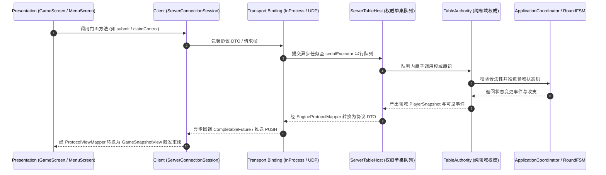
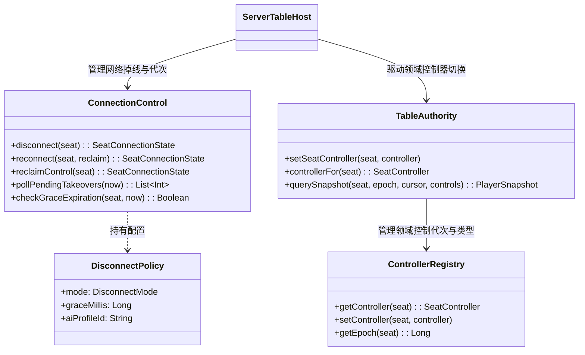
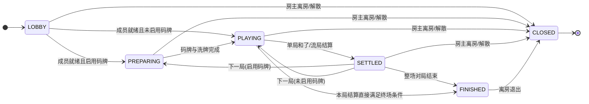
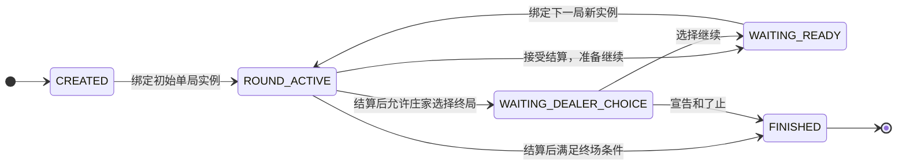
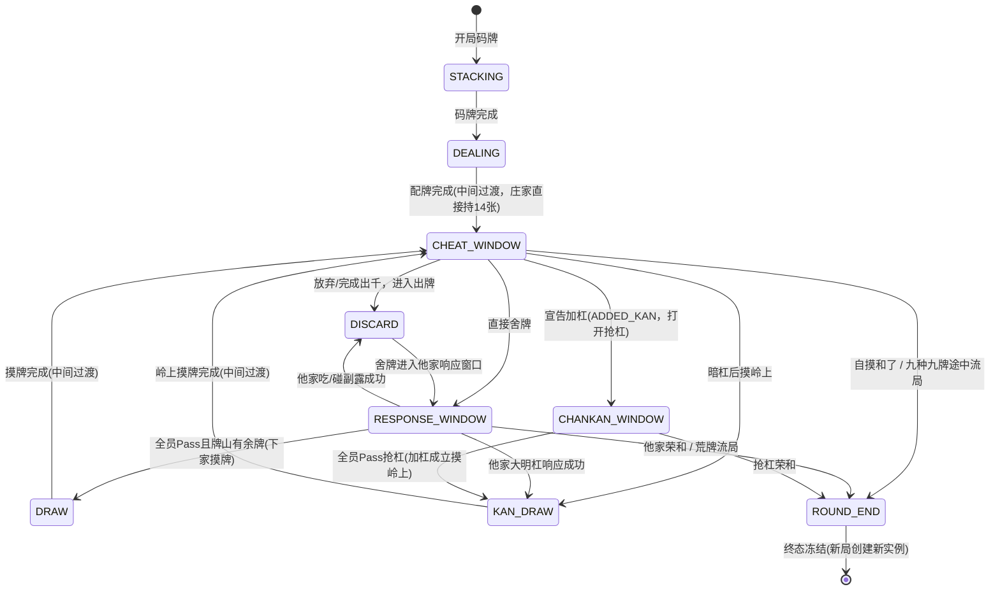

# 🀄 千术麻将游戏方案 V4：菜单/牌桌拆分、Client 桥接与 Server 接口化

本文档说明《千术麻将》当前 V4 架构的模块依赖、运行调用链、权威队列、连接控制归属与同步模型。2026-10-07 已完成连接控制迁移和文档校对，见 [本次验收](v4-migration/ACCEPTANCE-CONNECTION-OWNERSHIP.md)；约束以 [最终契约](v4-migration/CONTRACT.md) 为准。

---

## 1. 设计原则与核心契约

1. **表现层严禁直接触碰 engine**：牌桌画面 (`presentation.game`) 与菜单画面 (`presentation.menu`) 仅消费 `client.api` 暴露的视图模型与门面接口，不 import 任何 engine 领域模型或 server 实现类型。
2. **单机与联机同一套代码路径**：
   - 单机：组合根注入 `InProcessServer` 与 `InProcessBinding`，进程内直接异步交互，零网络开销、零报文编码；
   - 联机：启动独立 `UdpTableServer`，客户端经 `UdpClientBinding` 走可靠二进制 UDP 协议交互；
   - 两种部署共用同一套 `RoomRegistry`、`SharedRoom`、`ServerTableHost` 与 `TableAuthority` 权威业务逻辑，表现层与客户端上层零感知差异。
3. **Server 唯一权威串行循环**：所有玩家动作、超时强制作出、AI 决策出队、控制权变更均在每桌独占的串行执行器 (`serialExecutor`) 内排队裁决。同桌操作按序提交，玩家提交严格校验 deadline，tick 先处理超时再调度 AI，不同决策依序生效，响应窗口允许多个座位提交记录；动画仅门控客户端自动推进节奏。
4. **模型三层解耦与类型隔离**：
   - 领域层 (`engine`)：纯核心游戏状态、物理守恒与规则算法；
   - 线路层 (`protocol`)：不可变数据传输对象 (DTO)、帧头与可靠性协议；
   - 视图层 (`client`)：客户端私有视图模型与只读投影。
   - 三层类型互不共享，严禁 Any/Object/Map 穿透。
5. **协议契约是静态库而非中转服务**：`protocol` 模块仅为共享的不可变协议数据定义与编解码工具库，不承载任何运行时中转转发进程。

---

## 2. 模块划分与依赖拓扑

系统物理划分为七个 Gradle 模块，编译期依赖严格保持单向无环：

### 依赖规范
- `engine`：纯 Kotlin/JVM，零外部依赖（仅允许 Kotlin 标准库），**严禁反向依赖 client、server、protocol、libGDX、Gson 或 Socket**。
- `protocol`：独立协议定义，**不依赖 engine/client/server/presentation**。
- `server`：依赖 `engine` + `protocol`，拥有领域到协议的双向映射与连接控制实现。
- `client`：**仅依赖 `protocol`**，严禁 import `engine` 或 `server` 实现。
- `presentation`：`menu`、`game`、`common` 包仅依赖 `client.api`；组合根 `MahjongGame` 位于 presentation 根包，作为唯一允许装配 `server` 与 `client` 的应用根节点。

---

## 3. 运行调用链与组件架构

编译依赖与运行时调用链彻底解耦：

### 3.1 本地与远端双绑定统一
- **本地单机 (`InProcessServer` / `InProcessBinding`)**：
  直接持有 `SharedRoom` 与 `ServerTableHost`，通过同进程内存提交异步任务，返回包含协议 DTO 的 `CompletableFuture`，无序列化开销。
- **远端 UDP (`UdpTableServer` / `UdpRoom` / `UdpClientBinding`)**：
  基于版本 4 的 22 字节二进制帧头传输，支持可靠重传、分片重组与入站去重；拆包后调用相同的 `SharedRoom`。

---

## 4. 连接控制与领域控制权所有权

为确保领域模型纯粹性，连接状态与网络策略已完整迁入服务端：

### 4.1 所有权划分
1. **服务端连接控制 (`com.majiang.server.control`)**：
   - `ConnectionControl`：追踪各座位网络连接状态（`ConnectionStatus.CONNECTED/DISCONNECTED`）、掉线时刻、宽限期截止时间、AI 托管标记；
   - `DisconnectPolicy`：提供 `IMMEDIATE_AI`（立即接管）、`GRACE_THEN_AI`（宽限期后接管，默认 10 秒）、`TIMEOUT_ONLY`（仅超时裁决不接管）；
   - **重连不自动收回**：断线重连后默认保留接管状态，必须显式调用 `claimControl()` 收回控制权并自增代次。
2. **引擎领域控制权 (`engine`)**：
   - `SeatController`：领域级控制器密封接口（`LocalHuman`、`RemoteHuman`、`Computer`、`Takeover`）；
   - `ControllerRegistry`：权威 `controlEpoch` 递增维护者，任何控制器更迭均使先前决策缓存失效；
   - `SeatControlView`：投影至客户端快照的控制者视图（包含 seat、connected、role 字符串与 controlEpoch）。

---

## 5. 三级生命周期管理

系统清晰分离三套独立但协作的生命周期状态机：

### 5.1 房间生命周期 (`ProtocolRoomLifecycle` / `RoomLifecycle`)

### 5.2 整场账本生命周期 (`SessionLifecycle` / `MatchSession`)

图示为当前领域提交的主要路径：初始单局可尚未发牌，大厅是否开赛由房间层控制。接受单局结算时直接提交等待准备、庄家选择或终场状态，不经过独立的 `ROUND_RESULT` 中间提交。

`WAITING_START`、`ROUND_RESULT` 等仍在枚举中保留，但不应据此画成当前必经状态。产品暂停由 `TableAuthority` 冻结 `DecisionClock`，房间关闭由 server 管理；二者不等于整场生命周期必然切到同名枚举。

### 5.3 单局流转状态机 (`RoundStateMachine`)

- **单局状态机不可复用**：`RoundStateMachine` 达到 `ROUND_END` 终态后永久冻结，无任何回退边。下一局（包含连庄）必须由 `ApplicationCoordinator` 创建全新状态机实例与全新 `roundId`，严禁在旧状态机上重置。
- **中间过渡与原子提交**：`DEALING`（发牌）、`DRAW`（摸牌）与 `KAN_DRAW`（岭上摸牌）在单次动作执行中可能为瞬时中间阶段。例如开局发牌在单步操作中经过 `DEALING` 立即抵达庄家 `CHEAT_WINDOW`（庄家已持 14 张牌）。
- **抢杠与加杠推进**：加杠（`ADDED_KAN`）由当前摸牌/出千玩家在 `CHEAT_WINDOW` 主动宣告并直接打开 `CHANKAN_WINDOW`；若全员放弃抢杠，则摸岭上牌（`KAN_DRAW`）继续；大明杠响应则经 `RESPONSE_WINDOW` 裁决胜出后进入 `KAN_DRAW`。

---

## 6. 权威执行队列与时钟规范

1. **每桌独占串行队列**：
   - `ServerTableHost` 为每张牌桌维护独立的 `serialExecutor`；
   - 外部调用（玩家提交选择、洗牌方案、准备、控制切换）只入队并立即返回 `CompletableFuture`；
   - 所有突变统一串行排队裁决，不同决策依序生效，响应窗口允许多个座位提交记录，杜绝并发竞态。
2. **异步 AI 推理脱离权威临界区**：
   - AI 思考与启发式搜索在权威串行执行器之外的独立线程池异步执行；
   - AI 计算完毕后，将结果包装为 `AiResult` 重新入队提交；
   - 权威入队执行时严格比对三元组：`roundId`、`decisionId` 与 `controlEpoch`。若代次已因真人收回或局次推进而失效，则安全丢弃。
3. **权威 Deadline 绝对优先**：
   - 每座位配置 20 秒保留时间 + 3 秒思考时间（`20+3` 规则）；
   - 到期判定基于权威单调时钟 `MonotonicClock` 绝对时间戳；
   - 超时默认动作（超时摸切/放弃）具有权威最高优先级，**不可被客户端渲染动画或网络延迟无限推迟**。
4. **时钟驱动机制**：
   - 单机模式：由 `MahjongGame.render` 每一帧主动调用 `server.tick(presentationBusy)` 驱动宿主推进；
   - 联机模式：由服务端内部 50ms 独立调度线程 `ticker` 周期驱动 `tick`。

---

## 7. UDP v4 可靠网络协议规范

远端网络采用无连接、高实时性、带自愈能力的自封装 UDP 协议：

| 规范项 | 详细参数与契约 |
|---|---|
| **协议版本** | Version 4 (`ApiProtocol.PROTOCOL_VERSION = 4`) |
| **二进制帧头** | 固定 22 字节（魔数 2B + 协议版本 1B + 报文类型 1B + connectionId 4B + seq 4B + ackSeq 4B + payloadLen 2B + crc32 4B） |
| **数据报上限** | 单个 UDP 数据报严格限制在 1200 字节以内，避免 IP 分片 |
| **分片重组** | 载荷超过 1090 字节时自动切分（FRAG），按来源地址、连接与消息 ID 隔离重组 |
| **心跳与判死** | 客户端每 3 秒发送 PING 保活，服务端注入时间戳回显 PONG；10 秒无入站数据报判定连接失效 |
| **推送通道 (PUSH)** | 始终为**全量快照 + 可见增量事件**；单调递增游标（cursor）；服务端重传滑动窗口大小为 256 条（客户端保持 64 有界接收缓冲与 256 游标去重） |
| **基线建立与全量自愈** | `isFullSnapshot = true` 明确标识建立或替换基线；超出 256 窗口或首次订阅时直接下发全量快照重置客户端游标 |
| **会话与游标隔离** | 每个玩家席位拥有独立单调递增的游标；公开观战流拥有完全独立的游标序列；强绑定 `(sessionId, syncEpoch)`，代次更迭时重置序列 |
| **防重放与幂等** | 请求携带 `requestId`，服务端有界缓存回执；重复请求直接重放已生成回执，不重复执行领域逻辑 |

> **实现边界**：系统不使用增量状态模型、512 窗口、单一桌级混合游标、TCP 长连接、Ktor 或 WebSocket。

---

## 8. 尚未实现的功能边界声明

为保持架构严谨性，以下功能尚未实现，文档与代码均不作已具备承诺：
1. **公网用户体系与鉴权**：无远程用户数据库、OAuth 或集中式登录中心；
2. **自动撮合匹配**：大厅仅支持显式列房与输入目标服务器地址/房号加入，无全自动撮合匹配；
3. **三人麻将规则**：领域规则与牌山严格为标准四人日麻（136 张牌）；
4. **断电持久化恢复**：无数据库持久化账本，房间随进程生命周期销毁；
5. **运行时主机动态迁移**：房主离房即解散房间，不支持将房主与桌权限转移给其他席位；
6. **TLS / DTLS 加密传输**：UDP 帧基于 CRC32 校验，未启用传输层加密。
