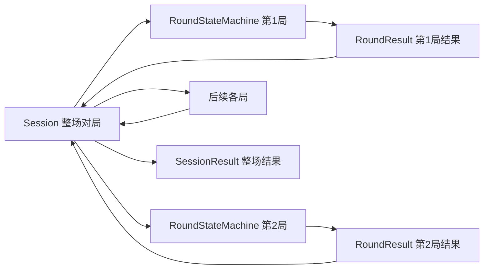
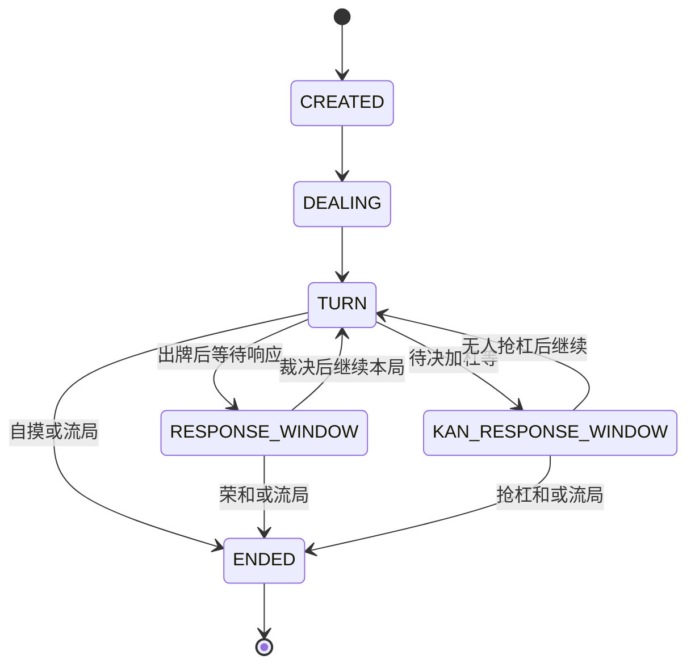
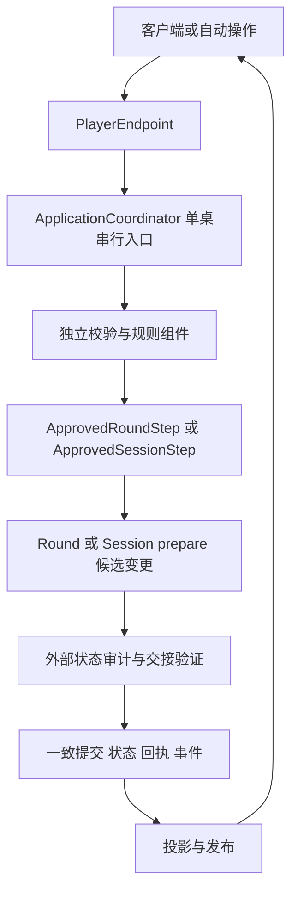
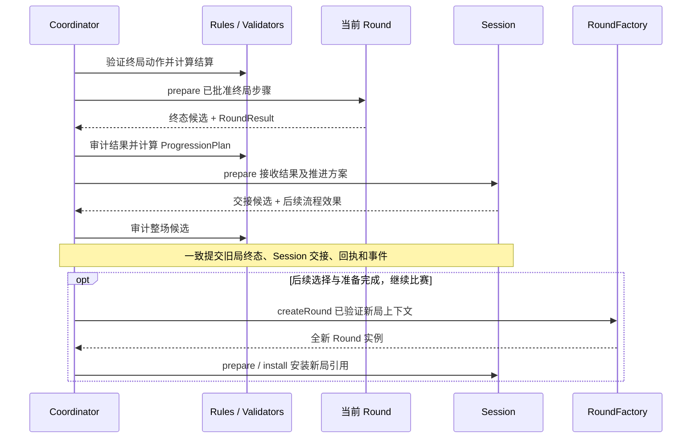

# 麻将架构职责与接口规格 v2：单局状态机、Session 与独立校验

版本：设计草案 v2.0；日期：2026-09-30。  
状态：完整目标规格；核心本地拆分已实施，具体范围与验收结论见下方进展。  
适用：本地单机、远端服务、玩家自建主机，共用同一套领域语义。  
前置分析：[状态机与客户端拆分](STATE_MACHINE_CLIENT_DESIGN.md)。历史版本：[接口规格 v1](MAHJONG_STATE_MACHINE_API_SPEC_V1.md)。职责归属以本文为准；v1 中未冲突的传输、展示与错误语义可继续复用。

> 实施进展（2026-09-30）：核心本地职责拆分已开发并验收，详见 [分类开发设计](round-session-split/DEVELOPMENT.md) 与 [检视和验收记录](round-session-split/REVIEW.md)。本文保留完整目标规格，不代表远端传输、持久化恢复及全部扩展接口已实现。

## 1. 核心边界

**RoundStateMachine 只负责一局麻将；Session 负责整场对局，串联多局状态机；所有验证放在独立组件。**

这里的“一局”指一次发牌到和牌或流局结束。连庄后的重新发牌也是新的一局，必须创建新的 roundId 和状态机实例。“整场对局”指按约定规则进行的东风战、半庄或其他配置的完整比赛。

| 组件 | 负责 | 不负责 |
|---|---|---|
| RoundStateMachine | 单局状态、牌张流转、响应窗口、单局结束与结果 | 动作合法性验证、身份权限、整场推进、AI、网络 |
| Session | 整场生命周期、局与局衔接、跨局账本、历史结果、最终结果 | 单局牌张操作、规则与算分算法、任何验证、网络 |
| ValidationPipeline | 调用独立验证器，产出可执行的内部指令 | 修改 Round 或 Session 的权威状态 |
| ApplicationCoordinator | 串行执行、组织验证与提交、结果交接、调度外部服务 | 自行实现麻将规则、把验证逻辑重新塞回领域对象 |
| Rule / Calculation Services | 规则判断、候选动作、响应裁决、算分、跨局推进方案 | 直接修改权威状态 |
| QueryFacade / ViewProjector | 一致性查询、按身份投影、脱敏、组合可展示数据 | 决定客户端提交的操作是否生效 |
| PlayerEndpoint | 本地或远程调用入口，查询、提交、订阅 | 保存另一份可自行推进的权威牌局 |

本文的 **Session 是整场比赛领域对象**，与当前代码中作为玩家调用门面的 GameSession / LocalGameSession 不是同一个职责。后者在目标架构中对应 PlayerEndpoint / LocalPlayerEndpoint，迁移时应消除名称歧义。

独立组件是代码职责边界，不要求分别部署为服务。本地版本可以全部放在同一进程中。

## 2. 一场对局如何串联多局



- 每场比赛只有一个权威 Session，同一时刻最多一个活动 RoundStateMachine。
- 每次发牌创建新状态机。不能通过清空上一局状态来复用同一实例和 roundId。
- 旧状态机进入 ENDED 后不会重新活动。Session 保留其结果和归档引用，实例可以释放。
- 单局结果不包含“下一局是谁坐庄”“整场是否结束”等决策。独立 MatchProgressionPolicy 计算这些方案，Session 应用方案。
- 状态机不持有其他状态机，不调用 Session，不自行启动下一局。

## 3. RoundStateMachine：单局内的详细功能

### 3.1 负责记录和推进的情况

| 情况 | 状态机执行的状态变化 | 外部提供的判断或方案 |
|---|---|---|
| 开局与发牌 | 接收开局上下文及已准备牌山，设置手牌、庄家首巡与牌山指针 | 规则配置、开局数据验证、牌山准备与守恒检查 |
| 摸牌与出牌 | 移动指定实体牌，更新摸牌区、手牌、牌河、历史和行动阶段 | 是否轮到该座位、可打哪些牌、动作限制 |
| 吃与碰 | 执行已批准的组合，建立副露，转入副露者的出牌阶段，不额外摸牌 | 可选组合、来源座位、食替等约束 |
| 明杠与暗杠 | 执行杠牌移动，更新杠次数、宝牌状态和岭上摸牌阶段 | 可开杠条件、立直后杠的限制、翻宝时机 |
| 加杠与抢杠 | 保存待决加杠，建立抢杠窗口；按裁决完成或取消加杠 | 抢杠候选、和牌资格、是否允许特殊抢暗杠 |
| 立直 | 应用经批准的立直步骤，记录宣言牌、成立状态、一发和供托变化 | 听牌候选、点数与门清条件、宣言成立时点 |
| 振听 | 保存舍牌振听、同巡振听、立直振听状态以及对应变化 | 规则组件根据历史、过和、摸牌等事实计算变化 |
| 响应窗口 | 记录各座位已提交的响应与窗口状态；应用最终裁决 | 和高于碰杠、碰杠高于吃、多家和与其他同级策略 |
| 和牌 | 应用已计算的结算方案，生成结果，进入 ENDED | 和牌合法性、役种、宝牌、符番、支付金额 |
| 荒牌与途中流局 | 记录终局原因、听牌座位，应用单局支付方案 | 流局条件、听牌检查、流局支付规则 |
| 可选千术玩法 | 应用启用的单局效果，记录牌张与警戒等状态变化 | 千术资格、效果合法性、惩罚和物理守恒检查 |

状态机负责“本局发生了什么，以及接下来处于什么阶段”。规则服务负责“这一步是否允许，以及应产生哪些规则效果”。响应优先级不能由输入到达顺序决定，必须先经过独立裁决。

### 3.2 不负责的功能

身份与权限、控制者判断、请求格式、过期请求、幂等、动作合法性、手牌分析、算符算番、积分公式、牌张守恒审计、跨局推进、终局排名、AI 策略、超时策略、网络、存储、视图脱敏和 UI 动画，均不属于状态机。

状态机可以采用穷尽分支和内部断言捕获编程错误，但不能把这些断言用作正常业务请求的验证入口。不可执行请求应在外部验证阶段得到明确错误。

### 3.3 持有的数据

```text
RoundState
  roundId, roundVersion, phase
  startContext                         本局只读开局上下文
  wall, deadWall, drawPointers          牌山、王牌和摸牌位置
  hands, drawnTiles, discards           手牌、摸牌区、牌河
  discardHistory, melds                出牌历史、副露
  currentPlayer, turnNumber
  riichi, ippatsu, furiten, kanFlags
  doraState
  responseWindow?, pendingKan?
  roundLedger                          本局实时积分和供托
  roundResult?
```

startContext 含本局庄家、场风、局数、本场数、起始积分、供托、规则版本及准备好的牌山。场风等跨局信息在这里是本局常量，状态机不能修改它们来推进整场。

### 3.4 生命周期



TURN 可细分 DRAW、CHEAT_WINDOW、DISCARD、KAN_DRAW 等子阶段。具体开杠、翻宝、流局的先后由固定规则版本决定。状态机没有 MATCH_END，也没有 nextRound、startMatch 或 finishMatch。

## 4. Session：整场对局的详细功能

Session 负责以下过程，但把规则计算和验证交给独立组件：

1. 保存整场配置引用、座位成员和比赛生命周期。
2. 维护局间积分账本、庄家、场风、局数、本场数和供托。
3. 在开赛条件已批准后，产生第一局的启动描述。
4. 接收已验证的 RoundResult，记录历史并完成积分交接。
5. 应用独立策略生成的 ProgressionPlan，进入庄家终局选择、局间准备、下一局或整场结束。
6. 保存庄家和止等局间选择，以及玩家的下一局准备状态。
7. 产生下一局的启动描述，通过外部工厂创建新状态机并安装活动局引用。
8. 保存可查询的各局摘要、归档引用、整场统计和 SessionResult。
9. 记录整场暂停、恢复或关闭。连接状态、计时器与恢复任务由外部组件维护。

Session 不移动手牌、不运行响应窗口、不判断吃碰杠和、不算役种符番、不自行判定南入西入或击飞、不维护网络连接或 AI 实例，也不实现请求和结果验证。

### 4.1 持有的数据

```text
SessionState
  sessionId, sessionVersion, lifecycle
  seats: SeatRoster                     成员和座位引用，不含连接或 AI 策略
  matchRuleRef
  betweenRoundLedger                    最近一次已交接的局间账本
  progress { dealer, roundWind, roundNumber, honba }
  activeRoundRef?
  roundRecords[] { roundId, resultId, archiveRef }
  pendingProgressionPlan?
  dealerEndChoice?
  readiness
  sessionResult?
```

控制类型、controlEpoch、AI 策略和托管设置由外部 ControllerRegistry / PreferenceService 按 sessionId 和 seatId 保存，不放进 Session 领域对象。

### 4.2 生命周期

```text
CREATED → WAITING_START → ROUND_ACTIVE → ROUND_RESULT
ROUND_RESULT → WAITING_DEALER_CHOICE → WAITING_READY / FINISHED
ROUND_RESULT → WAITING_READY / FINISHED
WAITING_READY → ROUND_ACTIVE（全新状态机）
```

PAUSED 是保留原阶段的暂停状态；CLOSED 表示管理性关闭，与自然结束 FINISHED 区分。具体允许在哪些阶段暂停或关闭由外部 SessionCommandValidator 检查。

单局出现负分等事实，并不让 RoundStateMachine 宣布整场结束。它只输出单局账本；MatchProgressionPolicy 根据规则计算终局方案，Session 应用。

## 5. 独立验证与计算组件

下列职责全部在 RoundStateMachine 和 Session 之外。不能仅把验证方法换个名字，仍由两个对象内部调用整条验证链。

| 组件 | 输入和职责 | 输出 |
|---|---|---|
| RequestSchemaValidator | 协议、字段类型、必填项、规则配置格式 | 规范化请求或格式错误 |
| IdentityAccessValidator | 身份、成员关系、座位访问和读写权限 | 已授权的调用上下文 |
| ControlValidator | 当前控制者、控制代次、托管归属 | 控制权验证结果 |
| RequestRegistry / IdempotencyValidator | 请求标识、载荷指纹、既有回执 | 既有回执、冲突错误或新请求资格 |
| DecisionValidator | roundId、decisionId、optionId、窗口、时效、是否已响应 | 有效决策上下文 |
| RoundRuleService | 候选动作生成、吃碰杠和与立直振听合法性、规则效果 | 候选选项、解释、ApprovedRoundStep 所需内容 |
| ResponseResolver | 已记录响应、未决座位和规则中的优先级 | 等待或最终 ResolutionPlan |
| ScoreCalculator / SettlementCalculator | 完整和牌上下文、役种、宝牌、符番及支付规则 | 含计算明细的 RoundSettlementPlan |
| MatchProgressionPolicy | 本局结果、整场进度、目标与结束规则 | ProgressionPlan，必要时含 SessionSettlementPlan |
| SessionCommandValidator | 开赛、准备、和止、暂停等操作及适用阶段 | ApprovedSessionStep |
| RoundResultValidator | 来源局、终态版本、账本一致性、未消费结果 | 已批准的单局结果交接 |
| StateInvariantAuditor | 候选 Round / Session 状态、牌张与积分约束 | 审计通过或内部一致性错误 |
| CheckpointValidator | 存档版本、完整性、关联关系、恢复条件 | 可恢复的已验证快照 |
| ViewProjector / EventRedactor | 权威状态与观看身份 | 不泄露暗牌和隐藏规则信息的视图与事件 |

请求校验不等于规则验证；候选动作生成也不能代替提交时的时效检查。展示候选和验证动作复用同一套规则计算，以免 UI 显示可选但提交时被另一套规则否定。

## 6. 统一执行流程：验证与状态转换解耦



统一流程：

1. 请求进入该桌的串行队列；状态读取、验证、准备和提交保持在同一个一致性边界内。
2. 验证协议和调用身份；在授权范围内查询请求去重记录。相同请求返回原回执，相同标识不同载荷返回冲突。
3. 读取 Session、活动 Round、控制权和决策上下文，调用独立验证器与规则组件。
4. 生成内部 Approved 指令，绑定目标对象及源版本。客户端不能构造或反序列化这种指令。
5. 调用目标对象的 prepare，生成候选状态、事实事件和效果描述；此时不修改权威状态、不发送事件。
6. 外部审计候选状态；单局结束时额外验证结果并准备 Session 的交接变更。
7. 在同一提交边界内安装所有候选状态，记录请求回执、结果消费记录及待发布事件。
8. 提交成功后投影并发布事件，外部调度器据此启动 AI、计时器或下一局准备任务。

Approved 指令是受封装保护的进程内能力，只能由可信流程生成和消费，不是传输 DTO。install 也是内部接口，不向客户端、AI 或插件暴露。源版本检查和不可重复消费由外部协调器及注册表执行；任何变更后都不能复用旧指令。

为了让提交后的审计失败不会留下半修改状态，不能采用“先修改权威对象，再审计”的方案。prepare 应返回不可变候选或隔离的副本；install 只安装已审计的候选，不重新运行业务规则。

ApplicationCoordinator 只组织流程。各类规则、验证、存储和发布仍由各自组件实现，避免产生另一个巨型类。

## 7. RoundStateMachine 的内部接口

这些接口供可信应用层使用，不是网络 API。接口名为设计示意，不绑定具体 Kotlin 签名。

| 编号 | 接口 | 详细行为 |
|---|---|---|
| R01 | RoundFactory.createRound(validatedContext) | 工厂创建全新单局实例。上下文已由外部验证，工厂不承担请求验证 |
| R02 | readState() → RoundSnapshot | 返回不可变的完整内部快照，供规则计算、审计与投影读取；不能直接交给普通玩家 |
| R03 | prepare(ApprovedRoundStep) → RoundChange | 根据本局当前状态计算候选变更，不提交、不执行外部副作用 |
| R04 | install(auditedRoundChange) | 仅供可信协调器安装已审计变更；外部确保源版本匹配和提交原子性 |
| R05 | readResult() → RoundResult? | 仅在 ENDED 后提供不可变的本局结果；其他阶段返回空 |
| R06 | RoundFactory.restoreRound(validatedSnapshot) | 根据已经验证的存档恢复同一局；与创建下一局严格区分 |

```text
RoundChange
  roundId, sourceVersion
  candidateState
  events[]
  result?
```

ApprovedRoundStep 可表达：发牌、摸牌、出牌、吃、碰、明杠、暗杠、待决加杠、完成加杠、记录响应、应用响应裁决、立直成立及供托变化、振听等标记变化、应用和牌或流局结算、启用的千术效果。

一次指令可以包含为完成同一操作必需的连续机械步骤，例如副露后切换出牌者；不能夹带下一名 AI 的决策，也不能操作另一局。自动摸切仍由外部策略选择普通合法选项，再经过相同执行流程。

queryLegalActions、explainAction、validateAction、assertInvariants、querySeatState 不放在 RoundStateMachine 中，分别归属于规则、校验、审计和投影组件。

## 8. Session 的内部接口

| 编号 | 接口或步骤 | 详细行为 |
|---|---|---|
| S01 | SessionFactory.create(validatedConfig) | 创建整场对局，建立座位、规则引用和初始局间账本 |
| S02 | readState() → SessionSnapshot | 返回整场生命周期和跨局数据的不可变内部快照 |
| S03 | prepare(ApprovedSessionStep) → SessionChange | 生成候选状态和流程效果，不提交或直接调用网络存储 |
| S04 | install(auditedSessionChange) | 由可信协调器安装已审计变更 |
| S05 | StartSession 步骤 | 按已批准开赛方案，产生首局启动描述 |
| S06 | AcceptRoundResult 步骤 | 接收已验证结果与 ProgressionPlan，交接积分、记入历史、结束活动局引用并推进生命周期 |
| S07 | ChooseDealerEnd 步骤 | 应用已批准的和止或继续选择及推进方案 |
| S08 | MarkReady 步骤 | 记录准备状态；条件经外部判断满足后产生下一局启动描述 |
| S09 | Pause / Resume / Close 步骤 | 应用经批准的管理性生命周期变化 |
| S10 | readRoundRecord(roundId) | 查询本场的单局摘要和归档引用；实体数据由外部存储读取 |
| S11 | readResult() → SessionResult? | 返回已完成的整场结果，包括最终积分、排名及其明细 |
| S12 | SessionFactory.restore(validatedSnapshot, activeRoundRef) | 从已通过外部验证的完整关联快照恢复整场状态 |

S05～S09 是 S03 接受的指令类型，不是绕过验证直接暴露的第二套修改入口。其他内部步骤包括安装已准备好的新局引用、应用整场尾款结算和记录计算好的统计结果。

SessionChange 包含 sourceVersion、candidateState、events 和效果描述，例如 StartRound、ArchiveRound、CompleteSession。Session 决定流程去向，协调器执行工厂创建、归档持久化、发布与可恢复重试。

新局实例准备成功且通过外部审计后，才能把 Session 提交为 ROUND_ACTIVE 并发布开局事件。创建失败时停留在可重试的局间状态，不产生悬空的 activeRoundRef。

## 9. 单局与整场之间的数据契约

### 9.1 RoundStartContext

```text
sessionId, roundId
ruleVersion
dealer, roundWind, roundNumber, honba
startingScores, startingRiichiSticks
preparedWall
enabledRoundFeatures
```

sessionId 仅作关联标识，不赋予状态机访问 Session 的能力。牌山准备、随机源和码牌配置由外部服务负责；状态机接收准备完成的数据。

### 9.2 RoundResult

```text
resultId, roundId, finalRoundVersion
outcome: RON | TSUMO | EXHAUSTIVE_DRAW | ABORTIVE_DRAW
winners[], loser?, tenpaiSeats[], drawReason?
settlementBreakdown
startingScores, finalScores, totalDeltas
startingRiichiSticks, remainingRiichiSticks
roundFacts                             庄家是否和牌或听牌等已计算事实
finalStateReference
```

settlementBreakdown 应可独立展示所有命中役种、各自番数、宝牌 / 里宝牌 / 赤宝牌命中及数量、符数明细、基本点、封顶档位、支付与取整、本场和供托。计算由外部服务完成，本局结果保存计算产物和规则版本，方便查询与复核。

RoundResult 不包含 nextDealer、nextRoundNumber、matchFinished 或整场最终名次。它是本局事实，不决定后续比赛。

### 9.3 ProgressionPlan

```text
sourceRoundId, sourceResultId, sourceSessionVersion
kind: WAIT_DEALER_CHOICE | PREPARE_NEXT_ROUND | FINISH_SESSION
nextRoundContext?                      下一局元数据，不含尚未生成的牌山
dealerChoiceOptions?
sessionSettlementPlan?
readinessPolicy
```

MatchProgressionPolicy 负责庄家轮转、连庄、本场数、局数 / 场风变化、延长战、击飞、和止资格和整场结束条件。Session 仅应用此方案，并保存需要用户选择或等待准备的状态。

### 9.4 积分与供托的唯一写入者

1. 活动局期间，实时积分和供托由 RoundStateMachine 的 roundLedger 持有。立直扣点等局中变化立即反映在此。
2. 此时 Session 的 betweenRoundLedger 是上一交接边界的基线，不同步维护另一份可写的实时账本。QueryFacade 应展示活动局账本。
3. RoundResult 的 totalDeltas 包含本局全部变化，包含局中已发生的立直扣点，不能只记录和牌瞬间的变化。
4. Session 接收结果时采用 finalScores 和 remainingRiichiSticks 作为新基线；不能同时再累加 totalDeltas，也不能重复执行和牌支付。
5. 外部结果验证器检查起始基线对应关系和 `finalScores = startingScores + totalDeltas` 等约束。守恒审计还需把供托池纳入总量。
6. 整场结束时剩余供托等如何处理，由外部计算 SessionSettlementPlan，Session 应用一次并保留明细。

结果消费注册表按 sessionId + resultId 记录交接，外部提交事务保证结果、账本、历史与消费记录同步生效。

## 10. 一局结束到下一局开始的完整过程

1. 外部组件验证和牌或流局条件，计算单局结算方案。
2. RoundStateMachine.prepare 生成 ENDED 候选、RoundResult 和本局终结事件。
3. 外部审计候选状态；RoundResultValidator 检查结果来自当前活动局且尚未交接。
4. MatchProgressionPolicy 根据本局结果和整场快照计算推进方案。
5. Session.prepare 接收结果与推进方案，生成积分交接及生命周期候选。
6. 外部审计 Session 候选；统一提交 Round、Session、结果消费记录、回执及待发布事件。
7. 向客户端发布可见的单局结算和整场阶段变化。旧 Round 此后保持终态。
8. 如果等待庄家和止或下一局准备，用户提交 SESSION 范围的操作，经独立验证后推进 Session。
9. 如果继续比赛，外部准备新局数据并通过工厂创建新 roundId 的状态机；提交新的活动局引用后发布开局。
10. 如果结束比赛，应用已计算的整场结算，Session 进入 FINISHED，不创建新状态机。



内存版本由单桌串行协调器保证观察不到半交接状态；持久化版本需要事务或等效的可恢复提交协议。跨组件调用不能被误认为天然具备原子性。下一局准备可异步进行，但必须使用稳定的启动标识处理重试，不能多创建并发布两个活动局。

## 11. 客户端公开接口：仍然统一查询和操作

客户端连接 PlayerEndpoint，由门面组合多个组件，不需要直接持有 Session 或 RoundStateMachine。

| 接口 | 实际责任方 | 功能与边界 |
|---|---|---|
| queryCapabilities | CapabilityCatalog | 返回协议、规则版本与已启用能力 |
| querySnapshot | QueryFacade + ViewProjector | 合并整场阶段、本局可见牌面、正确账本及同步游标 |
| queryDecision | RoundRuleService / SessionCommandValidator + DecisionRegistry | 返回当前玩家可选的本局动作或局间操作 |
| queryOptionDetail | 规则解释服务 + 投影 | 返回立直听牌预览、吃碰杠组合、动作原因等可见说明 |
| querySettlement | ResultQuery + 投影 | 返回本局或历史结算，以及完整役种和计算明细 |
| submit | ApplicationCoordinator + ValidationPipeline | 经统一验证提交 ROUND 或 SESSION 范围的选择 |
| queryReceipt | RequestRegistry | 查询请求受理、等待裁决、完成或拒绝结果 |
| subscribe | UpdatePublisher | 按身份发布更新，支持游标恢复或要求重新同步 |
| updatePreferences | PreferenceService | 自动摸切、自动和牌、托管等策略配置；不直接推进牌局 |
| requestControl | ControllerRegistry + ControlValidator | 申请或变更控制权，更新控制代次 |
| leaveMatch | ParticipationService | 按规则处理离开、托管或结束；必要时生成已批准 Session 步骤 |
| closeEndpoint | 本地适配器或传输层 | 关闭当前端点，不等价于关闭整场 Session |

主要提交结构：

```text
ChooseAction
  sessionId
  requestId
  targetScope: ROUND | SESSION
  roundId?                              ROUND 时必填
  decisionId
  controlEpoch
  optionId
```

选项对应完整且不可变的动作参数，例如具体牌实例或副露组合；客户端提交 optionId，无须自行计算操作内容。外部 DecisionRegistry 保存选项与作用域、座位、目标版本或窗口的关联。不能仅信任客户端传来的 targetScope。

| 操作 | 归属 |
|---|---|
| 出牌、立直、吃碰杠、荣和、自摸、过、允许主动选择的流局 | ROUND |
| 发牌、摸牌及无须玩家选择的机械推进 | 外部协调器驱动已批准的 ROUND 步骤 |
| 庄家和止 AGARI_YAME / 继续比赛 CONTINUE_MATCH | SESSION |
| 开赛、下一局准备 READY_NEXT_ROUND、暂停、恢复、关闭 | SESSION |
| 自动摸切、自摸时暂停、AI 决策、超时选择 | 外部策略选择合法选项后走同一提交入口 |
| 理牌、选中高亮、取消未提交选择、动画和显示设置 | 客户端本地 |

多家响应时，提交成功可能只表示 RECORDED，最终动作仍需等待裁决。客户端不能收到“碰的选择已记录”就自行移动牌张；应等待权威结果更新。

## 12. 外部调度、查询与本地 / 远程部署

### 12.1 AI、自动操作与超时

ControllerRegistry 决定谁有权控制座位；AI 读取按座位投影的快照和候选；AutoActionPolicy 根据偏好选择自动摸切等动作；TimerScheduler 根据外部期限触发选择。它们都不能直接调用 install。

对于立直后流程：规则服务提供合法选项；只有允许自动化的情形，外部策略才代选摸切。存在自摸或符合规则的开杠选项时，按设置保留玩家选择。规则资格与自动化偏好是两个独立职责。

### 12.2 一致性查询

QueryFacade 在同一一致性点组合 Session 的生命周期与历史、活动 Round 的当前牌面和实时积分、外部生成的候选动作、控制与偏好信息。没有活动局时读取局间账本。

完整内部快照不能直接暴露给玩家。候选选项说明、错误信息、事件和历史结算都须经过访问检查与脱敏；不仅是手牌视图需要隐藏信息。

### 12.3 部署

```text
本地：客户端 → LocalPlayerEndpoint → Coordinator → 独立服务 + Session + Round
远程：客户端 → RemotePlayerEndpoint → 传输 → 同一 Coordinator 与领域组件
```

两种部署保持相同的查询、选择、回执和事件语义。本地调用也不得绕过验证。远程客户端可以保存展示缓存，但权威 Session、活动 Round 及其验证流程只在权威端运行一份。

## 13. 并发、幂等和恢复的责任归属

| 情况 | 外部组件必须保证的行为 |
|---|---|
| 多家同时响应 | 单桌串行记录；按窗口及各座位资格验证，不能因别家响应导致全局版本变化就错误地作废剩余选项 |
| 重复请求 | 在身份与访问检查后返回原回执；相同 requestId 不同载荷返回冲突 |
| 旧局操作 | DecisionValidator 拒绝已经结束或不再活动的 roundId；不能误打到新局 |
| 旧窗口的过或碰 | 拒绝过期 decisionId / optionId；不会清除新窗口的等待 |
| 旧 AI 结果 | ControlValidator 拒绝 controlEpoch 已过期的提交 |
| 验证后状态变化 | 协调器序列化；异步计算结果返回时重新核对前提，必要时重新计算 |
| 重复单局结果 | RoundResultValidator 与消费注册表保证积分和历史只交接一次 |
| 单局结束时故障 | 恢复后 Round 终态与 Session 接收结果一致，或能按固定标识完成未结束的交接 |
| 新局启动时故障 | 恢复启动描述和稳定 roundId，不能产生两个可见活动局 |
| 快照与订阅的间隙 | 快照带游标，发布器提供后续更新或明确要求重新同步 |
| 存档恢复 | CheckpointValidator 验证 Session、活动 Round、规则版本、注册表和事件游标的关联 |
| 普通请求被拒绝 | 没有候选安装，不产生业务事件，不改变牌局；错误回执由外部记录 |

为保证观测一致性，版本用于不同目的：sessionVersion 标识整场状态、roundVersion 标识本局状态、decisionId 标识玩家当前可选上下文、controlEpoch 标识控制权代次。不能简单以单个全局版本替代所有语义。

## 14. 与 v1 设计的主要调整

| v1 中的职责 | v2 归属 |
|---|---|
| 一个 MahjongMachine 同时包含 ROUND_END 与 MATCH_END | Round 仅 ENDED；Session 单独管理 FINISHED |
| 状态机 nextRound / 整场生命周期 | Session 编排 + MatchProgressionPolicy 计算 + 外部工厂创建 |
| 状态机 queryLegalActions / explainAction | 独立 RoundRuleService 与解释服务 |
| 状态机 validateAction / assertInvariants | 独立验证管线与 StateInvariantAuditor |
| 状态机 querySeatState | QueryFacade / ViewProjector |
| MatchService 兼任所有管理工作 | Coordinator、Registry、Validator、Scheduler、Publisher 分工 |
| 状态机直接接收并检查玩家动作 | 外部验证后生成内部 Approved 指令，prepare / install 两阶段提交 |
| 和止属于单局最后一个动作 | 单局先结束；和止是 Session 的局间决策 |
| GameSession 作为玩家门面 | 目标命名 PlayerEndpoint，Session 专指整场领域对象 |
| 复用单个状态机重新开局 | 每次重新发牌创建独立 roundId 与实例 |

v1 的快照、候选选项、结算明细、请求回执、错误码及订阅恢复格式可以复用，但须按照本文调整归属、作用域和标识。两份文档有冲突时以 v2 为准。

## 15. 当前代码的后续迁移映射

以下是目标归属，不表示已完成迁移；实施前仍需按当时源码确定具体拆分点。

| 当前模块 / 职责 | 目标归属 |
|---|---|
| GameStateMachine 的摸打、副露、响应记录、本局阶段变化 | RoundStateMachine |
| nextRound、跨局庄家与场风、整场结束状态 | Session；决策算法交 MatchProgressionPolicy |
| GameState 中跨局元数据 | Session 持有权威数据，Round 保存只读开局副本 |
| LegalActionProvider、RiichiRules、KanValidator、振听算法 | 独立 RoundRuleService 内部模块 |
| ResponseResolver | 独立响应裁决服务，输出方案，由 Round 应用 |
| WinningScore / Fu / Score / Settlement 相关计算 | 独立算分与支付服务，输出带明细方案 |
| MatchProgression | 独立跨局推进策略，由 Session 应用 |
| StateInvariants、TilePool 守恒审计 | 外部 StateInvariantAuditor；牌张移动工具仍可供 Round 使用 |
| submitPlayerAction 的身份、控制权和统一验证 | PlayerEndpoint + Coordinator + 独立验证器 |
| runAutomaticActionLoop、AI 策略与超时 | 外部调度器、控制者注册表和自动操作策略 |
| PlayerView、SessionUpdate | 投影与统一更新发布组件 |
| LocalGameSession | LocalPlayerEndpoint 适配器 |
| GameScreen | 展示组合视图、选择候选和播放确认后的结果 |

## 16. 后续开发的验收要求

1. 单局状态机能覆盖摸打、副露、杠与抢杠、立直振听、和牌和流局，但没有推进下一局或计算整场名次的入口。
2. 每次发牌均有独立 roundId 和状态机实例，连庄同样如此；旧实例不能再次活动。
3. Session 能串联多局并维护正确的局间账本、进度和终局结果；每场最多一个活动局。
4. 和止、继续和下一局准备操作只改变 Session 的局间过程，不再修改上一局终态。
5. Round 和 Session 不依赖身份、权限、动作验证器、守恒审计器或存档验证器；外部协调器强制执行这些验证。
6. 无效动作、过期请求和审计失败均不能安装候选状态或发布业务变化。
7. 用户、AI 和自动操作共享候选规则与提交验证路径；展示与执行不存在两套麻将合法性规则。
8. 单局结果重复交付、请求重试、和牌供托与局中立直扣点不会导致重复支付。
9. 单局结束及新局创建的故障恢复不会遗漏历史、重复交接或产生两个活动局。
10. 活动局查询展示实时账本；局间查询展示已交接账本；总积分与供托满足配置的守恒约束。
11. 并发响应优先级、旧窗口拒绝、控制代次、隐私投影和订阅恢复仍满足原有行为要求。
12. 同一组领域与接口契约测试可覆盖本地和远端适配器；传输差异不影响规则结果。

以上是完整规格的验收契约。已实施范围、保留及新增测试和实际验证结果，以 [检视与验收记录](round-session-split/REVIEW.md) 为准。
