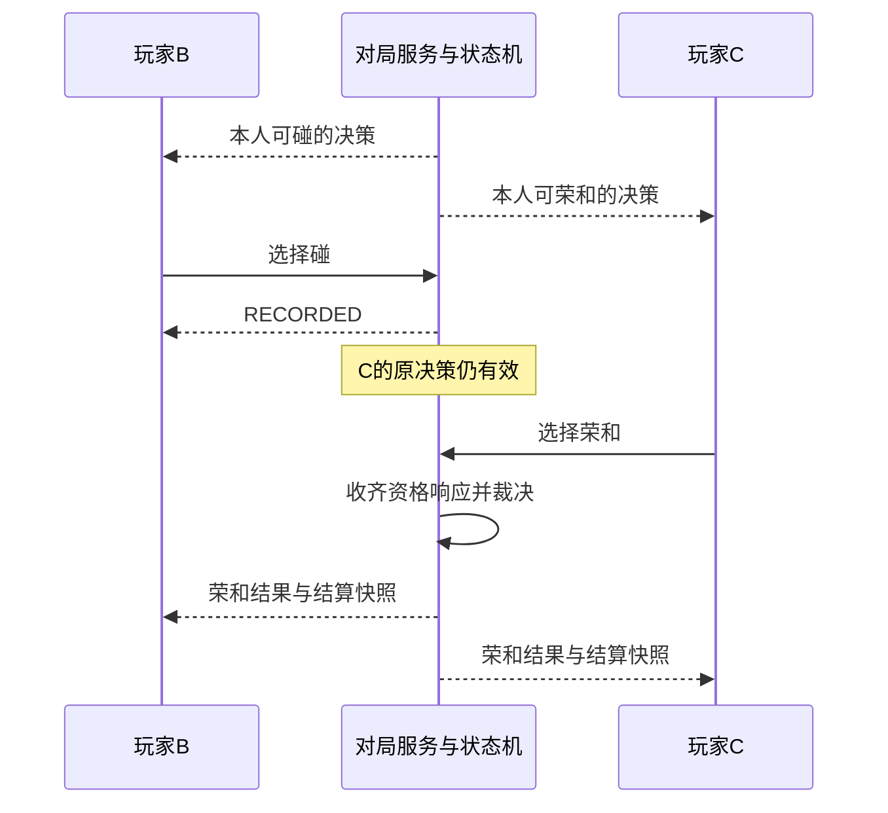

# 麻将状态机与客户端接口规格

> 历史归档，已由 [v2 规格：单局状态机、Session 与独立校验](MAHJONG_STATE_MACHINE_API_SPEC.md) 取代。保留原始接口细节供迁移参考；职责冲突以 v2 为准。

版本：设计草案 v1.0  
日期：2026-09-30  
适用：本地单机、远端服务、玩家自建主机，共用同一套语义  
状态：接口设计，尚未实现；本轮只新增本文档，不修改代码  
前置分析：[状态机与客户端拆分设计](STATE_MACHINE_CLIENT_DESIGN.md)

## 1. 目标、术语与实现范围

一张牌桌只有一份权威牌局。客户端查询自己可见的状态和可选操作，提交选择并订阅结果；麻将规则和实际执行由权威侧完成。

本文将“状态机对外提供接口”拆成三个明确边界：

| 边界 | 使用者 | 职责 |
|---|---|---|
| 玩家端点 PlayerEndpoint | 真人客户端、AI、托管决策器 | 查询本人视图、提交候选选择、接收可见更新 |
| 对局服务 MatchService | 本地装配入口、服务器、可信管理逻辑 | 身份与控制权、串行调度、生命周期、超时和恢复 |
| 领域状态机 MahjongMachine | 仅 MatchService 与可信测试 | 判断麻将合法性、维护牌局、裁决响应、结算和产生事实事件 |

公开接口不直接返回 GameState、TilePool、GameEventBus、AI 实例或内部可变集合。域内可以继续使用独立规则、算分、牌张移动和场次推进服务，不要求集中成一个大类。

**实施分级：**

- **A：本地拆分必须具备。** 查询、选择、统一执行、按座位投影、明确回执、单桌多端点、控制权与基本同步。
- **B：远端接入必须具备。** 连接认证、重连、可见流补发、网络重试、截止时间与掉线策略；本地可复用同一实现。
- **C：扩展预留。** 持久化检查点、观战、千术启用等；能力未实现时必须明确声明，不返回可用选项。

分级不表示现有代码已完成该能力。本规格是后续开发契约，文末列出现状与迁移映射。

## 2. 全局接口约定

1. 玩家端点绑定可信身份、matchId 和座位。客户端不通过请求体自行指定操作其他人的座位。
2. 对客户端所有调用均按异步结果设计。本地可以立即完成，远端等待传输；界面不依赖同步返回更新。
3. 每桌命令与一致性查询顺序处理。两个合法并发响应依次检查，不能仅因另一家先提交就拒绝本家仍有效的响应。
4. 查询无牌局副作用；拒绝不改变牌局、不扣分、不产生成功事实事件。拒绝审计和请求回执缓存不是牌局变更。
5. 操作实际执行前重新校验身份、控制权、决策、候选和规则，不把 optionId 当作绕过校验的凭证。
6. 返回值全部为不可变、可序列化的数据；枚举和结构化字段表达业务，不传运行时对象、任意 Any 参数或界面坐标。
7. 同一协议版本下，本地与远端适配器产生相同结果语义、错误码及可见数据。
8. 连接丢失或超时不等于动作被拒绝。结果未知时查询原请求回执或用同一 requestId 重试。
9. 规则版本在开局前锁定。接口字段允许扩展不等于允许对局中随意改变规则。
10. 不向客户端公开完整牌山、他家暗牌、他家合法动作或未授权私有效果；调试权限与普通玩家权限分离。

文中签名使用语言无关的伪接口：`Async<Result<T, ApiError>>` 表示异步成功或明确错误，`Stream<T>` 表示有序订阅流。它们不是本轮新增的 Kotlin 类型。

## 3. 接口总表

### 3.1 玩家与客户端接口

| 编号 | 接口 | 主要功能 | 等级 |
|---|---|---|---|
| P01 | queryCapabilities() | 查询协议、规则版本和已支持能力 | A |
| P02 | querySnapshot() | 获取一致的本人可见牌桌快照 | A |
| P03 | queryDecision() | 查询本人当前可选操作及决策标识 | A |
| P04 | queryOptionDetail(decisionId, optionId) | 获取某候选的牌组、待牌及规则解释 | A，可直接复用快照数据 |
| P05 | querySettlement(roundId) | 查询已公开的完整结算明细 | A |
| P06 | submit(ChooseAction) | 提交某个有效候选选择 | A |
| P07 | queryReceipt(requestId) | 查询自己先前请求的处理结果 | A，远端必须使用 |
| P08 | subscribe(afterCursor?) | 初始同步、持续更新及保留范围内补发 | A/B |
| P09 | updatePreferences(UpdatePreferences) | 修改本人允许调整的自动操作偏好 | A |
| P10 | requestControl(ControlRequest) | 本人请求托管或恢复人工控制 | A |
| P11 | leaveMatch(LeaveRequest) | 明确永久离开，不等同于临时断线 | B |
| P12 | closeEndpoint() | 关闭该端点及订阅，释放连接资源 | A |

### 3.2 对局服务与可信管理接口

| 编号 | 接口 | 主要功能 | 等级 |
|---|---|---|---|
| M01 | createMatch(CreateMatch) | 创建规则固定、尚未开始的牌桌 | A |
| M02 | openPlayerEndpoint(SeatBinding) | 按可信身份绑定玩家端点 | A/B |
| M03 | startMatch(StartMatch) | 校验开局条件，启动第一局 | A |
| M04 | setSeatController(SetController) | 切换指定座位控制者并使旧决策权限失效 | A |
| M05 | applyDeadline(DeadlineReached) | 处理权威计时器到期 | B |
| M06 | handleConnection(ConnectionChange) | 处理离线、重连与接管策略 | B |
| M07 | closeMatch(CloseMatch) | 受控终止整桌对局 | A |
| M08 | exportCheckpoint()/restoreMatch() | 导出和恢复可信完整运行状态 | C |

### 3.3 领域状态机接口

| 编号 | 接口 | 主要功能 | 等级 |
|---|---|---|---|
| D01 | create(RuleConfig, InitialContext) | 建立领域初态及规则依赖 | A |
| D02 | querySeatState(seat) | 生成脱敏的座位领域视图 | A |
| D03 | queryLegalActions(seat) | 生成该座位完整合法动作集合 | A |
| D04 | explainAction(seat, action) | 推导当前合法动作的规则说明和预览 | A |
| D05 | apply(DomainCommand) | 唯一正常牌局变更入口 | A |
| D06 | queryRoundResult(roundId) | 获取已结算结果，不重复计算支付 | A |
| D07 | assertInvariants() | 检查牌张、阶段、响应及资金一致性 | A |
| D08 | exportDomainState()/restoreDomainState() | 领域检查点读写，不含连接与 AI 对象 | C |

玩家不能调用 M/D 接口。即使本地同进程，也通过适配器维护这条依赖边界。AI 以受控决策端点使用 P02～P08 的等价内部接口，不授予管理权限。

## 4. 核心数据类型

### 4.1 标识与版本

| 字段 | 定义与约束 |
|---|---|
| matchId | 一场完整对局的唯一标识，重新开赛须新建 |
| roundId | 实际局实例唯一标识；连庄也创建新 roundId，不能仅用“东一局”代替 |
| requestId | 调用方生成、在同一身份与 matchId 下不复用的请求标识 |
| decisionId | 本座位当前一次选择机会；查询不会重新生成 |
| optionId | 当前决策中的候选标识；映射到规范内部动作 |
| controlEpoch | 该座位操作权代次；托管/恢复或操作者更换时递增 |
| viewVersion | 本端点可见快照版本，仅供展示同步；不是所有动作的强制全局版本前置条件 |
| preferencesVersion | 本人偏好版本，避免旧设置覆盖新设置 |
| cursor | `{ streamId, offset }`，标记一个可见更新批次 |
| eventId | 同一可见流内唯一，可由 cursor 与批内下标组成 |
| ruleProfileId / ruleVersion | 支持的规则配置及实现版本 |
| tileId | 指定局内的物理牌身份标识；不是牌山位置，不使用对象地址 |

决策内部可以关联响应 windowId，但不能借此公开他家私有候选。matchId、roundId 和 controlEpoch 防止跨局、跨控制权复用旧选项。

### 4.2 PlayerSnapshot

```text
PlayerSnapshot
  matchId, roundId?, protocolVersion, ruleProfileId, ruleVersion
  viewer: { seat, publicPlayerId, controlMode, controlEpoch }
  viewVersion, cursor, serverTime
  lifecycle
  table: PublicTable
  self: PrivateSeatView
  decision: Decision?                 // 只有本端点当前能提交时才有
  ownPendingResponse: PendingResponse?
  preferences: PlayerPreferences
  settlement: RoundSettlement?        // 最近可恢复的结算
  publicReadiness: ReadinessView?      // 局末准备；不是麻将响应资格列表
```

| 子结构 | 必需内容 |
|---|---|
| PublicTable | 场风、局数、本场、供托、庄家、当前行动座位、牌山剩余数、各家分数和立直状态、牌河、副露、公开宝牌指示、按规则公开的玩家身份/控制状态 |
| PrivateSeatView | 本人闭手牌、独立摸牌、本人振听分类、本人舍牌历史、授权私有效果；千术启用时才有本人袖牌等字段 |
| 可见 Tile | tileId、牌面、赤牌标识；未知暗牌只给张数或占位，不给真实牌面/身份 |
| 可见 Meld | 副露类型、允许公开的牌面、来源座位、被鸣牌/加杠牌位置标识；足够客户端横放和布局 |
| PendingResponse | 本人已记录的决策/请求、所选类型、等待最终裁决状态；不给他家尚未公开的选择 |
| PlayerPreferences | autoRiichiDiscard 及版本；其他自动选项未实现时不出现 |

客户端的排序、鼠标位置、选中高亮、音量与动画进度不放入权威牌局快照。

### 4.3 Decision 与 ActionOption

```text
Decision
  decisionId, roundId, controlEpoch
  category: TURN | DISCARD_RESPONSE | CHANKAN_RESPONSE | DEALER_END | ROUND_READY
  deadline: { deadlineId, expiresAt }?
  options: ActionOption[]

ActionOption
  optionId
  kind: ActionKind
  scope: GAMEPLAY | SESSION   // 所有选项仍通过 P06；内部处理职责明确区分
  detail: 与 kind 对应的明确类型
```

无合法选择或本端点没有操作权时，decision 为 null。本人响应已记录后撤掉对应决策，并在 ownPendingResponse 中保留反馈。

| detail 类型 | 字段及用途 |
|---|---|
| DiscardDetail | discardTileId、对应可见牌面、是否摸切 |
| RiichiDetail | discardTileId、理论待牌列表、振听预览、立直费用、双立直等当前可确定说明 |
| MeldDetail | CHI/PON/OPEN_KAN/CLOSED_KAN/ADDED_KAN、handTileIds、完整可见组合、calledTile、来源、addedTile |
| WinDetail | RON/TSUMO、和牌张、来源座位（如有）；实际得分以最终结算为准 |
| PassDetail | 放弃哪类当前机会；放弃合法荣和是否导致同巡/立直振听的本人提示 |
| AbortiveDrawDetail | 可声明流局的原因，例如当前支持的九种九牌 |
| DealerEndDetail | 终了或继续的选项含义及当前场况 |
| RoundReadyDetail | 确认哪一个已结束 roundId，当前是否已准备 |
| CheatDetail | C 级：固定类型的消耗、目标/牌组选项、授权说明；禁止任意 Map<String, Any> 参数 |

理论待牌只依据本人可见信息与规则推导，不利用隐藏牌山筛选或显示实际剩余牌。若以后增加公开剩余张数估算，应另加明确语义字段，不能与理论待牌混用。

### 4.4 ChooseAction

```text
ChooseAction
  matchId
  roundId
  requestId
  decisionId
  controlEpoch
  optionId
```

不含 player、完整手牌、完整 Meld、应扣分数或骰子/牌山结果。身份与座位来自端点；参数来自权威候选映射。

### 4.5 CommandReceipt

```text
CommandReceipt
  requestId
  status: APPLIED | RECORDED | REJECTED
  code?                       // REJECTED 时必有
  acceptedDecisionId?
  viewVersion, cursor         // 当前可见同步位置
  refreshRequired: Boolean
  detail?                     // 类型明确的附加信息
```

- APPLIED：直接动作或控制/偏好变更已经应用。
- RECORDED：响应选择已登记，最终是否生效以裁决事件为准。即便本次响应恰好使窗口完成，回执仍可统一为 RECORDED，最终结果从对应事件读取。
- REJECTED：明确没有应用该请求，不应播放成功动画。
- 同一请求重试返回原回执；原回执中的同步位置可能已经落后，应从订阅/查询获得最新快照。
- 网络结果未知由适配器报告 `OUTCOME_UNKNOWN`，不是权威 REJECTED。

### 4.6 RoundSettlement

| 字段组 | 详细内容 |
|---|---|
| 局标识与结果 | roundId、荣和/自摸/荒牌/途中流局、胜者/放铳者、按规则公开的听牌座位 |
| 和牌解释 | 和牌张、门前/副露信息、用于计分的最终解释；只公开规则允许展示的牌 |
| 役 | 所有命中的役 ID、显示名称键、番数或役满倍数、适用条件说明 |
| 宝牌 | 表宝牌指示及命中张数、里宝资格与实际公开结果、赤宝牌命中；分别列明计入值和不计入原因 |
| 符 | 原始符条目、各项加符、特殊固定符情况、取整过程 |
| 番与基本点 | 役番、宝牌番、总番、役满/限界档位、采用公式及中间计算值 |
| 支付 | 各家基础支付、本场加算、供托归属、最终收支与新分数 |
| 后续场况 | 连庄/轮庄、下一局信息或整场终了及排名 |

权威侧返回计算数据和解释步骤；客户端只格式化，不重新算番、算符或分配支付。不存在里宝资格时不提供未公开的里宝牌；役满下被规则排除的宝牌应说明“不计入”，不能混进总番。

大整数计算值使用精确整数或十进制字符串，不能因客户端浮点精度导致计算说明错误。

## 5. 玩家查询接口详细说明

### P01 queryCapabilities

**签名：** `queryCapabilities() -> Async<Result<Capabilities, ApiError>>`

**输入：** 无任意座位参数；连接协商阶段可以请求兼容协议版本范围。

**输出：** 支持协议版本、当前规则配置、支持的动作种类、可用查询、已实现役/规则能力标识、自动偏好字段、重连/观战/千术能力、游标及回执保留策略。

**功能：** 客户端据此选择协议和展示可用功能。未实现千术或网络恢复时明确 false，不能只因存在类定义就声明支持。

**错误：** PROTOCOL_UNSUPPORTED、ENDPOINT_CLOSED；身份相关字段只在授权后返回。

### P02 querySnapshot

**签名：** `querySnapshot() -> Async<Result<PlayerSnapshot, ApiError>>`

**功能：** 在一个一致性点生成完整本人可见快照，包含动作和对应预览，以及可恢复的最近结算。

**约束：** 不推进牌局、不触发 AI、不提交 Pass、不消耗随机源。相同决策的 optionId 保持稳定；重复读取不使旧选项失效。快照中的 cursor 可直接用于 P08 衔接补发。

**错误：** UNAUTHORIZED、MATCH_NOT_FOUND、ENDPOINT_CLOSED；已结束对局在保留期内仍可查询结果。

### P03 queryDecision

**签名：** `queryDecision() -> Async<Result<DecisionView, ApiError>>`

**输出：** `{ viewVersion, cursor, decision?, ownPendingResponse? }`。

**功能：** 轻量刷新本人的操作面板。与 P02 使用同一查询来源，不能另建一套判定逻辑。真人已被托管时不返回可提交候选；被授权的 AI 端点可以取得该座位候选。

**错误：** 同 P02。正常“没有可选操作”返回 decision=null，不是错误。

### P04 queryOptionDetail

**签名：** `queryOptionDetail(decisionId, optionId) -> Async<Result<OptionDetail, ApiError>>`

**功能：** 返回候选的完整鸣牌组合、立直弃牌及听牌/振听解释、放弃和牌的影响等。只能解释本人仍有效的候选，不能提交任意假设手牌进行隐藏信息探测。

**约束：** 小数据优先随快照一并返回，悬停无需逐次联网。此接口与快照内 detail 一致，不产生新规则权威。

**错误：** STALE_DECISION、OPTION_NOT_AVAILABLE、NOT_CONTROLLER，以及通用端点错误。

### P05 querySettlement

**签名：** `querySettlement(roundId) -> Async<Result<RoundSettlement, ApiError>>`

**功能：** 返回指定已结束局的、对当前身份可公开的结算解释。用于重连、重新打开结果页和查阅保留范围内的局结果。

**约束：** 至少保留最近已结束局直至整个对局结果保留期结束；更多历史通过 capabilities 声明。查询绝不重复发放供托或修改积分。

**错误：** ROUND_NOT_FOUND、RESULT_NOT_READY、HISTORY_UNAVAILABLE，以及通用错误。

### P07 queryReceipt

**签名：** `queryReceipt(requestId) -> Async<Result<ReceiptLookup, ApiError>>`

**输出：** `FOUND(originalReceipt)`、`NOT_FOUND` 或明确的 `RECEIPT_EXPIRED`。

**功能：** 处理“点击后连接断开，不知道动作是否成功”的情况。仅能查询自己授权范围内的请求，不读取其他玩家回执。

**约束：** 活跃对局期间不得丢弃已接受玩家写请求的幂等记录；结束后的保留期由 capabilities 声明。NOT_FOUND 不证明请求永远不会到达，客户端继续使用同一 requestId 重试，不能据此生成新 ID 再打一张牌。

## 6. 玩家提交、控制与生命周期接口

### P06 submit

**签名：** `submit(command: ChooseAction) -> Async<Result<CommandReceipt, ApiError>>`

**处理顺序：**

1. 校验端点身份、对局归属及请求基本结构。
2. 查同身份/matchId/requestId：相同内容返回原回执，不同内容拒绝 REQUEST_ID_CONFLICT。
3. 检查 roundId、controlEpoch、decisionId、未重复提交状态及 optionId。
4. 将选项解析为规范内部操作：GAMEPLAY 进入 D05 统一规则校验；SESSION（例如 READY_NEXT_ROUND）检查服务生命周期和本座位资格。
5. 原子提交牌局动作、记录响应或记录会话选择；对涉及牌局的变更审计不变量；产生不可重复应用的回执与已提交事件。
6. 完成必要的机械流程，按各座位生成快照/事件并发布；调度后续自动决策。

**拒绝约束：** 不把“当前候选已失效”自动转换为同名的新动作，不把旧 Pass 用于新窗口，不把不能和的请求默认为过牌。

**幂等边界：** 任何能改变牌局、控制权、准备状态、偏好或生命周期的公开请求，都必须携带 requestId；不仅普通出牌需要。

**常见错误：** STALE_ROUND、STALE_DECISION、STALE_CONTROL、NOT_CONTROLLER、OPTION_NOT_AVAILABLE、ALREADY_RESPONDED、MATCH_FINISHED、RULE_REJECTED。

### P09 updatePreferences

**签名：** `updatePreferences({ requestId, expectedPreferencesVersion, patch }) -> Async<Result<CommandReceipt, ApiError>>`

**patch：** 首版仅 `autoRiichiDiscard: Boolean?`；未知或未实现字段拒绝，不接受任意属性写入。

**功能：** 更新本座位自动摸切偏好，返回/发布新偏好版本。合法自摸或立直后合法暗杠存在时，开启该偏好仍必须暂停等待选择。

**生效时机：** 偏好请求在串行顺序中提交后，下一次自动策略评估使用新值；若当前已处于可自动摸切的等待状态，可随后调度合法摸切，不要求额外点击。偏好回执确认设置已应用，实际出牌另有事件。

**约束：** 本人当前决策若因自动出牌被消耗会失效；仅偏好字段变化而候选仍有效时不必重建决策。AI 托管期间可更新人的持久偏好，但该请求不抢回控制权。

**错误：** PREFERENCE_CONFLICT、UNSUPPORTED_FEATURE、INVALID_ARGUMENT、MATCH_FINISHED。

### P10 requestControl

**签名：** `requestControl({ requestId, expectedControlEpoch, mode: TAKEOVER | RECLAIM }) -> Async<Result<CommandReceipt, ApiError>>`

**功能：** 人类座位所有者请求托管，或在允许恢复的情况下取回人工控制。不能控制其他人的座位，也不能指定服务器任意策略代码。

**成功效果：** 切换控制者、递增 controlEpoch、撤销旧操作者的未提交决策凭据，并向相关端点发布新视图；如需要，安排新的 AI 决策或真人等待。

**保留内容：** 手牌、积分、牌河、副露、立直、振听和已提交响应全部保留。取回控制权不能撤回 AI 已记录的 Pass/Ron 或已打出的牌。

**迟到结果：** 旧控制代次的 AI 计算结果或客户端输入返回 STALE_CONTROL。

**错误：** CONTROL_NOT_OWNED、CONTROL_NOT_RECLAIMABLE、STALE_CONTROL、MATCH_FINISHED。

### P11 leaveMatch

**签名：** `leaveMatch({ requestId }) -> Async<Result<CommandReceipt, ApiError>>`

**功能：** 明确放弃该人类座位的继续参与/恢复资格。服务按创建时确定的离场策略移交托管或结束等待，并撤销该身份后续写权限。

**约束：** 不把离开自动解释为认输扣分、不凭空结算麻将积分。需要特殊离场处罚时必须有明确规则支持。历史回执及允许公开的结果查询可按保留策略继续提供。

**错误：** NOT_A_PARTICIPANT、UNSUPPORTED_FEATURE；重复同一请求返回原回执。

### P12 closeEndpoint

**签名：** `closeEndpoint() -> Async<Closed>`

**功能：** 幂等取消此端点的监听及传输资源，并让服务获知连接状态变化。

**约束：** 不直接关闭整个状态机，不重置牌桌，不等于永久离开。连接关闭后的托管/宽限由 M06 决定。已被权威侧接受的请求不会因本地取消等待而撤销。

关闭后旧端点的查询/提交返回 ENDPOINT_CLOSED；恢复连接必须重新建立授权端点。

## 7. 全部玩家动作及详细执行功能

以下动作通过 P06 的 optionId 提交，不新增一组可绕过候选校验的独立 HTTP/方法入口。

| 动作种类 | 候选出现条件 | 执行与后续功能 |
|---|---|---|
| DISCARD | 当前座位在出牌阶段，持有该物理牌；立直限制已满足 | 移动手牌到牌河与舍牌历史，记录摸切/立直弃牌标志，建立响应窗口 |
| RIICHI | 满足当前规则的门前、点数、牌山及弃牌后听牌条件 | 弃牌、声明、供托、双立直/一发等状态作为同一合法转换处理；再开放他家响应 |
| CHI | 本座位具有合法吃牌资格和具体两张手牌组合 | 先记录响应；胜出后将被鸣牌与手牌移成副露，更新一发/首巡，转本座位出牌；不额外摸牌 |
| PON | 本座位有合法碰牌组合，未被立直等规则禁止 | 先记录响应；胜出后形成副露，更新相关状态并转本座位出牌；不额外摸牌 |
| OPEN_KAN | 有合法大明杠组合，牌山/岭上容量允许 | 先响应裁决；胜出后提交杠、更新计数及相关状态、按规则翻宝牌与岭上摸牌，再给新动作 |
| CLOSED_KAN | 自家阶段有合法四张组合；立直后符合不破坏待牌/结构的既定校验 | 提交暗杠、更新副露/宝牌/岭上/一发状态，再产生下一决策；其他规则变体是否可抢暗杠必须由支持配置明确声明 |
| ADDED_KAN | 自家有可补成杠的碰组与合法补牌 | 先建立抢杠窗口，未裁决前不提前补成杠、不翻新宝牌、不摸岭上；无人抢杠后才提交 |
| TSUMO | 存在真实摸牌，满足合法和牌、有役等规则 | 评估最佳合法计分解释，结算各家支付、本场与供托，发布完整结算并进入局末/整场结束 |
| RON | 响应/抢杠窗口中存在合法荣和资格，非振听 | 先记录响应；按荣和优先与当前头跳规则裁决胜者，再结算；提交速度不决定胜者 |
| PASS | 当前本人确有响应机会 | 记录放弃；若放弃合法荣和，更新同巡或立直振听；待其他响应齐全后推进 |
| ABORTIVE_DRAW | 当前支持的可声明途中流局条件成立 | 按具体原因结束本局，处理积分/本场/连庄，不能让客户端自行决定流局原因或支付 |
| AGARI_YAME | 局末符合规则的庄家拥有终了选择 | 结束整场并按规则处理排名及剩余供托；每项支付只能发生一次 |
| CONTINUE_MATCH | 同一庄家终了决策允许继续 | 记录继续选择，进入下一局准备流程；不是直接跳过其他人的结算确认 |
| READY_NEXT_ROUND | 本局已结算，且局末必要选择已经完成 | 记录本座位确认；服务收齐需要的准备后发起下一局系统命令 |
| USE_CHEAT | C 级，仅当对应千术真实实现、规则启用且条件满足 | 进入同一验证与执行链；详见第 12 节，不把当前不可用功能伪装成成功空操作 |

补充约束：

- 普通客户端不提供自由 DrawTile、DealComplete、StartStacking、改分、改牌山接口。机械摸牌/发牌由内部流程执行；测试可通过可信领域命令精确驱动。
- 取消“立直选牌/鸣牌选牌面板”是纯客户端行为，不提交 PASS。确认响应后是否允许改选，首版明确不允许。
- 立直后有合法自摸或暗杠时保留对应选择；玩家若选择合法摸切，视为其主动选择。
- 鸣牌候选必须覆盖影响赤宝保留的有效组合。现有代码这方面可能需要补齐，不能只改展示接口而沿用不完整候选。
- 首版保留当前头跳裁决；多家同时和牌、其他抢杠变体等只有规则能力明确支持时才能启用。
- 局末准备与庄家终了分阶段进行，普通玩家“准备”不能提前越过庄家的终了选择。
- READY_NEXT_ROUND 属于 SESSION 选择，由服务记录准备；真正发牌进入下一局仍通过 D05 的可信系统命令。CONTINUE_MATCH/AGARI_YAME 的庄家资格和场次结果属于 GAMEPLAY 规则。
- AI/托管在局末同样需要明确的继续、终了或准备策略，不能因缺少人工点击永久停住；策略只能从当前可用选项中选择，自动准备与展示等待按对局配置执行。

## 8. P08 订阅、事件及恢复

### 8.1 接口

**签名：** `subscribe(afterCursor?) -> Stream<SyncMessage>`。

```text
SyncMessage =
  Snapshot(PlayerSnapshot)
  | Update(PlayerUpdate)
  | ResyncRequired(reason)
  | StreamClosed(reason)

PlayerUpdate
  cursor
  previousCursor
  viewVersion
  snapshot: PlayerSnapshot
  events: VisibleEvent[]

VisibleEvent
  eventId
  kind
  payload: 与 kind 对应的明确类型
```

首版采用完整可见快照加有序事件，不要求客户端应用复杂增量补丁。后续增加 patch 必须协商能力并保留完整恢复路径。

### 8.2 订阅语义

| 场景 | 必须行为 |
|---|---|
| 不传 afterCursor | 原子地建立初始快照及后续订阅，不能遗漏快照与订阅之间的更新 |
| 传入本流有效游标 | 先补发游标之后的保留更新，再连续接收新更新 |
| 游标过旧 | ResyncRequired(CURSOR_EXPIRED)，客户端重新获取快照；禁止猜测补齐 |
| 游标来自其他身份/座位/streamId | 拒绝或要求正确授权后重新同步，不能读取他家流 |
| 收到重复批次 | 客户端按 cursor 去重，不能重复播放和牌/扣分动画 |
| 更新积压超出容量 | 明确要求重同步；不无限增长队列，不静默跳过导致状态缺口 |
| 连接关闭 | 结束订阅；对局是否托管由服务策略决定 |

可见流 offset 按可见更新批次连续递增。内部事件被过滤后不暴露会让客户端误判丢包的空洞；无事件但本人决策/控制状态改变的更新也可以包含空 events。

### 8.3 事件目录与受众

| 事件 | 必需信息 | 可见范围 |
|---|---|---|
| MATCH_STARTED / ROUND_STARTED | 场况、roundId、规则标识 | 全部授权参与者 |
| OWN_TILES_DEALT | 本人发牌 | 该座位 |
| OWN_TILE_DRAWN | 本人摸牌、普通/岭上标识 | 该座位 |
| PUBLIC_DRAW_OCCURRED | 摸牌者、公开牌山剩余数，无暗牌内容 | 按规则公开 |
| TILE_DISCARDED | 出牌者、牌面、摸切/立直弃牌公开标志 | 全体 |
| RIICHI_DECLARED | 声明者、弃牌、本次供托等公开状态 | 全体 |
| RESPONSE_RECORDED | 本人选择已登记 | 仅该提交者/该座位授权视角 |
| RESPONSE_RESOLVED | 实际生效的和牌/鸣牌或无人响应结果 | 公开结果；不列出所有落选的私有选择 |
| MELD_COMMITTED | 副露类型、来源、按规则可见牌面 | 全体可见投影 |
| KAN_PROPOSED | 加杠声明及公开目标，尚未最终提交 | 全体可见投影 |
| DORA_REVEALED | 新公开的表宝牌指示 | 全体 |
| OWN_DECISION_CHANGED | 本人新决策或旧决策失效 | 该端点 |
| CONTROL_CHANGED | 公开控制状态；具体 controlEpoch 向所属端点提供 | 按公开/私有字段分别投影 |
| PREFERENCES_CHANGED | 本人偏好及版本 | 本人 |
| ROUND_SETTLED | 已提交的完整可见结算 | 按结算公开规则 |
| ROUND_READINESS_CHANGED | 哪些参与者已确认局末 | 全体；不与牌局响应资格混用 |
| MATCH_FINISHED | 最终积分、排名、正常终了原因 | 全体 |
| MATCH_CLOSED | 管理关闭原因；不冒充正常麻将和牌/流局 | 全体 |
| PRIVATE_EFFECT_REVEALED | C 级：透视结果及有效范围 | 仅明确授权座位 |
| CHEAT_CAUGHT / PUBLIC_GAZE_CHANGED | C 级：规则定义的抓包/视线公开事实 | 按既定玩法定义 |

事件枚举扩展时必须声明受众，不能用默认“其余事件全部广播”处理未审查的新事件。内部账本、完整牌山与策略输入不可作为客户端事件直接导出。

快照是当前事实来源，事件提供本批发生顺序。客户端不得在快照已经反映支付后，再按支付事件把分数加一次。

## 9. 对局服务与管理接口详细说明

以下调用由可信服务、受授权房间管理入口或本地装配代码发起。它们不作为普通玩家任意可调用的接口。

### M01 createMatch

**签名：** `createMatch(command: CreateMatch) -> Result<MatchCreated, ApiError>`。

**输入：** 管理 requestId、规则 profile/version、该版本允许的参数、四座位身份/控制配置、自动偏好、准备/离线/截止策略。随机源由可信配置提供；固定牌山或固定种子只能进入测试/受控调试路径。

**功能：** 验证四座位配置和规则能力，建立 matchId、初始控制代次与等待开局的状态机。规则参数整体验证，不部分生效。

**输出：** matchId、已解析的不可变配置、创建状态；不向普通参与者返回种子或未来牌山。

**错误：** INVALID_CONFIGURATION、UNSUPPORTED_RULE、DUPLICATE_SEAT_BINDING、REQUEST_ID_CONFLICT。

### M02 openPlayerEndpoint

**签名：** `openPlayerEndpoint(binding: SeatBinding) -> Result<PlayerEndpoint, ApiError>`。

**输入：** 已认证的 principal、matchId、服务端分配的座位、端点用途 HUMAN/AI、授权上下文；恢复时附恢复凭据。原始密码或传输握手不属于状态机接口。

**功能：** 绑定可见范围和控制权限，构造本地或远端适配端点。重连保持同一玩家身份，不能只凭客户端声明 seat=0 取回座位。

**约束：** 同一座位多个只读观察连接不等于多个操作者。更换有效操作端点时必须撤销旧端点写资格或更新 controlEpoch。

**错误：** UNAUTHORIZED、MATCH_NOT_FOUND、SEAT_UNAVAILABLE、RESUME_DENIED、PROTOCOL_UNSUPPORTED。

### M03 startMatch

**签名：** `startMatch({ managementRequestId, matchId }) -> Result<ManagementReceipt, ApiError>`。

**功能：** 检查未开局、必要座位和准备条件满足，发起内部 BeginRound；由权威随机源洗牌、创建王牌、发牌、翻宝牌并产生庄家首个决策。

**约束：** 同请求重复调用不能再次洗牌。局中不能用 startMatch 重置牌局。后续局启动由准备/场次推进流程触发，不让任意玩家直接调用。

**错误：** MATCH_ALREADY_STARTED、NOT_READY、MATCH_FINISHED、UNAUTHORIZED。

### M04 setSeatController

**签名：** `setSeatController({ managementRequestId, matchId, seat, expectedControlEpoch, controllerSpec }) -> Result<ManagementReceipt, ApiError>`。

**controllerSpec：** LocalHuman/RemoteHuman 的可信绑定，或 Computer/Takeover 的已注册策略 ID 与受支持配置；协议不传 AIStrategy 实例或可执行代码。

**功能：** 原子交接该座位的决策权，递增代次、使旧的未提交选择失效，并重新安排等待/自动决策。P10 经权限检查后复用本流程。

**保留内容：** 不重新发牌，不改变麻将状态，不清除该座位已提交的响应。不能在响应窗口中因切换控制者重新获得一次响应机会。

**错误：** INVALID_PLAYER、STALE_CONTROL、UNSUPPORTED_CONTROLLER、MATCH_FINISHED。

### M05 applyDeadline

**签名：** `applyDeadline({ matchId, roundId, decisionId, controlEpoch, deadlineId, observedTime }) -> Result<DeadlineResult, ApiError>`。

**功能：** 只接受可信计时器输入。检查仍是同一决策和有效截止时间后，按已声明策略提交一个合法默认选择。

**默认策略建议：** 响应窗口选合法 PASS；普通出牌优先合法摸切，否则规则允许的弃牌；不默认自摸、荣和、立直或开杠。局末准备和庄家终了采用创建时声明的独立策略，未配置则不启动相应计时器。

**过期处理：** 决策已经完成/替换、控制权变化或已进入下一局，返回 IGNORED_STALE_TIMER，零牌局副作用。重复有效计时触发最多应用一次。

**注意：** 超时 PASS 可能导致振听，这是应用合法 PASS 的规则结果；必须与手动 PASS 使用同一执行路径。

### M06 handleConnection

**签名：** `handleConnection({ matchId, principal, connectionId, kind, generation }) -> ConnectionResult`。

**kind：** DISCONNECTED、RECONNECTED、GRACE_EXPIRED。该输入来自连接服务，不是客户端任意声明他人掉线。

**功能：** 使用创建时声明的宽限/托管策略，安排或取消恢复计时器，必要时调用 M04；恢复时更新有效操作端点并提供快照/游标。

**约束：** 旧 connectionId 的迟到断线通知不能把刚重连的玩家再次切成托管。原记录响应不撤回，AI 旧代次结果不能继续生效。

**错误/忽略：** UNKNOWN_CONNECTION、STALE_CONNECTION_EVENT、RESUME_DENIED。

### M07 closeMatch

**签名：** `closeMatch({ managementRequestId, matchId, reason }) -> ManagementReceipt`。

**功能：** 停止新玩家动作和自动调度，结束定时器，发布可见关闭结果，释放运行资源并按保留策略保留查询材料。

**约束：** 管理关闭不是正常麻将结算；不得伪造赢家或重复支付。最后已提交状态保留，未提交请求明确失败。重复关闭幂等。客户端 P12 不隐式获得此权限。

### M08 exportCheckpoint / restoreMatch

**签名：** `exportCheckpoint(matchId) -> TrustedCheckpoint`；`restoreMatch(checkpoint, restorePolicy) -> RestoredMatch`。

**功能：** 在一致性点导出/恢复完整运行状态。仅可信存储和内部工具可调用，数据包含私密牌张，不能经 PlayerEndpoint 返回。

**检查点至少包括：** 领域状态、规则版本、已确定牌山及随机源继续所需状态、响应窗口与已记录选择、局末进度、身份绑定、控制代次、待决信息、偏好、已接受请求回执和内容摘要、流游标/保留更新、有效截止任务。

**恢复约束：** 验证 schema/规则兼容性与守恒；失败时不替换在用对局。迁移/重启完成后旧进程不得继续写入。根据恢复策略重新绑定连接并使旧计算代次失效；不得同时复活两个同 matchId 的权威实例。

**时间策略：** 恢复时明确采用“权威时间继续”还是“受控暂停后平移截止”，由规则/服务策略决定，不能默默给部分玩家额外时间。

**错误：** CHECKPOINT_INVALID、CHECKPOINT_VERSION_UNSUPPORTED、RULE_VERSION_MISMATCH、MATCH_AUTHORITY_CONFLICT。

## 10. 领域状态机接口详细说明

此层不做网络身份验证、不管理连接、不运行 UI，也不自行启动 AI 线程。所有检查和执行在服务建立的串行边界内进行。

### D01 create

**签名：** `create(ruleConfig, initialContext) -> MahjongMachine`。

**输入：** 已验证规则、初始分数/庄家/场况、受控随机源或可复现初始化上下文。

**功能：** 建立尚未开局的完整牌局状态与规则服务；固定单副牌物理身份、规则版本和资金初始总量。创建不自动向外广播，也不暴露未来牌山。

### D02 querySeatState

**签名：** `querySeatState(seat) -> DomainSeatView`。

**功能：** 返回该座位可见的领域数据：公开牌桌、本人暗牌/摸牌、本人振听与授权效果、公开结算。对手暗牌只给规则允许的信息。

**约束：** 拷贝隔离、只读；无自动推进。seat 在可信服务内传入，由 M02 绑定决定，不接受网络客户端任意指定。

### D03 queryLegalActions

**签名：** `queryLegalActions(seat) -> List<CanonicalAction>`。

**功能：** 统一判断当前阶段、当前玩家、物理牌所有权、门前/立直、听牌/有役、振听、来源座位、牌山/岭上余量、局末资格等，枚举全部合法具体动作。

**约束：** 不根据真人/AI 身份给予不同麻将权限；控制权过滤在服务侧。客户端 optionId 与内部 CanonicalAction 的映射由服务维护，不把此方法直接暴露给任意远端 seat。

### D04 explainAction

**签名：** `explainAction(seat, canonicalAction) -> ActionExplanation`。

**功能：** 为当前合法动作生成立直待牌、振听预览、鸣牌参与牌、和牌/过牌说明等结构化信息。可缓存，但缓存键必须覆盖相关状态及规则版本。

**约束：** 与 D03 及 D05 共用规则源；不是一套较宽松的“仅展示”判定。无效候选返回明确不可解释结果，不模拟修改权威状态后再忘记回滚。

### D05 apply

**签名：** `apply(command: DomainCommand) -> DomainTransition`。

```text
DomainCommand =
  PlayerChoice { boundSeat, canonicalAction }
  | BeginRound { validatedRoundContext }
  | AdvanceAfterReadiness { endedRoundId }
  | 明确支持的其他可信系统命令

DomainTransition
  outcome: APPLIED | RESPONSE_RECORDED | REJECTED
  rejectionReason?
  committedEvents[]
  affectedSeats[]            // 仅内部投影优化，不直接广播
```

**功能与顺序：**

1. 检查命令适用阶段、座位和操作合法性；玩家选择必须来自当前允许集合或匹配其规范内容。
2. 在候选事务中完成牌张移动和状态变更，或严格记录一次有效响应。
3. 执行物理守恒、阶段手牌数量、岭上容量、积分/供托等审计。
4. 原子提交结果，生成不可变事实事件。
5. 完成无需玩家选择的机械转换：例如响应全部 PASS 后换家摸牌、无人抢杠后的杠提交。
6. 到达下一次需要决策或局末时返回；AI 选择、自动摸切偏好与超时调度由服务继续驱动。

**原子范围：** 一条领域命令不能半打牌、半扣供托或半结算。一次服务自动链可包含多条已提交命令；后续策略失败不能回滚先前合法事实。

**错误处理：** 普通非法动作返回 REJECTED 且状态/事件不变。内部不变量损坏属于实现故障，不能伪装成成功或安全 PASS；服务隔离该桌故障并返回 INTERNAL_ERROR/终止恢复策略。

**统一要求：** AI、托管、超时默认动作和人工操作最终都调用 D05。不得给 AI 保留直接改牌、直接记响应或直接结算的旁路。

### D06 queryRoundResult

**签名：** `queryRoundResult(roundId) -> DomainRoundResult?`。

**功能：** 获取已提交的结算事实与计算解释。由投影层裁剪成 P05 的结果。

**约束：** 不因查询重新分配支付、不因规则代码升级用新算法重算旧结果。保存当时实际采用的规则版本与计分解释。

### D07 assertInvariants

**签名：** `assertInvariants() -> Valid | InvariantViolation`。

**检查：**

- 当前有效物理区域合计恰好 136 张，每个物理身份恰好一次；历史引用和宝牌指示引用不重复计数。
- TilePool 所有权与实际手牌/牌河/副露/牌山/王牌/袖牌一致。
- 活牌山、岭上指针、王牌替补、杠数和相关容量合法。
- 当前阶段与各家手牌等效张数、drawnTile 和副露结构一致。
- 响应来自合资格座位，记录动作属于该座位候选，同座位最多一次。
- 积分与供托按声明的初始资金及明确规则保持守恒，支付没有重复应用。

不能通过自动修复账本使审计“通过”。生产提交时执行必要审计，测试独立重建物理区域交叉检查。

### D08 exportDomainState / restoreDomainState

**签名：** `exportDomainState() -> TrustedDomainState`；`restoreDomainState(snapshot) -> MahjongMachine`。

**功能：** 保存/恢复全部领域状态，包括牌山顺序、私有手牌、振听、响应窗口、计分/场次进度及已确定结果。

**约束：** 这是内部能力，不能以“查询全部状态”的形式暴露给玩家。恢复必须验证结构、版本和不变量，不包含连接、线程、定时器句柄或 AIStrategy 对象；这些由 M08 恢复。

## 11. 状态、响应与自动推进规则

### 11.1 客户端可理解的生命周期

```text
WAITING_START
  -> PLAYING
  -> ROUND_RESULT
  -> AWAITING_DEALER_END_CHOICE（如有资格）
  -> AWAITING_ROUND_READY
  -> PLAYING（新 roundId）
  -> FINISHED

非正常管理终止 -> CLOSED
```

允许没有庄家终了选择时直接从 ROUND_RESULT 进入准备阶段；规则已经判定整场结束时直接 FINISHED。

### 11.2 领域主要阶段

保留/统一当前 STACKING、DEALING、DRAW、CHEAT_WINDOW、DISCARD、RESPONSE_WINDOW、CHANKAN_WINDOW、KAN_DRAW、ROUND_END、MATCH_END 的业务语义。客户端不靠推测阶段自行生成动作，直接使用 decision.options。

普通无人响应出牌：出牌 → 响应裁决 → 下一家摸牌 → 下一家决策。

吃碰胜出：响应裁决 → 形成副露 → 鸣牌者出牌，不额外摸牌。

加杠：声明 → 抢杠窗口 → 荣和结算，或杠提交 → 岭上摸牌 → 新决策。

### 11.3 决策失效规则

| 变化 | 本人当前决策如何处理 |
|---|---|
| 他家在同一响应窗口先提交，本人资格/选项不变 | 保持有效 |
| 本人成功提交 | 消耗；重复不同请求拒绝 ALREADY_RESPONDED/STALE_DECISION |
| 该窗口已裁决 | 全部相关旧决策失效 |
| 换局 | 上一 roundId 下所有决策失效 |
| 操作权交接 | 旧 controlEpoch 的凭据失效；已记录响应保留 |
| 牌局变化导致候选实际改变 | 生成新决策或更新到有明确失效边界的新决策 |
| 理牌、悬停、翻页、动画 | 不改变权威决策 |
| 单纯查询 | 不改变决策或 optionId |

### 11.4 AI 与自动操作

- AI 接收本人可见数据与深拷贝只读候选，不能访问完整权威状态。
- AI 返回一个 optionId，附生成输入时的 decisionId/controlEpoch。
- 异常、空返回、非候选结果只尝试一次策略后采用合法默认选择；默认选择仍进入 D05。
- 立直自动摸切：各真人偏好与全局支持同时启用；无合法自摸/暗杠时自动选择摸切，有任一则暂停。
- 没有安全合法默认动作时停止自动推进并报告调度问题，不编造 PASS 或强行结束。
- 自动链顺序执行，事件顺序稳定，不通过 render 循环或递归监听器提交动作。

## 12. 千术扩展接口功能

当前正式会话不支持千术。本节定义未来启用时应遵守的接口，默认 capabilities.cheats=false、候选列表无 USE_CHEAT。

| 技能 | 候选/参数 | 权威执行 | 返回与可见性 |
|---|---|---|---|
| 袖里乾坤 | 本人可交换的手牌与袖牌组合 | 校验阶段、资源/冷却及风险，物理交换，不创造牌 | 本人获得新私有快照；公开信息仅按成功/抓包规则投影 |
| 移花接木 | 本人用于交换的合法手牌选项 | 与权威确定的牌山目标交换，保持守恒 | 新获得牌仅告诉本人，不在候选中提前泄露目标牌山内容 |
| 神仙透视 | 可选目标种类及受规则限定的目标 | 校验并生成授权揭示，记录范围和时效 | PRIVATE_EFFECT_REVEALED，仅该座位可见 |
| 声东击西 | 当前规则允许的干扰选项 | 更新权威观察者/干扰状态，时间由服务管理 | 只公开规则允许的视线变化，不暴露其他私有状态 |

消耗、冷却、抓包惩罚必须有版本化规则，不能由客户端传入数值决定。现有联机设计仅 AI 观察者触发抓包、真人无举报入口；本规格不改变该取舍。纯真人局声东击西是否提供选项，应在启用千术时明确规则，未确定前不暗示它有实际效果。

## 13. 错误码与客户端处理

| 错误码 | 含义 | 客户端处理 |
|---|---|---|
| INVALID_ARGUMENT / INVALID_CONFIGURATION | 格式、参数或配置不合法 | 修正请求，不重试同一错误内容 |
| UNAUTHORIZED / NOT_A_PARTICIPANT | 身份无权访问或参与 | 重新认证或退出对局视图 |
| MATCH_NOT_FOUND / ROUND_NOT_FOUND | 对局/局不存在或不在允许范围 | 重新同步入口，不猜测身份 |
| ENDPOINT_CLOSED | 端点已关闭 | 重新建立授权端点 |
| PROTOCOL_UNSUPPORTED / UNSUPPORTED_FEATURE / UNSUPPORTED_RULE | 版本或能力不支持 | 使用能力协商支持的版本/功能 |
| INVALID_PLAYER / SEAT_UNAVAILABLE / DUPLICATE_SEAT_BINDING | 座位参数或分配冲突 | 管理/绑定流程修正 |
| NOT_CONTROLLER / STALE_CONTROL | 当前端点无控制权或代次已旧 | 刷新控制状态，丢弃旧待提交选择 |
| CONTROL_NOT_OWNED / CONTROL_NOT_RECLAIMABLE | 不能操作或恢复此座位 | 展示明确状态，不反复自动申请 |
| STALE_ROUND / STALE_DECISION | 操作属于旧局/旧决策 | 清理选择并刷新快照 |
| OPTION_NOT_AVAILABLE | 该选项不属于当前有效决策 | 刷新选项，不按同名按钮自动替换 |
| ALREADY_RESPONDED | 本座位已经记录响应 | 展示已提交状态，等待裁决 |
| REQUEST_ID_CONFLICT | 相同 ID 对应不同请求内容 | 客户端程序错误；不得覆盖原请求 |
| RULE_REJECTED | 动作未通过麻将规则校验 | 刷新视图，显示可公开的具体原因 |
| PREFERENCE_CONFLICT | 偏好版本过旧 | 重新读取偏好再由用户决定修改 |
| MATCH_ALREADY_STARTED / NOT_READY | 启动或推进条件不满足 | 查询生命周期，等待条件满足 |
| MATCH_FINISHED / MATCH_CLOSED | 对局已结束或被管理关闭 | 停止提交，进入结果/离开流程 |
| RESULT_NOT_READY | 当前局尚未完成结算 | 等待结果事件 |
| HISTORY_UNAVAILABLE / RECEIPT_EXPIRED | 超出声明的历史/回执保留范围 | 使用当前快照；不要假设请求未执行 |
| CURSOR_EXPIRED / CURSOR_INVALID | 无法按给定游标续接 | 丢弃旧同步基线，重新取快照 |
| RESUME_DENIED / UNKNOWN_CONNECTION | 连接恢复不被接受 | 重新进入授权流程 |
| CHECKPOINT_INVALID / CHECKPOINT_VERSION_UNSUPPORTED / RULE_VERSION_MISMATCH | 恢复数据不可用 | 由管理端处理，不覆盖现有状态 |
| MATCH_AUTHORITY_CONFLICT | 同一对局已有有效权威实例 | 禁止启动第二个可写实例 |
| UNSUPPORTED_CONTROLLER | 未注册/不支持的控制者策略 | 管理端选择已支持配置 |
| SERVICE_BUSY | 请求尚未接受且服务暂不能处理 | 按适配器约定，用同一 requestId 重试 |
| INTERNAL_ERROR | 执行故障 | 不按成功或普通规则拒绝处理；同步当前状态并等待服务恢复 |

RULE_REJECTED 可携带稳定子码：WRONG_PHASE、NOT_YOUR_TURN、TILE_NOT_OWNED、INVALID_COMBINATION、ACTION_NOT_AVAILABLE、UNSUPPORTED_ACTION。公开错误不得附带其他玩家的隐藏牌或候选集合。

`IGNORED_STALE_TIMER`、`STALE_CONNECTION_EVENT` 是可信后台事件的安全忽略结果，不是普通玩家可提交的麻将动作。

传输适配器另外区分 `NOT_SENT` 与 `OUTCOME_UNKNOWN`。未收到回执时不伪造 REJECTED；客户端先查询/重试原请求，防止重复副作用。

## 14. 典型调用时序

### 14.1 本地与远端共用路径

```text
本地：UI -> LocalEndpoint -> MatchService -> MahjongMachine
远端：UI -> RemoteEndpoint -> 传输 -> MatchService -> MahjongMachine
AI：  策略 -> 受控内部端点 -> MatchService -> MahjongMachine
```

远端只增加传输、认证和恢复适配，不复制另一套麻将算法。客户端展示逻辑不判断“是不是本地状态机”来放宽操作。

### 14.2 立直选牌

1. 查询/更新得到 RIICHI 候选，包含弃牌、理论待牌和振听提示。
2. 悬停与选牌只改变本地 UI，不发送规则命令。
3. 用户确认，提交匹配 decisionId 的 optionId 与新的 requestId。
4. 权威侧原子执行立直与弃牌；客户端收到回执及更新。
5. 若请求过期，清理旧选择并查询新决策，不自动立直或打出另一张牌。

### 14.3 碰与荣和同时存在



### 14.4 断线时提交结果未知

1. 客户端提交 requestId=R，连接在回执到达前中断。
2. 恢复身份和端点，查询当前快照与 R 的回执。
3. 若找到原回执，按当前快照恢复，不再次执行。
4. 若未找到，使用同一个 R 和相同内容重试；服务去重保证最多一次应用。
5. 已过控制代次/决策时，服务明确拒绝未接受的旧请求。已接受过的 R 仍返回原结果。

### 14.5 AI 思考期间恢复人工控制

1. AI 在 epoch=7 的决策上开始计算。
2. 本人成功恢复控制，epoch 变为 8；未提交的决策凭据重新绑定。
3. AI 带 epoch=7 的迟到结果被拒绝，不改变牌局。
4. 如果 AI 在交接之前已合法提交，则该事实保留，真人不能撤回。

## 15. 功能验收清单

以下是实施时需要新增或复用的验收，不表示本轮已编写或运行。

| 编号 | 必须验证的功能 |
|---|---|
| A01 | 四个独立端点共享同一牌桌，动作后所有相关端点收到一致的公开状态 |
| A02 | 本人手牌可见，他家暗牌、牌山、未公开里宝和私有候选不出现在输出中 |
| A03 | 反复查询不摸牌、不触发 AI、不消耗随机、不产生新的 decisionId/optionId |
| A04 | 同一状态下本地、远端、AI、托管享有相同麻将规则权限 |
| A05 | 打牌、立直、吃碰杠、和牌、流局、终了全部经 D05 校验，无 AI 旁路 |
| A06 | 立直预览与实际合法性一致，客户端不需要调用规则判定代码 |
| A07 | 鸣牌候选覆盖有效赤牌取舍，物理牌身份正确，理牌不影响选择 |
| A08 | 吃碰后直接出牌，杠后岭上摸牌正确，加杠抢杠前不提前修改副露 |
| A09 | 收齐资格响应后按荣和＞碰/大明杠＞吃裁决，同级按配置头跳 |
| A10 | 他家先响应不让本人同窗口候选失效，旧窗口 Pass 不能污染新窗口 |
| A11 | 本人放弃合法荣和的振听更新与手动/AI/超时来源无关 |
| A12 | 所有真人座位独立自动摸切，有合法自摸/暗杠时暂停 |
| A13 | 非法/异常 AI 一次安全兜底，无策略重试死循环，不吞守恒异常 |
| A14 | 控制权切换保留牌局和已记录响应，拒绝旧 AI/客户端迟到命令 |
| A15 | 重试同请求不重复出牌、扣供托、设置偏好、切换控制或结算 |
| A16 | 同一 requestId 不同内容拒绝；结果未知可通过原回执恢复 |
| A17 | 拒绝动作无牌局/积分/响应副作用，错误输出不泄露隐藏信息 |
| A18 | 快照与订阅之间无更新缺口；重复批次不重复播放；游标过期明确重同步 |
| A19 | 四家投影流不因过滤私密事件产生误报丢包的游标空洞 |
| A20 | 重连可恢复完整结算：所有命中役、宝牌/里宝/赤宝、符番及支付计算 |
| A21 | 局末准备不越过庄家终了决策，下一局只启动一次 |
| A22 | 旧定时器、旧连接断开消息不能操作新决策或新连接 |
| A23 | 客户端关闭端点不关闭整桌，永久离开与临时断线语义可区分 |
| A24 | 四 AI 与多人混合局可完整运行，不依赖渲染帧推进规则 |
| A25 | 每次合法提交持续满足 136 张物理守恒及积分/供托守恒 |
| A26 | 状态恢复失败不覆盖在用对局，恢复后不会出现双权威或重复支付 |
| A27 | 动画未追到决策时不能提前操作；快照已更新时事件不重复累加分数 |
| A28 | 未实现能力明确声明不可用，不提供可点击但空成功的操作 |

## 16. 现有代码与新接口的对应关系

| 当前实现 | 可复用基础 | 新契约需要补齐 |
|---|---|---|
| GameSession | 查询、提交、订阅接口形态 | 拆分管理权限；异步回执、决策标识、恢复接口 |
| LocalGameSession | 本地绑定座位、脱敏及统一提交 | 由共享 MatchService 维护一桌多个端点，不能各自独立拥有牌桌 |
| PlayerView | 本人可见数据与不可变集合 | 稳定决策/选项、控制代次、游标、恢复用结算数据 |
| SessionUpdate | 快照和可见事件 | 受众明确的 DTO、批次顺序、补发与同步缺口处理 |
| GameStateMachine | 共用执行/校验、状态转换、结算接入 | 封闭内部 state；将策略/连接/计时调度移到服务边界 |
| LegalActionProvider | 统一合法候选 | 规范 option 映射，补齐影响赤牌取舍的有效组合 |
| ResponseWindow / ResponseResolver | 资格、单次响应、优先级与头跳 | 与稳定决策、回执和超时语义连接 |
| SeatController / 统一自动循环 | 多真人、AI、托管、偏好和安全兜底 | 引入控制代次与服务调度，保持已实现语义 |
| RiichiPreviewProvider | 待牌与振听预览算法 | 移入权威查询输出，客户端不再运行该规则计算 |
| MeldChoiceProvider | 具体牌组与来源投影 | 转为动作 detail 输出，几何布局留客户端 |
| 计分与结算服务 | 已有命中役、宝牌与计算解释 | 将实际结算结果持久于可恢复查询，不只依赖瞬时事件 |
| GameScreen | 已根据合法动作展示，已具备动画输入限制 | 改为消费 DTO/optionId，保留展示逻辑而去除规则依赖 |

当前已有 401 项通过的测试是上一轮改造的回归基线，不代表本规格中网络、持久化和新接口已经实现。本轮没有运行新的程序测试。

## 17. 推荐开发交付边界

1. 先实现 A 级契约和本地适配：同一状态机服务四个逻辑端点，查询/操作/投影/回执可无头测试。
2. 将规则预览转入权威查询，并迁移 UI 为选择 optionId；保留原有渲染效果和动画门禁。
3. 把 AI、托管及自动摸切调度放到服务侧，所有实际动作仍共用 D05。
4. 再实现 B 级网络适配、重连、截止与离线流程，复用 A 级契约测试。
5. C 级能力独立排期；没有实现时保持明确不可用，不能混入第一阶段验收。

本文件是接口与功能规格，不是实施授权。后续开发应按确认的阶段拆任务，再由独立验收验证接口契约和已有行为。
