# 🌐 千术麻将 — 联网与大厅系统设计 (Online & Lobby Architecture)

本文档阐述《千术麻将》多人联机能力的整体设计：**三种游戏模式（单机 / 大厅 / 自建服务）、Ktor 权威服务端、WebSocket 协议、大厅/房间/快速匹配、AI 补位混合局、桌面客户端内嵌主机、断线重连**，以及现有三层架构如何以最小侵入的方式接入网络层。

> 状态：设计定稿（MVP 范围）。实施路线图见 [第十三节](#十三实施路线图)。

---

## 目录

1. [设计目标与核心原则](#一设计目标与核心原则)
2. [总体拓扑与 Gradle 模块改造](#二总体拓扑与-gradle-模块改造)
3. [通信协议设计](#三通信协议设计)
4. [服务端设计（Ktor）](#四服务端设计ktor)
5. [信息可见性与事件过滤 (Redactor)](#五信息可见性与事件过滤-redactor)
6. [千术系统的联机语义](#六千术系统的联机语义)
7. [客户端设计](#七客户端设计)
8. [自建服务模式（内嵌主机）设计](#八自建服务模式内嵌主机设计)
9. [断线重连](#九断线重连)
10. [安全与防护](#十安全与防护)
11. [关键时序图](#十一关键时序图)
12. [容量与性能预估](#十二容量与性能预估)
13. [实施路线图](#十三实施路线图)
14. [未来扩展方向](#十四未来扩展方向)

---

## 一、设计目标与核心原则

### 1.1 三种游戏模式总览

| 模式 | 会话形态 | 网络要求 | 适用场景 |
|:---|:---|:---|:---|
| **单机模式** | `LocalGameSession`（本地 `GameStateMachine` + AI 对手） | 无 | 随时开局、练手、体验千术剧情 |
| **大厅模式** | `OnlineGameSession` → 官方部署的 Ktor 服务端 | 公网（wss） | 快速匹配、房间制、与陌生玩家混合局 |
| **自建服务模式** | 桌面客户端**内嵌主机**（房主）/ IP 直连（客人） | 局域网或点对点 | 好友开黑、无官方服也可联机 |

三种模式共享同一套资产：**同一个权威服务端代码、同一套通信协议、同一套 `GameEvent` 渲染管线**。模式差异只体现在「状态机的生产者在哪里」：

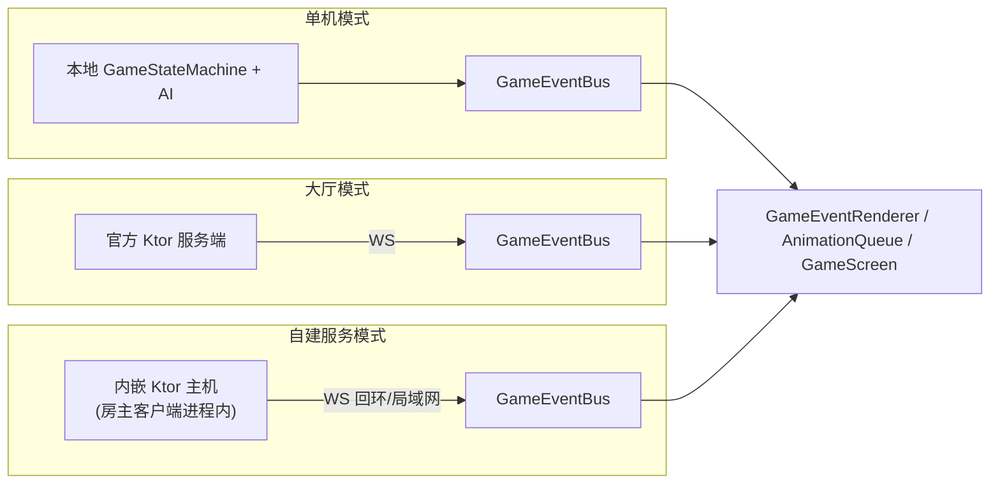

### 1.2 范围（MVP）

| 能力 | 说明 |
|:---|:---|
| 单机模式 | 现有路径原样保留，回归零变化 |
| 游客昵称制 | 无账号系统，连接后取昵称即玩，无数据库 |
| 创建/加入房间 | 4 位房间码，房主管理座位与开局 |
| 快速匹配 | 匹配队列凑 4 人，超时 AI 补位（大厅模式） |
| AI 补位混合局 | 支持 1~4 名真人 + AI 补齐空位 |
| 权威服务端对局 | 规则校验、洗牌、事件分发全部在服务端 |
| 内嵌主机 | 桌面客户端一键「创建主机」，房主即服务器，朋友 IP 直连 |
| 断线重连 | 60 秒宽限期，AI 暂时托管，重连后事件回放恢复 |
| 跨平台客户端 | lwjgl3 桌面版与 Android 共用同一套联机客户端代码（Android 仅作客户端）；iOS 预留纯客户端路线（RoboVM，遵守 7.5 节兼容契约，未排期） |

### 1.3 核心原则

1. **服务端权威 (Server-Authoritative)**：
   - 唯一可信状态存在于服务端的 `GameStateMachine`；客户端只做两件事——**提交意图 (`GameAction`)、消费事件 (`GameEvent`)**。
   - 洗牌、码牌、发牌、摸牌推进等一切 RNG 与系统动作均在服务端执行，客户端无法影响随机序列。
   - 规则校验天然复用 [`RiichiRuleEngine`](file:///d:/majiang/core/src/main/kotlin/com/majiang/rules/RiichiRuleEngine.kt)，**单一规则源**杜绝双端规则漂移。

2. **一套服务端，两种部署形态**：
   - 同一份 `server/` 代码，既可独立进程部署为**官方大厅服**，也可作为库**内嵌进桌面客户端**做自建主机。协议、房间逻辑、过滤规则零分叉。

3. **信息不对称即安全 (Hidden Information Never Leaves the Server)**：
   - 他家暗牌、牌山序列、袖中藏牌、里 Dora 指示牌等隐藏信息，**绝不下发给无权知晓的客户端**。这是本作联网的第一安全底线——外挂即使读遍客户端内存也拿不到牌山。
   - “神仙透视”作为玩法机制，由服务端**定向下发**给出千者本人（见[第六节](#六千术系统的联机语义)）。

4. **表现层零改动 (Presentation Stays Untouched)**：
   - 单机、大厅、自建三模式共用同一条事件驱动渲染管线。联机时本地 `GameEventBus` 的生产者从“本地状态机”换成“网络层”，`GameScreen` / `GameEventRenderer` / `AnimationQueue` **不感知网络存在，更不感知模式差异**。

5. **回合制 ≠ 低要求**：
   - 不需要帧同步/状态插值，但需要：事件序号与补发、超时托管、重连回放、动作幂等。这些是麻将联机体验的下限保障。

---

## 二、总体拓扑与 Gradle 模块改造

### 2.1 总体拓扑

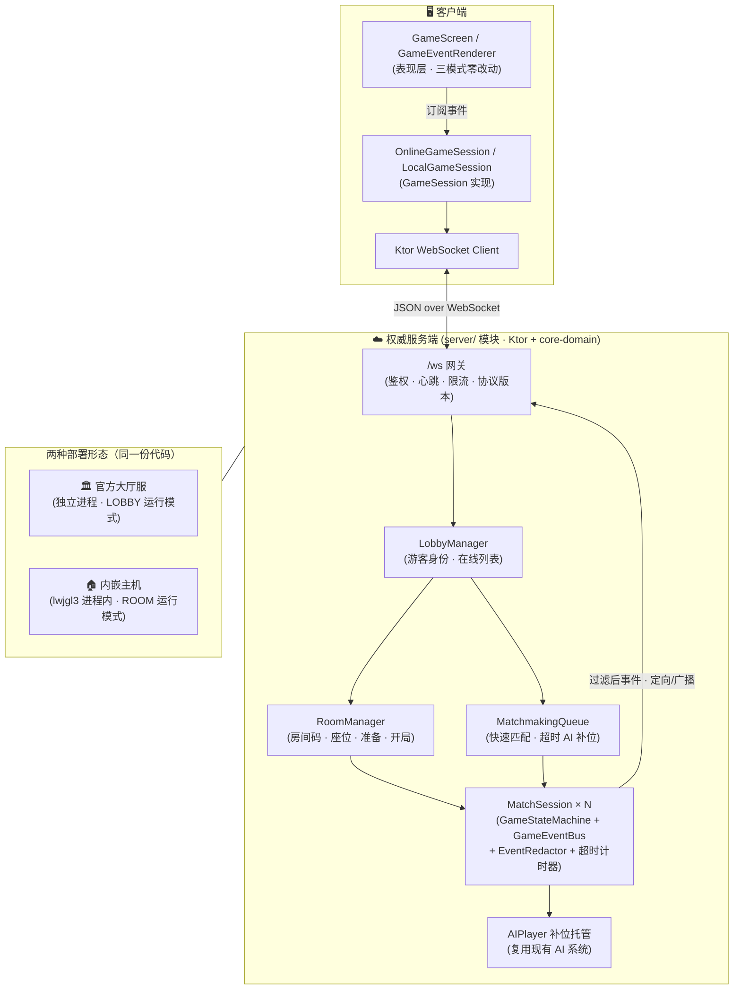

### 2.2 模块拆分：`core` → `core-domain` + `core`

当前 `core` 模块同时容纳**纯 Kotlin 领域层**与 **libGDX 表现层**（`render/`、`screen/`）。服务端要复用领域层，必须先解除这一耦合：

```
majiang/
├── core-domain/          【新增】纯 Kotlin 领域层，零 libGDX 依赖
│   └── src/main/kotlin/com/majiang/
│       ├── model/  state/  rules/  cheat/  ai/  event/
│       └── net/protocol/          【新增】双端共享的协议报文定义
├── core/                 表现层（render/ screen/ net-client/）
│                         → api project(':core-domain') + gdx
├── server/               【新增】Ktor 服务端 → project(':core-domain')
│                         （独立部署为官方服；亦作为库被 lwjgl3 内嵌）
├── lwjgl3/               桌面壳 → 额外依赖 :server（内嵌主机能力）
├── android/              移动壳（仅客户端，不依赖 :server）
├── ios/                  【预留 · 未创建】RoboVM 壳（仅客户端，P7 落地）
└── assets/
```

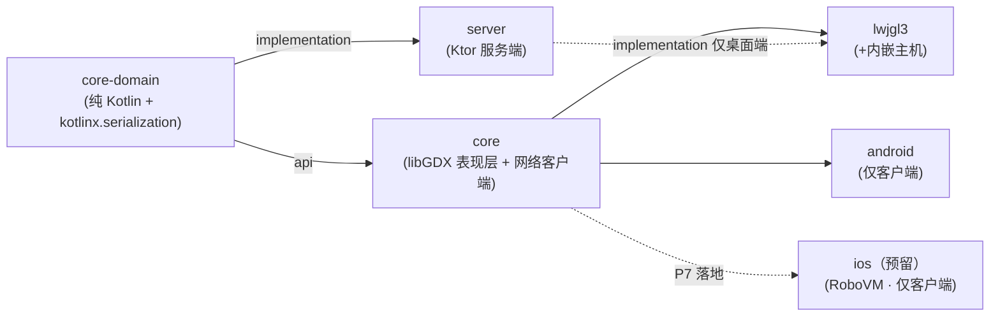

**拆分要点**：

| 事项 | 约定 |
|:---|:---|
| 包名 | 保持 `com.majiang.*` 不变，仅移动文件与模块，import 零修改成本 |
| `core` 对外暴露 | `core` 以 `api` 依赖 `core-domain`，平台模块无需改动依赖声明 |
| 领域层纯净度 | `core-domain` 的依赖白名单只有 `kotlin-stdlib` 与 `kotlinx-serialization-json` |
| 内嵌主机归属 | `server` 模块保持纯 JVM 库形态（无 `main` 强耦合），`lwjgl3` 引入它获得 `HostService`；**Android 明确不引入**，规避方法数与体积膨胀 |
| 单测迁移 | 现有领域层单测随代码迁入 `core-domain/src/test`，`./gradlew test` 行为不变 |
| 序列化 | `GameEvent` / `GameAction` / `Tile` / `Meld` 等加 `@Serializable`，注解是纯 Kotlin 库，不破坏“零 libGDX”约束 |

---

## 三、通信协议设计

> 三种联机形态（官方服 / 内嵌主机 / IP 直连他人主机）**使用完全相同的协议**，差异只在连接的目标地址。

### 3.1 传输与编码

- **传输层**：单条 WebSocket 长连接（`ws://host:port/ws`），生产环境建议前置 TLS（`wss://`）。
- **编码**：JSON（`kotlinx.serialization` 多态密封类），调试直观。预留未来切换 CBOR/二进制的余地（协议层不外泄编码细节）。
- **信封字段**：

```json
{
  "v": 1,          // 协议大版本，不匹配立即断开（自建模式版本校验尤其重要）
  "seq": 1024,     // S→C：本连接内单调递增的事件序号（重连补发依据）
  "ack": 1021,     // C→S：客户端已处理到的序号（可随任意消息捎带）
  "type": "...",   // 多态类名判别器（kotlinx 自动生成）
  "payload": { }   // 具体报文
}
```

### 3.2 客户端 → 服务端（`ClientMessage`）

| 报文 | 载荷要点 | 说明 |
|:---|:---|:---|
| `Hello` | `nickname`, `protocolVersion`, `resumeToken?` | 连接后第一条；带 `resumeToken` 走重连流程 |
| `CreateRoom` | `rules {东风/半庄, AI补位策略}` | 返回房间码，创建者成为房主 |
| `JoinRoom` | `roomCode` | 房间码加入指定座位局 |
| `QuickMatch` / `CancelMatch` | — | 进入/退出匹配队列（仅大厅模式有意义） |
| `SetReady` | `ready: Boolean` | 房间内准备 |
| `LeaveRoom` | — | 返回大厅（对局中= 认输托管） |
| `SubmitAction` | `action: PlayerAction` | 玩家决策动作（见 3.4） |
| `HostCommand` | `kick(seat)` / `closeRoom` / `setRules` | 仅房主（且自建模式下即为服务器管理员）可发 |
| `Chat` | `text` | 房间频道（长度 ≤ 100，限速） |
| `Ping` | `t` | 应用层心跳（穿透代理） |

### 3.3 服务端 → 客户端（`ServerMessage`）

| 报文 | 载荷要点 | 说明 |
|:---|:---|:---|
| `Welcome` | `sessionId`, `seat?`, `resumeToken`, `serverMode` | 身份确认；`serverMode` 告知 LOBBY/ROOM 形态（客户端据此调整 UI） |
| `LobbySnapshot` | 在线数、进行中房间数 | 大厅首页展示 |
| `RoomSnapshot` | 房间码、4 座位（昵称/准备/AI）、房主、规则 | 加入/变更时全量推送（房间状态小，全量最简单可靠） |
| `MatchFound` | `roomCode`, `seat` | 快速匹配成功 |
| `MatchStarted` | `seat`, `rules`, `初始可见快照` | 含自己的 13 张配牌 |
| `GameEventMessage` | `event: GameEvent`（已过滤）, `seq` | 事件流主通道 |
| `PrivatePeek` | `peekType`, `tiles` | 神仙透视结果，**仅出千者本人收到** |
| `ActionRejected` | `clientActionId`, `reason` | 动作非法/超窗（一般静默，调试用） |
| `PlayerConnection` | `seat`, `online: Boolean` | 掉线/重连广播 |
| `MatchEnded` | 终局得分、终局亮牌 | 含全场最终手牌 |
| `ServerError` | `code`, `message` | 可恢复错误（含 `HOST_CLOSING`：主机即将关闭） |
| `Pong` | `t` | 心跳回应 |

### 3.4 动作报文与系统动作的边界

`SubmitAction` 只允许携带**玩家决策类** `GameAction`（白名单注册到多态序列化器）：
`DiscardTile` / `DeclareChi` / `DeclarePon` / `DeclareKan` / `DeclareRiichi` / `DeclareTsumo` / `DeclareRon` / `Pass` / `DeclareAbortiveDraw` / `UseCheatTechnique`。

**系统动作（`StartStacking` / `DealComplete` / `DrawTile`）一律不开放给网络**：摸牌推进、开局码牌由服务端 `MatchSession` 在轮次推进时自动提交。客户端“摸牌”不是请求，而是等待服务端推来的 `TileDrawn` 事件。

```kotlin
// core-domain/src/main/kotlin/com/majiang/net/protocol/ClientMessage.kt
@Serializable
sealed class ClientMessage {
    @Serializable @SerialName("hello")      data class Hello(val nickname: String, val protocolVersion: Int = 1, val resumeToken: String? = null) : ClientMessage()
    @Serializable @SerialName("action")     data class SubmitAction(val clientActionId: Long, val action: PlayerAction) : ClientMessage()
    @Serializable @SerialName("host_cmd")   data class HostCommand(val cmd: HostCmd) : ClientMessage()   // 仅房主可用
    // ... CreateRoom / JoinRoom / QuickMatch / SetReady / LeaveRoom / Chat / Ping
}

/** 玩家决策动作 —— 从 GameAction 中裁剪出的网络白名单子集 */
@Serializable
sealed class PlayerAction {
    @Serializable data class Discard(val tile: Tile) : PlayerAction()
    @Serializable data class DeclareRon(val targetPlayer: Int) : PlayerAction()
    @Serializable data class UseCheat(val technique: CheatTechnique, val params: JsonObject = JsonObject(emptyMap())) : PlayerAction()
    // ...
}
```

> **为何不直接序列化 `GameAction`**：`StartStacking.stackingPlans: List<Any>` 与 `UseCheatTechnique.params: Map<String, Any>` 含无类型多态字段，既是序列化障碍也是攻击面。协议层用 `PlayerAction` 收窄为显式白名单，服务端收到后再补齐 `player` 座位号组装成 `GameAction` —— **座位号永远取自会话，绝不信任客户端报文里的 `player` 字段**。

### 3.5 事件序列化适配点

现有 `GameEvent` 基本可直接 `@Serializable`，仅三处需要注意：

| 字段 | 适配方案 |
|:---|:---|
| `ScoreSettled.newScores: IntArray` | kotlinx 原生支持，无需处理 |
| `Tile` / `Meld` / `CheatTechnique` | 普通 data class / enum，直接注解 |
| 事件中的 `turnNumber` | 照常传输；信封 `seq` 与之独立（`seq` 是连接级传输序号） |

---

## 四、服务端设计（Ktor）

### 4.1 技术选型

| 组件 | 选择 | 版本基线 |
|:---|:---|:---|
| 框架 | Ktor (Netty engine) | 3.x（与 Kotlin 2.x / JVM 17 兼容） |
| 序列化 | kotlinx.serialization | 与 core-domain 共用 |
| 并发模型 | 协程（每连接一个 Session 协程 + 每 MatchSession 一个 Actor 协程） | — |
| 持久化 | 无（内存态），接口预留 | — |

### 4.2 部署形态与运行模式

**同一份 server 代码，两种部署、两种运行模式**：

| | 官方大厅服 | 内嵌主机 |
|:---|:---|:---|
| 进程形态 | 独立 JVM（`java -jar` 或容器） | lwjgl3 客户端进程内（`embeddedServer`） |
| 运行模式 | `LOBBY`：多房间 + 匹配队列 | `ROOM`：启动即自动创建**唯一房间**，规则由房主预设 |
| 生命周期 | 常驻，运维管理 | 随房主客户端启停（见[第八节](#八自建服务模式内嵌主机设计)） |
| 地址 | 域名 + wss | 局域网 IP / 房主公网 IP，ws（或隧道 wss） |

```kotlin
/** 服务端引导配置 —— 两种形态只差一份配置对象 */
data class ServerConfig(
    val port: Int = 8080,
    val runMode: RunMode = RunMode.LOBBY,      // LOBBY(官方) / ROOM(内嵌)
    val autoRoomRules: RoomRules? = null,       // ROOM 模式：开机自动建房规则
    val rateLimitPerSec: Int = 20,
)
```

### 4.3 会话生命周期

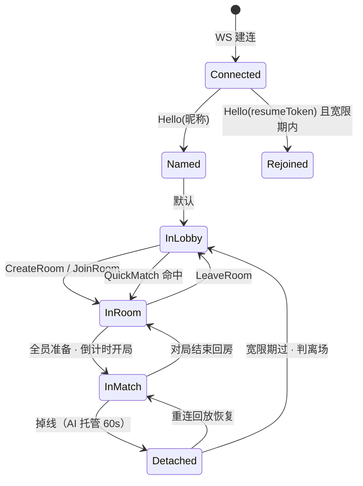

> ROOM 模式（内嵌主机）下，`Named` 之后直接落入唯一房间，跳过大厅页。

### 4.4 房间与匹配

- **房间码**：4 位无易混淆字符集（`23456789ABCDEFGHJKMNPQRSTUVWXYZ`，30^4 ≈ 81 万种），生命周期内存态，房主离开即转移房主或解散。
- **座位**：0~3 固定，加入即占座；房主可给座位设置「AI 补位」标记，开局时空位由 `AIPlayer` 填充。
- **快速匹配**（仅 LOBBY 模式）：队列 FIFO；凑满 4 人立即成局；等待超 30 秒逐个 AI 补位开局（1 真人 + 3 AI 也成局）。
- **开局条件**：所有真人座位 `ready` → 5 秒倒计时 → `MatchSession` 创建。

### 4.5 MatchSession —— 权威对局会话

每个对局一个 `MatchSession`，**单协程 Actor 串行消费**消息（动作提交、计时器到期、玩家上下线），天然免锁：

```kotlin
class MatchSession(
    val roomId: String,
    private val seats: Array<SeatBinding>,      // 座位 ↔ sessionId/AI 绑定
) {
    private val state = GameState()
    private val eventBus = GameEventBus().apply { setRecordHistory(true) }
    private val fsm = GameStateMachine(state, eventBus)
    private val redactor = EventRedactor(seats)
    private val sequencer = EventSequencer(bufferSize = 1024)

    /** Actor 收件箱：动作 / 计时器 / 连接事件 统一入队串行处理 */
    val inbox = Channel<MatchCommand>(Channel.UNLIMITED)

    suspend fun run() {
        fsm.initializeMatch(...)                 // AI 补位注入
        fsm.handleAction(GameAction.StartStacking())
        for (cmd in inbox) when (cmd) {
            is MatchCommand.Submit -> handleSubmit(cmd)
            is MatchCommand.Timeout -> handleTimeout(cmd)
            is MatchCommand.Connection -> handleConnection(cmd)
        }
    }

    private suspend fun publishRedacted(event: GameEvent) {
        val seq = sequencer.next()
        for ((seat, binding) in seats.withIndex()) {
            val view = redactor.redact(event, observerSeat = seat) ?: continue
            binding.send(GameEventMessage(view, seq))   // 私有事件仅达本人，公共事件广播
        }
        sequencer.retain(event, seq)                   // 环形缓冲，供补发与重连
    }
}
```

**职责要点**：

1. **系统动作自动推进**：轮到某座位时服务端自动 `DrawTile`；不等待客户端请求，杜绝“摸牌时序外挂”。
2. **超时计时器**（全部服务端持有时钟，客户端时钟仅作 UI 展示）：

| 窗口 | 时长 | 超时策略 |
|:---|:---|:---|
| `CHEAT_WINDOW`（摸牌后） | 5s | 视为放弃出千，进入打牌 |
| `DISCARD`（打牌决策） | 15s | 自动摸切（tsumogiri） |
| `RESPONSE_WINDOW`（吃/碰/杠） | 8s | 自动 `Pass` |
| `RESPONSE_WINDOW`（荣和机会） | 10s | 自动 `Pass`（客户端红字强提醒） |
| 准备开局倒计时 | 5s | 未准备者踢回大厅 |

3. **AI 补位即现有 `AIPlayer`**：真人掉线期间由 AI 托管；永久 AI 座位由 `SuspicionSystem` 驱动视线与怀疑度，行为与单机完全一致。
4. **对局结束亮牌**：`MatchEnded` 附带全场最终手牌与袖中牌（终局揭示，还原“这把谁在出千”的复盘乐趣）。

### 4.6 大厅管理器

- `LobbyManager`：`sessionId ↔ WebSocket会话` 映射、昵称查重、心跳清理（45s 无 Ping 判死）。
- `RoomManager`：房间 CRUD、房间码索引。
- 全部内存态；进程重启 = 大厅清空（MVP 明确接受；内嵌主机随房主退出即消亡，属预期行为）。

---

## 五、信息可见性与事件过滤 (Redactor)

`EventRedactor` 是联网安全的核心组件：**同一个 `GameEvent`，按观察者座位产出不同视图，或干脆不下发**。该组件位于 `server` 模块，**两种部署形态共用同一套过滤规则**——内嵌主机不提供任何“房主特权视角”。

### 5.1 事件可见性矩阵

| GameEvent | 当事人 | 其他真人 | 说明 |
|:---|:---|:---|:---|
| `TileDealt` / `TileDrawn` / `RinshanDraw` | ✅ 含牌面 | 🔒 `tile` 置空 + `masked=true` | 他家摸牌只知“摸了”，不知“摸了啥” |
| `TileDiscarded` | ✅ | ✅ | 牌河公开 |
| `Chi/Pon/KanDeclared` | ✅ | ✅ | 副露公开 |
| `RiichiDeclared` | ✅ | ✅ | 立直公开 |
| `TsumoWin` / `RonWin` | ✅ | ✅ | 和牌者手牌在结算时随终局快照公开 |
| `DoraRevealed`（表） | ✅ | ✅ | 即时公开 |
| `DoraRevealed`（里） | 🔒 结算前不下发 | 🔒 | 里 Dora 只在和了结算瞬间公开 |
| `CheatAttempted` | ✅ | ❌ **完全不下发** | 出千成功时对手不能收到任何信号 |
| `BustedEvent` | ✅ | ✅ | 抓包是公开事件（全场播放极刑演出） |
| `SuspicionChanged` | ✅（仅“关于我自己”的） | ❌ | 自己的怀疑度是自己的危险仪表盘 |
| `GazeShifted` | ✅ | ✅ | 视线是物理可见行为，全场可见 |
| `ScoreSettled` / `RoundEnded` / `MatchEnded` / `DrawGame` | ✅ | ✅ | 公开 |

### 5.2 私有信息通道

两类信息走**定向下发**，永不进入广播流：

1. **自己的手牌 / 袖中牌**：随 `MatchStarted` 与重连快照下发的**按座位裁剪的状态快照**（`RedactedStateSnapshot`：公开字段 + 自己的 `hand` + 自己的 `sleeveTiles` + 关于自己的怀疑度）。
2. **神仙透视结果**：`PrivatePeek` 报文，仅出千者本人接收（见下节）。

### 5.3 实现形态

```kotlin
class EventRedactor(private val seats: Array<SeatBinding>) {
    /** 返回 null = 对该观察者不下发 */
    fun redact(event: GameEvent, observerSeat: Int): GameEvent? = when (event) {
        is GameEvent.TileDrawn ->
            if (event.player == observerSeat) event
            else event.copy(tile = MASKED_TILE)      // 预定义的 tile=null 哨兵策略
        is GameEvent.CheatAttempted ->
            if (event.player == observerSeat) event else null
        is GameEvent.SuspicionChanged ->
            if (event.target == observerSeat) event else null
        // ...
        else -> event
    }
}
```

> **注**：`TileDrawn.tile` 为非空类型，需将其改为 `Tile?` 并在表现层对 `null` 渲染“牌背摸牌动画”。这是联网改造对领域层的**唯一一处签名级侵入**，单机路径同步适配（自己摸牌永远有值，行为不变）。

---

## 六、千术系统的联机语义

### 6.1 四大绝技 × 联机行为

| 绝技 | 服务端执行 | 信息流向 | 真人对手可感知？ |
|:---|:---|:---|:---|
| **袖里乾坤** | `CheatActionExecutor` 在服务端做手牌↔袖袋置换 | 置换结果仅同步本人 | ❌ 无任何信号 |
| **移花接木** | 服务端执行 `wall[wallPointer]` ↔ 手牌置换 | 摸到什么只告诉本人 | ❌ |
| **神仙透视** | 服务端拷贝隐藏信息 → `PrivatePeek` 定向下发 | **仅出千者** | ❌ |
| **声东击西** | 服务端 `SuspicionSystem` 强制改写 AI 观察者 `gazeTarget` | `GazeShifted` 全场广播（视线可见，动机不可知） | 视线变化本身可见 |

### 6.2 设计决策：真人对战不引入抓包机制

**已拍板（2026-09）**：`BustedEvent`（抓包）**仅由 AI 观察者的视线/怀疑度系统触发**。真人对手没有任何举报、质疑或抓包操作入口。该决策对**大厅模式与自建模式一致生效**（内嵌主机的房主同样无法抓包他人）。

带来的语义与平衡特性，如实记录如下：

1. 千术风险完全由**场上 AI 观察者的数量与性格**决定：AI 越少，出千越安全；4 真人局出千零抓包风险。
2. `声东击西` 在无 AI 观察者的纯真人局中退化为无效技（无 gaze 可操纵）。
3. 平衡阀在**房间规则层**而不在机制层：MVP 后续如需收紧，可在房间配置中加“本局 AI 性偏执化 / 千术禁用”等开关，无需改动协议。

### 6.3 服务端审计

所有 `UseCheatTechnique` 无论成败均写入服务端结构化日志（房间、座位、绝技、时刻、`seq`），用于外挂投诉回查与运营数据。透视内容同样落日志但**永不进入任何广播**。

---

## 七、客户端设计

### 7.1 GameSession 统一抽象（关键解耦点）

单机与两种联机共用同一个面向表现层的会话接口，`GameScreen` 构造时被注入不同实现：

```kotlin
/** 表现层看到的对局会话 —— 单机/联机在此接口后面互换 */
interface GameSession {
    val eventBus: GameEventBus              // 表现层照常 subscribe，不感知事件来源
    fun submit(action: GameAction)          // 单机→本地FSM；联机→转 PlayerAction 上行
    fun update(delta: Float) {}             // 联机实现泵网络消息到主线程
    fun dispose()
}

class LocalGameSession(...) : GameSession   // ① 单机：包装现有 GameStateMachine（原样保留）

class OnlineGameSession(
    private val net: NetworkClient,
    override val seat: Int,
) : GameSession {
    // ② 大厅模式：连官方服    ③ 自建模式：连内嵌主机(回环) 或 朋友的IP
    //    —— 三种连接目标对 OnlineGameSession 完全透明，只是 endpoint 不同
    // 上行：GameAction → PlayerAction（剥离 player 字段，座位由服务端会话决定）
    // 下行：GameEventMessage → eventBus.publish(event)（复用现有渲染管线）
    //       PrivatePeek → 透视UI事件
}
```

**客户端不做状态预测**：提交动作后等待服务端事件回显再驱动动画（回合制下延迟 ≤ 1~2 帧完全可接受）；仅允许本地即时 UI 反馈（按钮高亮、按压音效）。

### 7.2 连接目标与模式选择

```kotlin
/** 三种模式 = 三种 endpoint 来源，客户端逻辑此后完全一致 */
sealed class ServerEndpoint {
    object OfficialLobby : ServerEndpoint()                    // 大厅：官方域名（全局配置）
    data class Direct(val host: String, val port: Int) : ServerEndpoint()  // 自建：加入他人主机
    data class Embedded(val port: Int) : ServerEndpoint()      // 自建：自己创建的主机（127.0.0.1 回环）
}
```

### 7.3 屏幕流扩展

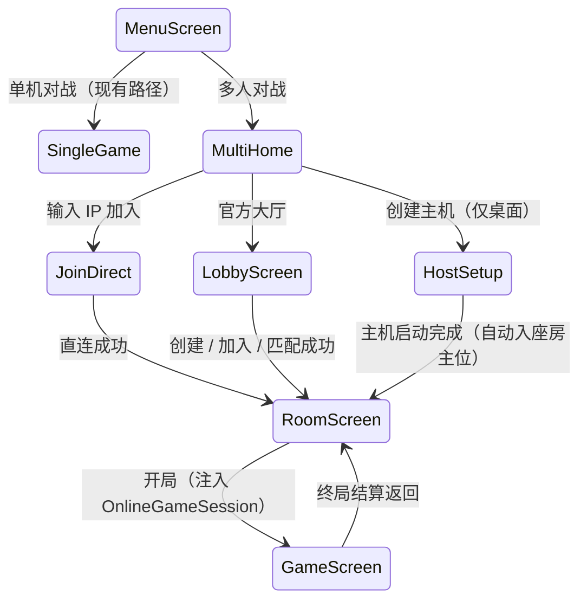

| 新屏幕 | 职责 |
|:---|:---|
| `MultiplayerHomeScreen` | 模式入口三分：官方大厅 / 创建主机 / IP 直连 |
| `HostSetupScreen` | 主机规则预设（东风/半庄、AI 补位策略、千术开关）、端口展示、防火墙提示 |
| `LobbyScreen` | 昵称输入、快速匹配、房间码加入、在线人数 |
| `RoomScreen` | 4 座位视图（昵称/准备/AI 标记）、准备/开局、房主管理（踢人/改规则/关房）、IP:端口 展示（自建）、简易聊天 |
| `GameScreen`（扩展） | 掉线遮罩与重连提示、对手掉线标记、终局亮牌结算页、主机即将关闭警示 |

### 7.4 平台注意事项

| 平台 | 事项 |
|:---|:---|
| lwjgl3（PC） | Ktor 客户端依赖直接可用；**内嵌主机能力仅桌面端具备**；默认官方服地址与最近直连地址可配置 |
| Android | `AndroidManifest.xml` 增加 `INTERNET` 权限；可加入大厅与直连主机，**不可创建主机**；模拟器调试连 `10.0.2.2:8080`；对裸 IP 的 `ws://` 需要 `networkSecurityConfig` 放行局域网明文流量，Release 对公网建议 wss |
| iOS（预留） | RoboVM（MobiVM 2.3.x）路线，**纯客户端**（大厅 + IP 直连，不可创建主机）；网络实现换 `RoboVmWsClient`（见 7.5）；打包需 macOS + Xcode + Apple 开发者账号 |
| 共用 | 网络客户端代码全部写在 `core/net-client/` 的 `NetworkClient` 接口之后，多端零重复（接口与平台实现分离） |

### 7.5 跨平台兼容契约（iOS / PC 预留设计）

为使未来 iOS 客户端（RoboVM 路线）以“只增不改”的方式接入，以下契约**从现在起生效**——它们就是本次“预留设计”的实体，P7 之前开发共享代码时必须遵守：

**① 代码层契约**

| 契约 | 约束 | 原因 |
|:---|:---|:---|
| 依赖白名单 | `core-domain` 只依赖 `kotlin-stdlib` + `kotlinx-serialization-json`；`core` 额外只允许 gdx 核心 API | RoboVM 消费 JVM 字节码 + 受限 JDK 子集，任何仅桌面 JVM 可用的库都会在 iOS 编译期爆掉 |
| JDK API 水位 | 共享代码（`core-domain`、`core` 表现层与 `net-client`）禁止使用 Java 11 之后引入的 JDK API，Kotlin stdlib 优先 | iOS 构建需将 `jvmTarget` 降至 8/11（RoboVM 字节码支持上限），高版本 API 编译能过但运行期缺失 |
| jvmTarget 分平台 | 桌面/Android 保持 17；iOS 变体以 8/11 编译（Gradle 编译参数切换，**不改源码**） | 同上；Kotlin 源码本身对两个目标等价 |
| libGDX API 面 | `core` 只使用跨后端稳定的 gdx 核心 API，严禁 import LWJGL / Android 专属类 | `gdx-backend-robovm` 只实现核心 API 面 |

**② 网络层契约**

- `NetworkClient` 必须是**纯接口**（位于 `core/net-client`），`OnlineGameSession` 只依赖该接口，不得泄漏 Ktor 类型——Ktor 实现只是桌面/Android 的一个 provider；P7 新增 `RoboVmWsClient`（RoboVM 的 CocoaTouch 桥接 `NSURLSession` WebSocket，或经验证的 OkHttp-on-RoboVM）即可，**协议与服务端零改动**；
- 传输保持「文本帧 + JSON」，不引入二进制帧、压缩等 iOS 侧难对齐的特性（协议升级走 `v` 字段）；
- iOS 与 Android 同为**纯客户端**：可上大厅、可 IP 直连，不可内嵌服务端/创建主机。

**③ 表现层契约**

- 虚拟坐标 1280x720 + 等比缩放对 PC / Android / iOS 通用；触控与鼠标走 libGDX 统一输入抽象；
- UI 命中区一律按触控标准设计（可点元素 ≥ 44px 逻辑尺寸），PC 端自然满足；
- 资源全部走 `assets/` 共享目录，不引入平台专属资源管线。

**④ 构建层契约**

- 预留 `ios/` Gradle 模块（RoboVM 插件 + `gdx-backend-robovm` + RoboVM 2.3.x），**不与 AGP 锁定冲突**（互不相干的插件链）；P7 落地时先验证 RoboVM 与当前 Gradle 9.7.1 / Kotlin 版本的兼容性，再定 RoboVM 具体小版本；
- iOS 最低系统版本基线建议 **iOS 14+**（RoboVM 对更老系统有已知兼容问题）；
- 打包链路需 macOS + Xcode + Apple 开发者账号；CI 预留 macOS runner 位。

---

## 八、自建服务模式（内嵌主机）设计

### 8.1 核心思路：房主也是普通客户端

lwjgl3 客户端内嵌 Ktor 服务端（引入 `:server` 模块，`embeddedServer` 启动），**房主的客户端通过 `127.0.0.1` 回环 WebSocket 连入自己进程内的服务器**，与远端客人走完全相同的协议与代码路径：

- 服务端权威、事件过滤、超时托管等逻辑**零特判**；
- 内嵌主机下没有“本地玩家直接改状态”的捷径，单机调试反而更接近真实联机；
- 房主掉线 = 主机进程存活（同进程），无主机迁移问题；房主退出游戏 = 服务器关闭（预期行为）。

```kotlin
/** lwjgl3 内嵌主机服务 —— 生命周期由 HostSetupScreen/RoomScreen 驱动 */
class EmbeddedHostService {
    private var server: ApplicationEngine? = null

    /** 启动 ROOM 模式服务器；端口被占则自动向后扫描 */
    fun start(rules: RoomRules, preferredPort: Int = 8080): HostInfo {
        val port = findFreePort(preferredPort..preferredPort + 20)
        server = startMajiangServer(ServerConfig(
            port = port, runMode = RunMode.ROOM, autoRoomRules = rules))
        return HostInfo(lanAddress = detectLanIp(), port = port)
    }

    fun stop() { server?.stop(1000, 2000); server = null }
}
```

### 8.2 主机生命周期与房主权限

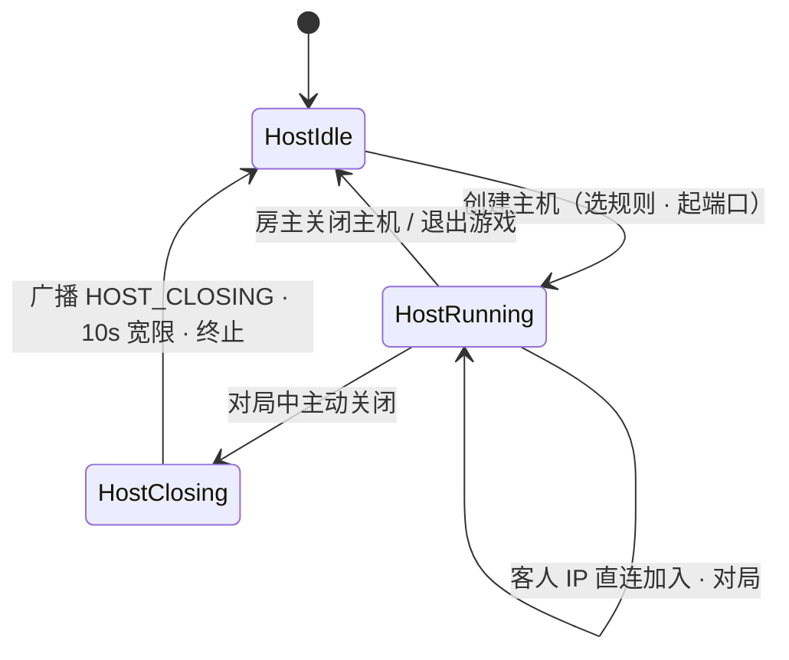

- **房主 = 房间房主 = 服务器管理员**三位一体：通过 `HostCommand`（踢人/改规则/关房）行使权力，服务端校验“该会话是否房主”，无需独立的 admin 通道。
- **对局中关闭主机**：向所有客人广播 `ServerError(HOST_CLOSING)`，给 10 秒宽限展示结算页后断连回菜单（MVP 不做对局存档迁移）。
- **端口与地址展示**：`RoomScreen` 明显位置显示 `IP:端口`（自动探测局域网 IP，探测失败提示用 `ipconfig` 自查）；Windows 首次启动会触发防火墙授权弹窗，`HostSetupScreen` 预先提示。

### 8.3 客人加入（IP 直连）

- 客人在 `JoinDirect` 页输入 `IP:端口`（记忆最近成功地址），`Hello` 之后由 `serverMode=ROOM` 直接落入唯一房间。
- 版本兼容：客人的协议 `v` 必须与主机一致，否则拒连并提示“主机版本不匹配”——自建场景没有统一运维，**版本硬校验是主要防线**。
- 局域网为明文 `ws`（可接受）；房主若想公网联机，可自行配合 frp/隧道转发并套 wss（文档提示即可，不内置 NAT 穿透）。

### 8.4 信任模型

**加入一台自建主机 = 信任房主**：房主进程内就是权威服务器，理论上可读取全部隐藏信息。这与“官方大厅服不可信、必须服务端加固”是两种不同的威胁模型：

- 官方服：客户端是敌手 → 服务端校验 + 信息过滤 + 限流（第十节）。
- 自建主机：房主天然全知（自己的服务器）→ 客人知情同意即可，MVP 在加入页明示“该对局由玩家主机托管”。

### 8.5 局域网自动发现（可选增强，非 MVP）

主机以固定端口周期性 UDP 广播信标 `{name, version, players, port}`，客户端“扫描局域网”页直接列出可加入的主机。实现成本低，排在路线图 P6 之后视情况插入。

---

## 九、断线重连

现有 `GameEventBus` 的**历史记录与回放能力**是为重连预留的现成钩子，服务端侧再补三块。**重连机制对官方服与自建主机一致**（自建场景客人重连 = 再次 IP 直连 + `resumeToken`）：

1. **resumeToken**：`Welcome` 下发一次性令牌并绑定座位；掉线后 60 秒宽限期内携令牌重连即复座。
2. **AI 暂时托管**：掉线瞬间座位切给 `AIPlayer`，对局不中断；重连后收回操作权。
3. **恢复流程（三段式）**：

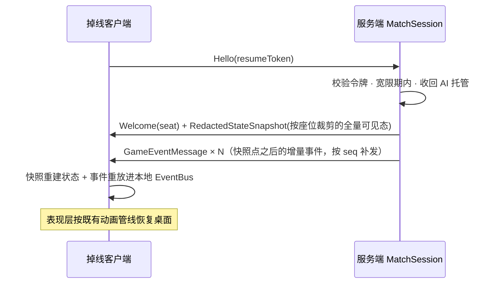

- 客户端长期运行中检测到 `seq` 跳号时，捎带 `ack` 上报，服务端从环形缓冲补发缺口（无需断线重连）。
- 宽限期耗尽：座位判离场、AI 接管至终局，`resumeToken` 作废。
- 特例：**房主（内嵌主机）断的是“回环连接”而服务器仍在其进程内**——直接重连回环即可，宽限期内座位与对局原地保留，是最轻量的重连路径。

---

## 十、安全与防护

| 威胁 | 对策 |
|:---|:---|
| 透视外挂（读客户端内存） | 隐藏信息根本不下发（第 1.3 条原则），客户端内存里不存在牌山与他人手牌 |
| 伪造动作 / 越座行动 | 座位号取自会话不取自报文；一切动作过 `RiichiRuleEngine` 校验 |
| 篡改洗牌 / 预知牌山 | RNG 与系统动作全在服务端，客户端无输入通道 |
| 重放 / 乱序提交 | `clientActionId` 幂等去重 + 窗口期校验（非当前窗口动作直接 `ActionRejected`） |
| 消息洪泛 | 网关限流（动作 ≤ 20 msg/s，单帧 ≤ 64KB），超限断连 |
| 房间码碰撞/枚举 | 30^4 熵 + 房间存在性不泄露（错误码统一“房间不存在或已开始”） |
| 协议不兼容 | `v` 字段大版本硬校验，不匹配即拒连并提示升级（自建模式主防线） |
| 冒充重连 | `resumeToken` 一次性、60 秒时效、绑定原连接指纹 |
| 房主越权（自建） | `HostCommand` 仅影响房间管理（踢人/规则/关房），**不能**查看隐藏牌或改对局结果数据；房主全知属信任模型范畴（见 8.4），非技术问题 |

---

## 十一、关键时序图

### 11.1 快速匹配 → 开局（大厅模式）

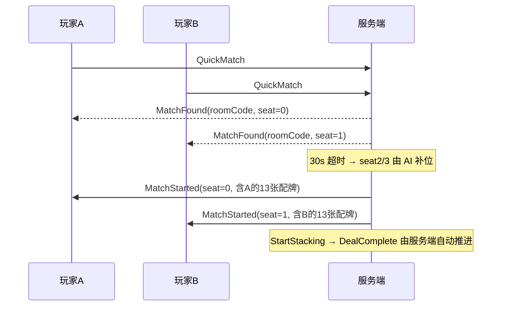

### 11.2 打牌 → 事件过滤分发

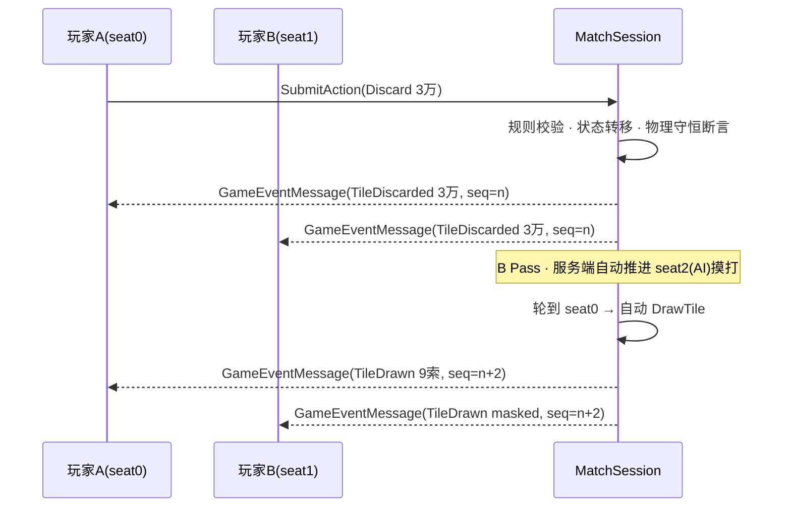

### 11.3 神仙透视（定向信息流）

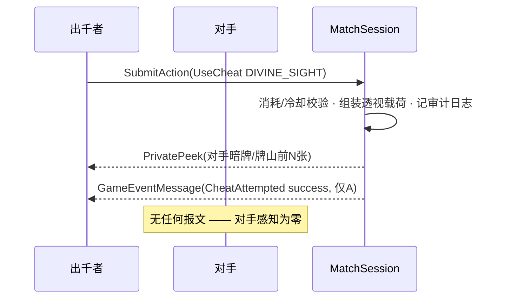

### 11.4 内嵌主机开局（自建模式）

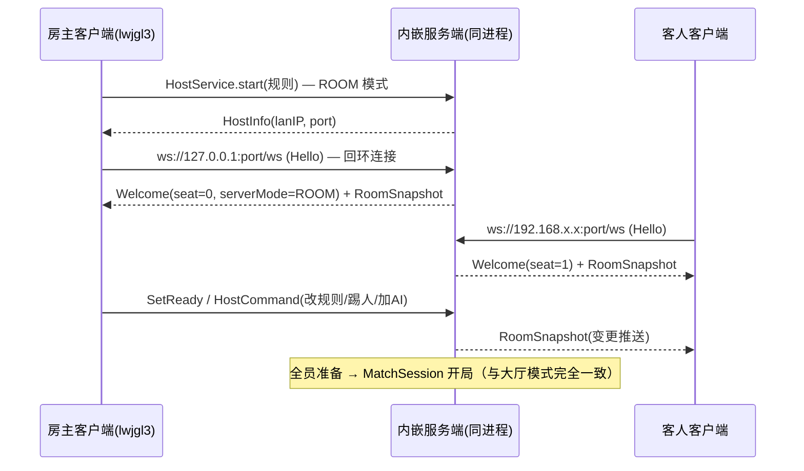

---

## 十二、容量与性能预估

- **流量量级**：一局半庄约 400~600 个事件，单事件 JSON 约 100~200 B → 单局单客户端下行 < 120 KB，微不足道。
- **并发模型**：每 MatchSession 单协程串行、每连接 1~2 个协程；回合制无 CPU 热点。官方服单进程（4C8G 量级）预估承载数百房间无压力。
- **内嵌主机开销**：与客户端同进程，Ktor(Netty) 常驻约 +30~50 MB 内存、空闲 CPU 占用可忽略；4 人麻将负载对房主游戏帧率无可感知影响。
- **延迟预算**：动作 RTT + 服务端处理 < 100ms（同区域/局域网 < 10ms），回合制体验无感；房主回环连接延迟趋近于 0。

---

## 十三、实施路线图

| 阶段 | 内容 | 验收标准 |
|:---|:---|:---|
| **P1 模块拆分** | `core` → `core-domain` + `core`；领域层加 `@Serializable`；单测迁移 | `./gradlew test` 全绿；`core-domain` 依赖白名单只剩 stdlib + serialization |
| **P2 协议与服务端骨架** | `net/protocol` 报文定义；Ktor `/ws`、Hello/Welcome、心跳、限流、`ServerConfig` 双运行模式 | 两个 ws 客户端可握手、互发心跳；ROOM 模式自动建房 |
| **P3 房间/匹配/权威对局** | RoomManager、MatchmakingQueue、MatchSession、EventRedactor、AI 补位、超时计时器 | 4 个 ws 测试客户端跑完一整局；隐藏信息抓包验证为零泄露 |
| **P4 客户端接入（大厅+单机回归）** | `GameSession`/`OnlineGameSession`、`MultiplayerHomeScreen`、`LobbyScreen`、`RoomScreen`、GameScreen 注入改造 | 桌面版双人 + 2AI 完整对战；单机路径回归无变化 |
| **P5 自建服务模式** | `EmbeddedHostService`、`HostSetupScreen`、IP 直连加入、`HostCommand` 房主管理、`HOST_CLOSING` 关闭流程 | 一台桌面机做主机、另一台桌面机 + 一台 Android IP 直连完成对局 |
| **P6 重连与打磨** | resumeToken、快照恢复、seq 补发、掉线托管、Android 真机验证 | 断网 30s 重连恢复对局（官方服与自建主机各验一遍）；Android 真机完成一局 |
| **P7（预留 · 未排期）iOS 客户端** | 新增 `ios/` 模块（RoboVM + `gdx-backend-robovm`）；`RoboVmWsClient` 网络实现；共享代码 `jvmTarget` 变体编译；真机联调 | iPhone/iPad 通过 IP 直连与官方大厅各完成一局；三平台协议行为一致，共享代码零返工 |

每阶段独立可合入、可回归（单机玩法始终是联机的子集路径，回归面小）。P1~P6 期间持续受 7.5 节兼容契约约束，保证 P7 启动时只有新增工作。

---

## 十四、未来扩展方向

- **iOS 客户端（P7）**：按 7.5 节兼容契约以 RoboVM 路线接入，仅作客户端（大厅 + IP 直连）。
- **局域网自动发现**：UDP 广播信标 + 客户端“扫描局域网”列表（见 8.5）。
- **账号与战绩**：`LobbyManager` 后面加一层 `IdentityProvider` 接口即可换装持久化实现（H2/SQLite 起步），自建主机仍保持免账号。
- **观战模式**：复用 Redactor，观察者座位 = `-1`（仅公开信息，防“幽灵指挥”）。
- **真人质疑制抓包**：若纯真人局出千零风险被验证为平衡问题，可按 [6.2](#62-设计决策真人对战不引入抓包机制) 预留的房间规则开关引入“质疑按钮”机制，协议只需新增一个 `Accuse` 报文。
- **录像回放**：服务端事件历史 + 终局亮牌已具备全部素材。
- **多实例部署**：匹配队列与房间表外置 Redis，网关无状态化。
- **主机迁移 / 断线续传存档**：房主退出将对局快照交由客人接管，提升自建模式健壮性。

---

## 相关文档
- 整体架构与三层分离：[`doc/FRAMEWORK_ARCHITECTURE.md`](file:///d:/majiang/doc/FRAMEWORK_ARCHITECTURE.md)
- 雀魂规则与计分设计：[`doc/RIICHI_RULES_DESIGN.md`](file:///d:/majiang/doc/RIICHI_RULES_DESIGN.md)
- 开局码牌算法：[`STACKING_ALGORITHM.md`](file:///d:/majiang/STACKING_ALGORITHM.md)
