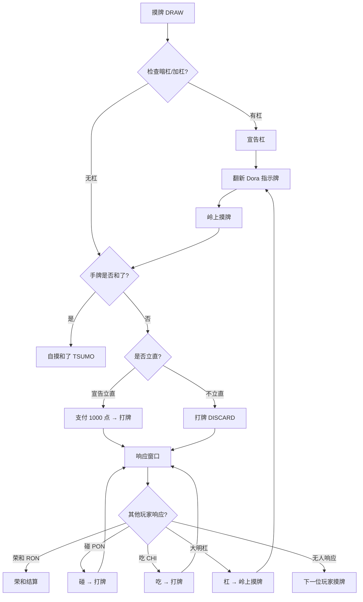

# 🀄 日本立直麻将规则详细设计文档

> 参照雀魂（Mahjong Soul）四人南规则，为千术麻将项目提供完整的规则实现参考。

---

## 目录

1. [牌张构成](#一牌张构成)
2. [对局结构与发牌流程](#二对局结构与发牌流程)
3. [回合流程](#三回合流程)
4. [和牌条件](#四和牌条件)
5. [副露规则（吃/碰/杠）](#五副露规则)
6. [立直规则](#六立直规则)
7. [振听规则](#七振听规则)
8. [役种一览](#八役种一览)
9. [符数计算](#九符数计算)
10. [得点计算](#十得点计算)
11. [Dora 系统](#十一dora-系统)
12. [流局条件](#十二流局条件)
13. [对局胜负判定](#十三对局胜负判定)
14. [代码对应关系](#十四代码对应关系)

---

## 一、牌张构成

### 1.1 全部 136 张牌

| 类别 | 花色 | 构成 | 张数 |
|:---:|:---:|:---|:---:|
| 数牌 | 万子 (MAN) | 一万~九万，各 4 张 | 36 |
| 数牌 | 筒子 (PIN) | 一筒~九筒，各 4 张 | 36 |
| 数牌 | 索子 (SOU) | 一索~九索，各 4 张 | 36 |
| 字牌 | 风牌 (WIND) | 東·南·西·北，各 4 张 | 16 |
| 字牌 | 三元牌 (DRAGON) | 白·發·中，各 4 张 | 12 |
| | | **合计** | **136** |

### 1.2 牌的分类

| 术语 | 含义 | 包含的牌 |
|:---|:---|:---|
| **数牌** | 万/筒/索 1~9 | 108 张 |
| **字牌** | 风牌 + 三元牌 | 28 张 |
| **幺九牌** | 数牌的 1 和 9 + 全部字牌 | 各种 1、9 + 东南西北白发中 |
| **老头牌（端牌）** | 仅数牌的 1 和 9 | 一万、九万、一筒、九筒、一索、九索 |
| **中张牌** | 数牌的 2~8 | 不含 1、9 的数牌 |
| **绿牌** | 绿一色构成牌 | 二索、三索、四索、六索、八索 + 發 |

### 1.3 代码中的 34 维索引

```
  万子: typeIndex 0~8   (一万=0, 二万=1, ..., 九万=8)
  索子: typeIndex 9~17  (一索=9, ..., 九索=17)
  筒子: typeIndex 18~26 (一筒=18, ..., 九筒=26)
  风牌: typeIndex 27~30 (東=27, 南=28, 西=29, 北=30)
  三元: typeIndex 31~33 (白=31, 發=32, 中=33)
```

每种牌有 `copyIndex` 0~3 共 4 张物理副本，`34 × 4 = 136`。

---

## 二、对局结构与发牌流程

### 2.1 对局模式

| 模式 | 局数 | 场风变化 | 说明 |
|:---|:---:|:---|:---|
| **东风战（東風戦）** | 4 局 | 東一局→東二局→東三局→東四局 | 快速模式 |
| **半庄战（半莊戦）** | 8 局 | 東一~四局→南一~四局 | 雀魂默认模式 |

- 每局的**庄家（親）**按东→南→西→北顺序轮换
- 庄家和了或听牌流局时**连庄**，庄家不换，局数不推进，**本场数+1**
- 闲家和了时，庄家轮换，局数推进，**本场数归零**
- 荒牌流局时，不论庄家是否听牌，**本场数+1**；庄家听牌则连庄，未听则换庄并推进局数
- 途中流局时连庄且**本场数+1**，立直供托保留。具体终局配置与可选庄家终了见 [架构 V2 场次契约](architecture-v2/DESIGN.md#52-场次推进)

### 2.2 发牌流程（配牌）

```
步骤 1: 掷骰子
  庄家掷两颗骰子，点数之和决定从哪面牌山开始取牌

步骤 2: 分离王牌区
  从指定位置起，保留最后 14 张牌为王牌区（Dead Wall）
  王牌区包含：
    - 4 张岭上牌（补杠用）
    - 5 组 Dora 指示牌（表/里各 5 张，共 10 张）

步骤 3: 配牌发牌
  从牌山起始位置开始，按以下顺序发牌：
  
  第 1~3 轮（每轮每人取 4 张）：
    庄家(東) → 南家 → 西家 → 北家  ×3 轮 = 每人 12 张
  
  第 4 轮（每人取 1 张）：
    庄家 → 南 → 西 → 北  = 每人 13 张
  
  第 5 步（庄家多取 1 张）：
    庄家再取 1 张 → 庄家 14 张，闲家各 13 张

步骤 4: 翻 Dora 指示牌
  翻开王牌区的第 3 张牌（位置 5，从左数）作为表 Dora 指示牌
```

> [!IMPORTANT]
> **牌山结构**：发牌后，牌山剩余约 `136 - 14(王牌) - 52(配牌) - 1(庄家多取) = 69 张`可摸牌。

### 2.3 座位与风

```
         北家 (P3)
          ┌───┐
西家 (P2) │牌桌│ 東家 (P0) ← 庄家
          └───┘
         南家 (P1)
```

- **场风（圈风）**：东风场/南风场，影响役牌判定
- **自风（门风）**：每位玩家的座位风，庄家=東，下家=南...
- 风牌的 `rank`：1=東, 2=南, 3=西, 4=北

---

## 三、回合流程

### 3.1 一回合的完整流程



### 3.2 响应优先级

当一张牌被打出后，多位玩家可能同时有权操作，优先级如下：

| 优先级 | 操作 | 条件 |
|:---:|:---|:---|
| **最高** | 荣和（ロン） | 任何玩家（非打牌者）手牌+此牌可和了，且有役，且不振听 |
| 高 | 碰（ポン） | 任何玩家（非打牌者）手中有 2 张相同牌 |
| 高 | 大明杠 | 任何玩家手中有 3 张相同牌 |
| **最低** | 吃（チー） | **仅下家**可吃，且该牌是数牌 |

> [!NOTE]
> 本项目默认采用**头跳**：多家合法荣和响应中，按从放铳者出发的行动顺序选最近一家，而不是按绝对座位编号或人类玩家身份优先。荣和优先于碰/大明杠，碰与大明杠同级，吃优先级最低。

### 3.3 摸牌规则

- 从牌山**左端**（wallPointer 位置）依次摸取
- 每次摸 1 张，wallPointer++
- 牌山剩余 0 张时触发**荒牌流局**
- 杠后从**王牌区**岭上位置摸牌（rinshanPointer）

---

## 四、和牌条件

### 4.1 基本和牌形

和牌时手牌必须满足以下三种形之一：

#### 标准形（4 面子 + 1 雀头）

```
面子 = 顺子（数牌的 3 张连续，如 234万）
     或 刻子（3 张相同牌，如 白白白）
     或 杠子（4 张相同牌，视作 1 面子）

雀头 = 2 张相同牌（对子）

示例：🀇🀈🀉 🀙🀚🀛 🀀🀀🀀 🀄🀄🀄 🀅🀅
      ──顺子── ──顺子── ──刻子── ──刻子── 雀头
```

#### 七对子（七組）

```
7 组不同的对子（每组 2 张相同牌）

示例：🀇🀇 🀉🀉 🀛🀛 🀝🀝 🀀🀀 🀂🀂 🀅🀅
```

> [!NOTE]
> 七对子固定 **25 符 2 翻**（门前限定）。四张相同牌算作两组对子。

#### 国士无双（国士無双）

```
13 种幺九牌各 1 张 + 其中任意 1 种成对

13 种幺九牌：一万、九万、一索、九索、一筒、九筒、東、南、西、北、白、發、中

示例：🀇🀏🀙🀡🀐🀘🀀🀁🀂🀃🀄🀅🀆 + 🀇（一万成对）
```

### 4.2 和牌必须有役

> [!CAUTION]
> **日麻最重要的规则**：和牌时必须至少拥有 1 个**役（Yaku）**。无役的手牌即使满足基本和牌形也不能和。

### 4.3 和牌方式

| 方式 | 日语 | 说明 |
|:---|:---|:---|
| **自摸（ツモ）** | 自摸和了 | 自己从牌山摸到的牌使手牌完成 |
| **荣和（ロン）** | 栄和 | 别人打出的牌使手牌完成（需非振听状态） |

---

## 五、副露规则

### 5.1 吃（チー）

| 条件 | 说明 |
|:---|:---|
| 来源 | **仅上家**打出的牌 |
| 牌种 | **仅数牌**（字牌不可吃） |
| 要求 | 手中有能与该牌组成顺子的 2 张牌 |
| 影响 | 破坏门前清状态 |

示例：上家打出 5 万，你手中有 4 万和 6 万 → 吃成 456 万的顺子

### 5.2 碰（ポン）

| 条件 | 说明 |
|:---|:---|
| 来源 | **任意玩家**打出的牌 |
| 要求 | 手中有 **2 张相同**的牌 |
| 影响 | 破坏门前清状态，形成明刻 |
| 优先级 | 碰 > 吃 |

### 5.3 杠（カン）

四种杠的类型：

| 类型 | 触发时机 | 条件 | 门前清 |
|:---|:---|:---|:---:|
| **大明杠** | 别人打出的牌 | 手中有 3 张相同 | ❌ 破坏 |
| **暗杠** | 自己摸牌后 | 手中有 4 张相同 | ✅ 保持 |
| **加杠（小明杠）** | 自己摸牌后 | 已碰的面子 + 手中第 4 张 | ❌ 已破坏 |

杠后流程：
1. 翻开新的 Dora 指示牌（杠 Dora）
2. 从王牌区摸 1 张岭上牌
3. 继续正常打牌流程

> [!WARNING]
> **抢杠**：当某玩家宣告**加杠**时，其他玩家可以用那张牌**荣和**（此为「抢杠」役）。暗杠不可被抢杠（国士无双例外，部分规则允许）。

### 5.4 副露后的限制

- 破坏门前清 → 无法宣告立直
- 以下役种**仅门前清可用**：立直、一发、门前清自摸、平和、一杯口、两杯口、九莲宝灯、四暗刻
- 部分役种副露后**翻数下降**：混一色(3→2)、清一色(6→5)等

---

## 六、立直规则

### 6.1 宣告条件

必须**同时满足**以下全部条件：

| 条件 | 说明 |
|:---|:---|
| 门前清 | 没有吃、碰、大明杠（暗杠不影响） |
| 听牌 | 打出某张牌后手牌处于听牌状态 |
| 点数 ≥ 1000 | 需支付 1000 点立直棒 |
| 牌山 ≥ 4 张 | 必须还有足够的牌供其他玩家摸 |
| 未立直 | 不能重复宣告 |

### 6.2 立直效果

立直宣言交互采用“选牌 → 预览待牌 → 确认”：点击立直先高亮合法弃牌，点击某张牌后在手牌上方列出该方案的待牌牌面；可改选或取消，只有确认才出牌并支付立直棒。桌面悬停仅临时预览，不改变已选项；触摸端点击完成同样流程。详见[立直选牌设计](riichi-choice/DESIGN.md)与[验收记录](riichi-choice/REVIEW.md)。

1. **支付 1000 点**立直棒放于场上（和了者回收）
2. 获得**立直**役（1 翻）
3. 立直后手牌**锁定**：不能自摸、也没有合法暗杠时自动摸切；能自摸或合法暗杠时暂停供玩家选择，也可点击摸牌主动摸切。
4. 立直后的**第一巡**内和了可获得**一发**（1 翻）
5. 和了后翻开王牌区**里 Dora 指示牌**，增加额外 Dora
6. 立直后若对手打出和了牌但放弃 → **立直振听**（永久只能自摸）

立直后只允许以本巡摸入的第四张组成暗杠，且杠前后待牌集合及所有和牌拆法均不得改变。已有三张必须在所有拆法中独立作为刻子；只满足“杠后仍能和牌”不足以开杠。立直后禁止明杠和加杠，王牌补牌用完或活牌山为空时也不能杠。岭上补牌后重新检查自摸、暗杠或自动摸切。详细设计和验收见 [立直流程设计](riichi-flow/DESIGN.md) 与 [验收记录](riichi-flow/REVIEW.md)。

### 6.3 两立直（ダブル立直）

条件：**第一巡**（自己第一次摸牌时）即宣告立直，且此前没有任何人副露。  
效果：2 翻（代替普通立直的 1 翻）。

---

## 七、振听规则

> [!CAUTION]
> 振听状态下**只能自摸和了，不能荣和**。

### 7.1 三种振听

| 类型 | 触发条件 | 持续时间 |
|:---|:---|:---|
| **舍牌振听** | 本人完整舍牌历史中有任何一张当前待牌，包含已被他家鸣走的牌 | 改听后全部待牌均不与历史相交时解除 |
| **同巡振听** | 放过他人打出的完成形，包括无役完成形、抢杠机会 | 本人下次实际摸牌（含岭上）解除；吃碰不直接解除 |
| **立直振听** | 立直后放过和牌机会 | 持续到本局结束；下次摸牌不解除，新局重置 |

### 7.2 舍牌振听详解

```
你的手牌听 3万 和 6万
你的牌河中有一张 3万（之前打出的）
→ 无论谁打出 3万 或 6万，你都不能荣和
→ 只能自摸 3万 或 6万

原理：所有待牌中只要有一张出现在本人舍牌历史中，全部待牌均禁止荣和（含抢杠）
```

### 7.3 代码实现要点

```kotlin
val status = FuritenRules.status(hand, closedTiles, temporary, riichi)
val blocksRon = status.isFuriten
// 自摸合法性仍单独按完成形、役、回合等条件判定，不使用 blocksRon 拦截。
```

创建响应窗口时，对有数学完成形但没有合法荣和动作的旁家自动记录振听，不额外制造只有 Pass 的无意义窗口；有合法荣和机会者在实际选择非荣和响应后才记录。人类与 AI 使用同一判定。

HUD 通过只读 PlayerView 显示本人振听原因；立直预览以“弃牌后的手牌 + 完整舍牌历史 + 拟弃牌”独立判断该方案是否振听，仍允许确认振听立直。自摸机会保留手动确认，立直自动摸切不会吞掉可自摸机会。

设计和规则变体说明见 [振听设计](furiten/DESIGN.md)，验收记录见 [振听检视](furiten/REVIEW.md)。

---

## 八、役种一览

### 8.1 一翻役

| 役名 | 日语 | 门前 | 副露 | 条件说明 |
|:---|:---|:---:|:---:|:---|
| 立直 | リーチ | 1 | — | 门前清听牌后宣告 |
| 一发 | 一発 | 1 | — | 立直后一巡内和了（未被副露打断） |
| 门前清自摸 | 門前清自摸和 | 1 | — | 门前清状态下自摸和了 |
| 断幺九 | 断么九 | 1 | 1 | 手牌全部为中张牌（2~8），无幺九牌 |
| 平和 | 平和 | 1 | — | 门前清 + 4 顺子 + 非役牌雀头 + 两面听 |
| 一杯口 | 一盃口 | 1 | — | 门前清 + 有 2 组完全相同的顺子 |
| 役牌·白 | 役牌·白 | 1 | 1 | 白的刻子（或杠子） |
| 役牌·發 | 役牌·發 | 1 | 1 | 發的刻子 |
| 役牌·中 | 役牌·中 | 1 | 1 | 中的刻子 |
| 场风牌 | 場風牌 | 1 | 1 | 场风（圈风）的刻子 |
| 自风牌 | 自風牌 | 1 | 1 | 自风（门风）的刻子 |
| 海底摸月 | 海底摸月 | 1 | 1 | 摸到牌山最后一张牌并自摸和了 |
| 河底捞鱼 | 河底撈魚 | 1 | 1 | 荣和最后一张打出的牌 |
| 岭上开花 | 嶺上開花 | 1 | 1 | 杠后从王牌区摸到的岭上牌自摸和了 |
| 抢杠 | 槍槓 | 1 | 1 | 别人宣告加杠时，用该牌荣和 |

### 8.2 二翻役

| 役名 | 日语 | 门前 | 副露 | 条件说明 |
|:---|:---|:---:|:---:|:---|
| 两立直 | ダブル立直 | 2 | — | 第一巡即宣告立直（无人副露） |
| 七对子 | 七対子 | 2 | — | 7 组不同的对子（固定 25 符） |
| 混全带幺九 | 混全帯么九 | 2 | 1 | 每组面子和雀头都包含幺九牌 |
| 一气通贯 | 一気通貫 | 2 | 1 | 同一花色的 123 + 456 + 789 |
| 三色同顺 | 三色同順 | 2 | 1 | 三种花色中有相同数字的顺子 |
| 三色同刻 | 三色同刻 | 2 | 2 | 三种花色中有相同数字的刻子 |
| 对对和 | 対々和 | 2 | 2 | 全部面子都是刻子（含杠子） |
| 三暗刻 | 三暗刻 | 2 | 2 | 有 3 组暗刻（自摸完成的刻子） |
| 三杠子 | 三槓子 | 2 | 2 | 有 3 组杠子 |
| 小三元 | 小三元 | 2 | 2 | 白發中其中 2 种刻子 + 1 种雀头 |
| 混老头 | 混老頭 | 2 | 2 | 手牌全部为幺九牌（老头牌+字牌） |

### 8.3 三翻役

| 役名 | 日语 | 门前 | 副露 | 条件说明 |
|:---|:---|:---:|:---:|:---|
| 混一色 | 混一色 | 3 | 2 | 仅一种数牌花色 + 字牌 |
| 纯全带幺九 | 純全帯么九 | 3 | 2 | 每组面子和雀头都包含老头牌（无字牌） |
| 两杯口 | 二盃口 | 3 | — | 门前清 + 2 组不同的一杯口 |

### 8.4 六翻役

| 役名 | 日语 | 门前 | 副露 | 条件说明 |
|:---|:---|:---:|:---:|:---|
| 清一色 | 清一色 | 6 | 5 | 仅一种数牌花色，无字牌 |

### 8.5 役满（单倍）

| 役名 | 日语 | 条件说明 |
|:---|:---|:---|
| 国士无双 | 国士無双 | 13 种幺九牌各 1 张 + 其中 1 种成对 |
| 四暗刻 | 四暗刻 | 4 组暗刻 + 1 雀头（自摸限定） |
| 大三元 | 大三元 | 白發中各 1 组刻子 |
| 小四喜 | 小四喜 | 东南西北中 3 种刻子 + 1 种雀头 |
| 大四喜 | 大四喜 | 东南西北各 1 组刻子 |
| 字一色 | 字一色 | 手牌全部为字牌 |
| 绿一色 | 緑一色 | 手牌仅含二索三索四索六索八索+發 |
| 清老头 | 清老頭 | 手牌全部为老头牌（1 和 9，无字牌） |
| 九莲宝灯 | 九蓮宝燈 | 门前清，单一数牌花色，1112345678999 + 任意 1 张同花色 |
| 四杠子 | 四槓子 | 4 组杠子 |
| 天和 | 天和 | 庄家配牌即和了（14 张直接形成和牌形） |
| 地和 | 地和 | 闲家第一次摸牌即自摸和了（此前无人副露） |

### 8.6 特殊判定规则

- **役满优先**：当手牌同时有役满和非役满役时，只计算役满
- **复合役满**：多个役满条件同时成立时，可累计（如大四喜+字一色=双倍役满）
- **累计役满**：13 翻以上视为**数え役満**（累计役满，按单倍役满计分）

---

## 九、符数计算

### 9.1 计算公式

```
总符数 = 副底 + 面子符 + 雀头符 + 听牌符 + 和了方式加符
→ 向上取整到 10 的倍数
```

### 9.2 副底（基础符数）

| 情况 | 副底 |
|:---|:---:|
| 所有和了的基础 | **20 符** |
| 门前清荣和额外加符 | **+10 符**（共 30 符底） |

> [!NOTE]
> 副露状态下荣和 = 20 符底（不加 10 符）

### 9.3 面子符

| 面子类型 | 中张牌 (2~8) | 幺九牌 (1,9,字) |
|:---|:---:|:---:|
| 顺子 | 0 | 0 |
| 明刻（碰） | **2** | **4** |
| 暗刻（自摸/手内） | **4** | **8** |
| 明杠（大明杠/加杠） | **8** | **16** |
| 暗杠 | **16** | **32** |

### 9.4 雀头符

| 雀头牌种 | 符数 |
|:---|:---:|
| 数牌 / 非役字牌 | **0** |
| 三元牌（白·發·中） | **2** |
| 场风牌 | **2** |
| 自风牌 | **2** |
| 连风牌（同时是场风和自风） | **4**（雀魂规则） |

### 9.5 听牌符（待ち符）

| 听牌形 | 符数 | 说明 |
|:---|:---:|:---|
| 两面听 | **0** | 如 23 听 1 或 4 |
| 双碰听 | **0** | 如 AA BB 听 A 或 B |
| 嵌张听 | **2** | 如 24 听 3 |
| 边张听 | **2** | 如 12 听 3，或 89 听 7 |
| 单骑听 | **2** | 雀头只差 1 张 |

### 9.6 和了方式加符

| 方式 | 符数 | 说明 |
|:---|:---:|:---|
| 自摸 | **+2** | ※平和自摸时不加此 2 符 |
| 门前清荣和 | 已含在副底 30 中 | — |

### 9.7 特殊固定符数

| 情况 | 固定符数 |
|:---|:---:|
| **平和自摸** | 固定 **20 符** |
| **七对子** | 固定 **25 符** |
| **副露平和形（喰い平和）荣和** | 最低 **30 符** |

### 9.8 完整计算示例

```
手牌：🀇🀈🀉 🀊🀋🀌 🀖🀗🀘 🀙🀙🀙 🀅🀅
      ──123万─ ──456万─ ──789索─ 四筒暗刻  雀头發

和了方式：自摸 四筒（刻子是暗刻）
门前清状态

计算：
  副底                     = 20
  顺子 123万               = 0
  顺子 456万               = 0
  顺子 789索               = 0
  暗刻 四筒(中张牌)         = 4
  雀头 發(三元牌)           = 2
  听牌 两面听               = 0
  自摸加符                  = 2
  ──────────────────────────
  合计 = 28 → 取整 = 30 符
```

---

## 十、得点计算

### 10.1 基本点公式

```
基本点 = 符 × 2^(2 + 翻数)

如果基本点 > 2000，则按满贯处理（基本点 = 2000）
```

### 10.2 支付规则

| 和了者 | 和了方式 | 支付方式 |
|:---|:---|:---|
| **庄家** | 荣和 | 放铳者支付 `基本点 × 6` |
| **庄家** | 自摸 | 每位闲家支付 `基本点 × 2` |
| **闲家** | 荣和 | 放铳者支付 `基本点 × 4` |
| **闲家** | 自摸 | 庄家支付 `基本点 × 2`，另两位闲家各支付 `基本点 × 1` |

> [!IMPORTANT]
> 所有支付金额**向上取整到 100 的倍数**。

### 10.3 完整得点对照表（闲家荣和）

| 符＼翻 | 1 翻 | 2 翻 | 3 翻 | 4 翻 |
|:---:|---:|---:|---:|---:|
| **25** | — | 1600 | 3200 | 6400 |
| **30** | 1000 | 2000 | 3900 | 7700 |
| **40** | 1300 | 2600 | 5200 | **满贯 8000** |
| **50** | 1600 | 3200 | 6400 | **满贯 8000** |
| **60** | 2000 | 3900 | 7700 | **满贯 8000** |
| **70** | 2300 | 4500 | **满贯 8000** | **满贯 8000** |
| **80** | 2600 | 5200 | **满贯 8000** | **满贯 8000** |
| **90** | 2900 | 5800 | **满贯 8000** | **满贯 8000** |
| **100** | 3200 | 6400 | **满贯 8000** | **满贯 8000** |
| **110** | 3600 | 7100 | **满贯 8000** | **满贯 8000** |

### 10.4 完整得点对照表（庄家荣和）

| 符＼翻 | 1 翻 | 2 翻 | 3 翻 | 4 翻 |
|:---:|---:|---:|---:|---:|
| **25** | — | 2400 | 4800 | 9600 |
| **30** | 1500 | 2900 | 5800 | 11600 |
| **40** | 2000 | 3900 | 7700 | **满贯 12000** |
| **50** | 2400 | 4800 | 9600 | **满贯 12000** |
| **60** | 2900 | 5800 | 11600 | **满贯 12000** |
| **70** | 3400 | 6800 | **满贯 12000** | **满贯 12000** |
| **80** | 3900 | 7700 | **满贯 12000** | **满贯 12000** |
| **90** | 4400 | 8700 | **满贯 12000** | **满贯 12000** |
| **100** | 4800 | 9600 | **满贯 12000** | **满贯 12000** |
| **110** | 5300 | 10600 | **满贯 12000** | **满贯 12000** |

### 10.5 闲家自摸得点表

格式：庄家支付 / 闲家各支付

| 符＼翻 | 1 翻 | 2 翻 | 3 翻 | 4 翻 |
|:---:|:---:|:---:|:---:|:---:|
| **25** | — | 800/400 | 1600/800 | 3200/1600 |
| **30** | 500/300 | 1000/500 | 2000/1000 | 3900/2000 |
| **40** | 700/400 | 1300/700 | 2600/1300 | **满贯** |
| **50** | 800/400 | 1600/800 | 3200/1600 | **满贯** |
| **60** | 1000/500 | 2000/1000 | 3900/2000 | **满贯** |
| **70** | 1200/600 | 2300/1200 | **满贯** | **满贯** |

### 10.6 庄家自摸得点表

格式：闲家各支付

| 符＼翻 | 1 翻 | 2 翻 | 3 翻 | 4 翻 |
|:---:|:---:|:---:|:---:|:---:|
| **25** | — | 800 all | 1600 all | 3200 all |
| **30** | 500 all | 1000 all | 2000 all | 3900 all |
| **40** | 700 all | 1300 all | 2600 all | **满贯** |
| **50** | 800 all | 1600 all | 3200 all | **满贯** |
| **60** | 1000 all | 2000 all | 3900 all | **满贯** |
| **70** | 1200 all | 2300 all | **满贯** | **满贯** |

### 10.7 满贯及以上固定得点

| 等级 | 翻数 | 基本点 | 闲家荣和 | 庄家荣和 | 闲家自摸 | 庄家自摸 |
|:---|:---:|:---:|---:|---:|:---:|:---:|
| **满贯** | 5 (或 3翻70符/4翻30符↑) | 2000 | 8,000 | 12,000 | 2000/4000 | 4000 all |
| **跳满** | 6~7 | 3000 | 12,000 | 18,000 | 3000/6000 | 6000 all |
| **倍满** | 8~10 | 4000 | 16,000 | 24,000 | 4000/8000 | 8000 all |
| **三倍满** | 11~12 | 6000 | 24,000 | 36,000 | 6000/12000 | 12000 all |
| **役满** | 13+ 或 役满 | 8000 | 32,000 | 48,000 | 8000/16000 | 16000 all |
| **双倍役满** | 双役满 | 16000 | 64,000 | 96,000 | 16000/32000 | 32000 all |

### 10.8 本场棒加算

每有 1 本场棒：

- **荣和**：总得点 **+300**
- **自摸**：**每位支付者** +100（共 +300）

```
示例：南二局 2 本场，闲家 30 符 3 翻荣和
= 3900 + 300 × 2 = 4500 点
```

### 10.9 供托棒（立直棒）

和了者**全额回收**场上所有立直棒（每根 1000 点）。  
流局时立直棒留在场上，下局和了者回收。

---

## 十一、Dora 系统

### 11.1 表 Dora

- 翻开王牌区的**第 3 张牌**作为 Dora 指示牌
- Dora 牌 = 指示牌的**下一张**

```
指示牌循环规则：
  数牌: 1→2→3→4→5→6→7→8→9→1（循环）
  风牌: 東→南→西→北→東（循环）
  三元: 白→發→中→白（循环）

示例：指示牌为 8万 → Dora 是 9万
      指示牌为 9万 → Dora 是 1万
      指示牌为 北 → Dora 是 東
      指示牌为 中 → Dora 是 白
```

### 11.2 里 Dora

- 仅**立直和了**后才翻开
- 位于 Dora 指示牌的正下方
- 同样按「下一张」规则确定 Dora 牌

### 11.3 杠 Dora

- 每次**宣告杠**后，翻开新的 Dora 指示牌
- 最多可以有 **5 张** Dora 指示牌（初始 1 + 最多 4 次杠）
- 每张杠 Dora 指示牌下方也有对应的杠里 Dora

### 11.4 赤 Dora（红宝牌）

> [!NOTE]
> 雀魂默认开启赤 Dora 规则。

- 每种数牌的**五**各有 1 张为红色（赤五万、赤五筒、赤五索）
- 赤 Dora 本身算作 Dora（+1 翻），且同时可以与表 Dora 叠加

### 11.5 Dora 的计分

- Dora **不是役**，不能单独作为和牌条件
- 必须先有至少 1 个役才能和牌，然后 Dora 作为额外翻数
- 手牌中每有 1 张 Dora 牌 = **+1 翻**

---

## 十二、流局条件

### 12.1 荒牌流局（最常见）

- 牌山全部摸完（wallRemaining = 0）且无人和了
- 听牌的玩家亮出手牌，进行**不听罚符**结算：
  - 1 人听牌 → 不听者各付 1000，听牌者得 3000
  - 2 人听牌 → 不听者各付 1500，听牌者各得 1500
  - 3 人听牌 → 不听者付 3000，听牌者各得 1000
  - 0 人或 4 人听牌 → 无不听罚符

### 12.2 途中流局（特殊流局）

| 流局类型 | 条件 | 说明 |
|:---|:---|:---|
| **九种九牌** | 第一巡配牌有 9 种以上的幺九牌 | 当事人可选择宣告流局（非强制） |
| **四风连打** | 第一巡四家都打出相同的风牌 | 自动流局 |
| **四杠散了** | 场上累计宣告了 4 次杠（非同一人） | 自动流局 |
| **四家立直** | 四家全部宣告立直 | 第四家立直打牌后无人荣和则流局 |
| **三家和了** | 同一张牌三人同时荣和 | 自动流局（雀魂规则） |

---

## 十三、对局胜负判定

### 13.1 半庄战终了条件

1. 南四局结束后（全 8 局打完）→ **正常终了**
2. 任何时刻有玩家点数 **< 0**（破产）→ **中断终了**（箱割）
3. 南四局庄家和了或连庄时，若庄家点数为全场最高且 ≥ 30000 → **庄家可选择终了**

### 13.2 西入规则（延长战）

- 南四局结束时，如果没有玩家达到 30000 点 → 进入**西入**（西风场延长）
- 西入中任何玩家达到 30000 点即终了
- 最多延长到北入结束

### 13.3 最终排名

```
最终点数 = 对局结束时的持有点数

排名按最终点数从高到低排列
点数相同时，起家（最初的庄家）方向优先
```

### 13.4 顺位マ（段位分加减）

| 顺位 | 加减 |
|:---:|:---:|
| 1 位 | +数值 |
| 2 位 | +较小数值 |
| 3 位 | −较小数值 |
| 4 位 | −数值 |

---

## 十四、代码对应关系

### 14.1 文件与规则模块映射

```
规则领域                  代码文件                                    职责
─────────────────────────────────────────────────────────────────────────
牌张定义               model/Tile.kt                          34维索引 + 属性判定
物理守恒               model/TilePool.kt                      136张转移审计
手牌管理               model/PlayerHand.kt                    暗牌+副露+牌河
副露定义               model/Meld.kt                          5种MeldType

和牌拆解               rules/HandDecomposer.kt                递归搜索全部合法拆法
役种判定               rules/YakuEvaluator.kt                 41种役 + 役满优先
符数计算               rules/FuCalculator.kt                  副底+面子+雀头+待ち+加符
得点计算               rules/ScoreCalculator.kt               翻符→基本点→支付金额
合法动作               rules/RiichiRuleEngine.kt              吃碰杠立直振听流局判定

对局阶段               state/GamePhase.kt                     9阶段FSM
玩家操作               state/GameAction.kt                    所有输入命令
状态快照               state/GameState.kt                     完整对局数据
状态机                 state/GameStateMachine.kt              对局流转核心

AI 决策                ai/AIStrategy.kt + AIPlayer.kt         策略接口 + 控制器

事件总线               event/GameEventBus.kt                  publish/subscribe
事件定义               event/GameEvent.kt                     20+事件类型
动画队列               render/AnimationQueue.kt               顺序/并行播放
事件渲染               render/GameEventRenderer.kt            事件→动画映射
```

### 14.2 关键算法复杂度

| 算法 | 时间复杂度 | 说明 |
|:---|:---|:---|
| 和牌判定 `canWin()` | O(34³) 最坏 | 枚举雀头 × 递归面子提取 |
| 听牌计算 `calculateWaits()` | O(34⁴) | 枚举候选牌 × 和牌判定 |
| 全拆解 `decompose()` | 指数级但剪枝后极快 | 实际手牌种类有限，回溯深度 ≤ 4 |
| 役种评价 `evaluate()` | O(拆解数 × 41) | 每种拆法逐一检查每种役 |

### 14.3 代码中的得点计算流程

```kotlin
// 1. 拆解手牌
val decompositions = HandDecomposer.decompose(allClosedTiles)

// 2. 对每种拆法评价役种，取最高翻数的拆法
val bestYaku = decompositions.maxByOrNull { decomp ->
    yakuEvaluator.evaluateForDecomposition(decomp, context).totalHan
}

// 3. 计算符数
val fu = fuCalculator.calculate(bestDecomp, winTile, isTsumo, isClosed, ...)

// 4. 计算得点
val score = scoreCalculator.calculate(fu, totalHan, yakumanCount)

// 5. 计算支付
val payment = score.totalPoints(isDealer, isTsumo)
              + honbaSticks * 300  // 本场棒加算
```
