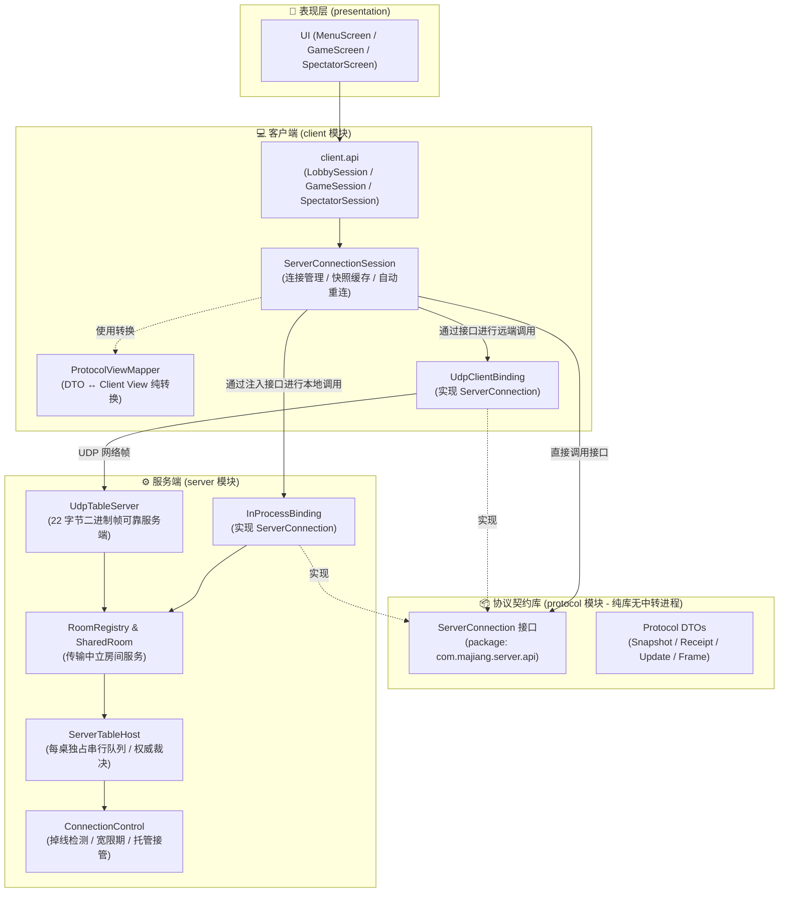

# 🀄 Server ↔ Client 接口与协议规范 (V4)

本文档说明当前 V4 的服务端接口、协议 DTO、客户端门面与可靠 UDP 传输。连接控制见 [2026-10-07 验收](v4-migration/ACCEPTANCE-CONNECTION-OWNERSHIP.md)；2026-10-12 补充袖里藏花接口，见 [E2 独立验收](sleeve-bloom/ACCEPTANCE-E2.md)。

---

## 1. 总体架构与绑定模式

客户端与服务端通过**独立协议契约库 (`protocol`) + 两种传输绑定**交互：



> **架构注记**：接口包 `com.majiang.server.api`（包含 `ServerConnection`、`LobbyApi`、`SessionApi`、`SpectatorApi`、`PushChannel`、`RoomBinding`、`SpectatorBinding`）物理归属于 **protocol** 模块；protocol 是轻量契约库，不作为网络运行节点转发流量。`InProcessBinding` 属于 `server` 模块，`UdpClientBinding` 属于 `client` 模块，二者均实现 protocol 的 `ServerConnection` 接口。

| 绑定方式 | 场景 | 特性与通信机制 |
|---|---|---|
| **进程内绑定 (`InProcessBinding`)** | 单机模式 | **零网络、零序列化**：同 JVM 直接异步调用，返回 `CompletableFuture`，DTO 深拷贝隔离状态，由 `MahjongGame.render` 驱动 `server.tick` |
| **UDP 绑定 (`UdpClientBinding`)** | 远端对战 | **自封装可靠 UDP 协议**：22 字节二进制帧头 + 1200B 报文上限 + 1090B 分片 + 服务端 256 条滑动重传窗口（客户端 64 缓冲 / 256 游标去重）+ 3s 心跳 / 10s 判死 |

两种绑定均实现 `protocol` 模块中定义的统一契约接口 `ServerConnection`，上层完全透明。

---

## 2. 服务端线路接口契约 (protocol)

在 `protocol` 模块的 `com.majiang.server.api` 包中定义：

```kotlin
/** 统一服务端连接入口 */
interface ServerConnection : LobbyApi, SessionApi, PushChannel, SpectatorApi, AutoCloseable {
    val closed: Boolean
    val disconnectReason: String?
    override fun close()
}

/** 大厅期服务接口 */
interface LobbyApi {
    fun listRooms(): CompletableFuture<List<RoomSummary>>
    fun createRoom(req: CreateRoomRequest): CompletableFuture<RoomBinding>
    fun joinRoom(req: JoinRoomRequest): CompletableFuture<RoomBinding>
    fun resumeSession(req: ResumeRequest): CompletableFuture<RoomBinding>
    fun leaveRoom(): CompletableFuture<ProtocolActionReceipt>
    fun getRoomInfo(): CompletableFuture<ProtocolRoomInfo>
    fun setReady(ready: Boolean): CompletableFuture<ProtocolActionReceipt>
    fun updateConfig(config: ProtocolRoomConfig): CompletableFuture<ProtocolActionReceipt>
    fun onRoomUpdate(listener: (ProtocolRoomInfo) -> Unit): AutoCloseable
}

/** 对局期服务接口 (已绑定席位) */
interface SessionApi {
    fun capabilities(): CompletableFuture<ProtocolAccessCapabilities>
    fun snapshot(): CompletableFuture<ProtocolPlayerSnapshot>
    fun decision(): CompletableFuture<ProtocolPlayerDecision>
    fun submit(choice: ProtocolActionChoice): CompletableFuture<ProtocolActionReceipt>
    fun submitShufflePlan(plan: ProtocolShufflePlan): CompletableFuture<ProtocolActionReceipt>
    fun submitTileMark(request: ProtocolTileMarkRequest): CompletableFuture<ProtocolActionReceipt>
    fun submitSleeveBloom(request: ProtocolSleeveBloomRequest): CompletableFuture<ProtocolActionReceipt>
    fun submitSleeveBloomChoice(request: ProtocolSleeveBloomChoiceRequest): CompletableFuture<ProtocolActionReceipt>
    fun start(): CompletableFuture<ProtocolActionReceipt>
    fun nextRound(): CompletableFuture<ProtocolActionReceipt>
    fun resume(cursor: Long): CompletableFuture<ProtocolPlayerSnapshot>
    fun claimControl(): CompletableFuture<ProtocolActionReceipt>
    fun releaseControl(): CompletableFuture<ProtocolActionReceipt>
    fun queryRoundResult(roundId: String): CompletableFuture<List<ProtocolGameEvent>>
}

/** 观战服务接口 (只读接入) */
interface SpectatorApi {
    fun joinSpectator(req: JoinSpectatorRequest): CompletableFuture<SpectatorBinding>
    fun resumeSpectator(req: ResumeSpectatorRequest): CompletableFuture<SpectatorBinding>
    fun publicSnapshot(): CompletableFuture<ProtocolPublicSnapshot>
    fun resumePublic(checkpoint: PublicCheckpoint): CompletableFuture<ProtocolPublicSnapshot>
    fun queryPublicRoundResult(roundId: String): CompletableFuture<List<ProtocolGameEvent>>
    fun onPublicUpdate(listener: (ProtocolPublicUpdate) -> Unit): AutoCloseable
}

/** 推送通道 (服务端向客户端单向派发) */
interface PushChannel {
    fun onUpdate(listener: (ProtocolPlayerUpdate) -> Unit): AutoCloseable
    fun onDisconnect(listener: (reason: String) -> Unit): AutoCloseable
}
```

---

## 3. 核心接口与操作明细

### 3.1 控制权管理：`claimControl` 与 `releaseControl`
对外接口提供语义明确的无参 `claimControl()` 与 `releaseControl()`（`ConnectionControl` 内部保留统一的 `requestControl(seat, takeover)` 状态切换实现）：
- **`claimControl()`**：真人玩家从 AI 托管状态收回控制权。
  - 服务端重置控制者为 `ControllerRole.HUMAN`；
  - 权威 `controlEpoch` 递增，废止先前托管 AI 生成的一切未决决策；
  - 托管期间已由权威执行的动作不可回滚，用时储备不重置。
- **`releaseControl()`**：真人玩家主动交出控制权转由 AI 接管。
  - 控制者原子切换为 `ControllerRole.TAKEOVER`，`controlEpoch` 递增。

### 3.2 离房与顶号语义
- **`leaveRoom()`**：
  - **房主主动调用**：房主离房即解散房间，其他成员连接收到 `ROOM_CLOSED` 通知并终结连接；仅主动离房成功的房主连接保持存活并回到未绑定大厅状态；
  - **普通成员主动调用**：仅调用者本人离房成功并回到未绑定大厅状态，连接保持存活 (`closed = false`)，可继续建房或加房；开赛前释放座位，开赛后席位转为永久 AI 代打并撤销原玩家 resumeToken；
  - **观战者主动调用**：仅观战者本人脱离房间并回到未绑定大厅状态。
- **顶号重连 (`resumeSession`)**：
  - 新连接验证 token 成功后分配新 `connectionId`；
  - 服务端先向旧 `connectionId` 发送可靠 `KICK(DISPLACED_BY_NEW_CONNECTION)` 终结通知；
  - 旧连接的在途请求全部异常终结并关闭连接；
  - 重连不自动收回控制权，需显式调用 `claimControl()`。

### 3.3 观战只读接入 (`SpectatorApi`)
- 观战会话绑定结果为 `SpectatorBinding`（包含 `roomId`、`spectatorId`、`resumeToken` 与 `snapshot: ProtocolPublicSnapshot`），**严格不包含玩家席位 (seat)**；
- 仅提供只读接口（`publicSnapshot`、`resumePublic`、`onPublicUpdate`），禁止调用玩家写操作（出牌、鸣牌、出千、控制权切换等）；但观战连接仍支持调用 `leaveRoom()` 退出观战及查询房间公开信息；
- 公开流游标与玩家游标完全隔离，基于 `(sessionId, syncEpoch, cursor)` 校验检查点。

### 3.4 落汗：`submitTileMark`

`ApiTags.SUBMIT_TILE_MARK` 的线路值为 `SUBMIT_TILE_MARK`，门面方法为 `submitTileMark`。载荷放在 `ApiRequest.tileMark`，包含 `requestId`、`sessionId`、`roundId`、`decisionId`、`controlEpoch` 与 `tileIds`。信封和载荷的请求 ID 必须一致，不能混入其他动作载荷。座位由绑定身份确定，请求不能指定所有者、费用或有效期。

房间需显式启用 `tileMarkConfig.enabled`，同时开启经济并配置 `TILE_MARK=10`；模型默认关闭。新服务端的 `tileMarkSupported=true` 表示实现支持该接口，不代表每个房间都已启用；缺失能力字段按 false 处理。进程内及 UDP 请求统一进入 `ServerTableHost` 串行队列执行身份校验与权威裁决。

每次选本人当前手牌中的 4 张不同实体牌，成功扣 10 额度，每位玩家最多 12 张有效标记。各组当局生效并持续后续 3 个实际发牌局，独立到期；施术不弃牌、不刷新截止时间。领域重放按排序后的牌集合识别语义相同请求，返回原回执及原游标。UDP 仍保留原始载荷冲突规则，自动重试必须复用完全相同的请求内容。

私有 `ProtocolPlayerSnapshot.tileMark` 包含候选、费用、上限及完整 `activeGroups`。每张牌带区域、允许公开的位置和牌面；`DISCARD` 必须含 `riverPosition(roundId, seat, discardIndex)`，索引从 0 开始，与当前牌河中的实体 ID 一致。`NOT_VISIBLE` 不带座位或牌山下标，对手手牌不带真实排序槽位或摸牌标志。完整快照中空组、组消失或 `tileMark=null` 都替换旧效果，重连通过快照恢复。

公开快照和观战 API 不增加标记字段。本地观战写入返回 `SPECTATOR_READ_ONLY`，UDP 观战写入返回 `UNAUTHENTICATED_SESSION`。业务拒绝原因包括 `TILE_MARK_INVALID_SELECTION`、`TILE_MARK_TILE_NOT_OWNED`、`TILE_MARK_ALREADY_MARKED`、`TILE_MARK_CAPACITY_EXCEEDED`、`TILE_MARK_RIICHI_LOCKED`、`INSUFFICIENT_FUNDS`、`DECISION_MISMATCH` 与 `DEADLINE_EXPIRED`。完整设计及分阶段验收见 [落汗设计](tile-mark/DESIGN.md) 和 [API 检视](tile-mark/REVIEW-API.md)。

---

### 3.5 袖里藏花：激活与二选一

线路标签分别为 `SUBMIT_SLEEVE_BLOOM` 和 `SUBMIT_SLEEVE_BLOOM_CHOICE`，门面方法为 `submitSleeveBloom` 和 `submitSleeveBloomChoice`。激活载荷 `ApiRequest.sleeveBloom` 包含 `requestId/sessionId/roundId/decisionId/controlEpoch`；选择载荷 `ApiRequest.sleeveBloomChoice` 在此基础上增加 `offerId` 与 `keep`（`FIRST` 或 `SECOND`）。两类载荷与其他动作载荷互斥，信封请求ID必须与载荷一致；拒绝未知字段、非法代次及客户端指定座位、候选、费用等权威字段。

`sleeveBloomConfig.enabled` 默认关闭；启用须同时开启经济、显式配置 `SLEEVE_BLOOM=10`。能力字段 `sleeveBloomSupported` 缺失按false处理；true只表示服务端实现支持。激活在本人正常或岭上摸牌后的千术窗口原子扣10，庄家起手第14张及立直后禁止；选择不再扣费。每次摸牌最多施术一次，原deadline不变；挂起时其他普通动作与落汗拒绝，取消保留第一张后继续决策，超时保留第一张再默认摸切。

`ProtocolPlayerSnapshot.sleeveBloom` 仅向获准的本人私有流投影。`pendingOffer` 包含两张实体候选、来源、offerId、权威deadline及当前决策/控制代次，不写入公开或观战快照。选择没有领域事件时也推送完整私有状态；客户端必须用新快照替换旧offer，不能等待事件才关闭面板。恢复通过完整快照保留未结束的offer；托管重连须先显式收回控制，使用新决策身份提交。

进程内与UDP统一入每桌串行队列，先校验可信会话绑定，再由领域核对幂等与当前身份/权限/截止。相同请求重放不重复扣费或交换；激活与选择共用领域去重命名空间，改载荷或跨这两类API撞ID返回 `REQUEST_ID_CONFLICT`。观战写入在本地返回 `SPECTATOR_READ_ONLY`，UDP返回 `UNAUTHENTICATED_SESSION`。完整物理语义、失败码和阶段进度见 [袖里藏花设计](sleeve-bloom/DESIGN.md)。

## 4. 客户端门面模型 (client.api)

`client` 模块对外暴露完全解耦的门面与纯数据视图，表现层仅与以下接口交互：

### 4.1 门面抽象
- **`LobbySession`**：大厅交互（建房、加房、准备、配置修改、房间广播监听）；
- **`GameSession`**：对局交互（拉取快照 `snapshot()`、提交决策 `submit()`、码牌计划 `submitShufflePlan()`、落汗 `submitTileMark()`、袖里藏花 `submitSleeveBloom()` / `submitSleeveBloomChoice()`、开赛 `start()`、下一局 `nextRound()`、收回控制 `claimControl()`、交出托管 `releaseControl()`、推送监听 `onUpdate()`）；
- **`SpectatorSession`**：观战交互（拉取公开快照 `publicSnapshot()`、对账恢复 `resumePublic()`、公开更新监听 `onPublicUpdate()`）；
- **`ServerConnectionSession`**：统一组合门面（位于 `client.session`），管理底层连接生命周期、自动重连与绑定切换。

`ProtocolViewMapper` 位于 `client.mapping`，`client.api` 保留门面与视图契约。

### 4.2 客户端纯数据视图模型
- `GameSnapshotView`：包含手牌、牌河、副露、场风、局数、点棒、20+3 权威时钟 (`ClockInfo`)、怀疑度与出千余额；
- `DecisionView` / `ActionOptionView`：当前合法候选动作集合；
- `Receipt`：包含 `requestId`、`ReceiptStatus (APPLIED / RECORDED / REJECTED)`、`cursor` 与 `reason`；
- `ActionChoice`：提交决策的幂等载荷（包含 `requestId`、`roundId`、`decisionId`、`controlEpoch`、`optionId`）。
- `TileMarkRequest` / `TileMarkView` / `RiverPositionView`：独立客户端落汗请求、私有追踪视图与当前牌河位置；`GameSnapshotView.tileMark` 可空。集合防御复制且只读，提交沿用 `isPending` 和连接/房间代次，回执不乐观改变费用或标记。
- `SleeveBloomRequest` / `SleeveBloomChoiceRequest` / `SleeveBloomView`：独立客户端激活、选择与私有候选模型；`GameSnapshotView.sleeveBloom` 可空。两类提交与普通动作共用在途锁；失败、取消或绑定切换只释放对应请求的锁，旧回执不能覆盖新身份状态。回执不乐观扣费、换牌或创建offer。

---

## 5. 可靠 UDP 数据报协议明细

### 5.1 二进制帧头格式 (固定 22 字节)
所有多字节数值采用**大端序 (Big-Endian)** 编码：

```
+---------------+---------------+---------------+---------------+
|       Magic (0x4D47)          |  Version (4)  |  Type & Flags |
+---------------+---------------+---------------+---------------+
|                         ConnectionId                          |
+---------------+---------------+---------------+---------------+
|                             Seq                               |
+---------------+---------------+---------------+---------------+
|                            AckSeq                             |
+---------------+---------------+---------------+---------------+
|          PayloadLen           |             CRC-32            |
|                               |       (覆盖全帧，自身字段清零)   |
+---------------+---------------+---------------+---------------+
|                          Payload ...                          |
+---------------+---------------+---------------+---------------+
```

- **Magic**：固定 `0x4D47` (ASCII "MG")；
- **Version**：固定 `4`；
- **Type & Flags**：高 2 位预留标志位，低 6 位为数据报类型枚举；
- **ConnectionId**：未绑定时填 `0`；建房/加入成功后由服务端下发的 32 位唯一随机数；
- **Seq**：发送方单调递增包序号；
- **AckSeq**：回指对方已被确认的序号；
- **PayloadLen**：有效载荷字节数（0..1178）；
- **CRC-32**：帧校验和，损坏直接静默丢弃。

### 5.2 报文类型定义
| 值 | 类型 | 方向 | 说明 | 可靠性保证 |
|---|---|---|---|---|
| `0x01` | `REQ` | C → S | 业务请求 (JSON) | 客户端指数退避重试，直至收到匹配 RSP |
| `0x02` | `RSP` | S → C | 业务响应 (JSON) | 服务端重发直至收到 ACK |
| `0x03` | `PUSH` | S → C | 状态更新 (全量快照 + 可见事件) | 游标序单调递增，接收端缺口触发 RESEND |
| `0x04` | `ACK` | 双向 | 纯确认帧 (空载荷) | 终止对端重传定时器 |
| `0x05` | `RESEND` | C → S | 请求补发指定游标区间的 PUSH | 服务端窗口内重传，窗口外全量自愈 |
| `0x06` | `PING` | C → S | 心跳探测 (每 3 秒) | 维持 NAT 映射，携带客户端时间戳 |
| `0x07` | `PONG` | S → C | 心跳回显 | 注入服务端单调时间戳，供 RTT 采样 |
| `0x08` | `FRAG` | 双向 | 分片帧 (载荷 > 1090 字节切分) | 按连接与消息 ID 隔离重组，超时丢弃 |
| `0x09` | `KICK` | S → C | 终结通知 (顶号/停服/解散) | 重传直至 ACK 或超时退出 |

### 5.3 核心可靠性与自愈设计
1. **PUSH 始终全量快照 + 可见事件**：
   - 杜绝双套增量状态维护模型；每次推送均携带当前完整快照投影与本步可见事件（供动画播放）；
   - `isFullSnapshot = true` 明确标识建立或重置基线；
   - 客户端通过 `cursor` 保证单调顺序，丢包不丢状态。
2. **256 条滑动重传窗口**：
   - 服务端为每个座位维护 256 条最近推送记录（客户端维持 64 条接收缓冲与 256 条已应用游标去重）；
   - 游标缺口在 256 条内：服务端重传对应推送包；
   - 游标缺口超出 256 条：服务端直接下发带 `isFullSnapshot = true` 的最新全量快照，客户端强制覆盖基线完成自愈。
3. **入站去重与幂等重放**：
   - 所有写入请求携带客户端生成的 `requestId`；
   - 服务端在 session 内缓存最近处理结果；重复请求直接重放已生成回执，**绝不二次执行领域操作**。

---

## 6. 未实现边界声明

以下功能明确**未实现**，严禁在文档或代码中承诺为已有功能：
- **公网用户体系与集中鉴权**：无远程用户数据库或自动匹配中心；
- **全自动排位撮合**：仅支持房间号与大厅列表；
- **三人麻将规则**：领域与发牌严格为四人日麻；
- **断电持久化恢复**：无落盘数据库，停服即销毁；
- **运行时主机动态迁移**：无房主迁移能力；
- **TLS / DTLS 传输层加密**：报文基于二进制 CRC 校验，未启用传输加密。
