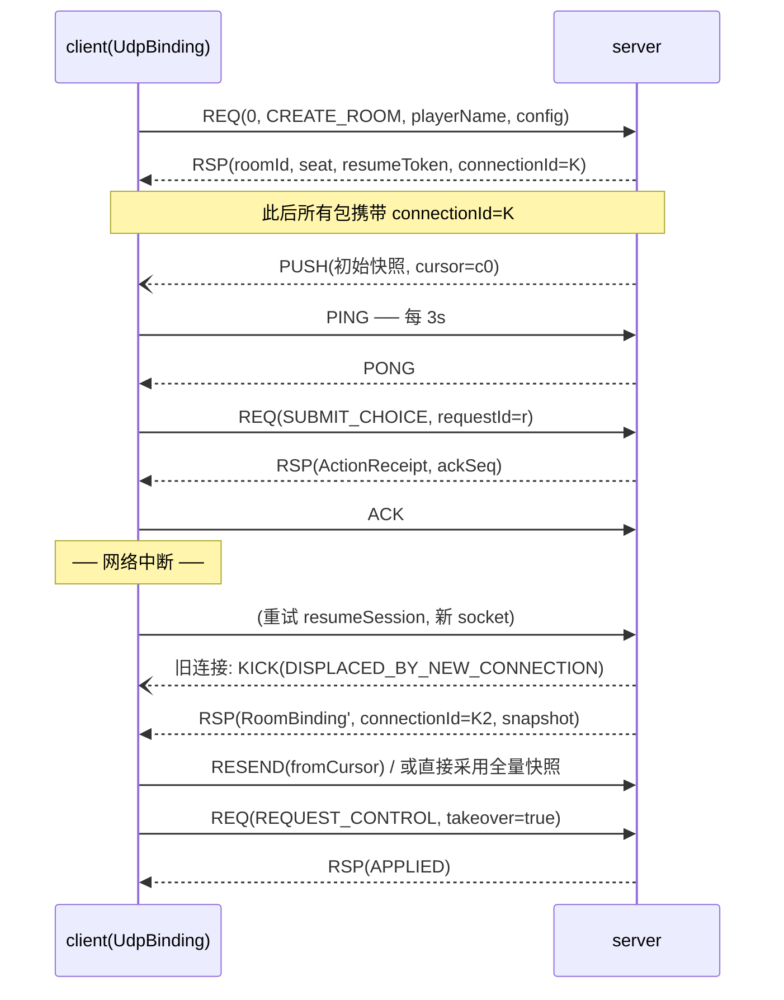

# Server ↔ Client 接口详细设计

日期：2026-10-05
状态：迁移起点的接口细化，字段与原 DTO 对齐。最终实施以 [V4 最终契约](v4-migration/CONTRACT.md) 为准：三层 DTO 完全解耦、client 自有输入输出、控制接口使用 claimControl/releaseControl、不保留 V3 入口兼容。本文原有 engine DTO 名称是过渡基线，不是最终共享类型授权。
关联：[GAME_ARCHITECTURE_V4.md](GAME_ARCHITECTURE_V4.md)（分层与职责）、现行实现 `client/network/protocol`、`server/TableServer`。

## 1. 总体设计

client 与 server 之间的通信定义为**一个传输无关的接口层 + 两种绑定**：

```
┌────────────┐   ┌────────────┐
│ presentation│   │   server   │
└─────┬──────┘   │  ┌────────┐ │
      ▼          │  │ engine │ │ │
┌────────────┐   │  └────────┘ │ │
│   client   │   └──────▲─────┘ │
│ ┌──────────┴─────────┴──────┐ │
│ │     ServerApi（传输无关接口层）│ │
│ └──────────┬────────────────┘ │
│      ┌─────┴─────┐            │
│  ┌───▼───┐   ┌───▼────┐       │
│  │InProc │   │UdpBind │       │  ← 两种绑定
│  │绑定   │   │(自封装) │       │
│  └───┬───┘   └───┬────┘       │
└──────┼───────────┼────────────┘
   直连调用        UDP 数据报
  （单机）        （远端）
```

| 绑定 | 场景 | 通信方式 |
|---|---|---|
| `InProcessBinding` | 单机 | **无网络协议**：client 直接持有 server 接口引用，进程内异步调用，零序列化、零帧、零心跳 |
| `UdpBinding` | 远端 | **UDP + 自封装二进制协议**：帧头 + 可靠性层 + 分片 + 心跳，payload 用 JSON 编码（预留压缩/二进制升级位） |

两种绑定实现同一 `ServerApi`，上层（GameClient / 表现层）完全无感知部署差异。

### 设计原则

1. **接口即契约**：所有接口先以传输无关形式定义（Kotlin 接口 + 不可变 DTO），绑定层只做搬运。
2. **状态同步优先于消息可靠**：对局状态以"游标 + 快照"表达，丢包可自愈（全量刷新），不需要字节流式的完全可靠传输。
3. **幂等提交**：所有写操作带 `requestId`，服务端按座位去重回放，重传不会重复执行动作。
4. **按座位脱敏**：一切快照/推送在 server 侧投影，对手暗牌与私密信息永不出宿主。

---

## 2. 传输无关接口层

```kotlin
/** 大厅期接口（未绑定座位的连接可用） */
interface LobbyApi {
    fun listRooms(): CompletableFuture<List<RoomSummary>>
    fun createRoom(req: CreateRoomRequest): CompletableFuture<RoomBinding>
    fun joinRoom(req: JoinRoomRequest): CompletableFuture<RoomBinding>
    fun resumeSession(req: ResumeRequest): CompletableFuture<RoomBinding>
    fun leaveRoom(): CompletableFuture<ActionReceipt>          // 新增：显式离开
}

/** 对局期接口（已绑定座位 + token 校验） */
interface SessionApi {
    fun capabilities(): CompletableFuture<AccessCapabilities>
    fun snapshot(): CompletableFuture<PlayerSnapshot>
    fun decision(): CompletableFuture<PlayerDecision>
    fun submit(choice: ActionChoice): CompletableFuture<ActionReceipt>
    fun submitShufflePlan(plan: ShufflePlanRequest): CompletableFuture<ActionReceipt>
    fun start(): CompletableFuture<ActionReceipt>
    fun nextRound(): CompletableFuture<ActionReceipt>
    fun resume(cursor: Long): CompletableFuture<PlayerSnapshot>
    fun requestControl(takeover: Boolean): CompletableFuture<ActionReceipt>
    fun queryRoundResult(roundId: String): CompletableFuture<List<GameEvent>>
}

/** 推送通道（server → client） */
interface PushChannel {
    fun onUpdate(listener: (PlayerUpdate) -> Unit): AutoCloseable
    fun onDisconnect(listener: (reason: String) -> Unit): AutoCloseable
}
```

约定：

- 全部异步 `CompletableFuture`，UI 线程零阻塞；**REJECTED 回执是合法结果**，仅传输失败/响应缺载荷才异常完成。
- `closed` / `disconnectReason` 只读属性 + `close()` 幂等释放（沿用现有 `NetworkSessionAccess` 语义）。

---

## 3. 接口明细

### 3.1 大厅接口

#### `createRoom` — 建房并绑定为房主座

| 入参 (CreateRoomRequest) | 类型 | 必填 | 说明 |
|---|---|---|---|
| `playerName` | String | 否 | 房主显示名，缺省 `"Host"` |
| `config` | MatchConfig | 否 | 比赛配置，缺省默认半庄（见 §4.4） |
| `protocolVersion` | Int | 是 | 客户端协议版本，服务端只接受当前值，不符即拒 |

| 出参 (RoomBinding) | 类型 | 说明 |
|---|---|---|
| `roomId` | String | 8 位大写房间号（不可猜测） |
| `seat` | Int | 绑定座位 0..3（房主为 0） |
| `resumeToken` | String | 断线恢复令牌（仅本接口与 resume 返回，客户端安全持久化，日志脱敏） |
| `snapshot` | PlayerSnapshot | 绑定后初始视图（等价于立刻收到一次 PUSH_UPDATE） |

错误：`SERVER_FULL`（房间数达上限 100，经 `CREATE_FAILED` 包装）、`ALREADY_BOUND`、`INVALID_PROTOCOL_VERSION`。

#### `joinRoom` — 加入房间

| 入参 (JoinRoomRequest) | 类型 | 必填 | 说明 |
|---|---|---|---|
| `roomId` | String | 是 | 目标房间号 |
| `playerName` | String | 否 | 缺省 `"Player"` |
| `preferSeat` | Int | 否 | 期望座位；被占时由服务端分配 |

| 出参 | 同 `RoomBinding`（`seat` 为分配结果） |

错误：`ROOM_NOT_FOUND`、`ROOM_FULL`、`ALREADY_BOUND`、`MISSING_ROOM_ID`。

#### `listRooms` — 房间列表

| 入参 | 无 |
|---|---|

| 出参 (List\<RoomSummary\>) | 类型 | 说明 |
|---|---|---|
| `roomId` / `roomName` / `hostPlayerName` | String | 标识与显示 |
| `playerCount` / `maxPlayers` | Int | 座位占用（默认 4 座） |
| `matchStarted` | Boolean | 是否已开赛 |
| `configSummary` | String | 配置摘要（人读） |

#### `resumeSession` — 断线重连（重新绑定）

| 入参 (ResumeRequest) | 类型 | 必填 | 说明 |
|---|---|---|---|
| `roomId` | String | 是 | 原房间 |
| `token` | String | 是 | 原 `resumeToken` |
| `cursor` | Long | 否 | 客户端最后持有的游标，供服务端决定续传/全量 |

| 出参 | 同 `RoomBinding`；`snapshot` 为重连时刻全量视图 |

语义：校验 token → 换发新连接代次 → **旧连接立即失效**（收 `KICK/DISPLACED_BY_NEW_CONNECTION`，其挂起请求全部异常终结）→ 返回快照。托管期间已发生动作不回滚。

错误：`ROOM_NOT_FOUND`、`MISSING_ROOM_OR_TOKEN`、`INVALID_TOKEN`、`ALREADY_BOUND`。

#### `leaveRoom` — 显式离开（新增）

| 入参 | 无（作用于当前绑定） |
|---|---|

| 出参 | `ActionReceipt`（APPLIED = 已离开，座位转为托管/回收） |

语义：与直接断连的区别是**显式语义**——房主离开即中止比赛并保留已完成局记录；普通成员离开后座位交 AI。离开后连接回到未绑定状态（可再建房/加入）。

---

### 3.2 对局接口

所有对局接口要求连接已绑定且请求携带 `token`，否则 `UNAUTHENTICATED_SESSION` / `INVALID_TOKEN`。

#### `capabilities` — 能力协商

| 入参 | 无 |
|---|---|

| 出参 (AccessCapabilities) | 类型 | 说明 |
|---|---|---|
| `protocolVersion` | Int | 服务端协议版本 |
| `supportedPlayerCounts` | Set\<Int\> | 当前 {4} |
| `remoteTransport` | Boolean | 是否远端绑定 |
| `persistence` | Boolean | 是否持久化（当前 false） |
| `resumption` | Boolean | 是否支持断线恢复（true） |

#### `snapshot` — 拉取全量快照

| 入参 | 无 |
|---|---|

| 出参 (PlayerSnapshot) | 见 §4.1（按座位脱敏的完整视图） |

#### `decision` — 当前合法决策

| 入参 | 无 |
|---|---|

| 出参 (PlayerDecision) | 见 §4.2（候选选项列表，含千术动作按余额/怀疑度过滤） |

#### `submit` — 提交动作选择

| 入参 (ActionChoice) | 类型 | 必填 | 说明 |
|---|---|---|---|
| `requestId` | String | 是 | 按座位作用域去重，**幂等重放**（UDP 重传安全的基石） |
| `roundId` | String? | 是 | 目标局；局间决策为 null |
| `decisionId` | String | 是 | 依据的决策版本标识（过期即拒绝） |
| `controlEpoch` | Long | 是 | 提交时控制代次（被顶号/收回后失效） |
| `optionId` | String | 是 | 所选候选选项标识 |

| 出参 (ActionReceipt) | 类型 | 说明 |
|---|---|---|
| `requestId` | String | 回显 |
| `status` | ReceiptStatus | `APPLIED` 已生效 / `RECORDED` 已记录待裁决 / `REJECTED` 被拒 |
| `reason` | String? | 拒绝/记录的稳定原因码 |
| `cursor` | Long? | 生效后的同步游标；未生效为 null |

错误：`MISSING_ACTION_CHOICE`。

#### `submitShufflePlan` — 码牌阶段提交洗牌方案

| 入参 (ShufflePlanRequest) | 类型 | 必填 | 说明 |
|---|---|---|---|
| `requestId` | String | 是 | 幂等标识 |
| `roundId` | String | 是 | 目标局 |
| `controlEpoch` | Long | 是 | 控制代次 |
| `selection.initialTargets` | Set\<ShuffleTarget\> | 否 | 偷天换日目标（40 点） |
| `selection.drawTargets` | Set\<ShuffleTarget\> | 否 | 瞒天过海目标（20 点；并用 60 点） |

| 出参 | `ActionReceipt`（成功为 `RECORDED`——方案记录，发牌时才结算） |

错误：`MISSING_SHUFFLE_PLAN`、余额不足、超出准备窗口 → REJECTED 回执（带原因）。

#### `start` — 开赛（房主）

| 入参 | 无 |
|---|---|

| 出参 | `ActionReceipt`（非房主/人数不足 → REJECTED） |

#### `nextRound` — 进入下一局

| 入参 | 无 |
|---|---|

| 出参 | `ActionReceipt`（终局后 → REJECTED `MATCH_FINISHED`） |

#### `resume` — 会话内按游标恢复

| 入参 | 类型 | 说明 |
|---|---|---|
| `cursor` | Long | 客户端持有的游标（缺省 0 = 全量） |

| 出参 | `PlayerSnapshot`（服务端按游标决定返回全量或对账视图） |

#### `requestControl` — 收回/交出托管

| 入参 | 类型 | 说明 |
|---|---|---|
| `takeover` | Boolean | true = 收回本座控制权；false = 交出托管 |

| 出参 | `ActionReceipt`（不撤销托管期已提交动作、不重置用时） |

#### `queryRoundResult` — 查询单局结算事件

| 入参 | 类型 | 说明 |
|---|---|---|
| `roundId` | String | 目标局（缺省 "" → 空列表） |

| 出参 | `List<GameEvent>`（该局公开结算事件投影，含 ScoreBreakdown 明细） |

---

### 3.3 推送接口（server → client）

#### `PUSH_UPDATE` — 对局更新

| 字段 (PlayerUpdate) | 类型 | 说明 |
|---|---|---|
| `snapshot` | PlayerSnapshot | 最新完整快照（**全量，非增量**——游标保证顺序，内容以快照自愈） |
| `fromCursor` | Long | 前置游标（与本端已持有游标连续则按序应用） |
| `visibleEvents` | List\<GameEvent\> | 自前置游标以来的脱敏可见事件（动画/结算明细用） |

#### `PUSH_DISCONNECT` / `KICK` — 连接终结通知

| 字段 | 类型 | 说明 |
|---|---|---|
| `reason` | String | 稳定原因码：`DISPLACED_BY_NEW_CONNECTION`、`ROOM_CLOSED`、`SERVER_SHUTDOWN` 等 |

收到即视为连接终结，在途请求全部异常完成；client 据此决定重连（resumeSession）或回菜单。

---

## 4. 共享数据结构

### 4.1 PlayerSnapshot（快照主体）

| 字段 | 类型 | 说明 |
|---|---|---|
| `sessionId` | String | 整场比赛标识 |
| `roundId` | String? | 当前单局标识；局间/终局为 null |
| `syncEpoch` | String | 同步流代次（重连或新对局更新） |
| `cursor` | Long | 本快照对应的单调递增游标（**按座位独立连续**） |
| `sessionVersion` / `roundVersion` | Long / Long? | 整场/单局状态版本号 |
| `view` | PlayerView | 观察者座位投影视图：phase、场风局数、场供/立直棒、庄家、轮到谁、牌山余数、宝牌指示牌、各家分数、立直状态、牌河、副露、手牌计数、**仅自己的**暗手/摸牌/袖牌/振听/舍张历史、合法动作、最后舍牌 |
| `decision` | PlayerDecision | 当前座位可执行决策（见 §4.2） |
| `clocks` | List\<ClockView\> | 各座位权威时钟：`seat`、`opensAt`、`deadline`、`reserve`（剩余储备 ms）、`serverNow`（采样时刻） |
| `cheatPoints` | List\<Int\> | 各座位出千点数 |
| `session` | SessionView? | 整场视图：lifecycle、scores、roundWind/roundNumber、dealerSeat、honba、roundRecords、finalResult |
| `controls` | List\<SeatControlView\> | 各席位控制状态：`seat`、`connected`、`role`、`controlEpoch` |
| `paused` | Boolean | 权威时钟是否暂停 |
| `settlementRoundId` | String? | 刚结束/终局结算的局标识 |
| `settlementEvents` | List\<GameEvent\> | 结算公开事件投影（含役种/番/符/宝牌明细） |
| `preparation` | ShufflePreparationView? | 洗牌千术准备阶段**私有**视图；非准备阶段 null |

### 4.2 PlayerDecision / ActionOption

| 字段 | 类型 | 说明 |
|---|---|---|
| `roundId` | String? | 决策所属局；整场级决策（尾庄和了/听牌止）为 null |
| `decisionId` | String | 决策唯一版本标识（窗口/局/控制代次变化即更新） |
| `controlEpoch` | Long | 该座位当前控制代次 |
| `options` | List\<ActionOption\> | `optionId` + `action: GameAction`（DiscardTile/DeclareRon/DeclarePon/DeclareChi/DeclareKan/DeclareRiichi/DeclareTsumo/Pass/千术动作…） |

### 4.3 ActionReceipt

见 §3.2 `submit` 出参表。

### 4.4 MatchConfig

| 字段 | 类型 | 默认 | 说明 |
|---|---|---|---|
| `playerCount` | Int | 4 | 仅支持四人 |
| `handsPerWind` | Int | 4 | 每场风局数 1..4 |
| `winds` | List\<Int\> | [1,2] | [1]=东风战，[1,2]=半庄 |
| `startingScores` | List\<Int\> | 4×25000 | 起始点 |
| `allowExtension` | Boolean | true | 延长战 |
| `allowAgariYame` | Boolean | true | 尾庄和了/听牌止 |
| `bankruptcyEnabled` / `bankruptcyThreshold` / `bankruptcyInclusive` | Boolean/Int/Boolean | true/0/false | 击飞判定 |
| `targetScore` | Int | 30000 | 返点基准 |
| `tieBreakSeats` | List\<Int\> | [0,1,2,3] | 同分优先座次 |
| `cheatEconomy` | CheatEconomyConfig | 默认 | 出千点数初始值/费用/奖励 |
| `shuffleConfig` | ShuffleConfig | 默认 | 码牌阶段开关、selectionMillis、plannedDraws(0..18)、strength(0..1)、interference |

---

## 5. 错误码

| 错误码 | 触发 | 层级 |
|---|---|---|
| `INVALID_PROTOCOL_VERSION` | 协议版本缺失/不符 | 绑定 |
| `MALFORMED_REQUEST` | 帧解析失败/未知 type/字段校验失败 | 绑定 |
| `ALREADY_BOUND` | 已绑定连接再建房/加入/恢复 | 大厅 |
| `ROOM_NOT_FOUND` / `ROOM_FULL` / `SERVER_FULL` | 房间状态类 | 大厅 |
| `MISSING_ROOM_ID` / `MISSING_ROOM_OR_TOKEN` / `MISSING_ACTION_CHOICE` / `MISSING_SHUFFLE_PLAN` | 缺必填字段 | 通用 |
| `UNAUTHENTICATED_SESSION` | 未绑定连接发会话命令 | 会话 |
| `INVALID_TOKEN` | token 与绑定不符 | 会话 |
| `UNKNOWN_REQUEST_TYPE` | 未知接口 | 会话 |
| `INTERNAL_ERROR` | 服务端兜底，绝不悬挂客户端 | 通用 |

业务性拒绝（过期决策、非法动作、余额不足等）**不是错误码**，以 `ActionReceipt(REJECTED, reason)` 返回。

---

## 6. 进程内绑定（单机，无网络协议）

```kotlin
/** 单机绑定：直接调用 server 进程内实现，无序列化、无帧、无心跳 */
class InProcessBinding(server: InProcessServer) : LobbyApi, SessionApi, PushChannel {
    // 实现：方法直通 server.roomApi()/server.sessionApi()，
    // 返回的 CompletableFuture 即 server 内部异步结果（server 侧串行权威循环的提交凭据）。
}
```

| 项 | 设计 |
|---|---|
| 通信方式 | Kotlin 接口直连调用，对象引用传递；DTO 走 server 出参时的深拷贝（防跨层共享可变状态） |
| 序列化 | **无**。`protocolVersion` 协商退化为构造期断言 |
| 心跳/超时 | **无**。`closed` 仅在进程关闭或显式 `close()` 时为 true；`onDisconnect` 仅由本端关闭触发 |
| 推送 | server 权威循环直接回调 listener（经 client 注入的 `Gdx.app.postRunnable` 派发到渲染线程，语义与远端一致） |
| 异步语义 | 保留 CompletableFuture：server 权威循环串行裁决，调用方永不阻塞在裁决锁上 |
| 绑定流程 | 组合根直接构造：`server.createRoomForLocal()` 返回绑定对象，跳过 roomId/token 网络握手（token 恒为本地占位值，不外发） |

单机与远端的**唯一行为差异**：进程内绑定不存在断线、重连、顶号；其余（快照、决策、提交、推送、错误模型）完全一致。

---

## 7. UDP 自封装协议（远端）

### 7.1 动机与取舍

| 选择 | 理由 |
|---|---|
| UDP 而非 TCP | 推送流是"最新状态优先"——队头阻塞无意义；丢包用快照自愈比对字节流重传恢复更快；避免 TCP 慢启动/拥塞退避放大操作延迟 |
| 不用 QUIC | 依赖重；局域网场景 NAT 穿透简单；自封装层很小（可靠性只需"请求-响应 + 游标序"两种模式） |
| 代价 | 必须自建：完整性校验、去重、重传、分片、心跳。全部在本节定义 |

### 7.2 数据报格式

所有多字节整数**大端序**。单个数据报总长 ≤ 1200 字节（避免 IP 分片）。

```
偏移  长度  字段
0     2    magic        0x4D47 ("MG")
2     1    version      协议版本（当前 4）
3     1    packetType   见 §7.3
4     4    connectionId 绑定后分配的 32bit 随机标识；绑定前请求填 0
8     4    seq          发送方单调递增序号（每连接每方向独立）
12    4    ackSeq       回指对方已处理的 seq（ACK/RESPONSE 用；其余填 0）
16    2    payloadLen   payload 字节数
18    4    crc32        覆盖头（crc 字段清零）+ payload 的 CRC-32
22    ...  payload      packetType 决定结构（当前为 UTF-8 JSON；flags 预留压缩/二进制）
```

头部长度 22 字节。`flags` 并入 `packetType` 高 2 位（`0xC0` 位：bit7=zlib 压缩、bit6=保留加密位），低 6 位为类型值。

### 7.3 包类型

| 值 | 类型 | 方向 | payload | 可靠性 |
|---|---|---|---|---|
| 0x01 | `REQ` | C→S | `{api: "SUBMIT_CHOICE", requestId, ...入参}` | 重传直至 RSP |
| 0x02 | `RSP` | S→C | `{requestId, success, error?, ...出参}` | 重传直至 ACK |
| 0x03 | `PUSH` | S→C | `PlayerUpdate`（JSON，大则分片） | 游标序，缺口触发 §7.4-3 |
| 0x04 | `ACK` | 双向 | 空 | 纯确认 |
| 0x05 | `RESEND` | C→S | `{fromCursor}` | 请求重传推送缺口 |
| 0x06 | `PING` | C→S | `{clientMillis}` | 心跳 |
| 0x07 | `PONG` | S→C | `{clientMillis, serverMillis}` | 心跳应答（RTT 估计） |
| 0x08 | `FRAG` | 双向 | `{msgId, fragIndex, fragCount, bytes}` | 分片承载（重组后按原类型处理） |
| 0x09 | `KICK` | S→C | `{reason}` | 终结通知（顶号/房关/停服），重传直至 ACK |

### 7.4 可靠性设计

**1) 请求-响应（写操作与查询）**

```
C: REQ(seq=n, requestId=r)  ──丢失──✕
C: REQ(seq=n, requestId=r)  ────────→  S: 裁决（requestId 幂等去重）
                            ←────────  RSP(ackSeq=n, requestId=r, receipt)
C: ACK(seq=m)               ────────→  （服务端停发该 RSP）
```

- RTO 初始 200ms，×1.5 退避，上限 3s；累计 5 次无应答判连接死亡。
- 服务端按 `(seat, requestId)` 去重：重复 REQ 直接重放已生成回执，**绝不二次执行动作**（与 `ActionReceipt.requestId` 幂等契约对齐）。
- 查询类（SNAPSHOT/LIST_ROOMS 等）同通道；丢响应由重传覆盖。

**2) 分片（大 payload）**

- payload > 1090 字节（1200 − 头 − FRAG 子头）→ 拆 `FRAG` 包：`msgId`（递增）、`fragIndex`、`fragCount`。
- 接收端按 msgId 重组，3s 内未齐则丢弃整条（推送靠 §3 游标自愈，请求靠重传覆盖）。
- 全量快照是典型大 payload：单快照预估 4–8 KB（3–8 片）。

**3) 推送流（游标序 + 自愈）**

- `PUSH` 携带 `snapshot.cursor` 与 `fromCursor`；**游标即序号**，不依赖传输层顺序。
- 客户端检测 `fromCursor > 本端游标 + 1`（缺口）→ 发 `RESEND(fromCursor=本端游标+1)`。
- 服务端保留每座位**重传窗口 256 个推送包**（约对应最近数分钟对局）：
  - 缺口在窗口内 → 按序重发缺的包；
  - 缺口在窗口外 → 回一条 `PUSH(全量快照, fromCursor=当前)`，客户端直接跳到最新（丢中间动画，不丢状态）。
- 重复/乱序包按 `cursor ≤ 本端游标` 丢弃。
- 推送不要求 ACK——**丢包的代价是重传窗口内补发或一次全量刷新，而非连接重置**。这是选 UDP 的前提。

**4) 防重放与完整性**

- 每方向 `seq` 单调；`seq ≤ 已见最大值` 的包直接丢弃（重传由对方 RSP/ACK 覆盖，不靠 seq 回绕）。
- `connectionId` 不匹配的数据报**静默丢弃**（不回任何错误，防放大反射攻击）。
- CRC32 防意外损坏（非抗篡改）；`flags` 预留加密位，公网部署时升级为 HMAC-SHA256 截断 + AES-GCM。

### 7.5 会话生命周期

```
未绑定 ──createRoom/joinRoom──→ 已绑定 ──leaveRoom──→ 未绑定
   │                              │
   └──── resumeSession(token) ────┘（旧 connectionId 收 KICK 后失效）
```

- 绑定成功：服务端分配 `connectionId`（32bit 随机）并随 `RSP(RoomBinding)` 下发；此后所有数据报必须携带。
- 顶号：新连接 `resumeSession` 成功 → 服务端向旧 `connectionId` 发 `KICK(DISPLACED_BY_NEW_CONNECTION)`（重传至 ACK 或超时）→ 旧端在途 Future 全部异常终结。座位不因旧连接超时被误判掉线。
- 掉线：心跳丢失 → 服务端按房间策略 AI 托管，对局继续；客户端侧表现为 `closed=true, disconnectReason=READ_TIMEOUT`。

### 7.6 心跳与超时参数

| 参数 | 值 | 说明 |
|---|---|---|
| PING 间隔 | 3s | UDP 需更勤保 NAT 映射 |
| PONG 期望 | 1s | 超 3 次连续丢失判死 |
| 判死超时 | 10s 无任何入站包 | 客户端与服务端同参 |
| REQ 超时 | 10s | 单请求截止（与 Future 超时对齐） |
| RTO | 200ms 起，×1.5，上限 3s | 重传节奏 |
| 重传窗口 | 256 推送包/座位 | 服务端内存上限 |

### 7.7 绑定与重连时序（远端）



---

## 8. 与现有实现的差异对照

| 项 | 现状 | 本设计 |
|---|---|---|
| 远端传输 | TCP + 长度前缀 JSON 帧 | UDP + 22 字节二进制头自封装协议 |
| 单机通信 | LocalSession 进程内直连（无协议） | 保持无协议，形式化为 `InProcessBinding` |
| 接口形态 | 胖信封 NetworkRequest/Response（全字段可选） | 传输无关 Kotlin 接口 + 每接口独立入参/出参 DTO |
| 离开房间 | 只能断连 | 新增 `leaveRoom` 显式语义 |
| 推送可靠性 | 依赖 TCP 有序可靠 | 游标序 + 重传窗口 + 全量自愈 |
| 心跳 | TCP PING 5s / 读超时 20s(客户端) 60s(服务端) | UDP PING 3s / 判死 10s 双端同参 |
| 幂等 | requestId 已有 | 显式作为 UDP 重传安全的核心契约 |
| 协议版本 | 3 | 4（UDP 头 version 字段 + capabilities 协商） |
