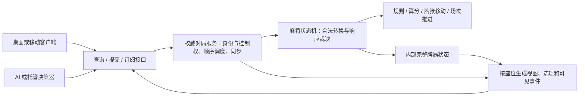

# 麻将状态机与客户端拆分：可行性分析及接口设计草案

> 本文保留早期可行性分析。最新职责和接口以 [v2 规格：单局状态机、Session 与独立校验](MAHJONG_STATE_MACHINE_API_SPEC.md) 为准：状态机仅负责单局，Session 串联整场各局，验证由独立组件完成。本文中状态机兼管整场、验证等旧方案不再作为实施依据。

日期：2026-09-30。状态：设计草案，未实施。本轮仅新增本文档，不改生产代码、测试或构建配置，不委派开发。

## 1. 结论

可以拆分，建议以此作为后续架构方向。

对客户端而言，麻将应是一项服务：查询“我能看到什么、现在能选什么”，提交“我选择哪个操作”，订阅结果。完整牌局状态、麻将规则、合法性判断、响应裁决和结算都留在权威侧。客户端负责展示、选择、提交和播放反馈。

当前已有 GameStateMachine、LegalActionProvider、GameSession、PlayerView、SessionUpdate，以及刚完成的逐座位控制者和统一执行入口，可以逐步收拢边界，不需要重写已有麻将算法。

这里的“一个状态机”指一张牌桌只有一份权威状态和一条合法变更路径。规则计算仍可由独立的纯函数/服务完成；对外统一不要求把代码集中到一个巨大类里。

## 2. 当前代码距离目标有多远

| 现有基础 | 当前作用 | 还需要补齐的边界 |
|---|---|---|
| GameStateMachine + 统一内部执行 | 检查动作、修改牌局、自动推进 | state/eventBus 仍公开给持有引擎者；AI 调度和规则执行仍在同一类 |
| LegalActionProvider | 统一生成各座位合法动作 | 需要转换成客户端可直接展示、带决策标识的选项 |
| GameSession | 查询、提交、订阅的初步门面 | 同步提交约定、直接 start/nextRound 权力还不适合共享对局 |
| PlayerView | 按座位隐藏他家暗牌、牌山和未公开里宝 | 缺少完整决策上下文、同步游标和可恢复的结算快照 |
| SessionUpdate | 过滤事件并提供当前视图 | 一次调用只通知本 LocalGameSession 的订阅者；没有一张牌桌统一发布给所有端点的机制 |
| SeatController | 支持本地真人、远端真人、AI、托管 | 后续把决策策略与控制权调度从规则状态机抽到服务层 |
| RiichiSelectionModel + RiichiPreviewProvider | 客户端选择模型调用规则计算待牌和振听预览 | 权威侧提供预览结果，客户端只选择和展示 |
| MeldChoiceProvider | 从合法动作提取鸣牌组合 | 可复用为选项投影；几何布局、分页仍留客户端 |
| GameScreen | 基本经会话提交、根据合法动作显示按钮 | 仍拼装 GameAction，按完整视图相等判断选择是否失效，并推断一些流程状态 |

另一个值得收拢的点：GamePhase.allowedTransitions 当前没有生产调用方。阶段枚举及其辅助转移表不能被视为已经统一执行的规则规范；应以实际受校验的状态转换为准，后续避免另留一套与执行器不同步的转移规则。

依据：`core/src/main/kotlin/com/majiang/state/GameStateMachine.kt`、`state/GamePhase.kt`、`session/GameSession.kt`、`session/LocalGameSession.kt`、`session/PlayerView.kt`、`session/SessionUpdate.kt`、`screen/RiichiSelectionModel.kt`、`session/RiichiPreviewProvider.kt`、`screen/MeldSelectionModel.kt`、`screen/GameScreen.kt`。

## 3. 推荐职责划分

对外是“客户端 ↔ 麻将服务”。麻将服务内部再区分状态机与会话调度，防止网络、AI 思考、计时和规则重新挤进一个类。



### 3.1 状态机负责

- 手牌、摸牌、牌河、副露、牌山、王牌、宝牌指示、积分、供托、本场、庄家和局数等完整状态。
- 正常摸打、吃碰杠、立直、抢杠、振听、和牌、流局、计分及场次终了规则。
- 每个座位的合法动作与具体候选组合，及这些候选所需的规则解释。
- 响应窗口：资格、已提交选择、优先级和最终裁决。
- 每次合法转换的原子修改、物理牌与资金守恒审计、已提交事实事件。
- 需要内部完成的机械流程，例如无人响应后换到下一家并摸牌。无需向普通客户端暴露“从牌山取牌”的自由操作权限。

状态机不加载字体、纹理或音效，不依赖渲染帧，不等待鼠标，也不主动访问网络。时间、随机和外部管理请求由明确输入或注入的依赖提供，使相同初始条件及有序输入可重复验证。

### 3.2 权威对局服务负责

- 将真实连接/本地端点绑定到座位，区分玩家、观战和管理权限。
- 管理逐座位控制权与控制权代次；决定由真人、AI 或托管提供下一次选择。
- 将命令和查询安排在一张牌桌的串行处理边界上，避免读到半提交状态。
- 调度 AI、立直自动操作策略、超时、掉线托管和下一局准备；实际牌局变更仍进入状态机。
- 维护请求去重、决策标识、发布顺序及恢复快照，为各端点裁剪数据。

可以先用进程内实现，不必先引入服务器或网络框架。现有原子守卫继续用于拒绝非法重入；未来服务入口采用每桌顺序调度，正常同时到来的两家响应应依次处理，而非依赖“并发者一律拒绝”作为完整联机方案。

### 3.3 客户端负责

- 渲染可见牌桌、本人手牌、副露、牌河、待牌、振听、宝牌和结算明细。
- 展示权威侧给出的操作及牌组，让玩家选择并确认。
- 管理悬停、牌面高亮、理牌顺序、弹窗、分页、音效和动画队列。
- 管理提交中的反馈、掉线提示、快照恢复及过期选择清理。

客户端仍然需要一个轻量的交互状态模型，例如“浏览桌面、选择立直弃牌、等待提交结果、播放动画、查看结算”。这些是展示状态，不决定麻将是否允许吃碰杠或和牌。

| 问题 | 负责方 |
|---|---|
| 这张牌能否打出、能否吃碰杠、能否和牌？ | 状态机 |
| 此立直方案听哪些牌，会不会振听？ | 权威查询/选项投影，调用同一套规则服务 |
| 命中了哪些役、宝牌、里宝、赤宝，如何计分？ | 权威结算结果 |
| 玩家是否还拥有这个座位的操作权？ | 对局服务 |
| 这家应由 AI 决策还是等待真人？ | 控制者调度 |
| 这组牌怎么排列、哪张横放、动画何时播完？ | 客户端，消费明确的副露来源等数据 |
| 目前按钮能不能点？ | 服务器有该选项，并且客户端已到可交互的展示状态 |

## 4. 查询接口：一次得到一致的视图和选项

建议对客户端使用绑定身份的端点，而不是公开 `query(seat = 任意座位)`。

```text
PlayerEndpoint
  querySnapshot() -> PlayerSnapshot
  submit(ChooseAction) -> 异步 CommandReceipt
  subscribe(afterCursor?) -> 有序 PlayerUpdate 流
  close() -> 关闭此客户端端点
```

close 只表示该端点离开/断开；是否终止整桌、托管或等待重连由对局生命周期策略决定。房主关闭牌桌使用单独的管理接口。

推荐快照包含：

| 数据 | 内容 |
|---|---|
| 对局标识 | matchId、roundId、协议/规则配置版本 |
| 同步信息 | 当前视图版本和连续可见流游标 |
| publicTable | 场况、分数、牌河、副露、公开宝牌、公开玩家信息 |
| self | 本人暗牌/摸牌、本人振听、允许公开给本人的私有效果 |
| decision | 当前本人决策编号、可选动作、截止信息；无选择时为空 |
| settlement | 最近一局的结算结果、命中牌型与宝牌、符番和支付计算明细 |
| lifecycle | 等待开局、对局中、局末确认、整场结束等客户端可理解的状态 |

查询必须无牌局副作用，不因“查一下能否和牌”推进摸牌、消耗随机数、提交过牌或改变振听。视图与合法选项在同一权威状态点计算，避免先查手牌再查动作时得到不一致的数据。

快照带有与其对应的可见流游标；订阅从该游标之后补发，覆盖“查完快照、尚未订阅”之间发生的更新。如果游标已超出保留范围，则明确要求重新获取快照。不能用一次普通查询加一个只接收未来事件的监听器拼出存在缺口的恢复流程。

结算应能够从快照恢复，不能只靠过去收到的一次 TsumoWin/RonWin 事件。否则重新打开界面或重连后，即使积分正确，也可能无法恢复详细算分页面。

## 5. 操作接口：提交选项标识，避免客户端重建规则动作

建议权威侧提供 `ActionOption`，客户端主要提交选中的标识。

```text
Decision
  decisionId
  controlEpoch
  deadline?                 // 若本局启用了时限
  options[]

ActionOption
  optionId
  kind                     // DISCARD / RIICHI / CHI / PON / KAN / RON / TSUMO / PASS ...
  presentation             // 类型明确的牌组、目标牌、理论待牌、振听说明等

ChooseAction
  matchId
  roundId
  requestId
  decisionId
  controlEpoch
  optionId
```

提交不允许客户端自行决定 player、完整 Meld、计分结果或牌山内容。服务端把 optionId 映射到当前座位的规范内部动作，再调用统一校验。optionId 只是标识，不能替代身份、控制权及规则校验。

同一个仍有效的决策，其 decisionId 与 optionId 保持稳定。标识在决策建立/变化时分配或稳定推导，不能每次查询随机重建，导致另一端读取一次就让已有选项失效。

明确选择的动作可以全部枚举：不同立直弃牌、不同吃法、红五与普通五的取舍都应分别对应有效候选。只依赖 UI 临时拼接组合，会重新引入两端规则不一致。相同结果的无意义物理副本组合可以合并展示，但提交须对应明确的权威动作。

示例：立直选项同时携带“打哪张牌、理论听牌列表、该方案的振听状态”。客户端点选后直接显示这些数据，不再调用 HandDecomposer 或 FuritenRules。这里的听牌信息沿用当前理论待牌语义，不泄露牌山实际还剩哪些牌，也不擅自扩大提示范围。

客户端仍可做纯展示转换，例如把动作类型转换为本地化按钮文字、将副露来源映射为横放位置。协议中返回结构化数据，不返回 HTML、像素坐标或排好版的长文本。

## 6. 决策窗口比单一全局版本更重要

不能简单规定“全局牌局版本变化，所有人的按钮都过期”。

例如 A 出牌后，B 和 C 同时拥有荣和机会。B 先提交会改变内部状态，但 C 在同一个响应窗口中的选择仍然有效。如果强制 C 的请求匹配 B 提交后的全局版本，就会错误地拒绝 C 的合法响应。

推荐契约：

- 每个待处理决策绑定 roundId、decisionId、座位与 controlEpoch。响应窗口内各座位可有独立 decisionId，并关联同一个内部 windowId。
- 他家仅提交响应、未使本人的候选和资格变化时，本人决策保持有效。
- 本人已提交、窗口裁决、进入下一局、候选失效或控制权变化时，相应决策失效。
- 显示数据可以更新；客户端以决策标识及选项变化决定是否保留选择，不再要求整个 PlayerView 完全相等。
- 每次转换后权威侧仍重新校验实际动作，不能仅因为标识存在就执行。

请求去重以身份/端点授权范围、matchId 和 requestId 为基础。同一个请求重试返回原回执，不重复出牌、扣供托或结算；同一 requestId 携带不同内容必须拒绝。过期请求返回明确拒绝及可重新查询的信息，不自动替换为当前窗口的同名操作。

## 7. 回执、事件与响应优先级

“提交成功”与“动作最终赢得裁决”需要分别表达。

| 回执/结果 | 含义 |
|---|---|
| APPLIED | 本次直接动作已被合法应用，例如打出一张牌 |
| RECORDED | 响应已记录，仍需等待其他合资格座位 |
| REJECTED | 过期、非法、无控制权等，牌局未因该请求改变 |
| 后续公开裁决事件 | 荣和/鸣牌最终成立，或更高优先级响应生效 |

例如玩家选碰，服务返回 RECORDED。此时客户端显示“已选择碰，等待其他响应”，不能立即把手牌永久移入副露区；另一家随后选择荣和，碰就不会执行。当前“荣和＞碰/大明杠＞吃、同级头跳”继续由状态机决定。

AI 也不能因为响应更快而获得优先权。需要按既定资格收齐响应或按权威超时规则生成缺席响应后再裁决。

一次更新提供同一提交批次的最终快照与有序可见事件。快照用于恢复事实，事件用于表现先后顺序。客户端维护最新权威快照和展示进度，避免把“逻辑已经轮到本人”误当成“前面动画已经播完”。

事件回执及订阅可能重复到达，应以游标/事件标识去重。同一订阅的可见事件游标应连续；内部隐藏事件不能被直接丢弃后留下让客户端误判为丢包的序号空洞。可使用每座位可见流游标，或明确的过滤游标协议。

## 8. AI、托管和立直自动摸切放在哪里

AI 是逻辑上的客户端/决策器。它只读取该座位可见状态和动作选项，选择 optionId，经相同端点提交。AI 可以与权威服务运行在同一进程，无需为了统一接口额外绕一次网络。

状态机不关心“这次选择来自鼠标还是 AI”；服务层检查该决策器是否仍拥有该座位控制权。AI 思考完成前若发生托管恢复，其旧 controlEpoch 已失效，迟到结果被拒绝。

立直后自动摸切属于自动决策策略：服务层按座位偏好检查是否有合法自摸/暗杠；有则等待，没有则选择合法摸切。规则层仍负责保证“立直后只能打该打的牌”与杠合法性。客户端关闭或卡顿不会使自动摸切依赖渲染而停摆。

逐座位类型仍保留，但持有策略实例、连接、线程或计时器的对象留在服务侧；核心牌局状态不保存这些运行时资源。规则配置与自动操作偏好要明确区分：麻将规则对四家一致，偏好只决定从合法集合中自动选哪一项。

## 9. 开局、下一局、千术与计时

**开局与下一局。** 将普通玩家操作与房间管理、系统推进分开。洗牌发牌只能由权威侧执行；客户端的“开始”是请求创建/开始对局，“下一局”在多人模式下表达本人准备。何时真正开始下一局由服务收齐必要确认或按规则超时推进。庄家终了仍是需要资格校验的游戏选择，不能被任意玩家的 nextRound 绕过。

**千术。** 如以后恢复四大绝技，使用同样的操作与授权投影通道。换牌、资源消耗、怀疑度和抓包事实留在权威侧；透视结果只投影给被授权座位。当前正式会话拒绝千术，本设计不代表已启用。既有联机文档“仅 AI 观察者抓包”的取舍保持不变，除非另行修改产品设计。

**时间。** 规则截止时间由权威服务维护，超时是带目标决策标识的系统输入；过期定时任务不能影响新窗口。查询本身不触发超时副作用。客户端倒计时只是展示。

**动画。** 出牌动画与点击限制留在客户端。新决策可以先收到，但动画未追到该决策时不开放操作。未来若启用联机时限，需要给出合理演出预算并允许积压动画加速/跳到快照；不能无限等待所有客户端报告动画完成，也不能让长动画耗尽玩家的全部决策时间。动画策略不更改牌局合法动作。

## 10. 信息边界

完整状态机查询仅限可信内部工具。普通玩家端点只能看到自己的投影；其他玩家的手牌、可选操作和未公开摸牌不能出现在数据里，再靠 UI 隐藏。

“某家正在等待响应”的细节也可能暴露其持牌能力，公开等待提示应按明确规则提供，不能直接广播内部 eligibleActions 或所有待决座位的私有选项。

领域事件和客户端事件应区分类型/受众。扩展事件时明确标注公开、本人私有、被授权私有或内部专用，避免新增事件默认向所有人透传。结算明细和亮牌遵循已确定的公开规则；不能因为进入结算就导出整副牌山。

对单机，权威服务与客户端可以同进程；这是职责隔离，不构成对同进程恶意代码的安全沙箱。以后真正的联网隐藏信息边界由远端权威服务负责。

## 11. 逻辑与部署如何拆

建议先确定依赖方向，再选择是否拆 Gradle 模块：

| 逻辑组件 | 可以依赖 | 不应依赖 |
|---|---|---|
| 客户端契约 | 不可变 DTO、接口、类型明确的错误与消息 | libGDX、GameState、AI 实例、服务器连接 |
| 麻将领域核心 | 内部状态、规则、计分、牌张移动与契约类型 | GameScreen、纹理、网络、AI 策略调度 |
| 权威对局服务 | 领域核心、投影、控制者、顺序处理、计时接口 | 具体游戏界面 |
| 客户端表现 | 客户端契约、libGDX、渲染和输入 | 内部可变 GameState、规则判定服务 |
| 运行入口/装配 | 根据模式创建服务和客户端适配器 | 不承担麻将规则 |

可能的后续模块名称为 `mahjong-contract`、`mahjong-domain`、`mahjong-service` 与现有表现层模块；名称不是本轮必须确定的内容。当前领域目录未检索到 libGDX import，而 core 的 Gradle 依赖同时包含 libGDX，说明存在按依赖边界拆分的基础，仍需构建验收确认实际依赖闭包。

单机：客户端 → LocalEndpoint → 内存中的 MatchService → 状态机。

联机：客户端 → RemoteEndpoint → 传输层 → MatchService → 状态机。

两种部署共享查询、操作和更新契约；状态机不用因传输变化而重写。第一阶段可以只完成单机端点与内部隔离，不要求同时实现大厅、账号、网络协议或事件溯源系统。

## 12. 推荐迁移顺序

1. **定义客户端契约。** 固定快照、决策、操作选项、回执、可见更新及局末恢复数据。先用适配器把现有 GameSession 映射过去。
2. **把规则解释放到权威查询。** 迁移立直待牌/振听预览与鸣牌候选投影；客户端选择模型只消费结果。复用当前规则算法。
3. **建立一桌一个 MatchService。** 独占状态机，按座位统一查询和广播，普通端点不能访问 GameState/eventBus 或直接开始下一局。保持本地运行。
4. **抽离自动决策调度。** 把当前引擎内 AI 与自动摸切调度移到服务层，共用动作端点；保留共用校验、响应裁决和审计。
5. **补齐决策时效与恢复。** 验证 requestId、decisionId、controlEpoch、快照/事件同步、托管迟到结果与结算恢复。
6. **最后接网络适配器。** 在本地多端点能完整对局后再实现房间、连接与断线流程。

每一步保留上一轮已有的逐座位控制者语义，不重新引入“唯一真人”的假设。现有规则测试和客户端表现测试继续复用，先验证行为一致再移动模块。

## 13. 将来的验收条件

- 客户端不引用 GameState、LegalActionProvider、RiichiRuleEngine、FuritenRules 或牌型拆解服务；UI 测试仅需固定快照和选项。
- 相同牌局条件下，本地真人、远端真人、AI、托管获得相同规则权限和候选解释。
- 四个独立端点共享一张桌：任意合法提交都会更新所有有关端点，但各自暗牌仍隔离。
- 查询重复调用不改变状态；拒绝不改变牌局；请求重试不重复提交、扣分或结算。
- 两家同时响应时，一家先提交不让另一家的仍有效选择失效；旧窗口 Pass 不能作用于新窗口。
- 客户端收到“碰已记录”不能提前显示为最终副露；荣和优先级与头跳得到端到端验证。
- 玩家恢复控制后，旧 AI 决策不能出牌；控制权切换不重置牌局或已记录响应。
- 断开后重新查询能恢复手牌、当前选择机会和完整结算明细，不依赖旧屏幕对象。
- 相同初始牌局、规则配置、随机条件和有序输入产生相同结果；136 张牌及资金守恒持续成立。
- 动画积压期间不提前开放操作，恢复快照不重复播放整个历史；逻辑进度与演出进度都可独立测试。
- 改造前既有 401 项测试作为回归基线；这是上一轮实现的结果，本轮没有重新运行测试，也没有将本草案描述的能力算作已实现。

## 14. 成本与取舍

主要工作量在接口数据与生命周期，尤其是操作选项、响应回执、按座位广播及恢复。麻将判定算法大多可继续使用。收益是界面和规则能够分别测试，后续增加客户端或替换 AI 时不再复制判定逻辑。

代价是必须维护明确的客户端契约、数据投影和异步交互状态；客户端会变得更专注，但不会完全没有逻辑。对于四人回合制麻将，建议先采用完整可见快照加有序事件，再根据实际数据规模考虑增量优化。

本草案的下一步是确认接口与迁移范围；在用户明确要求实施之前，仅保留设计，不开始代码重构。
