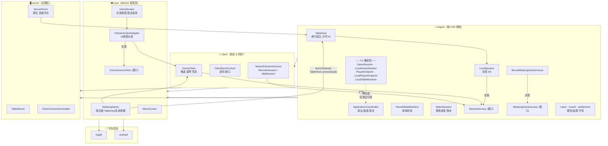

# 千术麻将 V2→V3 接口迁移状态 & 整体架构分析

> **分析基准**：2026-10-05 | 测试基线：**561 项全通过**（0 失败、0 跳过）
> **分析范围**：engine / client / core / server 四模块生产代码 + 95 个测试文件

---

## 一、模块拓扑与依赖图



> [!IMPORTANT]
> **禁止反向依赖**：engine 不得依赖 client、server 或 libGDX。违反此约束由 `ArchitectureBoundaryContractTest` 在 CI 中拦截。

---

## 二、V2 → V3 接口迁移状态总表

### 2.1 V2 兼容层（当前保留状态）

| V2 接口/类 | 文件位置 | 当前形态 | 产品链路使用 | 测试引用数 |
|---|---|---|---|---|
| `GameSession` | [`engine/.../session/GameSession.kt`](file:///d:/majiang/engine/src/main/kotlin/com/majiang/session/GameSession.kt) | 1行薄接口：`interface GameSession : PlayerEndpoint` | **❌ 无** | 3 个测试文件 |
| `LocalGameSession` | [`engine/.../session/LocalGameSession.kt`](file:///d:/majiang/engine/src/main/kotlin/com/majiang/session/LocalGameSession.kt) | 薄包装：继承 LocalPlayerEndpoint，无独立逻辑 | **❌ 无** | 3 个测试文件 |
| `PlayerEndpoint` | [`engine/.../client/PlayerEndpoint.kt`](file:///d:/majiang/engine/src/main/kotlin/com/majiang/client/PlayerEndpoint.kt) | 统一同步契约接口，含 `view()/submit()/subscribe()` | 作为继承基础（内部） | 1 个边界测试 |
| `LocalPlayerEndpoint` | [`engine/.../client/LocalPlayerEndpoint.kt`](file:///d:/majiang/engine/src/main/kotlin/com/majiang/client/LocalPlayerEndpoint.kt) | `open class`，LocalGameSession 的父类 | 内部继承基础 | — |
| `LocalTableRuntime` | [`engine/.../application/LocalTableRuntime.kt`](file:///d:/majiang/engine/src/main/kotlin/com/majiang/application/LocalTableRuntime.kt) | 节奏调度辅助类（0.15s idle 阈值驱动） | **❌ 无**（产品用 TableHost） | 1 个测试文件 |

> [!NOTE]
> `engine/src/main/kotlin/com/majiang/host/LocalTableRuntime.kt`（旧 V2 host 包路径）**已删除**。现存的 `application/LocalTableRuntime` 是保留给节奏测试的辅助类，不在产品链路。

### 2.2 V3 核心接口与类

#### engine 模块

| 类/接口 | 文件 | 职责 |
|---|---|---|
| `SessionAccess` | [`access/SessionAccess.kt`](file:///d:/majiang/engine/src/main/kotlin/com/majiang/access/SessionAccess.kt) | 统一整场异步访问接口（Future-based），13 个方法 |
| `MahjongGameAccess` | [`access/MahjongGameAccess.kt`](file:///d:/majiang/engine/src/main/kotlin/com/majiang/access/MahjongGameAccess.kt) | 绑定 roundId 的单局访问接口 |
| `BoundMahjongGameAccess` | [`access/BoundMahjongGameAccess.kt`](file:///d:/majiang/engine/src/main/kotlin/com/majiang/access/BoundMahjongGameAccess.kt) | MahjongGameAccess 标准实现 |
| `LocalSession` | [`access/local/LocalSession.kt`](file:///d:/majiang/engine/src/main/kotlin/com/majiang/access/local/LocalSession.kt) | 本地进程内 SessionAccess → TableHost |
| `TableHost` | [`host/TableHost.kt`](file:///d:/majiang/engine/src/main/kotlin/com/majiang/host/TableHost.kt) | V3 权威宿主：串行锁 + DecisionClock + AI + 连接代次 |
| `ApplicationCoordinator` | [`application/ApplicationCoordinator.kt`](file:///d:/majiang/engine/src/main/kotlin/com/majiang/application/ApplicationCoordinator.kt) | 应用层协调器：验证、候选审计、结果提交 |
| `MatchSession` | [`match/MatchSession.kt`](file:///d:/majiang/engine/src/main/kotlin/com/majiang/match/MatchSession.kt) | 整场生命周期、账本、进度、排名 |
| `RoundStateMachine` | [`round/RoundStateMachine.kt`](file:///d:/majiang/engine/src/main/kotlin/com/majiang/round/RoundStateMachine.kt) | 单局状态机，仅保存批准的状态变更 |
| `PlayerSnapshot` | `access/PlayerSnapshot.kt` | 按座位投影的完整只读快照（含出千余额、控制态） |
| `PlayerUpdate` | `access/PlayerUpdate.kt` | 增量更新 + 游标（保证顺序） |
| `DecisionClock` | `timing/DecisionClock.kt` | 每席位 20s 储备 + 3s 免费计时 |

#### client 模块

| 类/接口 | 文件 | 职责 |
|---|---|---|
| `GameClient` | [`client/GameClient.kt`](file:///d:/majiang/client/src/main/kotlin/com/majiang/client/GameClient.kt) | 候选管理、幂等提交、事件顺序、断线恢复 |
| `ClientSynchronizer` | `sync/ClientSynchronizer.kt` | 游标连续消费，缺口缓冲 |
| `NetworkSessionAccess` | `network/NetworkSessionAccess.kt` | TCP SessionAccess 实现（RemoteSession/MallSession） |

#### core 模块

| 类/接口 | 文件 | 职责 |
|---|---|---|
| `GameScreenClient` | [`presentation/GameScreenClient.kt`](file:///d:/majiang/core/src/main/kotlin/com/majiang/presentation/GameScreenClient.kt) | 表现层与客户端解耦契约（Future + Listener） |
| `V3GameClientAdapter` | [`presentation/V3GameClientAdapter.kt`](file:///d:/majiang/core/src/main/kotlin/com/majiang/presentation/V3GameClientAdapter.kt) | GameClient → GameScreenClient，展示线程回执派发 |
| `MahjongGame` | [`MahjongGame.kt`](file:///d:/majiang/core/src/main/kotlin/com/majiang/MahjongGame.kt) | V3 组合根：持有 TableHost，驱动 tick，管理 Screen 切换 |

---

## 三、产品默认调用链（完整 V3）

```
MahjongGame.launchGame()
  ↓
createLocalHost()  →  TableHost(MatchConfig)
  ↓
host.connect(seat=0)  →  LocalSession : SessionAccess
  ↓
GameClient(access = LocalSession, dispatch = Gdx.app::postRunnable)
  ↓
GameScreen(game, client)  →  V3GameClientAdapter : GameScreenClient
  ↓
render() 每帧：host.tick(isDiscardPlaybackBusy)
```

**生产代码中完全无 `PlayerEndpoint / GameSession / LocalPlayerEndpoint / LocalGameSession` 调用。**

---

## 四、V2 引用分布统计（生产代码 vs. 测试代码）

| 符号 | 生产代码引用 | 测试引用 |
|---|---|---|
| `GameSession` | **0**（仅自身定义） | 3 个文件（LocalGameSessionContractTest 等） |
| `LocalGameSession` | **0**（仅自身定义） | 3 个文件 |
| `LocalTableRuntime` | **0**（仅自身定义） | 1 个文件（RiichiPacingAcceptanceTest） |
| `PlayerEndpoint` | engine 内部继承链 | 1 个文件（ClientBoundaryAcceptanceTest） |
| `SessionAccess` | ✅ 大量（LocalSession、NetworkSessionAccess、GameClient、TableHost 等） | — |
| `TableHost` | ✅ 大量（MahjongGame、GameScreen、MenuScreen、ServerRoom、LocalSession 共 47 处） | — |
| `GameClient` | ✅ MahjongGame、V3GameClientAdapter、GameScreen | — |
| `MahjongGameAccess` | ✅ BoundMahjongGameAccess、NetworkSessionAccess、LocalSession | — |

> [!NOTE]
> **迁移结论**：V2 兼容层已与产品链路完全解耦。兼容层仅作为历史回归测试的载体保留，属于「engine 批2/批3」明确保留策略。

---

## 五、当前架构已知问题

### 🔴 P1 — `review/A.md` 5 项规则缺陷无逐项关闭证据

[`doc/architecture-v2/review/A.md`](file:///d:/majiang/doc/architecture-v2/review/A.md) 记录了：

1. `drawRinshan` 仅检查 `rinshanPointer < deadWall.size`，未限制到 0..3 槽位
2. `StateInvariants.containersEmpty` 漏检 `deadWallReplacements`
3. 有效王牌检查 `>= 14` 放过 0..13 的损坏状态（应 `== 14`）
4. 各阶段手牌计数约束不完整（DRAW/DISCARD/RESPONSE_WINDOW 要求不同）
5. 生产代码曾出现 `TestTableBuilder.kt`（已清理）

STATUS.md 仅提到"批次返修完成"，**缺少对上述 5 项的逐一对应验收记录**。

### 🟡 P2 — `LocalTableRuntime` 在 engine 生产包存在定位歧义

`LocalTableRuntime` 在 `engine/.../application/` 生产包中，但其唯一外部引用是一个节奏验收测试（`RiichiPacingAcceptanceTest`），产品实际使用 `TableHost`。它不属于 `testFixtures`，但实质上是测试辅助工具。

**建议**：移入 `engine/src/testFixtures`，或在 ARCHITECTURE.md 中明确注明"节奏测试专用辅助类，不在产品链路"。

### 🟡 P3 — `PlayerEndpoint` 同步方法缺少 `@Deprecated` 标注

V3 全链路已改为 `CompletableFuture` 异步，但 `PlayerEndpoint` 的 `view()`、`submit()`、`start()` 等方法仍为同步调用。若在网络适配路径上被意外使用，会产生阻塞风险。

### 🟢 P4 — `ArchitectureBoundaryContractTest` 注释使用 V2 措辞

[第 39 行注释](file:///d:/majiang/core/src/test/kotlin/com/majiang/state/ArchitectureBoundaryContractTest.kt#L35-L39)：
```kotlin
assertTrue(leaks.isEmpty(), "Action availability must come from the injected GameSession")
```
V3 已改用 `GameScreenClient`，注释应更新为 `GameScreenClient`，避免误导。

### 🟢 P5 — `AccessCapabilities` 与 `EndpointCapabilities` 语义重叠

`SessionAccess.capabilities()` → `AccessCapabilities`  
`PlayerEndpoint.capabilities` → `EndpointCapabilities`

两套能力声明含义相近，后续扩展可能产生不一致。长期宜合并或明确分工。

---

## 六、未完成功能范围边界

以下均在 STATUS.md 明确说明为**当前范围外**，不视为迁移遗漏：

| 功能 | 状态 |
|---|---|
| 摸打阶段千术（袖里乾坤/移花接木等） | ⏳ 洗牌阶段已接线；摸打阶段未开放 |
| 三人麻将规则 | ❌ 未实现 |
| 公网 TLS / 账户认证 | ❌ 局域网明文 TCP |
| 自动匹配大厅 UI | ❌ `MallSession` 结构存在，界面未完成 |
| 持久化崩溃恢复 | ❌ 未实现 |
| 主机迁移 | ❌ 未实现 |
| Android 真机验证 | ⚠️ 仅验证构建，未真机测试 |

---

## 七、建议行动项

| 优先级 | 项目 | 具体措施 |
|---|---|---|
| 🔴 P1 | 关闭 review/A.md 5 项规则缺陷 | 在 V2-CLEANUP-FIX-REVIEW.md 或 STATUS.md 逐项标注"已修复·对应测试" |
| 🟡 P2 | 明确 LocalTableRuntime 归属 | 移入 `engine/src/testFixtures`，或在 ARCHITECTURE.md 加注 |
| 🟡 P3 | PlayerEndpoint 同步方法加 `@Deprecated` | 防止新代码误入同步路径，注明"使用 SessionAccess 的 Future 接口" |
| 🟢 P4 | 更新 ArchitectureBoundaryContractTest 注释 | 将 "injected GameSession" 改为 "injected GameScreenClient" |
| 🟢 P5 | 统一能力声明（长期） | 规划 AccessCapabilities / EndpointCapabilities 合并或明确分工 |
