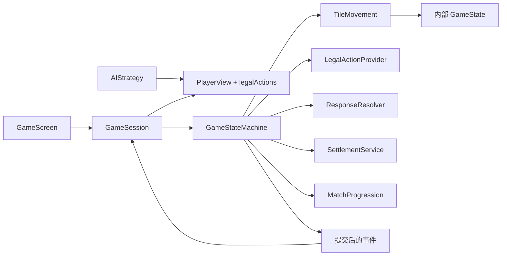

# 对局架构 V2：设计与验收契约

状态：Antigravity 已实现并完成返修，Codex 已通过独立验收；185 项测试、桌面/Android 构建与真实 OpenGL 冒烟通过。2026-09-29。具体范围与限制见 [REVIEW.md](REVIEW.md)。

## 1. 范围和职责

本轮只处理架构审查的 1（真实物理守恒）、2（动作合法性）、4（仲裁、结算与整场推进）、5（表现层/AI 边界）。不把完整千术玩法、网络服务、动画系统或全量役种重写混入本轮。

Codex 负责接口契约、独立验收测试、审查与复测。Antigravity 负责生产实现。实现者不得通过删除测试、放宽断言、捕获异常后假成功、恢复 UI 公开可变状态等方式获得通过。

保留 core/lwjgl3/android 的现有 Gradle 结构和版本。所有新增生产代码在 core 中。当前没有 Git 仓库；并行工作必须遵守 TASKS.md 的独占文件归属，不得全目录覆盖复制。

## 2. 目标依赖方向



领域内允许可变状态，领域外只暴露深拷贝、无可变底层引用的座位视图。引擎是唯一正常写入口。没有必要为了本轮引入 DI 框架或事件溯源框架。

## 3. 物理牌模型与原子移动（任务 A）

### 3.1 唯一身份和实际区域

Tile 的 typeIndex + copyIndex 表示 136 个合法物理身份；不以对象引用判断相同牌。每种 typeIndex 恰好四个 copyIndex。

所有权记录 `TileLocation(zone: Zone, player: Int = -1)` 必须精确到座位。WALL/DEAD_WALL 无座位，HAND/DISCARD/MELD/SLEEVE 有座位。玩家手牌归属不能继续默认为 -1。

保留当前 wall/deadWall 数组和指针的表示以降低迁移风险，但明确：

- 活牌山为 wall[wallPointer, wallEndExclusive)。新增 wallEndExclusive；初始化为 wall.size。
- 当前有效王牌为 deadWall[rinshanPointer, size) 加 deadWallReplacements。
- 每次岭上摸牌，从活牌山末端补入 deadWallReplacements，并缩小 wallEndExclusive。不得把补入牌加入岭上可摸槽位或改变宝牌索引。
- HAND = closedTiles + drawnTile；MELD = 所有 meld.tiles；DISCARD = 尚未被叫走的物理弃牌；SLEEVE 按座位存储。
- lastDiscard、calledTile、宝牌指示、历史事件、已消耗牌山槽位均为引用或历史，不是额外物理区域。
- 新增独立 discardHistory（不会因吃碰杠删除），供舍张振听使用。它也不参与物理计数。
- 尚未开局允许全 136 张 UNASSIGNED；开始发牌后不允许 UNASSIGNED。

### 3.2 审计

`StateInvariants.assertValid(state: GameState)` 必须从上述实际容器重建位置清单，检查：合法身份集合恰好 136、每张恰好一次、与 TilePool 位置逐张相等、指针界限、各副露结构、阶段对应的手牌等效张数。

`TilePool.assertConservation()` 保留兼容入口，但绑定 GameState 的池必须执行实际区域审计；不能仅检查 Map.size。测试和生产不能使用两个强弱不同的守恒定义。

审计不得顺手重建/修复账本，否则会隐藏移动遗漏。测试夹具可以用显式的 `TestTableBuilder` 初始化一张合法牌桌，但生产处理动作后不能自动重建账本。

### 3.3 移动接口

新增 `model/TileMovement.kt`，其方法接收 GameState，完整检查所有源、目标和参数后再修改容器与 TilePool。提供 deal、draw、discard、chi、pon、closedKan、addedKan、openKan、drawRinshan、swapHandWithWall、swapHandWithSleeve 等具名操作。错误时不得只完成一半移动。

允许引擎通过 deepCopy 候选状态执行命令、审计后一次提交，或通过完整预校验的事务实现相同效果。接口层必须满足“拒绝动作 = 状态与事件完全不变”，不能依赖 UI 保证参数正确。

未参与暗杠/加杠的 drawnTile 必须先合并回闭手，再放置岭上摸牌，不能覆盖丢牌。吃碰杠必须移动所有相关牌的所有权。

## 4. 命令入口与响应窗口（任务 D）

### 4.1 对外契约

新增 `state/ActionResult.kt`：

```kotlin
sealed interface ActionResult {
    data class Accepted(val events: List<GameEvent>) : ActionResult
    data class Rejected(val reason: RejectionReason) : ActionResult
}
enum class RejectionReason {
    INVALID_PLAYER, WRONG_PHASE, NOT_YOUR_TURN, TILE_NOT_OWNED,
    INVALID_COMBINATION, ACTION_NOT_AVAILABLE, ALREADY_RESPONDED,
    MATCH_FINISHED, UNSUPPORTED_ACTION
}
```

引擎 `handleAction(action): ActionResult` 保留名称。已有忽略返回值的调用仍能编译。非法用户动作返回 Rejected，不抛异常、不发领域事件、不修改随机源/状态/响应记录。内部不变量损坏必须显式失败，不能吞掉。

增加 `legalActions(player: Int): List<GameAction>`，校验与展示必须使用同一规则源。规则包含阶段、座位、当前玩家、精确 copyIndex 所有权、和牌形与有役、振听、立直条件、牌山/岭上容量和副露组合。系统动作不得从 GameSession.submit 放行。

`StartStacking` 仅允许尚未开局或 ROUND_END；MATCH_END 不能开始下一局。整场重开通过单独的会话生命周期创建新引擎。`DealComplete` 不作为玩家命令。无功能实现的千术返回 UNSUPPORTED_ACTION，不能 Accepted 空操作。

### 4.2 响应窗口

用 `ResponseWindow(id, fromPlayer, discard, eligibleActions, responses)` 代替 pendingAiResponse 单槽位。每个有合法响应的座位提交一次响应；无机会的座位自动 Pass；AI 与人类共用收集与裁决流程。

默认规则为头跳：Ron 优先于 Pon/OpenKan，后者优先于 Chi；同级按 `(seat - discarder + 4) % 4` 从近到远。Pon/OpenKan 同级；Chi 只允许下家。不得让人类天然优先于 AI。重复响应无副作用。

`Pass` 仅可用于当前开放的响应窗口；拒绝回合外 Pass。放弃合法 Ron 记录同巡振听，下一次该玩家正常/岭上摸牌后清除；立直后放弃 Ron 则持续到本局结束。合法动作生成和直接 DeclareRon 都必须检查。

加杠建立抢杠窗口，所有有效响应结束后才提交加杠和岭上摸牌。默认不允许立直后改变待牌的杠；若实现不能可靠验证，明确禁止该种杠并记录受限策略，不能错误放行。

### 4.3 事件与推进

状态完成校验和提交后再通知监听器。Rejected 不产生事件。监听器异常不得回滚已提交动作，也不得使下一动作停留在半完成状态。引擎内部自动动作使用可迭代队列，防止嵌套回调重新进入尚未提交的命令。

提供测试模式关闭 AI 自动推进，使一次断言准确观察一次领域提交。随机源通过构造器注入并给出默认值。此处仅为可靠测试和动作边界，不实现完整动画调度。

## 5. 结算与整场推进（任务 B）

### 5.1 纯服务接口

新增 settlement 包：

```kotlin
data class SettlementInput(
    val scores: List<Int>, val dealer: Int,
    val honba: Int, val riichiSticks: Int
)
data class SettlementResult(
    val deltas: List<Int>, val newScores: List<Int>,
    val remainingRiichiSticks: Int
)
class SettlementService {
    fun ron(input: SettlementInput, winner: Int, loser: Int,
            score: ScoreCalculator.ScoreResult): SettlementResult
    fun tsumo(input: SettlementInput, winner: Int,
              score: ScoreCalculator.ScoreResult): SettlementResult
    fun exhaustiveDraw(input: SettlementInput, tenpai: Set<Int>): SettlementResult
    fun abortiveDraw(input: SettlementInput): SettlementResult
}
```

- 荣和：放铳者支付基础得点 + 300 × 本场；赢家回收全部供托。
- 自摸：每个付款者在其基础付款上增加 100 × 本场；赢家回收全部供托。
- 和了后供托清零；流局保留供托。
- 荒牌流局 1/2/3 人听牌时共支付 3000；0/4 人听牌无收支。途中流局不支付罚符。
- 核算 `sum(newScores)+remainingRiichiSticks*1000 == sum(oldScores)+oldRiichiSticks*1000`。
- deltas 必须与 newScores-oldScores 逐座位一致，包含本场与供托；不要错误要求供托结算时 deltas 自身为零和。
- 引擎统一应用结果；每次和了/流局都发一次 ScoreSettled，不得重复结算。

符、役、点数评估必须对应同一拆解，并选择最终得点最高的合法解释；不能役取最优拆解而符取第一个拆解。任务 B 提供纯计算组合服务，任务 D 接入。既有役种识别范围不在本轮扩充。

### 5.2 场次推进

新增 `match/MatchProgression.kt`：输入当前庄家、场风、局号、本场、结算后分数、RoundOutcome；输出 `NextRound` 或 `MatchFinished`，服务不得直接修改 GameState。

明确 roundNumber 为场内 0..3，roundWind 为 1..3。DealerWin：连庄、本场+1；NonDealerWin：换庄、推进局数、本场归零；ExhaustiveDraw：庄家听牌连庄，否则换庄；两种荒牌结果本场均+1；AbortiveDraw：连庄、本场+1。这是对旧规则文档第 3 节“庄家不听流局本场归零”简写的修订，在交付时同步文档。

采用规则配置表达终局策略，不隐含硬编码：默认半庄，分数 < 0 飞人，南四正常换庄时有人达到 30000 则结束，否则西入；西入在一局结算后有人达到 30000 即结束，最迟西四换庄结束。南四庄家达到 30000 且独占最高时提供可选终了动作，否则可连庄；同分不默认触发该选择。最终并列顺序按初始座位顺序，并在结果中明示。

终局剩余供托按配置给予最终第一名，并更新最终分数/收支；只发一次 MatchEnded。选择终了是公共动作，界面需有入口。通过规则参数测试简化的东风场/禁西入配置，禁止测试依赖随机打完整半庄才能验证推进。

RoundEnded 对应刚结束的局。仅在用户调用 nextRound 时应用已计算的下一局元数据，不允许重复点击重复推进。终局不可 nextRound。

## 6. 会话、视图与 AI 边界（任务 C）

新增 session 包：

```kotlin
interface GameSession {
    val viewerSeat: Int
    fun view(): PlayerView
    fun legalActions(): List<GameAction>
    fun start(): ActionResult
    fun submit(action: GameAction): ActionResult
    fun nextRound(): ActionResult
    fun subscribe(listener: (SessionUpdate) -> Unit): AutoCloseable
    fun close()
}
```

`PlayerView` 是深拷贝值对象：自己 closedTiles/drawnTile；他家只给暗牌数量；公开 melds/discards/dora/scores/round metadata/phase；合法动作仅属于观察座位。不得包含 GameState/PlayerHand/TilePool、他家暗牌、牌山顺序、未公开里宝或其他座位的合法动作。

`SessionUpdate` 携带更新后的 PlayerView 和公开结果/本座位可见事件；绝不直接把全量 TileDealt/TileDrawn 广播给界面。UI 牌河以视图为准，避免暗杠/加杠误删牌河。

`LocalGameSession` 由组合根创建并持有引擎；GameScreen 通过构造器注入会话（可保留创建默认本地会话的便利构造）。删除 GameScreen 公开 state/fsm，不再直接依赖 RiichiRuleEngine。按钮只取 legalActions；副露后自摸不能写死暗牌数 >=14。

AI 策略改为接收自己的 PlayerView 与该座位合法动作，返回其中一个动作。禁止传完整 GameState，AIPlayer 可以作为领域侧适配器负责取得视图。Basic/Trivial 两个策略保持原有倾向；迁移测试由 Codex 负责。

隐藏暗杠牌等公开信息细节与本地规则配置保持一致；不可为了测试方便暴露调试状态。测试通过 test 源集中的夹具/引擎装配创建所需局面，再注入 LocalGameSession 或 FakeGameSession。

视图中 List/Map 至少做深拷贝，不能把内部 MutableList 当作只读 List 返回；最好使用不可修改包装。无论调用者如何处理旧视图，都不得影响引擎或未来视图。

## 7. 交付门槛

参见 ACCEPTANCE.md。每个开发任务需填写独立交付文件：修改清单、接口偏差、已知限制、自检日志路径。公共契约变更先提出变更单，不允许并行任务自行漂移。

只有完成生产集成、全部验收及既有测试迁移、桌面编译与 Android debug 构建后，才能标为完成。文档或脚手架完成不等于实现完成。
