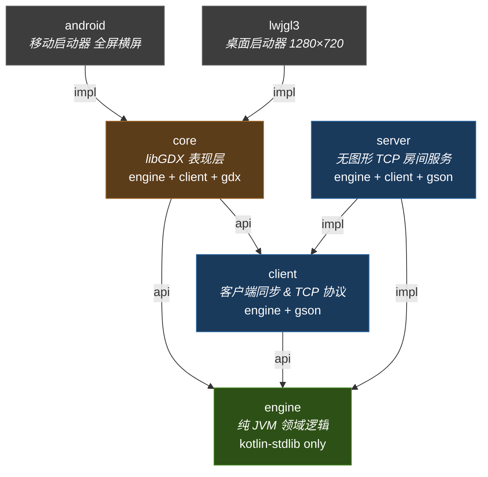
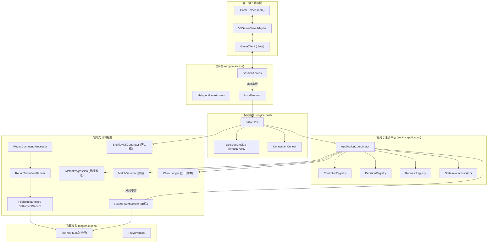
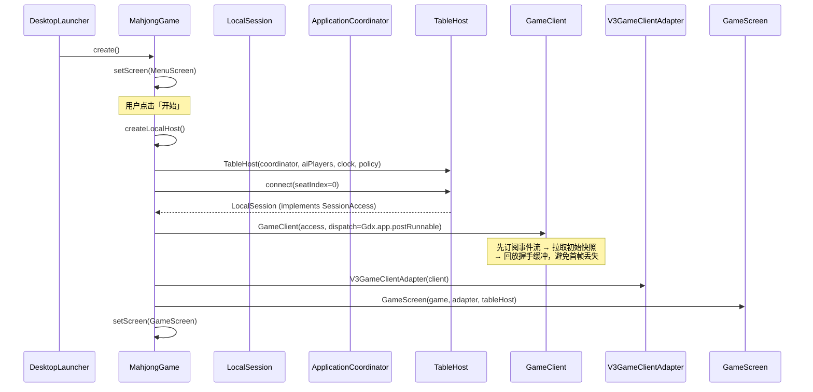
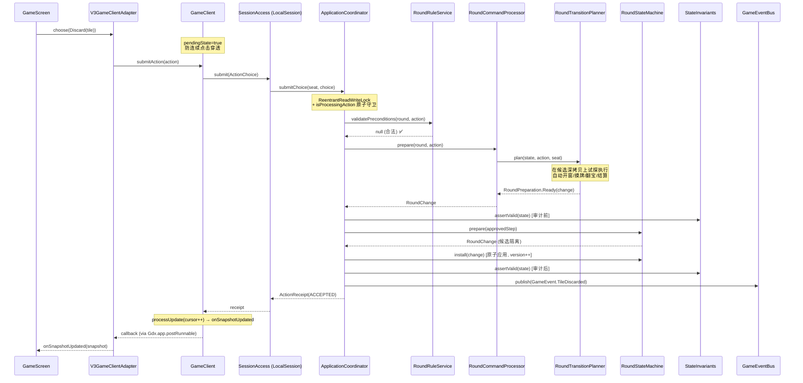
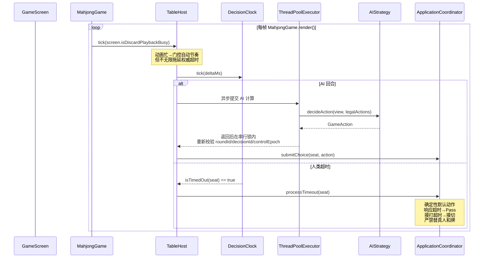
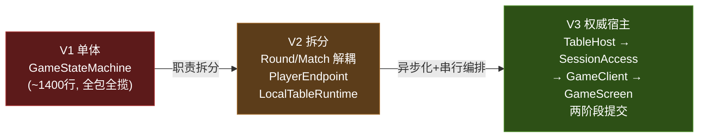

# 🀄 千术麻将 — 架构全面审查报告

> **审查日期**: 2026-10-02  
> **代码库**: `d:\majiang` · 包名 `com.majiang.*`  
> **技术栈**: Kotlin 2.4.10 / libGDX 1.14.2 / Gson 2.11.0 / LWJGL3 / Android  
> **构建系统**: Gradle 9.7.1 (Groovy DSL) — 6 子模块  
> **测试基线**: **556 项测试，100% 通过**（0 失败、0 错误、0 跳过）  
> **Engine 外部依赖**: **仅 kotlin-stdlib**（零序列化/网络/UI 框架）

---

## 一、模块分层全景

六模块严格单向 DAG，无循环依赖。`ArchitectureBoundaryContractTest` 已通过反射断言验证分层隔离。



| 模块 | 职责 | 关键组件 | 测试 |
|------|------|----------|------|
| **engine** | 纯 JVM 领域：规则、状态机、码牌、AI、千术经济、计时、事件总线、结算 | 20 个子包，`java-test-fixtures` 导出 | ~35 文件 |
| **client** | `GameClient` 有序同步、游标重同步、TCP 传输、Gson 协议（3500+ 行手写适配器） | 4 个包，8 个源文件 | 3 文件 |
| **core** | `MahjongGame` 组合根、`GameScreen` (3899 行)、四家副露/听牌面板/洗牌千术面板/结算弹窗 | 4 个包，25 个源文件 | 无头 GL 测试 |
| **server** | `TableServer` TCP + 50ms ticker、`ServerRoom` 席位绑定/连接代次/断线托管 | 3 个文件 | 2 文件 |
| **lwjgl3** | 桌面启动（1280×720, 60FPS, VSync） | `DesktopLauncher` | — |
| **android** | Android 启动（沉浸横屏, minSdk 21, targetSdk 36, desugaring） | `AndroidLauncher` | — |

> [!TIP]
> **Server 依赖 client** 是为了复用 `NetworkFrameCodec` / `NetworkMessages` / `ProtocolJson` 协议层，客户端-服务端使用**同一套 TCP 长度前缀 JSON 帧**通信 ✅

---

## 二、Engine 内部架构（20 个子包）



### 核心职责详述

| 包 | 核心类 | 职责 |
|----|--------|------|
| `round/` | `RoundStateMachine` | **两阶段提交**：`prepare(ApprovedRoundStep) → RoundChange`（候选隔离）→ `install(RoundChange)`（原子应用 + version++）。`readState()` 返回深拷贝 |
| `round/` | `RoundRuleService` | 纯函数式：`legalActions(round, seat)`、`validatePreconditions(round, action)` |
| `round/` | `RoundCommandProcessor` | 组合门面：`prepare(round, action) → RoundPreparation.Ready/Rejected`，零副作用 |
| `round/` | `RoundTransitionPlanner` | 在候选深拷贝上试探执行：自动开窗/自动摸牌/自动翻宝/自动结算 |
| `match/` | `MatchSession` | 整场聚合根。`SessionLifecycle`: CREATED → WAITING_START → ROUND_ACTIVE → ROUND_RESULT → FINISHED/CLOSED |
| `match/` | `MatchProgression` | 纯函数赛程推进：连庄/下家庄/入南/西入/击飞/尾庄和止 |
| `application/` | `ApplicationCoordinator` | 串行执行中心（`ReentrantReadWriteLock` + `isProcessingAction` 原子守卫），聚合 9+ 子组件 |
| `host/` | `TableHost` | 权威宿主：`tick()` 步进、AI 异步线程池计算、洗牌 10 秒准备窗口、连接管理 |
| `access/` | `SessionAccess` | `CompletableFuture` 异步契约：`snapshot()`、`decision()`、`submit()`、`subscribe()`、`resume(cursor)` |
| `state/` | `GameStateMachine` | 底层状态机（与 `RoundStateMachine` 关系见问题 #1） |
| `state/` | `ResponseResolver` / `ResponseWindow` | 竞争响应裁决：荣和 > 碰 > 吃 |
| `state/` | `StateInvariants` | 运行时断言：物理守恒、账本匹配 |
| `rules/` | `RiichiRuleEngine` | 外观类：`HandDecomposer` + `YakuEvaluator` + `FuCalculator` + `ScoreCalculator` + `FuritenRules` + `RiichiKanValidator` |
| `model/` | `TilePool` | 136 张守恒池，7 种 Zone，`transfer()` + `assertConservation()` |
| `model/` | `TileMovement` | 唯一物理变动执行器，严格同步容器与 `TilePool` |
| `model/` | `Tile` | `suit` + `rank` + `copyIndex`(0..3) → `tileId`(0..135) + `typeIndex`(0..33)，`isRedFive` = 数牌5 且 copyIndex==3 |
| `cheat/` | `CheatActionExecutor` | 四大绝技物理执行（袖里乾坤/移花接木/神仙透视/声东击西） |
| `cheat/` | `SuspicionSystem` | AI 怀疑度 0~100%、视线游走、捉奸在床判定 |
| `economy/` | `CheatLedger` | 原子扣费、幂等重试、跨局结转、流水明细 |
| `timing/` | `DecisionClock` | 20+3 计时：3 秒免费 → 20 秒储备 → 3 秒快速出牌 |
| `event/` | `GameEventBus` | 不可变 `GameEvent`（sealed class 20+ 子类型）发布/订阅 |
| `settlement/` | `SettlementService` | 和牌/流局数学结算，物理点数守恒断言 |
| `stacking/` | `ShuffleWallGenerator` | 确定性牌山：6 类目标、34 维重叠矩阵、有界局部采样、王牌区严格隔离 |
| `session/` | `PlayerView` / `TenpaiPreviewProvider` | 座位脱敏投影、常驻听牌推导（含振听告警） |
| `ai/` | `AIStrategy` | 策略接口 + `TrivialAIStrategy` + `TsumogiriAIStrategy` |
| `control/` | `ConnectionControl` / `DisconnectPolicy` | 连接代次、托管策略（IMMEDIATE_AI / GRACE_THEN_AI / TIMEOUT_ONLY） |

---

## 三、V3 运行时调用链

### 单机启动全链路



### 单局动作处理（两阶段提交）



### AI 与计时驱动



---

## 四、客户端-服务端网络架构

> [!NOTE]
> **协议一致性已验证** ✅ — Server (`TableServer` ServerSocket) 和 Client (`ClientTransport` Socket) 均使用**原始 TCP** + 共享的 `NetworkFrameCodec`（4 字节大端长度前缀 + UTF-8 JSON，4MB 上限），共享 `NetworkMessages`（`protocolVersion = 3`）和 `ProtocolJson`（Gson 严格白名单）。

```mermaid
graph LR
    subgraph "客户端进程"
        GC["GameClient<br/>(游标同步/请求门控)"]
        NSA["NetworkSessionAccess<br/>↳ RemoteSession (LAN)<br/>↳ MallSession (大厅)"]
        CT["ClientTransport<br/>(异步 TCP, 有界写队列)"]
        NFC1["NetworkFrameCodec<br/>+ ProtocolJson"]
    end

    subgraph "服务端进程"
        TS["TableServer<br/>(ServerSocket + 50ms Ticker)"]
        NFC2["NetworkFrameCodec<br/>+ ProtocolJson"]
        SR["ServerRoom<br/>(席位绑定/连接代次<br/>resumeToken/断线托管)"]
        TH["TableHost (权威宿主)"]
        AC["ApplicationCoordinator"]
    end

    GC --> NSA
    NSA --> CT
    CT --> NFC1
    NFC1 <-->|"TCP 长连接<br/>[4B len][JSON]"| NFC2
    NFC2 --> TS
    TS --> SR
    SR --> TH
    TH --> AC

    style NFC1 fill:#1a3a5c,stroke:#2e6ea6,color:#fff
    style NFC2 fill:#1a3a5c,stroke:#2e6ea6,color:#fff
```



### 会话实现

| 实现 | 位置 | 入口 | 状态 |
|------|------|------|------|
| `LocalSession` | engine `access/local/` | `TableHost.connect(seat)` | ✅ 完整可用 |
| `RemoteSession` | client `network/` | `create/join/resume/listRooms` | ✅ 局域网 TCP，无 TLS |
| `MallSession` | client `network/` | 继承 `NetworkSessionAccess`，共享 TCP 协议 | ⚠️ 接入规范定义，公网服务未实现 |

> [!IMPORTANT]
> `LocalSession` 位于 **engine** 模块（非 client），使得 engine 可以独立完成本地直连而不反向依赖 client ✅

---

## 五、发现的架构问题

### 🔴 严重问题

#### 1. `RoundStateMachine` (round/) 与 `GameStateMachine` (state/) 并存，关系不清晰

Engine 中存在两个状态机类，均以 `GameState` + `TilePool` 为核心：

| 类 | 包 | 配套组件 |
|----|-----|----------|
| `GameStateMachine` | `state/` | `LegalActionProvider`, `ResponseResolver`, `ResponseWindow`, `StateInvariants`, `SeatController` |
| `RoundStateMachine` | `round/` | `RoundRuleService`, `RoundCommandProcessor`, `RoundTransitionPlanner`, `RoundChange` |

**问题**：
- `state/GameStateMachine` 头部注释标注为 **"核心游戏状态机兼容适配器 (Architecture V2)"**，但它拥有 `state/` 包下 5 个核心配套组件
- `round/RoundStateMachine` 是 V3 主路径（`ApplicationCoordinator` 直接使用），采用两阶段提交（`prepare/install`）
- 新开发者无法从代码结构判断哪个是权威实现
- `state/` 包下的 `LegalActionProvider`、`ResponseResolver`、`StateInvariants` 被多处引用，是否属于遗留或核心？

**建议**：
- 明确标注 `GameStateMachine` 为 `@Deprecated`
- 若 `state/` 包下的辅助组件（`LegalActionProvider` 等）是 V3 核心依赖，将它们迁移到 `round/` 或独立的 `state/core/` 子包
- 消除命名混淆：一个项目中不应有两个功能高度重叠的状态机类

---

### 🟡 中等问题

#### 2. `ApplicationCoordinator` 聚合 9+ 子组件

[`ApplicationCoordinator`](file:///d:/majiang/engine/src/main/kotlin/com/majiang/application/ApplicationCoordinator.kt) 内部聚合：

```
RoundRuleService, RoundCommandProcessor, RoundTransitionPlanner,
ControllerRegistry, RequestRegistry, DecisionRegistry,
SettlementService, RoundResultValidator, SessionCommandValidator
```

并持有 `ReentrantReadWriteLock` + `isProcessingAction` 原子守卫实现严格串行。虽然每个子组件职责聚焦，但编排器承担了**验证、注册、决策、结算、审计**多重协调。

**评估**: 编排器就应该是"胶水"，当前聚合规模在可控范围内。但若继续增长，建议将验证链抽取为 `ValidationPipeline`。

#### 3. 遗留类缺少 `@Deprecated` 标注

AGENTS.md 明确标注为兼容入口的类，仅 `MahjongGame` 中两个旧入口方法有 `@Deprecated` 注解。以下类虽有注释声明但**无编译器级标注**：

| 遗留类 | 位置 | 注释状态 |
|--------|------|----------|
| `GameStateMachine` | engine `state/` | 头部注释标注 V2 兼容 |
| `GameSession` | engine `session/` | 头部注释标注兼容适配层 |
| `LocalGameSession` | engine `session/` | 头部注释标注兼容薄适配层 |
| `PlayerEndpoint` | engine `client/` | 无显式标注 |
| `LocalPlayerEndpoint` | engine `client/` | 无显式标注 |
| `LocalTableRuntime` | engine `application/` | 产品环境已被 `TableHost.tick()` 取代 |

**建议**: 添加 `@Deprecated` 注解 + `DeprecationLevel.WARNING`，让 IDE 对误用产生警告。

#### 4. Engine `com.majiang.client` 包名与 client 模块包名冲突

Engine 模块的 `com.majiang.client`（含 `PlayerEndpoint`、`LocalPlayerEndpoint`）与 client 模块的 `com.majiang.client`（含 `GameClient`）使用**完全相同的包名**。

**影响**：IDE 导航中同一包名出现在两个源根；无法从包名判断文件归属。

**建议**: 将 engine 遗留端点迁移到 `com.majiang.compat` 或 `com.majiang.legacy`。

#### 5. AI 摸切策略实现重复

| 策略类 | 位置 | 行为 |
|--------|------|------|
| `TrivialAIStrategy` | engine `ai/` | 摸切，但会声明荣和/自摸 |
| `TsumogiriAIStrategy` | engine `host/ai/` | 纯粹摸切弃权 |

`TableHost` 生产绑定使用 `TsumogiriAIStrategy`，`TrivialAIStrategy` 仅在旧单测中引用。

**建议**: 合并至 `host/ai/` 命名空间，或将 `TrivialAIStrategy` 移入测试夹具。

#### 6. 千术系统阶段性割裂

| 阶段 | 状态 |
|------|------|
| **洗牌阶段千术**（偷天换日/瞒天过海/六大目标） | ✅ 完全接入 V3 权威链路（10 秒准备窗口、原子记账） |
| **摸打阶段千术**（袖里乾坤/移花接木/神仙透视/声东击西） | ⚠️ 执行器骨架存在，但**尚未对接 `TableHost` 的时钟与决策门禁** |

`CheatActionExecutor` 和 `SuspicionSystem` 的代码已存在，但与主流程的集成点（何时触发、如何门控、经济扣费是否走 `CheatLedger`）尚未完全连通。

**建议**: 后续开发摸打千术时，参考洗牌阶段的原子记账与确认时钟模式，避免直接穿透修改权威 `GameState`。

---

### 🟢 轻微问题

#### 7. 测试双轨制与异步覆盖缺口

- 大量 `core` UI 测试基于 `FakeGameSession`（同步替身）+ `LegacyEndpointAdapter` 运行，**未覆盖 V3 真实异步事件重排和网络恢复链路**
- V3 异步表现主要依靠 `AsyncScreenAcceptanceTest` 和 OpenGL 冒烟测试覆盖
- 网络传输层（`NetworkSessionAccess`、`ClientTransport`）无专用单元测试
- 端到端 client→server 完整回合无集成测试

**建议**: 逐步补充基于 `TestTableBuilder` + `LocalSession` 的 V3 集成测试，减少对 `FakeGameSession` 的过度依赖。

---

## 六、遗留兼容层演进历史



| 遗留类 | V3 对应 | 关系 |
|--------|---------|------|
| `GameStateMachine` | `RoundStateMachine` + `ApplicationCoordinator` | 内部持有 coordinator，双向同步镜像 |
| `GameSession` / `LocalGameSession` | `SessionAccess` + `MahjongGameAccess` | 继承 `PlayerEndpoint`，薄适配层 |
| `PlayerEndpoint` (pull-based) | `SessionAccess` (push-based subscribe) | 范式转换：同步等待→异步订阅 |
| `LocalTableRuntime` (0.15s 心跳) | `TableHost.tick()` (帧驱动) | 驱动模式转换 |
| `LegacyEndpointAdapter` | `V3GameClientAdapter` | 旧→新桥接（同步→Future） |
| `V3EndpointCompat` | — | 新→旧只读防护（写操作返回 UNSUPPORTED_ACTION） |

> [!NOTE]
> 所有遗留类**零重复领域逻辑**，全部委托 V3 内部实现。`GameStateMachine` 通过 `attachLegacyMirror` 双向同步，允许旧测试直接修改 state 属性后无缝同步回权威 `RoundStateMachine`。

---

## 七、测试覆盖全景

### 总览

- **556 项测试 · 100% 通过 · 零 TODO/FIXME/HACK**
- **42+ 测试文件** + OpenGL 冒烟截图验证
- **`java-test-fixtures`** 导出共享夹具（`TestTableBuilder`、`FakeGameSession`、`MeldChoiceFixtures`）

### 详细覆盖矩阵

| 领域 | 测试文件 | 评级 |
|------|---------|------|
| **规则引擎** | `HandDecomposerTest`, `YakuEvaluatorTest`, `FuCalculatorTest`, `ScoreCalculatorTest`, `WinningScoreEvaluatorTest`, `FuritenRulesTest`, `RiichiKanValidatorTest` | ✅ 优秀 |
| **状态系统** | `GameStateMachineTest`, `LegalActionProviderTest`, `ResponseResolverTest`, `StateInvariantsTest` | ✅ 优秀 |
| **Round 系统** | `RoundStateMachineTest`, `RoundRuleServiceTest`, `RoundCommandProcessorTest`, `RoundTransitionPlannerTest` | ✅ 优秀 |
| **物理模型** | `TileTest`, `PlayerHandTest`, `TilePoolTest`, `MeldTest` + 牌张移动守恒审计 | ✅ 良好 |
| **Match 系统** | `MatchSessionTest`, `MatchProgressionContractTest` | ✅ 良好 |
| **应用编排** | `ApplicationCoordinatorTest` | ✅ 良好 |
| **宿主与 V3** | `TableHostTest` + 节奏/时钟/AI 锁外隔离 | ✅ 良好 |
| **计时** | `DecisionClockTest` | ✅ 良好 |
| **千术/经济** | `CheatActionExecutorTest`, `SuspicionSystemTest`, `CheatLedgerTest` | ✅ 良好 |
| **事件** | `EventIsolationContractTest` | ✅ 良好 |
| **码牌** | `ShuffleWallGeneratorTest` + 偷天换日/瞒天过海 | ✅ 良好 |
| **结算** | `SettlementServiceTest` | ✅ 良好 |
| **听牌预览** | `TenpaiPreviewTest` (含振听) | ✅ 良好 |
| **架构边界** | `ArchitectureBoundaryContractTest` (反射断言) | ✅ 良好 |
| **客户端** | `GameClientTest`, `NetworkFrameCodecTest`, `ClientSynchronizerTest` + 游标/乱序/缺口自愈 | ✅ 良好 |
| **服务端** | `ServerRoomTest`, `TableServerTest` + TCP 代次/托管 | ✅ 基本 |
| **Core 渲染** | 弃牌动画、宝牌特效、高斯模糊、皮肤映射、副露展示、听牌面板 | ✅ 无头 GL |
| **遗留兼容** | `LocalPlayerEndpointTest`, `LocalGameSessionContractTest` | ✅ 回归 |
| **网络传输** | `NetworkSessionAccess`, `ClientTransport` | ❌ 无专用测试 |
| **端到端集成** | 完整 client→server 回合 | ❌ 无集成测试 |

---

## 八、架构优点总结

| # | 亮点 | 说明 |
|---|------|------|
| 1 | **Engine 零外部依赖** | 仅 kotlin-stdlib，实现极致领域隔离。无序列化框架意味着所有 mapping 集中在 client/server 的 `ProtocolJson` 中 |
| 2 | **两阶段提交** | `RoundStateMachine.prepare()` 候选隔离 → `install()` 原子应用，杜绝半提交 |
| 3 | **串行执行保障** | `ApplicationCoordinator` 通过 `ReentrantReadWriteLock` + 原子守卫确保零并发，审计前后双重 `StateInvariants.assertValid()` |
| 4 | **物理守恒律** | `TilePool.assertConservation()` + `TileMovement` 唯一变动执行器，136 张牌永远闭环 |
| 5 | **事件驱动 FX 解耦** | `GameEventBus` 不可变事件 → 表现层 `TileDrawBuffer` 指令缓冲 → 单批次渲染 |
| 6 | **cursor 有序同步** | `ClientSynchronizer` 连续游标 + 乱序重排缓冲 + 缺口链式自愈（Gap Recovery） |
| 7 | **GameClient 防穿透** | `pendingState` 原子锁 + 物理牌身份匹配 `PlayerDecision.options`，杜绝 rawAction 伪造和连击穿透 |
| 8 | **适配器三层隔离** | `SessionAccess` → `GameClient` → `V3GameClientAdapter` → `GameScreenClient` → `GameScreen` |
| 9 | **20+3 计时 + AI 线程池** | AI 在 `ThreadPoolExecutor` 异步计算，返回后在串行锁内三重校验（roundId/decisionId/controlEpoch） |
| 10 | **千术经济独立** | 原子扣费、幂等重试、跨局结转、流水追踪，独立于麻将点数 |
| 11 | **连接代次鉴权** | `ServerRoom` 的 `generation` + 不可猜测 `resumeToken`，旧连接自动失效 |
| 12 | **遗留迁移零重复** | 全部委托 V3 实现 + 双向同步镜像，保留回归测试 |
| 13 | **556 测试零失败** | 代码质量基线扎实，`ArchitectureBoundaryContractTest` 编译级验证分层 |

---

## 九、改进优先级建议

| 优先级 | 问题 | 工作量 | 影响 | 建议 |
|--------|------|--------|------|------|
| **P0** | 双状态机并存混淆 | 中 | 架构清晰度 | 标注 `GameStateMachine` @Deprecated；明确 `state/` 包辅助组件归属 |
| **P1** | 遗留类缺 `@Deprecated` | 小 | 防误用 | 5 个类添加注解 |
| **P1** | Engine `com.majiang.client` 包名冲突 | 小 | 开发体验 | 迁移至 `com.majiang.compat` |
| **P1** | AI 策略重复 | 小 | 代码整洁 | 合并或移入 testFixtures |
| **P2** | 摸打阶段千术未接入 | 大 | 功能完整性 | 参考洗牌模式设计 |
| **P2** | 网络层测试缺失 | 中 | 可靠性 | 补充 `NetworkSessionAccess`、`ClientTransport` 测试 |
| **P2** | 端到端集成测试缺失 | 中 | 整体信心 | 编写 client→server 完整回合测试 |
| **P3** | 测试双轨制 | 中 | V3 覆盖深度 | 逐步用 `TestTableBuilder` + `LocalSession` 替代 `FakeGameSession` |
| **P3** | `ApplicationCoordinator` 复杂度 | 中 | 可维护性 | 观察增长，必要时抽取 `ValidationPipeline` |
| **P3** | Server 依赖 client 暴露过多 | 小 | 模块边界 | 可考虑抽取 `protocol` 模块 |

---

> [!IMPORTANT]
> **总体评价**：这是一个**架构设计非常成熟**的项目。六模块分层严格、领域隔离彻底（engine 零外部依赖）、两阶段提交保障一致性、556 测试零失败。主要问题集中在**双状态机命名混淆**和**遗留标注不足**——均为可快速解决的低风险项。核心架构无需大幅调整，整体质量在同类项目中属于上乘。
