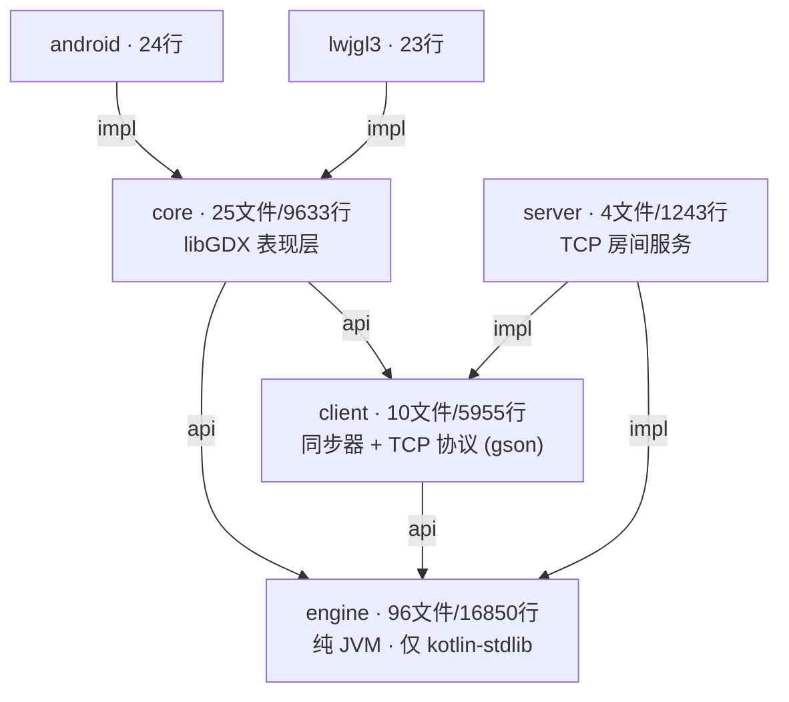
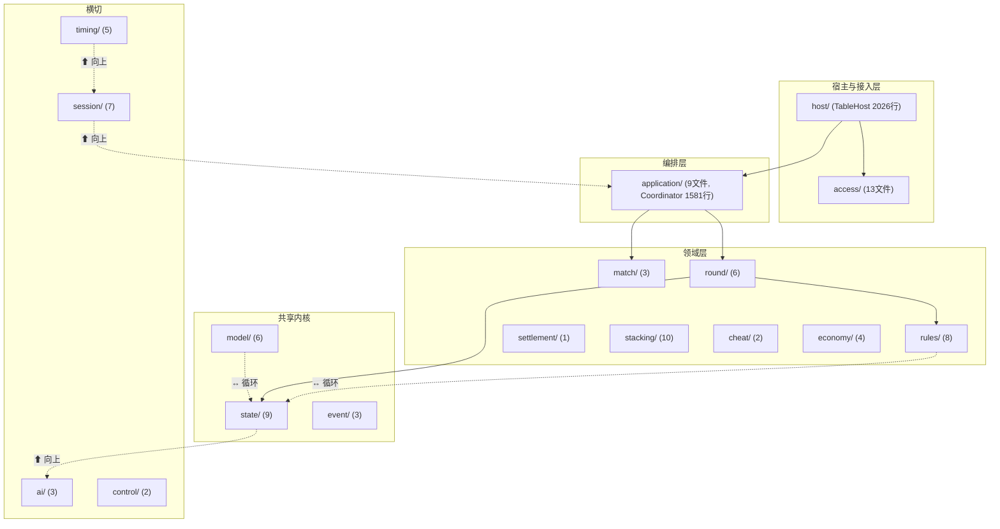

# 🀄 千术麻将 — 代码结构与耦合分析报告

> **日期**: 2026-10-05  
> **方法**: 双路并行源码审查（跨模块边界 + engine 内部包依赖），全部结论附文件级证据  
> **基线**: 518 项测试全绿（2026-10-03 GameStateMachine 合并后）；前序报告 [ARCHITECTURE_REVIEW_2026-10-02.md](ARCHITECTURE_REVIEW_2026-10-02.md)、[DESIGN_ISSUES_ANALYSIS.md](DESIGN_ISSUES_ANALYSIS.md)  
> **测试与运行验证**: `./gradlew test` 518/0/0；桌面版实机启动-运行-退出闭环正常

---

## 一、总体结构（健康 ✅）

### 模块依赖 DAG（无循环，零层次违规）

**验证过的边界事实**：

| 检查项 | 结果 |
|---|---|
| engine main → libGDX / com.majiang.core | **零命中** ✅ |
| server main → libGDX | **零命中** ✅ |
| 启动器厚度 | lwjgl3 全部 23 行、android 24 行，纯薄壳 ✅ |
| engine 对外依赖 | 仅 kotlin-stdlib（无序列化/网络/UI 框架）✅ |
| 模块间循环 | 无（Gradle DAG 单向）✅ |

**规模与测试**: 测试共 93 文件约 11600 行（engine 51 / core 33 / client 7 / server 2）+ engine testFixtures 3 个（被 core/server 复用）。

### engine 22 个包的层次模型（理想 vs 实际）

依赖方向总体清晰：`host → access/application → round/match → rules/state → model`。**问题集中在下图标注的虚线处**（见第三节）。

---

## 二、与前次报告（10-02）对照：已解决项

| 前次问题 | 状态 |
|---|---|
| 🔴 P0 双状态机并存（GameStateMachine 混淆） | ✅ **已解决** — 2026-10-03 按方案A彻底删除，25 个依赖文件迁移至 ApplicationCoordinator，镜像同步代码（~110行）清除，518 测试全绿（[GSM_MERGE_PLAN.md](GSM_MERGE_PLAN.md) 执行记录） |
| 🟡 P1 GameStateMachine 缺 @Deprecated | ✅ 随删除终结 |
| 模块分层 / 物理守恒 / 两阶段提交等优点 | 保持，未回归 |

其余前次问题（裂包、兼容层标注、AI 策略重复等）**仍然存在**，下面结合新证据细化。

---

## 三、耦合问题清单（本次核心发现，按严重度排序）

### 🔴 C1：`GameScreen` 巨类 — 全工程最大耦合点

**证据**（core/src/main/kotlin/com/majiang/screen/GameScreen.kt）：

| 指标 | 数值 |
|---|---|
| 行数 | **3898**（全工程第 1） |
| 属性声明 | **568 个** val/var |
| 方法 | 77 个 |
| import 覆盖包 | **13 个**（gdx 13 个类 + render 11 + presentation 7 + session 6 + state 3 + model 3 + client 3 + access 3 + rules/event/application/MahjongGame 各 1） |
| Gdx.* 静态调用 | 34 处 |

**耦合的具体形态**：

1. **一个类同时承载两条协议路径**：既持有 V3 的 `GameScreenClient`/`V3GameClientAdapter`/`GameClient`，又通过 3 个兼容二级构造器接收 `PlayerEndpoint`/`GameSession` 并包装成 `LegacyEndpointAdapter`（GameScreen.kt:84-110）。渲染、输入、动画状态机、双协议适配、结算展示全部内联。
2. **越层引用**：表现层直接 import `com.majiang.rules.FuritenStatus`（规则包）与 `com.majiang.state.{ActionResult,GameAction,GamePhase}`（内核状态），绕过了 `session.PlayerView` 投影层设计的脱敏边界。
3. 568 个属性意味着任何渲染/输入/动画改动都在同一个作用域里进行，变更影响面不可局部化。

**建议**：按职责拆分为 `GameScreenOrchestrator`（生命周期/适配器选择）+ `TableRenderer`（牌桌绘制）+ `PlayerActionPanel`（输入门控）+ `ResponsePanel`（鸣牌/立直选择）等；先把三个 V2 兼容构造器移出主类（配合 C4 兼容层退场）。

---

### 🟠 C2：engine 内部包级循环依赖（2 组）

| 循环 | 证据 |
|---|---|
| **model ↔ state** | model/TileMovement.kt:3、model/TilePool.kt:3-4 `import com.majiang.state.{GameState,StateInvariants}`；反向 state/GameState.kt:116 持有 `model.TilePool` |
| **rules ↔ state** | rules/RiichiRuleEngine.kt:4-5 `import com.majiang.state.{GamePhase,GameState}`；反向 state/LegalActionProvider.kt:5-7 `import com.majiang.rules.*` |

**影响**：`state` 是被 10 个包引用的共享内核（application 8、session 5、round 5、model 2、host 2、client 2、ai 2、timing 1、rules 1、cheat 1 文件），它与 model/rules 成环后，"内核只被依赖、不依赖别人"的不变量被打破——改动 TilePool 或规则接口会经环回波及 GameState 自身，是未来重构最大的隐性阻力。

**建议**：把 `StateInvariants`、`LegalActionProvider` 这类"依赖别人"的成员迁出 `state` 包（如 `audit/` 与 `round/`），让 state 退化为纯数据 + 枚举 + 动作定义；`TilePool` 与 `GameState` 的互相持有改经构造注入或拆出 `PhysicalAuditContext`。

---

### 🟠 C3：兼容层造成的向上依赖链（5 处）

`session/`、engine 的 `client/`、`access/`、`timing/` 本应是中低层，却因 V2 兼容类出现"下层 import 上层"：

| 依赖 | 证据 | 性质 |
|---|---|---|
| state → ai | state/SeatController.kt:3-4 `import com.majiang.ai.{AIStrategy,BasicAIStrategy}` | 内核状态包依赖 AI 策略包（`SeatController.Computer(strategy)` 内联持有策略） |
| session → application + client(engine) | session/LocalGameSession.kt:3-4、session/GameSession.kt:3 | 兼容适配层向上够 |
| client(engine) → application | client/PlayerEndpoint.kt:3-4、LocalPlayerEndpoint.kt:3-5 `import com.majiang.application.*` | 端点契约依赖协调器 |
| access → session | access/PlayerSnapshot.kt:7 `import com.majiang.session.PlayerView` | 接入层 DTO 依赖会话视图 |
| timing → session | timing/TimeoutPolicy.kt:4 `import com.majiang.session.PlayerView` | 计时策略依赖视图投影 |

其中 **access→session、timing→session、client→application 属于长期架构债**（不只是兼容残留——PlayerView 作为通用投影被接入层与计时层消费）；**session→application/client 是纯兼容债**，随兼容层退场可消。

**建议**：`PlayerView` 若确为跨层契约，迁至 `state/` 或独立 `view/` 包；`SeatController` 中的策略持有改为按 `controllerKind + strategyRef` 的中性描述，或把 `SeatController` 迁到 `ai/` 之上专门的控制包。

---

### 🟠 C4：V2 兼容层仍有一半在场（裂包 + 双事件通路）

GSM 删除后，兼容层现状盘点：

| 类 | 位置 | 生产引用（main） | 下一步 |
|---|---|---|---|
| `LocalGameSession` | engine session/ | **零**（仅 engine/core 测试 9 文件） | 🟢 可按 GSM 先例直接退场 |
| `GameSession` | engine session/ | core GameScreen 兼容构造器 1 处 | 待 GameScreen 拆分后删 |
| `PlayerEndpoint` / `LocalPlayerEndpoint` | **engine client/** | core 4 文件（MahjongGame、GameScreen、LegacyEndpointAdapter、V3EndpointCompat）+ engine 内部 2 处 | 待退场 |
| `LocalTableRuntime` | engine application/ | core MahjongGame.kt:52,143（@Deprecated 入口） | 待退场 |

**裂包问题**（前次 P1 未解决，证据更新）：包名 `com.majiang.client` 同时存在于 engine（PlayerEndpoint 2 文件）与 client 模块（GameClient.kt）。两者无编译依赖，但 IDE 同包双源根、包名失去归属指示。

**双事件通路**：engine 生产代码中 `GameEventBus.subscribe` 调用为 **0**（发布在 ApplicationCoordinator 与 cheat 包）；订阅全部发生在 client 模块 GameClient 与测试。core 生产侧另有 `PlayerEndpoint.subscribe(SessionUpdate)`（LegacyEndpointAdapter.kt:53、V3EndpointCompat.kt:83）——同一状态变化存在"事件总线"与"SessionUpdate 回调"两条消费路径，且 V3EndpointCompat 还提供反向（新→旧）桥接，适配器矩阵为 3×2。

**建议**：沿 GSM 模式分批退场——①删 LocalGameSession（连带迁移其 9 个测试文件）；②core 测试改用 V3GameClientAdapter 后删 LegacyEndpointAdapter/V3EndpointCompat；③engine 的 `com.majiang.client` 包迁移至 `com.majiang.compat`，解决裂包。

---

### 🟡 C5：`GameState` 共享可变内核 — 32 个公开可变成员

state/GameState.kt（281 行）暴露：

- **16 个公开 `var`**（wallPointer、phase、currentPlayer、scores 旁的 riichiSticks、honbaSticks 等）
- **16 个公开可变集合/数组**（wall/deadWall: MutableList，scores/cheatPoints: IntArray，sleeveTiles: List<MutableList<Tile>> 等）

**修改入口现状**（盘点）：`round/install`（权威）、`application`（初始局深拷基底）、`model/TileMovement`（唯一物理原语，含 swapHandWithSleeve 直接改 hand/sleeve，TileMovement.kt:118-119,465,512+）、`cheat/CheatActionExecutor`（持有 `private val state` 构造注入，CheatActionExecutor.kt:20，经 TileMovement 间接改）。host/match/session/access 无直接字段写入 ✅。

**风险**：封装完全靠约定（`readState()` 深拷贝只保护跨边界读取，不阻止持有者内部改）。GSM 时代靠镜像同步掩盖了这一点；现在权威链路内 `RoundStateMachine.state` 为 internal + 版本号审计是唯一防线，一旦新代码（如未来的摸打千术）拿到 `readState()` 返回值之外的引用直接改，物理守恒断言将成为唯一告警点。

**建议**：为 GameState 增加修改权柄模式（如 `MutationToken` 或将 setter 收窄为 internal + 由 TileMovement 独占），至少把 16 个数组/集合的公开写权限降为 internal。

---

### 🟡 C6：三个巨型文件（除 GameScreen 外）

| 文件 | 行数 | 问题 |
|---|---|---|
| client/network/protocol/ProtocolJson.kt | **3533** | 手写 Gson 适配器单体，engine 12 个包的类型在此逐一映射；engine 侧任何 DTO 演进都要改这一个文件（ Shotgun Surgery 放大器） |
| engine/host/TableHost.kt | **2026** | 41 个 fun：宿主生命周期 + AI 线程池 + 洗牌窗口 + 连接管理 + 超时驱动五合一 |
| core/presentation/ShufflePreparationPanel.kt | 715 | 单面板（相对可控） |

ProtocolJson 的耦合是**模块边界的必然代价**（engine 零依赖原则把映射全部推到 client），当前可接受，但建议按事件域/快照域/请求域拆成 3-4 个文件，避免单文件合并冲突与审查盲区。

---

### 🟢 C7：杂项

1. **assets 混入崩溃日志**：assets/ 下有 `hs_err_pid32748.log`、`replay_pid32748.log`（JVM 崩溃残留）。**会被打进 Android APK**，建议删除并加 .gitignore。
2. **AI 摸切策略双实现**（前次 P1 遗留）：TrivialAIStrategy(ai/) 与 TsumogiriAIStrategy(host/ai/) 并存，前者仅旧测试引用。
3. **无状态单例 ✅**：14 个 object + 5 个 companion INSTANCE 全部无 var 成员，无全局可变静态状态。
4. **测试对兼容层的依赖**：core 33 个测试文件中相当部分经 FakeGameSession/LegacyEndpointAdapter 运行（V2 风格），V3 异步链路覆盖仍集中在 AsyncScreenAcceptanceTest（前次结论维持）。

---

## 四、耦合度量汇总

| 维度 | 数值 | 评价 |
|---|---|---|
| 模块间 | DAG 单向、零违规 | ✅ 优秀 |
| engine 包间 | 2 组循环（model↔state、rules↔state）+ 5 处向上依赖 | ⚠️ 中等 |
| 最大类扇出 | GameScreen：568 属性 / 13 包 import | 🔴 需拆分 |
| 共享内核 | state 被 10 包引用（设计使然）；GameState 32 公开可变成员 | ⚠️ 需收权 |
| 事件通路 | 总线（发布端 3 处）+ SessionUpdate 回调双轨 | ⚠️ 兼容期可接受 |
| 重复实现 | AI 摸切 ×2、协议适配器矩阵 3×2 | 🟢 低危 |
| 全局可变状态 | 零 | ✅ 优秀 |

---

## 五、行动建议（优先级）

| # | 行动 | 工作量 | 消除的债务 |
|---|---|---|---|
| 1 | 删除 assets 崩溃日志 + .gitignore | 5 分钟 | C7.1 |
| 2 | 按 GSM 先例退场 `LocalGameSession`（迁移 9 个测试） | 小 | C4 一角 |
| 3 | `LegalActionProvider`→round、`StateInvariants`→audit，斩断 rules↔state；`TilePool` 审计与持有解耦，斩断 model↔state | 中 | C2 |
| 4 | engine `com.majiang.client` → `com.majiang.compat` | 小 | C4 裂包 |
| 5 | GameScreen 拆分（先剥离 3 个 V2 兼容构造器，再拆渲染/输入/面板） | 大 | C1 + C4 双通路 |
| 6 | GameState 可变成员收权（internal 化 + TileMovement 独占写） | 中 | C5 |
| 7 | ProtocolJson 按域拆文件；AI 摸切合并 | 小 | C6 + C7.2 |

> **总体评价**：模块级分层依然是本工程的强项（零违规、启动器薄壳、engine 零外部依赖）。当前的技术债集中在**engine 包内层的方向纪律**与**core 表现层的一个巨类**——前者是历史兼容层与共享内核演化的自然结果，后者是 V2→V3 过渡期的双路径并存代价。GSM 合并已证明"渐进退场"模式可行，建议沿同一节奏执行上表 2→5。
