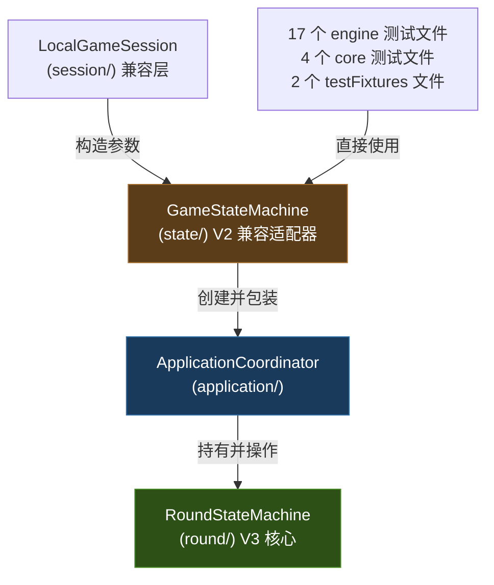

# 🏗️ 千术麻将 — 架构设计问题分析报告

> **日期**: 2026-10-03  
> **基于**: 对全部 6 模块源码的实际 `view_file` 和 `grep` 审查（修正此前子代理误报）

---

## 勘误说明

> [!CAUTION]
> 此前研究子代理对两个状态机关系的描述**严重不准确**。  
> 实际代码审查揭示：`RoundStateMachine` **不是** `GameStateMachine` 的委托外观，两者是完全不同职责的类。

| 子代理误报 | 实际代码 |
|-----------|---------|
| "`RoundStateMachine` 是 `GameStateMachine` 的纯 100% 委托包装" | `RoundStateMachine` 是独立的 V3 两阶段提交状态机，**不引用** `GameStateMachine` |
| "`GameStateMachine` 是底层状态容器" | `GameStateMachine` 是 **V2 兼容适配器**，内部包装 `ApplicationCoordinator` |
| "合并为内联即可" | 两者职责完全不同，不存在简单的"内联"合并 |

---

## 一、双状态机的真实关系

### `GameStateMachine` (state/) — V2 兼容适配器

```kotlin
// 实际代码（110行）
class GameStateMachine(
    val state: GameState,                    // ← 公开的可变镜像状态
    val eventBus: GameEventBus,
    val ruleEngine: RiichiRuleEngine = ...,
    val matchProgression: MatchProgression = ...,
    val autoPlayAi: Boolean = true,
    ...
) {
    val coordinator: ApplicationCoordinator = ApplicationCoordinator(
        initialState = state, eventBus = eventBus, ...
    )
    init { coordinator.attachLegacyMirror(state) }  // ← 双向同步镜像
    
    // 全部方法转发给 coordinator
    fun submitPlayerAction(seat, action) = coordinator.submitPlayerAction(seat, action)
    fun legalActions(player) = coordinator.legalActions(player)
    fun initializeMatch(...) = coordinator.initializeMatch(...)
    fun advanceAutomaticActions() = coordinator.advanceAutomaticActions()
    fun handleAction(action) = coordinator.handleAction(action)
    fun startNewRound() = coordinator.start()
    fun nextRound() = coordinator.nextRound()
}
```

**特征**：
- 包装 `ApplicationCoordinator`，提供 V2 风格的同步 API
- 持有公开的 `state: GameState`，通过 `attachLegacyMirror` 实现双向同步
- 允许旧测试直接修改 `state` 属性后无缝同步回权威 `RoundStateMachine`

### `RoundStateMachine` (round/) — V3 核心状态机

```kotlin
// 实际代码（167行）
class RoundStateMachine(
    initialState: GameState,
    val roundId: String = UUID.randomUUID().toString()
) {
    internal val state: GameState = initialState  // ← internal，不公开
    var version: Long = 0L; private set
    internal var startingScores: List<Int>
    internal var startingCheatPoints: List<Int>
    
    // 两阶段提交
    internal fun prepare(step: ApprovedRoundStep): RoundChange { ... }
    internal fun install(change: RoundChange) { ... }
    
    fun readState(): GameState = state.deepCopy()
    val responseWindow: ResponseWindow?  // 防御复制
    val result: RoundResult?              // 防御复制
    val preparationRecord: RoundPreparationRecord?  // 洗牌千术
}
```

**特征**：
- 真正的权威状态机，`prepare/install` 两阶段提交
- `state` 是 `internal`（不公开），`readState()` 返回深拷贝
- 被 `ApplicationCoordinator` 直接持有和操作

### 依赖拓扑（真实）



> [!IMPORTANT]
> `GameStateMachine` → `ApplicationCoordinator` → `RoundStateMachine`  
> 它们形成一条**间接调用链**，而非"一个包装另一个"的直接委托。

---

## 二、设计问题清单

### 🔴 P0：`GameStateMachine` 的定位与命名引发混淆

**问题**：
- 命名为"GameStateMachine"却实际是兼容适配器，不是真正的状态机
- 位于 `state/` 包（暗示它是核心状态基础设施），但实际是上层兼容外壳
- `state/` 包的 9 个核心类（`GameState`, `GameAction`, `GamePhase`, `ResponseResolver` 等）是 V3 真正的核心基础设施，与这个兼容类同包容易误解

**影响范围**：

| 使用方 | 文件数 | 类型 |
|--------|--------|------|
| engine 生产代码 | 1 (`LocalGameSession.kt`) | 兼容层 |
| engine 测试 | 17 | V2 风格集成/回归测试 |
| core 测试 | 4 + 2 (testFixtures) | UI 契约测试 |
| client/core/server 生产代码 | 0 | — |

**严重度**: 高 — 新开发者无法从类名/包名判断其真实角色。

---

### 🟡 P1：遗留类缺少 `@Deprecated` 标注

| 遗留类 | 位置 | 当前标注 |
|--------|------|----------|
| `GameStateMachine` | engine `state/` | 仅注释"兼容适配器" |
| `GameSession` | engine `session/` | 仅注释"兼容适配层" |
| `LocalGameSession` | engine `session/` | 仅注释"兼容薄适配层" |
| `PlayerEndpoint` | engine `client/` | 无显式标注 |
| `LocalPlayerEndpoint` | engine `client/` | 无显式标注 |
| `LocalTableRuntime` | engine `application/` | 产品已被 `TableHost.tick()` 取代 |

仅 `MahjongGame.kt` 中两个旧入口方法有 `@Deprecated` 注解。

---

### 🟡 P1：Engine `com.majiang.client` 包名与 client 模块冲突

Engine 模块的 `com.majiang.client`（含 `PlayerEndpoint`、`LocalPlayerEndpoint`）与 client 模块的 `com.majiang.client`（含 `GameClient`）包名完全相同。

---

### 🟡 P2：AI 摸切策略双重实现

- `TrivialAIStrategy` (engine `ai/`) — 摸切但会声明和牌
- `TsumogiriAIStrategy` (engine `host/ai/`) — 纯粹摸切弃权

`TableHost` 生产绑定使用后者，前者仅在旧测试中引用。

---

### 🟡 P2：千术系统阶段性割裂

- **洗牌阶段千术**（偷天换日/瞒天过海）✅ 完全接入 V3
- **摸打阶段千术**（袖里乾坤/移花接木/神仙透视/声东击西）⚠️ 执行器骨架存在，未对接 `TableHost`

---

### 🟢 P3：测试双轨制

- **23 个测试文件**使用 `GameStateMachine` (V2 兼容入口)
- V3 真实异步链路主要靠 `AsyncScreenAcceptanceTest` 和 OpenGL 冒烟测试覆盖
- 网络传输层（`NetworkSessionAccess`, `ClientTransport`）无专用单元测试

---

### 🟢 P3：`ApplicationCoordinator` 复杂度

1655 行，聚合 9+ 子组件 + `ReentrantReadWriteLock` + 原子守卫。当前可控，需观察增长。

---

## 三、`state/` 包核心类全局引用热度

这些类是 V3 **真正的核心基础设施**，不是遗留代码：

| 类 | engine 内部引用 | client | core | server |
|----|----------------|--------|------|--------|
| `GameState` | round, application, host, session, ai, cheat, settlement, stacking | ProtocolJson | — | — |
| `GameAction` | round, application, host, session, ai, cheat, timing, event | GameClient, ProtocolJson | GameScreen, presentation | ServerRoom |
| `GamePhase` | round, application, host, session | ProtocolJson | GameScreen | — |
| `ActionResult` | application, host, access | GameClient | presentation | ServerRoom |
| `LegalActionProvider` | round, application, session | — | — | — |
| `ResponseResolver` | round, application | — | — | — |
| `ResponseWindow` | round | — | — | — |
| `SeatController` | application, host, control | — | — | — |
| `StateInvariants` | application | — | — | — |

> `GameStateMachine` 本身**不在此核心引用网络中**，它的引用全部来自兼容层和测试。
