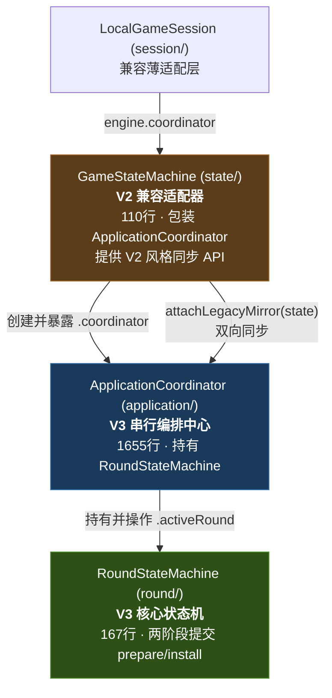

# 🔀 GameStateMachine 合并方案

> **日期**: 2026-10-03  
> **前提**: 基于实际代码审查（非子代理推测）

---

## 一、实际关系确认（纠正此前误报）

> [!CAUTION]
> 此前分析称 "`RoundStateMachine` 是 `GameStateMachine` 的纯委托外观" — **这是错误的**。实际代码审查揭示两者是完全不同职责的类。

### 真实架构



### 关键区别

| 维度 | `GameStateMachine` | `RoundStateMachine` |
|------|-------------------|---------------------|
| **角色** | V2 兼容适配器（轻量代理） | V3 核心权威状态机 |
| **内部** | 创建 `ApplicationCoordinator`，全部方法转发 | 独立实现 `prepare/install` 两阶段提交 |
| **生命周期** | 跨局整场（`startNewRound`, `nextRound`） | 严格单局（每局新实例、新 `roundId`） |
| **`state`** | `val state: GameState`（**公开**可变镜像） | `internal val state: GameState`（**内部**，外部只能 `readState()` 深拷贝） |
| **生产使用方** | 仅 `LocalGameSession`（兼容层） | `ApplicationCoordinator`, `MatchSession`, `TableHost`, 所有 round/ 服务 |
| **测试使用方** | **23 个测试文件**（V2 风格回归测试） | 5 个直接测试 + 间接经 coordinator |

---

## 二、合并可行性分析

### 能否简单删除 `GameStateMachine`？

**不能直接删除**。原因：

1. **23 个测试文件** 直接构造和使用 `GameStateMachine`
2. **1 个生产文件** (`LocalGameSession`) 依赖它
3. **1 个测试夹具** (`MeldChoiceFixtures`) 依赖它
4. `ApplicationCoordinator` 中有 ~80 行兼容镜像同步代码（`attachLegacyMirror`, `syncToLegacyMirror`, `syncFromLegacyMirror`, `syncLegacyStateBeforeQuery`）

### 合并的本质是什么？

`GameStateMachine` 本质上是 `ApplicationCoordinator` 的**便捷构造工厂 + V2 API 外壳**。合并意味着：

1. 将 `GameStateMachine` 的 V2 API 移入 `ApplicationCoordinator`（或保留为 `@Deprecated` 瘦壳）
2. 让 23 个测试文件直接使用 `ApplicationCoordinator`
3. 清理镜像同步代码

---

## 三、推荐方案

### 方案 A（✅ 推荐）：渐进式废弃

**思路**：先标注 `@Deprecated`，保留编译通过；然后逐步迁移测试；最后删除。

#### 步骤 1：标注 `@Deprecated` + 添加工厂函数

```kotlin
// state/GameStateMachine.kt — 仅添加注解
@Deprecated(
    message = "V2 兼容适配器。新代码请直接使用 ApplicationCoordinator 或 TestTableBuilder + RoundStateMachine。",
    level = DeprecationLevel.WARNING
)
class GameStateMachine(
    val state: GameState,
    val eventBus: GameEventBus,
    // ... 其余不变
)
```

同时在 `ApplicationCoordinator` 中添加直接创建方法：

```kotlin
// application/ApplicationCoordinator.kt — 新增
companion object {
    /** 便捷工厂：替代旧 GameStateMachine 构造 */
    fun createForTest(
        state: GameState = GameState(),
        eventBus: GameEventBus = GameEventBus(),
        autoPlayAi: Boolean = false,
        autoRiichiDiscard: Boolean = true,
        random: Random = Random.Default
    ): ApplicationCoordinator = ApplicationCoordinator(
        initialState = state,
        eventBus = eventBus,
        autoPlayAi = autoPlayAi,
        autoRiichiDiscard = autoRiichiDiscard,
        random = random
    )
}
```

#### 步骤 2：逐批迁移测试（可分多个 PR）

每个测试文件的迁移模式：

```kotlin
// 迁移前（V2 风格）
val e = GameStateMachine(s, bus, autoPlayAi = false)
e.initializeMatch(humanIndex)
e.handleAction(GameAction.DiscardTile(1, tile))
val actions = e.legalActions(player)

// 迁移后（直接使用 coordinator）
val coordinator = ApplicationCoordinator.createForTest(s, bus, autoPlayAi = false)
coordinator.initializeMatch(humanIndex)
coordinator.handleAction(GameAction.DiscardTile(1, tile))
val actions = coordinator.legalActions(player)
```

#### 步骤 3：迁移 `LocalGameSession`

```kotlin
// 迁移前
class LocalGameSession(
    engine: GameStateMachine = GameStateMachine(GameState(), GameEventBus()),
) : LocalPlayerEndpoint(coordinator = engine.coordinator, ...)

// 迁移后
class LocalGameSession(
    coordinator: ApplicationCoordinator = ApplicationCoordinator.createForTest(),
) : LocalPlayerEndpoint(coordinator = coordinator, ...)
```

#### 步骤 4：删除 `GameStateMachine.kt` + 清理镜像代码

- 删除 `state/GameStateMachine.kt`
- 从 `ApplicationCoordinator` 移除：
  - `legacyMirror` 字段
  - `attachLegacyMirror()` 方法
  - `syncToLegacyMirror()` 方法
  - `syncFromLegacyMirror()` 方法
  - `syncLegacyStateBeforeQuery()` 方法
  - 5 处 `syncLegacyStateBeforeQuery()` 调用

---

### 方案 B（备选）：一次性删除

直接删除 `GameStateMachine.kt`，一个 PR 修改全部 25 个文件。

**优点**：干净利落  
**缺点**：23 个测试文件 + 1 个生产文件 + 1 个夹具 = 大范围改动，review 成本高

---

## 四、影响范围详表

### 需要修改的文件（共 26 个）

#### 生产代码（3 个文件）

| 文件 | 修改内容 |
|------|----------|
| [`state/GameStateMachine.kt`](file:///d:/majiang/engine/src/main/kotlin/com/majiang/state/GameStateMachine.kt) | **删除** |
| [`session/LocalGameSession.kt`](file:///d:/majiang/engine/src/main/kotlin/com/majiang/session/LocalGameSession.kt) | 构造参数 `engine: GameStateMachine` → `coordinator: ApplicationCoordinator` |
| [`application/ApplicationCoordinator.kt`](file:///d:/majiang/engine/src/main/kotlin/com/majiang/application/ApplicationCoordinator.kt) | 删除 ~80 行镜像同步代码 + 添加 `createForTest()` 工厂 |

#### 测试夹具（1 个文件）

| 文件 | 修改内容 |
|------|----------|
| [`testing/MeldChoiceFixtures.kt`](file:///d:/majiang/engine/src/testFixtures/kotlin/com/majiang/testing/MeldChoiceFixtures.kt) | `GameStateMachine` → `ApplicationCoordinator` |

#### Engine 测试（17 个文件）

| 文件 | 修改模式 |
|------|----------|
| `state/RiichiFlowContractTest.kt` | `GameStateMachine(s,bus)` → `ApplicationCoordinator.createForTest(s,bus)` |
| `state/MixedAiInvariantContractTest.kt` | 同上 |
| `state/SeatControllerAcceptanceTest.kt` | 同上 |
| `state/UnifiedActionAcceptanceTest.kt` | 同上 |
| `state/ScoreBreakdownEventContractTest.kt` | 同上 |
| `state/SettlementDetailPaymentAcceptanceTest.kt` | 同上 |
| `state/WinContextIntegrationContractTest.kt` | 同上 |
| `state/ArchitectureSafetyRegressionTest.kt` | 同上 |
| `state/CommandValidationContractTest.kt` | 同上 |
| `state/EngineProtocolContractTest.kt` | 同上 |
| `state/FuritenFlowContractTest.kt` | 同上 |
| `state/HeadlessGameLoopTest.kt` | 同上 |
| `state/MatchIntegrationContractTest.kt` | 同上 |
| `session/FuritenViewContractTest.kt` | 同上 |
| `session/LocalGameSessionContractTest.kt` | 同上 + 构造参数 |
| `session/SeatControllerSessionAcceptanceTest.kt` | 同上 |
| `rules/RiichiPhysicalChoiceContractTest.kt` | 同上 |

#### Core 测试（5 个文件）

| 文件 | 修改模式 |
|------|----------|
| `screen/FuritenScreenContractTest.kt` | `GameStateMachine(s,bus)` → `ApplicationCoordinator.createForTest(s,bus)` |
| `screen/MeldChoiceScreenContractTest.kt` | 同上 |
| `screen/RiichiChoiceScreenContractTest.kt` | 同上 |
| `screen/RiichiScreenIntegrationTest.kt` | 同上 |
| `state/ArchitectureBoundaryContractTest.kt` | 白名单移除 `GameStateMachine` |
| `state/GameplayLoopRegressionTest.kt` | 同上模式 |

---

## 五、迁移中的关键技术点

### 1. 旧测试的 `state` 直接修改模式

旧测试通过 `GameStateMachine.state` 直接修改 `GameState`，依赖 `syncFromLegacyMirror` 同步回权威 `RoundStateMachine`。迁移后需改用 `TestTableBuilder` 构建初始状态。

```kotlin
// 旧模式（直接修改 state）
val e = GameStateMachine(state, bus)
state.currentPlayer = 2  // 直接修改！
state.phase = GamePhase.DISCARD
e.legalActions(2)  // syncLegacyStateBeforeQuery 自动同步

// 新模式（用 builder 构建正确初始状态）
val state = TestTableBuilder.create(currentPlayer = 2, phase = GamePhase.DISCARD, ...)
val coordinator = ApplicationCoordinator.createForTest(state, bus)
coordinator.legalActions(2)
```

### 2. `MeldChoiceFixtures` 的 `passOthers()` 模式

```kotlin
// 旧模式
data class Fixture(val state: GameState, val engine: GameStateMachine, val seat: Int) {
    fun view() = PlayerView.fromGameState(state, seat, engine.legalActions(seat))
    fun passOthers() { for (p in 0..3) if (p != seat && ...) engine.handleAction(GameAction.Pass(p)) }
}

// 新模式
data class Fixture(val state: GameState, val coordinator: ApplicationCoordinator, val seat: Int) {
    fun view() = PlayerView.fromGameState(
        coordinator.activeRound!!.readState(), seat, coordinator.legalActions(seat))
    fun passOthers() { for (p in 0..3) if (p != seat && ...) coordinator.handleAction(GameAction.Pass(p)) }
}
```

### 3. `ApplicationCoordinator` 镜像代码清理

删除后 `ApplicationCoordinator` 净减约 80 行，核心流程不受影响：

```kotlin
// 删除这些字段和方法
- private var legacyMirror: GameState? = null
- internal fun attachLegacyMirror(mirror: GameState) { ... }
- internal fun syncToLegacyMirror() { ... }
- internal fun syncFromLegacyMirror() { ... }
- internal fun syncLegacyStateBeforeQuery() { ... }
// 删除散落的 5 处 syncLegacyStateBeforeQuery() 调用
```

---

## 六、风险评估

| 维度 | 评估 |
|------|------|
| **逻辑变更** | **零** — 测试仅改变入口（从 `GameStateMachine` 到 `ApplicationCoordinator`），被测逻辑完全相同 |
| **API 变更** | **零** — `RoundStateMachine` 和 `ApplicationCoordinator` 的公开 API 不变 |
| **V3 生产路径** | **零影响** — 生产代码不走 `GameStateMachine`，所有改动只影响兼容层和测试 |
| **测试覆盖** | **完整保留** — 556 项测试功能不减，只变入口 |
| **迁移失败回滚** | **安全** — 每个 PR 独立可编译可运行 |

---

## 七、推荐执行计划

| 阶段 | 内容 | PR 规模 | 预计时间 |
|------|------|---------|----------|
| **Phase 1** | 标注 `@Deprecated` + 添加 `createForTest()` 工厂 | 小（2 文件） | 30 分钟 |
| **Phase 2** | 迁移 `MeldChoiceFixtures` + 5 个 core 测试 | 中（6 文件） | 1 小时 |
| **Phase 3** | 迁移 17 个 engine 测试 | 大（17 文件，但改动模式统一） | 2 小时 |
| **Phase 4** | 迁移 `LocalGameSession` + 删除 `GameStateMachine.kt` + 清理镜像代码 | 中（3 文件） | 1 小时 |
| **验证** | `./gradlew test` 确保 556 项全部通过 | — | 10 分钟 |

> [!TIP]
> 推荐按此 4 阶段分 PR 执行。每个 PR 独立可编译可运行测试，失败可单独回滚。Phase 1 可以今天立即执行。

---

## 八、执行记录（2026-10-03 完成）

**方案A 全四阶段已执行完毕，`GameStateMachine` 已彻底删除。**

| 阶段 | 结果 |
|------|------|
| Phase 1 | ✅ `@Deprecated` 注解 + `ApplicationCoordinator.createForTest()` 工厂 |
| Phase 2 | ✅ `MeldChoiceFixtures` + 6 个 core 测试迁移 |
| Phase 3 | ✅ 17 个 engine 测试迁移 |
| Phase 4 | ✅ `LocalGameSession` 构造迁移（默认 `ApplicationCoordinator()`，保真旧 `autoPlayAi=true` 语义）；删除 `state/GameStateMachine.kt`；移除 `legacyMirror` 字段与 `attachLegacyMirror` / `syncToLegacyMirror` / `syncFromLegacyMirror` / `syncLegacyStateBeforeQuery` 四方法及全部约 22 处调用点 |

**验证**：`./gradlew test` 518 项全部通过（0 failures / 0 errors），与合并前基线完全一致；断言计数逐文件比对无任何削弱；无新增编译警告。

**迁移中发现的镜像语义残留（三类，均已修复）**：

1. `autoPlayAi` 默认值差异（旧 true / `createForTest` false）——省略处一律显式补 `autoPlayAi = true`。
2. 构造即深拷贝——构造后修改 `state` 的用例全部前置到 `createForTest` 调用之前（经 `configure`/`customize` lambda 或直接前移）。
3. 镜像实时同步语义的两处特殊残留：
   - **AI 回调内读实时状态**（`UnifiedActionAcceptanceTest`）：旧镜像在每步 install 后同步，AI 策略回调里读到的 `s` 是抽牌后状态；迁移后改为回调内 `e.activeRound!!.readState()`。
   - **MATCH_END / 押金清零 / 终局分数呈现**（`MatchIntegrationContractTest`）：旧镜像在 session FINISHED 时覆写 `phase=MATCH_END`、`riichiSticks=0`、`scores=betweenRoundScores`；权威 Round 快照保持 `ROUND_END` 与局内终值。断言改读 `engine.queryView(0)`（`phase` / `riichiSticks` / `scores` 均为整场账本呈现）。

**联动零改动确认**：`OpponentMeldDisplayAcceptanceTest`、`MeldDisplayContractTest` 经夹具兼容别名（`Fixture.engine` / `Fixture.state` 实时 getter）无缝编译。
