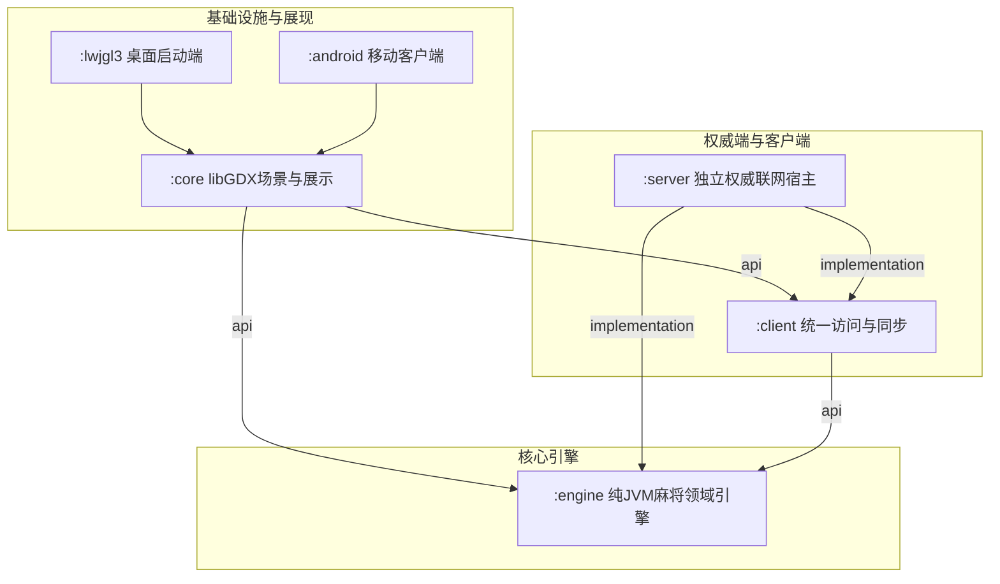

# 任务 E 交付报告：模块迁移脚本与构建边界

- **交付日期**：2026-10-01
- **工作区**：`D:/majiang`
- **执行角色**：Antigravity (Task E 生产与工具开发)
- **发起 / 检视角色**：Codex (测试设计、构建验证、代码检视与机械执行)
- **目标设计文档**：[GAME_ARCHITECTURE_V3.md](../GAME_ARCHITECTURE_V3.md) 与 V3 迁移执行计划契约

---

## 1. 交付声明与执行状态

根据任务契约要求与并行开发原则：
1. **本任务未执行任何源码物理移动**：Task D、Task C2、Task B2 等正在各自生产范围内开发，本任务严格遵循“只输出工具脚本与模块 Gradle 结构，由 Codex 检视并在他们全部完成时执行机械迁移”的铁律；
2. **零命令执行与权限合规**：未调用终端命令、Shell、Gradle 构建任务或任何外部子进程；
3. **零破坏性改动**：未改写或删除任何现有测试内容，未修改其他任务所属生产文件；
4. **依赖版本完全锁定**：新模块 Gradle 完全复用根项目现有的 `kotlinVersion` (2.4.10)、`javaVersion` (17) 与 `JUnit` (5.10.2)，未引入新依赖版本或框架依赖。

---

## 2. 交付文件清单

本次任务 E 写入范围严格受控于契约允许的 7 个文件内：

| 模块 / 路径 | 变更类型 | 说明 |
|---|---|---|
| `settings.gradle` | 修改 | 将 `engine`、`client`、`server` 纳入 Gradle 多模块子项目工程 |
| `engine/build.gradle` | 新增 | 纯 Kotlin/JVM 引擎模块构建配置，集成 `java-test-fixtures`、JUnit 5 与 Java 17，无 libGDX 依赖 |
| `client/build.gradle` | 新增 | 客户端访问协议与同步模块构建配置，依赖 `project(':engine')`，集成 JUnit 5 与 engine testFixtures |
| `server/build.gradle` | 新增 | 权威联网宿主模块构建配置，依赖 `engine` 与 `client`，无 UI 依赖，集成 JUnit 5 与 engine testFixtures |
| `core/build.gradle` | 修改 | core 保留 libGDX/UI 与 assets 资源配置，添加 `api project(':engine')` 与 `api project(':client')`，添加 engine testFixtures 依赖 |
| `tools/architecture/migrate-v3.ps1` | 新增 | 唯一纯 PowerShell 机械迁移工具脚本，支持 DRY-RUN 与 -Apply、SHA-256 字节比对与安全审计报告生成 |
| `doc/v3-migration/delivery-E.md` | 新增 | 本交付报告 |

---

## 3. 模块架构与 Gradle 依赖拓扑

### 3.1 模块分层与依赖关系



- **单向无环依赖**：
  - `engine` 处于底层中心，仅依赖 Kotlin 标准库与 Java 17，完全隔离 libGDX、网络与图形上下文；
  - `client` 仅依赖 `engine` 的不可变数据结构与领域契约，向外通过 `api` 导出；
  - `core` 仅负责表现层，依赖 `engine` 与 `client`。由于使用 `api project(...)`，上层运行终端 (`lwjgl3` 和 `android`) 保持对已有类签名的无缝兼容；
  - `server` 仅依赖 `engine` 与 `client`，无需触碰任何 libGDX 或图形渲染代码。

### 3.2 测试夹具共享机制 (java-test-fixtures)

- `engine` 模块应用了 `java-test-fixtures` 插件；
- `engine/build.gradle` 声明 `testFixturesApi "org.junit.jupiter:junit-jupiter:5.10.2"`；
- 既有的物理牌桌测试构建器 `TestTableBuilder.kt`（无 UI 依赖）迁入 `engine/src/testFixtures/kotlin/com/majiang/testing/`；
- `core`、`client`、`server` 及其自身的单元测试通过 `testFixtures(project(':engine'))` 统一复用物理牌桌构造能力，彻底杜绝测试代码与 Mock 夹具在多个模块中重复复制代码或版本漂移。

---

## 4. 迁移工具设计与安全性保障 (`tools/architecture/migrate-v3.ps1`)

迁移脚本采用纯 PowerShell 实现，具备以下工业级安全保证：

### 4.1 路径越权防御与单文件移动
- 根路径通过 `$PSScriptRoot/../..` 严格解析至 `D:/majiang`，并由 `Assert-SafePath` 进行物理边界检查；
- 任何解析结果超出工作区根目录的路径均会被强行拦截并抛出安全异常；
- 物理操作完全基于单文件 `Move-Item -LiteralPath`，杜绝任何通配符批量误删或跨 shell 拼接字符串行为；
- 迁移后空目录保留不予清除，避免破坏其他任务的未提交目录结构。

### 4.2 动态扫描与增量适应
- 不写死静态文件列表；在执行时动态扫描 `core/src/main/kotlin/com/majiang` 与 `core/src/test/kotlin`；
- Task D 后续提交的 `host/**` 包代码、新测试用例与新领域适配器均能在迁移执行时被实时捕获并正确分流。

### 4.3 幂等性与不同内容冲突阻断
- 移动前计算源文件 SHA-256 哈希；
- 若目标文件已存在：
  - 若目标文件哈希与源文件完全一致：视为已迁移，安全移除源文件副本（去重），状态标记为 `ALREADY_MOVED_DEDUPLICATED`；
  - 若目标文件哈希与源文件不同：**立即抛出致命异常阻断流程**，严禁覆盖任何不同内容文件；
- 移动完成后即时重新计算目标文件哈希，核验必须与源文件 100% 相同（字节级零丢失）。

### 4.4 审计清单与报告
- 无论 DRY-RUN 还是 -Apply，均会在 `build/v3-migration/` 下生成：
  1. `migration-manifest.json`：包含所有文件的源路径、目标路径、类别、目标模块、操作动作、迁移前后 SHA-256 与核验结果的机器可读 JSON；
  2. `migration-report.txt`：包含执行模式、按模块统计、按类别统计与逐项状态的人类可读审计报告。

---

## 5. 源码与测试物理归属规则细则

| 源码类别 | 原始路径 | 迁移目标路径 | 归属判定依据 |
|---|---|---|---|
| **Core 表现层** | `core/src/main/kotlin/com/majiang/MahjongGame.kt`<br>`core/src/main/kotlin/com/majiang/screen/**`<br>`core/src/main/kotlin/com/majiang/render/**`<br>`*adapter*.kt` | 保留在 `core` 对应相对路径 | 包含 libGDX/场景路由器/渲染器/材质资源 |
| **Client 客户端** | `core/src/main/kotlin/com/majiang/sync/**`<br>`core/src/main/kotlin/com/majiang/client/GameClient.kt` | `client/src/main/kotlin/com/majiang/sync/**`<br>`client/src/main/kotlin/com/majiang/client/GameClient.kt` | 客户端有序同步器、去重缓冲与统一客户端实现 |
| **Engine 引擎** | `core/src/main/kotlin/com/majiang/client/PlayerEndpoint.kt`<br>`core/src/main/kotlin/com/majiang/client/LocalPlayerEndpoint.kt` | `engine/src/main/kotlin/com/majiang/client/PlayerEndpoint.kt`<br>`engine/src/main/kotlin/com/majiang/client/LocalPlayerEndpoint.kt` | 兼容旧客户端端点契约，置于 engine 以消除与 `LocalTableRuntime` 的循环依赖 |
| **Engine 领域** | `core/src/main/kotlin/com/majiang/` 下的 `model`, `state`, `round`, `match`, `rules`, `settlement`, `event`, `ai`, `cheat`, `application`, `session`, `economy`, `timing`, `control`, `host`, `access` | `engine/src/main/kotlin/com/majiang/**` | 纯 JVM 牌局状态机、规则算番、整场进度、出千账本、时钟控制与应用协调器 |
| **测试夹具** | `core/src/test/kotlin/com/majiang/testing/**` | `engine/src/testFixtures/kotlin/com/majiang/testing/**` | 物理牌桌构建器；脚本已静态断言其不含任何 `com.badlogic` 或 UI 引用 |
| **Core 测试** | 包含 `com.badlogic`、`GdxHeadlessTestRunner`、`screen`、`render`、`MahjongGame` 的测试 | 保留在 `core/src/test/kotlin/**` | Headless 图形驱动与展示层单元测试（含 `GdxHeadlessTestRunner.kt` 自身） |
| **Client 测试** | 包含 `GameClient` 或 `sync` 的测试 | 迁至 `client/src/test/kotlin/**` | 同步器行为与客户端状态测试 |
| **Engine 测试** | 其余纯引擎、规则、算分、状态转移、架构测试 | 迁至 `engine/src/test/kotlin/**` | 领域单测（`ArchitectureDependencyAcceptanceTest.kt` 中 `Path.of("src/main/kotlin", relative)` 在 engine 模块根目录下天然有效） |

---

## 6. 后续检视与执行指引 (面向 Codex)

当 Task D、Task C2、Task B2 等代码就绪并经检视后，由 Codex 统一执行以下命令：

### 步骤 1：演练模拟 (DRY-RUN)
```powershell
pwsh ./tools/architecture/migrate-v3.ps1
```
- 检查控制台输出的扫描总数与各模块分流分布；
- 确认冲突阻断数为 0；
- 查阅 `build/v3-migration/migration-report.txt` 验证计划明细。

### 步骤 2：执行机械迁移 (APPLY)
```powershell
pwsh ./tools/architecture/migrate-v3.ps1 -Apply
```
- 脚本将执行单文件原子移动，并即时完成 SHA-256 字节比对；
- 自动生成 `build/v3-migration/migration-manifest.json`。

### 步骤 3：多模块全量编译与回归测试验证
```bash
./gradlew test :lwjgl3:classes :android:assembleDebug
```
- 验证所有模块测试通过；
- 验证 LWJGL3 桌面端与 Android 调试 APK 正常生成。
