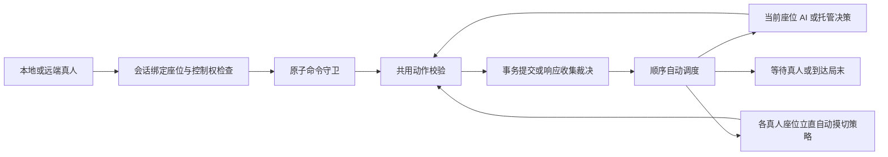

# 逐座位控制者与统一动作执行设计

日期：2026-09-30。Codex 负责设计、测试与检视；Antigravity 负责生产开发。

## 目标与范围

支持任意 0～4 个真人座位，本地与远端真人都等待对应输入；AI 与托管按各座位策略行动。所有玩家动作共用规则校验、响应记录、事务提交和后置推进。默认单机行为、现有规则、立直自动摸切、结算及动画门禁保持兼容。

本次不实现网络传输、房间广播、请求编号/重连协议、多方下一局准备，也不改变 AI 局末终了策略、麻将规则、千术或 UI 布局。RemoteHuman 是领域控制类型，不代表联机功能已上线。



自动循环在同一个外层守卫内执行；回到共用校验时不重新获取守卫。所有已提交事件按发生顺序返回会话。

## 对外契约（任务 E 实现，任务 S 使用）

在 `com.majiang.state` 新增 `SeatController.kt`：

```kotlin
sealed interface SeatController {
    data class LocalHuman(val autoRiichiDiscard: Boolean = true) : SeatController
    data class RemoteHuman(val autoRiichiDiscard: Boolean = true) : SeatController
    data class Computer(val strategy: AIStrategy = BasicAIStrategy()) : SeatController
    data class Takeover(val strategy: AIStrategy = BasicAIStrategy()) : SeatController
}
```

这些是权威侧控制配置，不放入 PlayerView，不广播策略对象。真人自动摸切是座位偏好；引擎已有 `autoRiichiDiscard` 为总开关，两者均开启才自动摸切。AI/Takeover 受已有 `autoPlayAi` 总开关控制。

GameStateMachine 新增：

- `val hasControllerConfiguration: Boolean`：是否已显式调用任一 initializeMatch 或成功 setSeatController。只读。
- `fun initializeMatch(controllers: List<SeatController>)`：列表必须恰好 4 项，防御复制；仅配置，不摸打、不改变牌局。非法配置全部验证后再写入，抛 IllegalArgumentException，无部分修改。配置写入同样获取原子命令守卫；并发/回调重入时因签名为 Unit，抛 IllegalStateException 且无修改。
- 保留 `initializeMatch(humanIndex: Int = 0, aiStrategies: Map<Int, AIPlayer> = emptyMap())`：支持 -1 与 0..3，转换为四座位配置，保留指定策略。无效座位/AIPlayer 索引不匹配须先拒绝。旧 `humanPlayerIndex` 保留只读兼容查询（恰一名 LocalHuman/RemoteHuman 时为其座位，否则 -1），禁止驱动生产自动流程。
- `fun controllerFor(seat: Int): SeatController`：座位 0..3；越界 IllegalArgumentException。
- `fun submitPlayerAction(seat: Int, action: GameAction): ActionResult`：权威适配器绑定座位的外部玩家入口；禁止系统动作，禁止越座提交，当前控制者必须为 LocalHuman/RemoteHuman；Computer/Takeover 返回 ACTION_NOT_AVAILABLE。动作中的 seat 与绑定 seat 不符返回 INVALID_PLAYER。该 seat 来自可信会话，而不是网络自报身份。
- `fun setSeatController(seat: Int, controller: SeatController): ActionResult`：可信对局管理操作，原子替换控制者，再顺序推进当前可自动完成的动作并返回全部事件。非法座位 INVALID_PLAYER；处理中的切换 ACTION_NOT_AVAILABLE。MATCH_END 拒绝。不重新发牌、不重设积分/立直/振听，不重置已经提交的响应；恢复真人不会撤销托管已提交的动作。若切换后无自动动作，Accepted(emptyList)。
- `fun advanceAutomaticActions(): ActionResult`：可信调度入口，用相同守卫运行自动循环；MATCH_END 返回 MATCH_FINISHED。便于恢复/切换与无头驱动，不产生额外强制人工动作。
- 原 `handleAction` 保留为可信系统/无头模拟入口，仍可为任意座位注入合法动作，必须走相同规则校验。它不是客户端权限入口；LocalGameSession 不再用它提交玩家动作。

构造但尚未 initializeMatch 时，兼容旧行为：座位 0 是默认真人，其他座位语义为 Computer；未配置的 AI 不主动摸打（保留无头 fixture 语义），不可把缺失策略当真人。默认真人 0 的立直自动摸切仍有效。正式会话 start 初始化后照常自动 AI。

## 统一执行与顺序调度

1. 最外层命令守卫覆盖外部动作、配置切换、自动动作、事件发布；使用 AtomicBoolean.compareAndSet 或等价可靠互斥，不依赖普通布尔跨线程判断。并发/监听器重入立即拒绝 ACTION_NOT_AVAILABLE，不阻塞、不排队重放。
2. 外部权限/绑定座位检查完成后，调用唯一的内部动作校验与执行函数。AI 和立直自动摸切同样进入该函数；不能绕过 `validateActionPreconditions`，不能只做守恒审计。
3. 内部函数执行一个动作，按现有事务与响应裁决逻辑完成必要系统推进（例如摸牌、建立响应窗口）。不递归发起另一个 AI 决策。
4. 顶层 accepted 后运行一个顺序自动循环：响应窗口选择尚未响应的 AI/托管座位；自家阶段选择当前座位的 AI/托管动作，或检查真人立直自动摸切；得到一个动作则再次进入共同校验/执行；遇到需真人输入或 ROUND_END/MATCH_END 即停止。循环中积累所有事件，顺序与 eventBus 一致，各事件发布一次。
5. 响应窗口要继续等待所有合资格真人，AI 先应答不提前裁决。不调用公开带守卫入口递归执行，以免自锁。
6. 统一响应记录与“放弃合法荣和即振听”逻辑，不复制 AI 与真人各一套。`ResponseWindow.recordResponse` 应防御拒绝错座位/非候选动作；对于无序牌组，可由共同校验映射到合法列表中的规范动作再记录。原有可接受的合法牌序不应退化。
7. AI 只能收到深拷贝 PlayerView/只读 legalActions。AI 选择必须绑定当前被调度座位，不能冒充另一真人，即使伪造动作碰巧对对方合法也拒绝。
8. 策略返回 null、非法动作或抛普通 Exception 时，只尝试一次策略；合法响应窗口使用 Pass 兜底，自家回合优先合法摸切，否则第一个合法弃牌。兜底也经共同校验；不能默认宣告和牌/立直/杠，不能反复调用坏策略导致死循环，不能吞掉执行阶段的守恒异常。没有安全动作则停止推进。
9. 总开关 autoPlayAi=false 仍允许外部 handleAction 逐步模拟各座位，但 submitPlayerAction 的控制权校验不因此绕过。所有本地/远端真人均适用其自己的立直自动摸切偏好：合法自摸或暗杠时必须暂停。
10. 任意拒绝动作不得改变牌局、响应记录、振听、积分或事件历史。切换控制者失败不改变配置。整个自动链不是回滚事务：先前合法已提交动作保持有效，错误策略仅拒绝其候选并安全兜底。

## 本地会话兼容（任务 S）

LocalGameSession 构造函数末尾新增可选 `controllers: List<SeatController>? = null`，保留所有现有参数及位置；传入配置防御复制并验证长度 4。

- start：如提供 controllers 则初始化该配置；否则 engine.hasControllerConfiguration 已为 true 时保留已有配置和策略；仅未配置时调用 initializeMatch(viewerSeat) 得到传统默认局。
- submit：保留 closed、系统动作与绑定 viewerSeat 的拒绝行为，最终调用 `engine.submitPlayerAction(viewerSeat, action)`。
- legalActions/view 的动作列表：本会话座位为 Computer/Takeover 时空列表，避免客户端仍显示可操作；手牌视图仍按 viewerSeat 脱敏。LocalHuman/RemoteHuman 时返回引擎对应合法动作。
- 保持返回事件与订阅事件的过滤、深拷贝、异常隔离、关闭行为。GameSession 接口不必添加对局管理方法；本地会话不假扮共享房间服务，不擅自添加 UI/网络代码。

## 分工与文件所有权

- **任务 E**：`state/SeatController.kt`、`state/GameStateMachine.kt`、`state/ResponseWindow.kt`；如确需纯内部 helper，可新增 state 包文件。完成控制模型、统一校验、自动循环、切换和线程重入防护。不要改 LocalGameSession 或测试。
- **任务 S**：仅 `session/LocalGameSession.kt`，使用上述固定 API；可在 E 尚未出现时按契约编写，不需等待。不要改 state 或测试。
- **Codex**：本设计、桥接脚本、验收测试、构建/运行及检视。生产代码修正仍交 Antigravity。

## 验收

新增测试涵盖：两名及四名真人不被 AI 抢操作；混合响应待齐与头跳；控制者配置隔离/非法配置；托管切入、恢复、已响应不撤销；Local/Remote 独立自动摸切偏好与自摸/杠暂停；真人与 AI 非法出牌/立直/加杠/抢杠响应校验；AI 冒充他人、返回 null、异常策略合法兜底；响应记录拒绝非法动作且不误触发振听；跨线程及监听器重入；原默认、四 AI 整局和任意座位会话兼容；本地会话不得覆写显式策略。

执行全量 JVM 测试、桌面 classes、Android debug APK；运行现有出牌门禁 OpenGL smoke，确认逻辑循环改造不破坏同步事件/动画限制。测试通过后记录实际范围与未实施的联网功能。
