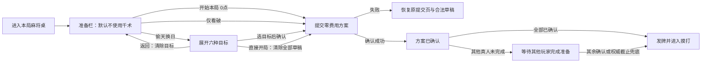

# 正式 APP · 先入牌桌、再选千术的开局交互设计

适用每次新局、连庄和局间继续。风格沿用已确定的深翡翠桌面、朱红木边、暖金描线与动物麻将馆。这里设计的是正式 libGDX APP 的准备阶段，未把这些概念图接入运行代码。

## 1. 页面状态与预期图

| 状态 | 预期图 | 用户看到什么 |
| --- | --- | --- |
| 默认开局 | [01-table-entry.png](01-table-entry.png) | 已进入麻将桌，右侧只有紧凑准备栏；默认不施术，不展示六种牌型 |
| 选择偷天换日 | [02-target-picker-final.png](02-target-picker-final.png) | 从右展开局部牌型抽屉；牌桌仍可见，选择后才能确认施术 |
| 本人已确认 | [03-confirmed-wait-final.png](03-confirmed-wait-final.png) | 显示本人确认回执；仅确有其他玩家未确认时等待，无人为最短等待 |

图像用内置 imagegen 生成，精确文案/费用/牌面/时间以本规范和权威快照为准。动物图像仅表达美术风格，不代表正式 APP 已有动物能力或选角系统。图 02 为“用户已选中第一项目标”的例子，新局默认并不自动选择清一色。

## 2. 默认先进入麻将桌

新局开始立即显示桌面、四席公开名字/分数、局次与本场数。本人手牌区在发牌前保持空白，可显示“准备完成后发牌”。不先弹满屏六选一，不显示不存在的手牌、弃牌、宝牌或已生成的真实牌山。桌面装饰不能伪装成权威实体牌。

右侧“本局准备”栏只放以下内容：

1. 小号剩余时间，读取当前准备窗口的权威时间。
2. “偷天换日 · 30点”入口，提示“选择后再挑牌型”。
3. 房间允许时显示“看破 · 10点”勾选项；禁用时不提供可交互假入口。
4. 当前方案、预计消耗与剩余出千点。
5. 主要动作“开始本局 · 0点”。默认一次点击提交零费用跳过，不再二次确认。

“偷天换日”在这版 UI 中对应现有**统一码牌目标**：选择一个 target，作用于起手和后续预计摸牌槽。只调整目标倾向，不承诺成型或和牌，不恢复旧的起手/摸牌双目标方案。

## 3. 点偷天换日后才选牌型

点击入口只打开抽屉，不扣点、不提交，也不延长本局倒计时。抽屉替换右侧准备栏并向左扩展，桌面保留在可见区域。

抽屉内容依次为标题“偷天换日 · 选择目标”、返回、规则短句、六张目标卡、看破勾选、费用预览及操作区。规则短句固定为“影响起手及后续摸牌，不保证成型”。六项目标沿现有枚举：

| 显示名 | 现有 target |
| --- | --- |
| 清一色（万） | CHINITSU_MAN |
| 清一色（条） | CHINITSU_SOU |
| 清一色（筒） | CHINITSU_PIN |
| 大三元 | DAISANGEN |
| 国士无双 | KOKUSHI |
| 大四喜 | DAISUUSHII |

每张卡只有示意牌纹、名称、选中金框和勾选标识，示意牌不是玩家实际手牌。目标单选，第二次点击已选卡可取消；没有目标时确认按钮禁用并提示“先选择一个目标牌型”。选定后按钮为“确认施术 · 30点”，叠加看破则为“确认施术 · 40点”。预计消耗与余额同步更新，资金不足时保留编辑但阻止提交。

“返回”或 Esc 收起抽屉、清空 target、保留看破勾选，回到准备栏；不提交、不扣点。重新打开仍无默认目标。抽屉中的“直接开局 · 0点”明确清空 target 与看破，并立刻提交零费用跳过，不要求再返回点一次。

## 4. 看破与费用

看破是独立可叠加选项，保留现有 10 点效果与权限。它不要求先进入偷天换日抽屉。只勾看破时，准备栏主要动作改为“确认看破 · 10点”；取消勾选立即恢复“开始本局 · 0点”。说明为“抵消对手本局码牌并清除其既有落汗；双方费用照付”。详细规则放说明入口，不在准备页堆长段落。

| 用户确认的方案 | 提交 selection | 费用 |
| --- | --- | ---: |
| 默认直接开始 | target=null, seeThrough=false | 0 |
| 仅看破 | target=null, seeThrough=true | 10 |
| 偷天换日一个目标 | target=已选枚举, seeThrough=false | 30 |
| 目标 + 看破 | target=已选枚举, seeThrough=true | 40 |

这些是现有方案组合，不新增协议动作。界面编辑阶段只预览；确认请求成功后按现有预留/发牌结算规则处理，不能在界面本地重复扣点。

## 5. 提交、等待与进入本局

提交期间显示“正在确认方案…”，阻止重复点击但继续接收权威快照。失败时恢复发起提交的原页面（从目标抽屉提交失败就恢复抽屉），保留合法草稿并显示可理解原因；不能将未成功的提交显示为已确认。

成功后抽屉收起为小回执：“方案已确认”，并列本人方案与实际预留费用。此时不能撤销或换牌型；不再强调本人已无意义的选择倒计时，也不提供第二次确认按钮。联机如果仍有人未完成，只显示“等待其他玩家完成准备”，不新增人数、谁已确认、谁选了看破等未公开信息。

单机中不出千的电脑应及时完成零费用确认；所有席位已确认就正常发牌，不等固定 10/15 秒，也不为显示回执或动画设置最短停留。若确认快照直接变成已发牌，可跳过等待画面。发牌由权威推进，UI 只在 preparation 结束后解除准备输入门控；手牌按真实快照出现。

## 6. 图层与区域

| 层 | 内容 | 约束 |
| --- | --- | --- |
| L0 | 麻将馆环境与桌面装饰 | 不抢交互焦点；准备阶段和后续牌局保持同一视觉场景 |
| L1 | 翡翠桌布、木边、公开四席与局次 | 使用真实公开信息；发牌前不杜撰实体牌 |
| L2 | 当前玩家准备栏 | 稳定深色底板，正文高对比；默认不显示目标卡 |
| L3 | 按需牌型抽屉 | 仅右侧局部遮罩，左侧桌面保持可见 |
| L4 | 费用、错误、确认回执 | 状态与权威快照一致；文字不只靠颜色区分 |
| L5 | 系统暂停/退出等既有弹窗 | 优先级高于准备栏；关掉不会重置局内草稿和倒计时 |

1280×720 下的局部 UI 建议坐标（libGDX 左下角原点）：准备栏 `(936,48,312,624)`，目标抽屉 `(688,40,560,640)`。桌面和席位在准备阶段按剩余安全桌区构图，避免右家名字被抽屉遮住；这种视图构图不改变座位、物理牌或领域坐标。

准备栏主要动作 `(956,162,272,64)`。目标卡为两列三行，各 `252×94`；列 x 为 `708/976`，行 y 为 `462/352/242`。抽屉底部两动作各 `252×54`，x 为 `708/976`、y 为 `64`；右侧确认、左侧零费用直接开始。窄横屏等比适配，文字和触控目标需实测；不得为压缩空间缩成难以点中的小字行。

## 7. 动画与输入

- 新局准备栏：从右移入约 72 单位，220ms；动作可见位置与命中矩形使用同一变换，或在移动时阻止该局部交互。
- 目标抽屉：右侧移入 160 单位，280ms easeOutCubic；原准备栏同步淡出，不推着整张桌面滑走。
- 选中目标：金框与勾选 120ms，示意牌可轻抬 4 单位；不自动提交。
- 回执/发牌衔接：回执淡出约 150ms，可与真实发牌动画重叠；不等待动画结束才允许权威开始。
- 减少动态效果：直接显示终态，功能与请求时序相同。

准备阶段的手牌/鸣牌/千术入口尚未开放，背景可见并不代表可点击。空白桌面输入不穿透准备态。键盘默认焦点为“开始本局”，在抽屉内按六项目标与底部动作顺序移动；Esc 返回选项、不自动提交。触控按下/松开位置一致才确认，拖出按钮可取消。

## 8. 生命周期与落地约束

每个新 roundId 都回到默认准备栏，清空上一局 target/看破草稿；同一局的快照刷新、抽屉开关、暂停恢复和窗口 resize 不重播准备流程、不重开倒计时。重连本人已确认时直接展示锁定回执；本人未确认时回到准备栏，不从旧局缓存拼接选择。

倒计时使用已有 serverNow/deadline 插值，关闭抽屉不改变它；到期后停止编辑与提交，等待权威兜底快照。费用、控制代次、requestId 幂等、看破结算和 136 张实体守恒沿现有权威链路处理。视觉改造集中在 GameScreen 的准备场景绘制与 ShufflePreparationPanel/Model，UI 使用 client.api，不越层访问引擎或服务端。

需在后续开发验证：每局默认先见桌面且无目标卡；只有点偷天换日才出现六选一；正常开局一次提交 0 点；单看破 10、目标 30、组合 40；退回/取消草稿不扣费；失败返回原页面；新局清空与重连确认恢复；未确认真人仍被等待；单机及时发牌；抽屉动画/输入一致且不会延长权威倒计时。

这份设计需与正在进行的菜单点击动画、提前发牌修复一起验收；当前不把尚未完成检视的修复视为通过。图像提示记录见 [PROMPTS.md](PROMPTS.md)。
