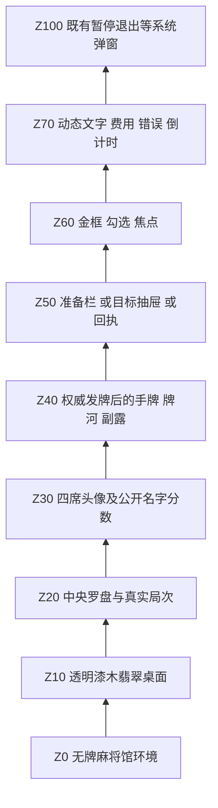

# 正式 APP 牌桌视觉还原：图层、素材和拼接交付

> 多分辨率方案已由 Codex 实际绘制验证并更新为 [RESPONSIVE-DESIGN.md](RESPONSIVE-DESIGN.md)。其“中央16:9交互内容区等比缩放、窗口环境铺满”规则覆盖本文旧版扩展世界相机与物理窗口右沿锚定建议；新字号/过滤与HUD避让也以新方案为准。本轮只保留设计、绘制代码和截图供用户检查，暂不交代理开发。

设计负责：Codex。开发执行：DeepSeek Flash（用户最新指示，替代 MiniMax）。范围：正式 libGDX APP 的准备阶段与发牌后同场景衔接。2026-10-22。

## 1. 视觉依据与本次纠正

首要美术依据仍是 `01-table-entry.png`、`02-target-picker-final.png`、`03-confirmed-wait-final.png`。现有 `runtime-01-entry.png`、`runtime-02-target-picker.png`、`runtime-08-dealt.png` 明显没有达到此风格：平色大矩形代替桌面、无动物头像、无雕金纹饰、目标卡是文字和小色块，发牌后环境完全消失，字体缺乏层级。

本次已经提供七张正式独立素材与四张真实素材拼接图，开发不得再以色值接近或按钮能点击作为视觉完成依据。

| 设计状态 | 使用实际素材拼接后的执行稿 |
| --- | --- |
| 默认准备栏 | [ASSEMBLY-01-entry.png](ASSEMBLY-01-entry.png) |
| 偷天换日抽屉 | [ASSEMBLY-02-targets.png](ASSEMBLY-02-targets.png) |
| 本人确认回执 | [ASSEMBLY-03-receipt.png](ASSEMBLY-03-receipt.png) |
| 发牌后同场景衔接 | [ASSEMBLY-04-playing.png](ASSEMBLY-04-playing.png) |

这些是设计交付图，不是实机截图。它们以现有正式牌皮和新素材验证拼接可行。图内玩家名、牌、10秒和25000分仅说明布局，开发必须绘制权威数据。发牌前空桌上的插画目标卡不算实体牌。

本文件与 `assets/ui/table/manifest.json` 的视觉坐标覆盖 DESIGN.md 第6节旧建议坐标。DESIGN.md 中的交互、费用、权限、失败恢复、换局隔离仍全部有效。不要让旧测试对94px卡高的硬编码阻止采用新114px插画卡。

## 2. 图层栈

Z0和Z10跨准备、选目标、确认、真实发牌持续绘制。准备/抽屉切换不能调整背景相机或按 safeTableRect 把整张桌子压窄。safeTableRect 仅约束公开 HUD 与可交互区域，背景不依赖它。右侧抽屉覆盖原桌面右部，左侧仍保留原构图。

头像是装饰公开席位，不附带任何新能力。所有装饰层不接收输入。新局尚未发牌不绘制手牌、牌河、宝牌或真实牌山。玩家界面删掉“由权威生成”“立即提交、不做二次确认”等实现说明，只保留“准备完成后发牌”等玩家能理解的短句。

## 3. 拼接坐标和纹理规则

以下矩形均为 **1280×720、左上角原点 `(left, top, width, height)`**。libGDX 转为 `(left, 720-top-height, width, height)`。SVG 源与 manifest 也使用左上角，避免设计表与 PNG 切片混用。

### 3.1 持续场景

| 内容 | 矩形 | 拼接方式 |
| --- | --- | --- |
| 环境 | 0,0,1280,720 | cover居中，无移动，无随机裁切 |
| 桌面 | 32,76,1216,620 | 整张透明 sprite；固定宽高的美术透视，不能动态压成窄方桌 |
| 准备阶段罗盘 | 344,250,220,220 | 等比缩放，圆盘局次与准备状态动态绘制 |
| 发牌后罗盘 | 546,261,188,188 | 留出原桌面中心数据区；原中心文字移入圆盘、宝牌移出重叠区 |
| 准备底部短提示 | 228,622,552,54 | 面板九宫格，居中“准备完成后发牌” |
| 发牌后本人手牌托盘 | 208,596,852,110 | 纯装饰深翡翠九宫格，在真实手牌下方 |
| 发牌后对家手牌托盘 | 436,8,408,54 | 纯装饰，不改变暗牌可见性 |

桌面在准备和发牌后完全相同；阶段切换只改变罗盘文字/位置、席位 HUD 和真实牌层。不要通过截图切换或两张不同背景伪造连续效果。

### 3.2 四席公开 HUD

| 位置 | 准备阶段头像 | 准备阶段名牌 | 发牌后头像 | 发牌后名牌 |
| --- | --- | --- | --- | --- |
| 本人 | 16,490,144,144 | 20,622,140,50 | 16,564,112,112 | 128,614,80,48 |
| 左家 | 16,184,144,144 | 20,316,140,50 | 16,228,112,112 | 16,340,112,58 |
| 对家 | 368,8,120,120 | 488,30,160,54 | 308,4,112,112 | 164,22,148,54 |
| 右家 | 800,178,128,128 | 804,300,124,50 | 1148,228,112,112 | 1148,340,112,58 |

抽屉展开时，右家头像改为 `(536,172,124,124)`，名牌 `(538,292,124,50)`，只移动该公开 HUD，背景、其他席位和罗盘不动。右家 HUD 可随抽屉进度在两位置间插值，在对应进度处按实际位置绘制。

名字优先用现有 client.api 的公开名称；无名称则沿用 P0 等既有标识，不将熊猫等装饰名冒充玩家身份。名牌最多两行；分数21px，名称17px；长名字省略，悬停/说明可显示全称。发牌后倒计时、立直标志、庄家和轮次高亮必须保留，必要时把小号时钟放名牌第三行，不能只画头像而丢失原 HUD 语义。方向牌按现有公开座位/庄家映射正确绘制，设计图方向不是硬编码协议。

### 3.3 默认准备栏

| 内容 | 矩形/基准 | 要求 |
| --- | --- | --- |
| 面板 | 936,48,312,624 | 深翡翠不透明底，细金饰边，四边目标44 |
| 标题 | 中心1092,105基线 | 34px，暖金，大标题 |
| 倒计时条 | 960,124,264,40 | 21px，真实剩余秒数；临近截止提高对比 |
| 偷天换日入口 | 956,188,272,156 | 插画式大卡；左斜麻将牌，右技能名和30点，底部短提示 |
| 看破整行 | 956,360,272,64 | 金色眼形、名称/10点、右侧勾选；整行命中 |
| 当前方案/费用 | 956,464,272,66 | 两行，方案19px/费用17px |
| 主要按钮 | 956,552,272,76 | 红色金边底板，25px；默认开始本局0点 |
| 剩余出千点 | 956,638,272,20 | 16px；不与按钮重叠 |

偷天换日入口只是打开抽屉，不提交。卡片内装饰牌用当前 TileSkin，不使用 AI 乱码牌纹。看破禁用时整行所有装饰和交互一起隐藏，后续内容可以保留稳定间距。

### 3.4 目标抽屉

抽屉 `(688,40,560,640)`。标题28px，基线`(712,86)`；返回`(1140,60,88,40)`，可扩展命中区到44高；提示`(708,112,520,24)`。六张卡两列三行：x=`708/976`，top=`154/284/414`，大小252×114。

图片顺序固定：清一色万/条，清一色筒/大三元，国士无双/大四喜。源切片见 manifest，不得整张图集当一张卡显示。每张卡底部名称21px，上部围绕中心绘制3～5张当前牌皮的示例牌，建议宽30高45，轻微扇形。TileDrawBuffer 使用独立临时绘制列表，不能复用玩家实体ID、进入权威状态或对外同步。

选中卡描暖金双框+右上勾，牌面120ms上抬4单位；初始没有选中项，执行图中选中第一张只用于展示。未选中卡也必须保留完整插画。避免绿色色块或三个小字牌作为最终版本。

底部看破/费用条`(708,544,520,58)`，左选项整块252×58命中，右显示当次30/40点；操作`(708,616,252,48)`直接开局0点、`(976,616,252,48)`确认施术。文本不能超过面板边缘，不把“未选目标”长提示挤进按钮；无目标时禁用按钮，另在短状态位置提示。

### 3.5 本人确认回执

面板 `(944,160,304,260)`。标题31px，基线`(1096,224)`；方案24px基线292；必要的等待说明19px基线345；底部短句17px基线384。没有倒计时、按钮、复选框、费用预览的残影。只有其他玩家确实未完成准备才显示等待文案。

## 4. 九宫格与素材切片

七张素材列表、源图尺寸、SHA256、source region、目标边框都在 `assets/ui/table/manifest.json`；`README.md` 提供接入说明。所有资源一次加载，Linear/ClampToEdge，无 mipmap，straight alpha。不要按黑色抠图，不改变源 Alpha，不把图集的透明分隔区做背景色。

面板用1254方图源分割340，目标角44；小名牌角12，短提示条角18，入口卡22。按钮先取红/绿源区域，再按248/248/120/120切九宫格，目标左右32、上下18。直接使用构造器默认的源像素当目标边框会把角饰撑爆；须显式设置 NinePatch 的目标边框大小或手工九块拼接。

旋转头像/卡面是不必要的，头像与圆盘必须等比。桌面是美术指定的固定宽高适配，不随准备/抽屉安全区变化。不得在每帧创建 Texture、Pixmap、NinePatch 或字体，不得让 Screen 释放 UiAssets 所有的共享纹理。失败可用轻量色块兜底，但正常截图不能走兜底路径。

## 5. 字体、动效和适配

使用正确字号生成的中文字体：标题34/抽屉28/按钮25/目标名称21/正文19/辅助16。可复用已有24/21/16字体或补正确字号；不能把17px字库大幅放大伪装标题。正文淡米金，重要标题暖金，已确认方案淡翡翠，错误暖红。截图需检查“万、条、筒、看破、剩余”等字形完整。

准备栏从右+72进入220ms；抽屉从右+160进入280ms easeOutCubic；不平移背景、不调整相机中心、不推挤桌子。选中卡120ms轻抬4。确认后回执150ms淡出与权威发牌并行，不能因此等待发牌。减少动画直接终态，请求时序一致。各时刻绘制和点击矩形同变换，或仅在进入动画期间禁用该局部输入。

现有1280×720逻辑相机、反投影和实际输入链保持一致。1280×720为主验收尺寸，另截图960×540与1600×600。环境填满实际可见区域，面板依据实际可见右沿/安全区锚定；不为本次换肤重写牌河、鸣牌、手牌逻辑坐标。所有标题、按钮、余额都在安全区内，目标卡可点。后续如引入 FitViewport，必须统一绘制、unproject、手牌触控和既有弹窗，不得只修某一层造成错位。

发牌后现有操作列维持约x1078，牌河提示入口维持顶部右侧，可换用新底板，保持落汗/袖里藏花/偷梁换柱的原权限、禁用态和时序。禁用态用降低亮度且保留可读标签，不能所有按钮都画成可施术的亮红色。`ASSEMBLY-04` 为视觉构图，所有卡片数量、分数、手牌和按钮状态仍必须来自真实快照。

### 5.1 多分辨率与连续窗口缩放验收补充

根据用户对分辨率与窗口拖动缩放的追问补充。此前只要求1280×720、960×540、1600×600几个终态截图，不能据此宣称任意窗口大小及动态缩放已经通过。

- 1280×720是逻辑设计画布，不是唯一支持的物理窗口尺寸。桌面、头像、圆盘、牌和文字采用统一等比变换；宽屏扩展横向环境、较方窗口扩展纵向环境；背景cover填充。不能按窗口宽、高独立拉伸各层。
- 窗口尺寸改变后，显示区域、相机、准备栏/抽屉右侧锚点、公开HUD、输入反投影需要在下一次有效绘制前同步更新。已有每帧尺寸检测可使用，不强求只有resize回调实现；要求效果和命中一致。
- 小窗口以960×540作为最低常规可读性验收尺寸。更小窗口至少不崩溃、不产生无效矩形；不得宣称任意小尺寸仍具有同等可读性。竖屏不属于本次横屏APP的布局交付范围。
- 连续拖动缩放不重置当前roundId的目标草稿、看破、已确认状态、倒计时截止或发牌进度，不重新播放整次入场；正在按住时若几何改变，取消该次释放提交，避免误触。
- 最小化产生的0宽/0高跳过投影和除法，恢复后重算视图；不重建会话、不新增准备等待。
- 高DPI需区分窗口输入坐标与实际帧缓冲像素，验证鼠标、触控、GL viewport及截图尺寸对应；不能把分辨率截图通过等同于已验证系统缩放。

补充验收矩阵：

| 场景 | 尺寸/动作 | 重点 |
| --- | --- | --- |
| 同比例缩放 | 960×540、1280×720、1920×1080 | 等比、字号层级、手牌与操作列不重叠 |
| 不同宽高比 | 1024×768、1280×800、1600×600、2560×1080 | 无扁头像、无椭圆罗盘、抽屉不出界、背景无空洞 |
| 连续拖动 | 1280×720→960×540→1600×600→1024×768→1280×720 | 每步真实点击目标卡/返回/底部按钮，检查命中与布局同步 |
| 交互中缩放 | 抽屉进入中、选中目标+看破后、本人确认后、发牌后 | 状态保持，费用正确，无背景滑动或重复提交 |
| 窗口状态 | 最大化→还原，最小化→恢复 | 无崩溃、无停留旧相机、无倒计时重置 |
| 系统显示缩放 | 100%、150%、200%（环境具备时） | 文字清晰，实际点击位置一致；无法实测需记缺口 |

开发记录已有960×540/1600×600终态截图及宽屏点击记录，属于开发自检，须独立确认。以上新增连续缩放/4:3/高DPI场景尚未实测，不可预先标为通过。

## 6. 行为回归与交付验收

保留既有默认0点立即开局、看破10/目标30/叠加40、无默认目标、Esc清目标保留看破、零费用直接开局清全部、失败恢复源页面与草稿、旧round回包隔离、真实136张守恒、模态输入门控。不得因视觉改造重加固定10/15秒等待，不能修改 authority deadline 或暂停server tick。

开发交付至少包含：

1. 正式 APP 实际使用新素材的 Kotlin 接入代码，根资源生命周期明确。
2. 1280×720真实 GL 截图：默认准备、目标未选/选中、40点、回执、抽屉动画中段、真实发牌后；960×540及1600×600至少各一张。运行截图命名`visual-runtime-*`，不能用ASSEMBLY充当运行截图。
3. 逐项对照本次四张执行图，说明桌布/木沿/头像/金边/卡图/字体层级的实际还原。发现明显差异先自行修复再交付。
4. 定向准备状态/布局/点击测试，已有开局GL冒烟及桌面编译；Android编译至少`:android:compileDebugKotlin`，记录实际结果。改观战公共渲染时同时验证观战路径。不要无理由改引擎/协议/服务端。
5. 在`VISUAL-DELIVERY.md`写实际变更、命令、截图路径、通过项和未完成项。旧检测如固定坐标或绿色回执标题不再符合设计，调整为新布局和真实文字/金色像素检测，保留原先回执可读、不延迟发牌的语义。

此次不修改主菜单按钮向右滑出的修复，不做 ui_demo，不添加角色能力，不增加虚假在线服务，不提交 Git，不覆盖本次源素材与设计稿。
