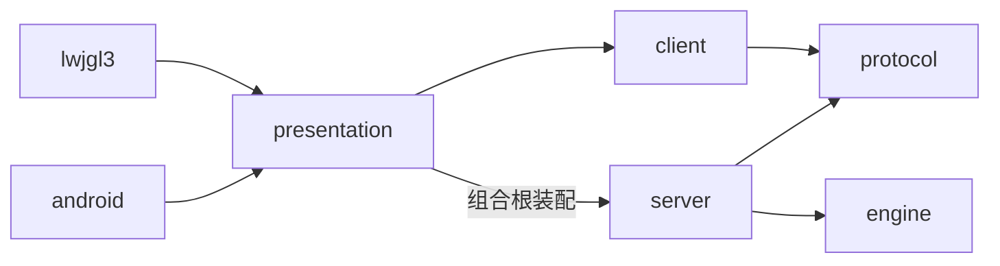
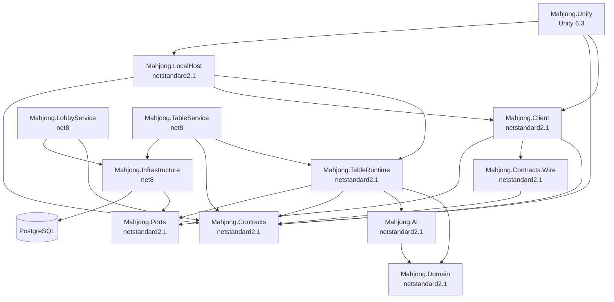
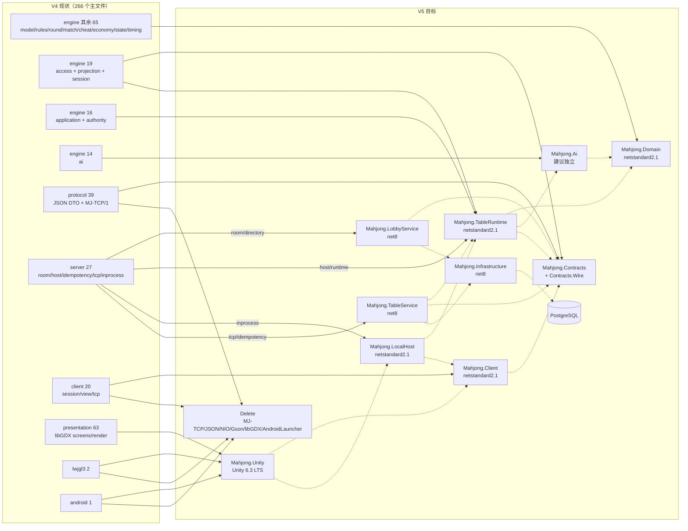
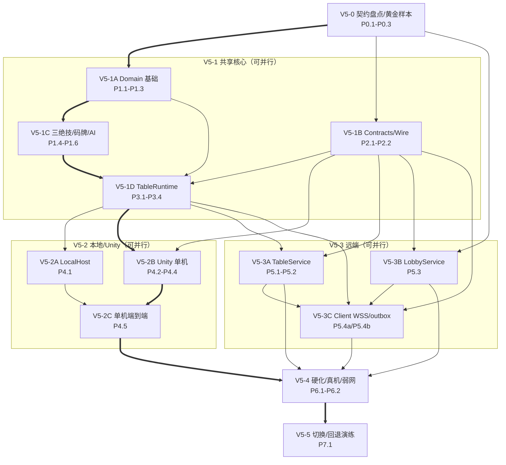

# 千术麻将 V4 → V5 模块迁移审计与实施方案

日期：2026-10-23  
状态：**待 Codex 评审的迁移方案，不是实施记录，也不是验收报告。**  
审计基线：`D:\majiang` 工作树当前真实源码（HEAD `f8f4543`，分支 `fix/menu-motion-preparation-early-deal`）以及 `doc/v5-重构/V5-ARCHITECTURE-DESIGN.md`。  
约束：本文件是本次唯一新增/修改的文件；未修改生产代码、测试、既有 V5 草案、`AGENTS.md` 或任何未提交工作；未提交、未推送。

> 重要前提：V4（Kotlin/JVM + libGDX + MJ-TCP/1）仍是唯一生产基线。V5 设计中的 Unity、纯 C# 规则核心、.NET 大厅/桌服务、HTTPS/WSS、PostgreSQL、匹配与 iOS 均**尚未实现或验收**。本方案描述“如何迁移”，不把目标写成既成事实。

---

## 0. 审计方法、证据口径与未覆盖范围

### 0.1 实际做了什么

- 核对 `settings.gradle`、根 `build.gradle`、七个模块的 `build.gradle`、`gradle.properties` 的模块、依赖、语言/运行时与版本。
- 对七个模块 `src/main`/`src/test` 做全量文件清单和行数统计：主代码 **266 个 Kotlin 文件、86,244 行（含空行）**；测试 **235 个 Kotlin 文件、64,372 行（含空行）**。
- 逐文件读取每个生产文件的包声明、类/接口声明与文件头 KDoc，建立 1.3 节的逐文件去向；对下列核心文件做了逐段/函数级阅读：
  - engine：`Tile`、`TilePool`、`TileMovement`、`GameState`、`StateInvariants`、`RoundStateMachine`、`RoundTransitionPlanner`、`TableAuthority`、`ApplicationCoordinator`（发牌/千术/回执段）、`MatchSession`、`MatchProgression`、`SettlementService`、`ScoreCalculator`、`YakuEvaluator`、`LegalActionProvider`、`ResponseResolver`、`ResponseWindow`、`DecisionClock`、`TimeoutPolicy`、`ShuffleWallGenerator`、`ShufflePreparationHandler`、三大绝技模型/预检/投影工厂。
  - protocol：`TcpWire`、`TcpFrame`、`TcpFrameDecoder`、`TcpMessages`、`ApiMessage`（信封/标签）、`ApiErrors`。
  - server：`ServerTableHost`、`HostDispatch`、`RequestScopeReceiptStore`、`IdempotencyTypes`、`TcpReceiptManager`、`TcpRequestRouter`、`TcpTableServer`、`TcpServerConfig`、`TcpOutboundQueue`、`SharedRoom`（成员/生命周期/表宿主段）、`RoomRegistry`、`ConnectionControl`、`InProcessServer`、`InProcessBinding`（绑定/身份段）、`EngineProtocolMapper`（入口）。
  - client：`GameSession`、`LobbySession`、`PlayerStreamEngine`、`ServerConnectionSession`（连接/重连/提交段）、`TcpClientBinding`（缓冲/未确认副作用/重放段）、`ProtocolViewMapper`（入口）。
  - presentation：`MahjongGame`、`GameScreen`（头部/订阅/渲染入口）、`MenuScreen`（结构）、`SnapshotLauncher`、`AndroidLauncher`、`DesktopLauncher`，以及各面板/布局/模型文件头 KDoc。
- 读取关键测试的意图/断言范围：`GameStateFieldChecklistTest`、`ArchitectureDependencyAcceptanceTest`、`DualTransportBindingScenarioParameterizedTest`、`Mr10PayloadCaptureTest`、`Mr10TileAndZlibMeasurementTest`、`Mr10SnapshotAuditAndHotspotTest`。
- 只读检查了工作树中他人未提交的 V5 脚手架（`dotnet/`、`unity/`、`tools/unity/`、`doc/v5-重构/UNITY-ENVIRONMENT.md`），未修改。

### 0.2 没有做什么

- **没有运行 Gradle 全量测试/构建**；文中“V4 有测试覆盖”不等于本次重新执行通过。
- **没有做 Android 真机/模拟器、iOS 构建、跨物理网络、Unity 许可激活、IL2CPP 构建**。
- **没有逐行阅读所有大文件**。只读了入口/关键路径、不能宣称逐行审阅的有：`ApplicationCoordinator.kt`（3,336 行）、`TableAuthority.kt`（2,828）、`ServerTableHost.kt`（2,598）、`TcpRequestRouter.kt`（1,265）、`EngineProtocolMapper.kt`（1,381）、`InProcessBinding.kt`（1,755）、`TcpClientBinding.kt`（3,205）、`ServerConnectionSession.kt`（2,646）、`GameScreen.kt`（2,791）、`ShufflePreparationPanel.kt`（1,482）、`MenuScreen.kt`（1,050）、`SharedRoom.kt`（1,455）、`ApiMessage.kt`（2,632）、`ProtocolModels.kt`（2,085）、`ViewModels.kt`（1,707）、`ProtocolViewMapper.kt`（1,606）。
- **没有统计参数化测试展开后的运行数**。静态统计为 **1,826 个 `@Test/@ParameterizedTest/@RepeatedTest/@TestFactory` 方法**（engine 578、protocol 199、server 343、client 235、presentation 471）。这与文档“1,275 项标准用例”不是同一口径，不能等同或互相否定。
- **没有把 V5 脚手架当已实现**：`dotnet/src` 下 **0 个 `.cs` 文件**，只有 5 个 `.csproj` 注释；`unity/` 下 **0 个 `.cs`**、2 个模板场景、5 个 `.asmdef`，但 `ProjectSettings`/`Packages`/`Plugins` 与 5 个 3.5 KB 空 DLL 已生成。详见 1.2.4。

### 0.3 证据标记

- `路径:行号` 或 `函数名()`：来自当前工作树。行号会随未提交修改漂移；评审优先按“路径 + 函数/类名 + 行号”复核。
- “文档称”与“代码实际”不一致时，以代码为准，并单独标注差异。

---

## 1. 源码现状与证据

### 1.1 构建、模块与依赖事实

`settings.gradle` 只有七个模块：

```groovy
rootProject.name = 'majiang'
include 'engine', 'protocol', 'client', 'server', 'presentation', 'lwjgl3', 'android'
```

| 项 | 当前值 | 证据 |
|---|---|---|
| Gradle | 9.7.1 wrapper | `gradle/wrapper/gradle-wrapper.properties`、`CLAUDE.md` |
| JVM | Java 17，Kotlin `jvmTarget=17` | 根 `build.gradle`、各模块 `build.gradle` |
| Kotlin | 2.4.10 | `gradle.properties` |
| libGDX | 1.14.2 | `gradle.properties` |
| AGP | 8.9.3（锁定） | 根 `build.gradle`、`gradle.properties` |
| Android | compileSdk 36 / minSdk 21 / targetSdk 36 | `android/build.gradle` |
| 协议序列化 | **Gson 2.11.0，UTF-8 JSON 载荷** | `protocol/build.gradle`、`TcpMessages.kt:545`、`TcpWire.kt:15` |
| 传输 | **MJ-TCP/1，12 字节固定头 + JSON 载荷** | `TcpWire.kt:9-45`、`TcpFrame.kt:20-41` |
| 桌面启动 | LWJGL3，1280×720 | `lwjgl3/build.gradle`、`DesktopLauncher.kt:14-19` |
| Android 启动 | 沉浸式、横屏 | `AndroidLauncher.kt:14-21` |

编译期依赖：



关键细节：

- `protocol` 只依赖 Gson；不依赖 engine/client/server/presentation。
- `server` 依赖 engine+protocol；测试额外依赖 client。
- `client` 只依赖 protocol；测试额外依赖 server（测试期反向依赖，不是生产依赖）。
- `presentation` 的 `api` 是 client、`implementation` 是 server；`MahjongGame.kt:27` 直接 import `InProcessServer`。因此“presentation 只依赖 client.api”在屏幕层成立，在组合根层不成立。
- `client` 的 `com.majiang.server.api.*` 看起来像依赖 server，但这些类实际在 **protocol 模块**；这是包名假象，不是编译违规。V5 应改名 `Mahjong.Contracts.*`。

### 1.2 模块规模、入口与工作树中的 V5 脚手架

#### 1.2.1 文件数与行数（静态，含空行）

| 模块 | 主文件 | 主代码行 | 测试文件 | 测试代码行 | 真实入口 |
|---|---:|---:|---:|---:|---|
| engine | 114 | 26,256 | 74 | 16,186 | 无 `main`；`TableAuthority` 是领域门面 |
| protocol | 39 | 13,040 | 21 | 6,366 | 无 `main`；`TcpWire`/`ApiMessageCodec` |
| server | 27 | 13,857 | 43 | 17,444 | `TableServerMain`、`TcpTableServer.start()` |
| client | 20 | 14,061 | 21 | 9,807 | `ServerConnectionSession.connectTcp()`、`TcpClient.connect()` |
| presentation | 63 | 18,846 | 76 | 14,569 | `MahjongGame`（libGDX `Game`） |
| lwjgl3 | 2 | 162 | 0 | 0 | `DesktopLauncher.main`、`SnapshotLauncher.main` |
| android | 1 | 22 | 0 | 0 | `AndroidLauncher.onCreate` |
| **合计** | **266** | **86,244** | **235** | **64,372** | — |

#### 1.2.2 生产入口与生命周期归属

- 单机：`MahjongGame.launchGame()` → `openLocalLobby()` → `InProcessServer(isSingleplayer=true)` → `createConnection()` → `ServerConnectionSession` → `LobbySession.createRoom()` → `start()` → `GameScreen`；`MahjongGame.render()` 每帧调用 `inProcessServer.tick(busy)`。
- 远端：`openRemoteLobby(host, port)` → 后台线程 `ServerConnectionSession.connectTcp()` → `TcpClient.connect()` → `TcpClientBinding` → 同一 `ServerConnectionSession`。
- 服务端：`TableServerMain` 解析 `--port/--bind`，创建 `TcpTableServer`，启动 NIO 事件循环、共享派发池、ticker、房间巡检。
- 权威：`ServerTableHost` 每桌一个 `serialExecutor`，内部调用 `TableAuthority`；`TableAuthority` 内部 `@Synchronized`，再调用 `ApplicationCoordinator`。
- 房间：`RoomRegistry`（最多 1024 个）→ `SharedRoom`（成员、就绪、生命周期、`ServerTableHost`）。
- 表现：`MenuScreen`/`GameScreen`/`SpectatorScreen` 只持 `LobbySession`/`GameSession`/`SpectatorSession`；`MahjongGame` 是唯一允许接触 server 的组合根。

#### 1.2.3 当前协议事实（与旧文档的差异）

- 12 字节固定头：`"MJTC"` + `wireVersion=1` + `type` + `flags=0` + 4 字节大端 payloadLength（`TcpWire.kt:9-45`）。
- 载荷上限 **1,048,576 字节**（`TcpWire.kt:88-89`、`TcpFrame.kt:33-35`）。
- 载荷是**严格 UTF-8 JSON**（`TcpFrame.kt:49-63`、`TcpMessages.kt:540-583`）。因此“二进制帧头”不等于“二进制 DTO”；V5 的 Protobuf 是协议重写。
- `ApiProtocol.PROTOCOL_VERSION = 8`（`ApiErrors.kt:100`），`TcpWire.BUSINESS_VERSION = 8`（`TcpWire.kt:45`）；HELLO/WELCOME 硬相等校验。
- 心跳 3 秒 PING、10 秒无完整合法入站判死；PING/PONG nonce 16 hex（`TcpServerConfig.kt:33-40`、`TcpMessages.kt:146-159`）。
- 单连接出站 256 帧/4 MiB、入站邮箱 64 帧/4 MiB、全局 256 MiB、总连接 512（`TcpServerConfig.kt:21-64`、`TcpOutboundQueue.kt:21-26`）。

#### 1.2.4 他人未提交的 V5 脚手架（只读审计，完整保留）

`git status --short` 显示：

```text
 M .gitignore
?? .editorconfig
?? .gitattributes
?? doc/v5-重构/
?? dotnet/
?? tools/unity/
?? unity/
```

这些不是 V4 生产代码，也不是本次交付的一部分。实际内容：

| 路径 | 实际内容 | 结论 |
|---|---|---|
| `dotnet/Mahjong.sln` | 只有 5 个工程：Client/Contracts/Domain/LocalHost/TableRuntime | 设计中的 LobbyService/TableService/Infrastructure/Unity 工程均不存在 |
| `dotnet/src/**/*.csproj` | 5 个空项目，只有注释；netstandard2.1、C# 9、TreatWarningsAsErrors | 目标框架与设计一致，但 0 个 `.cs` |
| `dotnet/src/**/bin` 与 `obj` | 3,584 字节空程序集 | 只构建过空项目，不代表规则核心存在 |
| `unity/.../Scripts/**/*.asmdef` | 5 个 asmdef，均 `references: []`、`noEngineReferences: false`；`ProjectSettings`/`Packages`/`Plugins` 已生成，Plugins 下 5 个 3.5 KB 空 DLL；2 个模板场景 | 只有工程/程序集骨架，0 `.cs`、0 游戏场景/0 规则/UI 实现 |
| `tools/unity/build-shared.ps1` | 构建 5 个共享工程并复制 DLL 到 `Assets/Plugins/Mahjong` | 脚本可用；空 DLL 已复制，不代表有实现 |
| `doc/v5-重构/UNITY-ENVIRONMENT.md` | 自述 Unity 6.3/URP 2D/Input System 工程骨架、5 个 DLL 已复制、许可未激活、Android 无 NDK、iOS 不覆盖、V5-0/V5-1 未开始 | 与“V5 未实施”一致，不能作为验收证据 |

**结论：V5 是“工程骨架 + 空 DLL/0 代码 + 环境说明”，必须按 greenfield 处理；唯一可复用的是 V4 行为、测试意图和文档。**

### 1.3 逐生产文件清单、职责与 V5 去向

说明：去向是建议目标，不是已实现模块；“移植”=逻辑/算法可重写后行为等价，“重写”=接口/并发/序列化/UI 运行时必须换实现，“删除”=V5 不保留，“拆分”=进入多个目标。

#### 1.3.1 engine（114）

**access（11）**：玩家可见读模型/回执/能力声明。

| 文件 | V5 去向 | 迁移注意 |
|---|---|---|
| `access/AccessCapabilities.kt` | Contracts | 改协议能力位/版本矩阵，不把 `persistence=false` 暴露给客户端 |
| `access/ActionReceipt.kt` | Contracts + TableRuntime | Domain 定义 `CommandResult`，TableRuntime 映射；避免 Domain 依赖 Contracts |
| `access/ClockView.kt` | Contracts | 改 `serverTimeMs/deadlineRemainingMs/reserveRemainingMs`，不要只发单调原点 |
| `access/PlayerPresentationPreview.kt` | Contracts | 仅由 TableRuntime 按座位投影，不从完整状态裁剪 |
| `access/PlayerSnapshot.kt` | Contracts + TableRuntime | 拆视图模型/线路 DTO；禁止直接序列化 `PlayerView` |
| `access/PlayerUpdate.kt` | Contracts | 明确 `fromCursor`；建议改用 `stateVersion` |
| `access/PublicRoundRecord.kt` | Contracts | 保留“不含暗牌/详细出千流水”白名单 |
| `access/PublicSessionResult.kt` | Contracts | 名次/分数/供托；不带账户余额 |
| `access/ReceiptStatus.kt` | Contracts | 增加 `UNKNOWN/PENDING/CONFLICT` 稳定码 |
| `access/SeatControlView.kt` | Contracts | 区分 `bindingEpoch` 与 `controlEpoch` |
| `access/SessionView.kt` | Contracts | 只读；不暴露 `MatchSession` 内部版本 |

**ai（14）**：策略/候选/千术 AI；只读本座位投影。

| 文件 | V5 去向 | 迁移注意 |
|---|---|---|
| `ai/AIPlayer.kt` | Mahjong.Ai | 组合配置，不进 Domain 状态 |
| `ai/AIStrategy.kt` | Mahjong.Ai | 输入 `SeatObservation`+合法命令；不得读完整状态 |
| `ai/TrivialAIStrategy.kt` | Mahjong.Ai | 确定性基线/测试桩 |
| `ai/TsumogiriAIStrategy.kt` | Mahjong.Ai | 摸切/放弃副露 |
| `ai/TargetAwareAIStrategies.kt` | Mahjong.Ai | 含浮点启发式，不进权威哈希 |
| `ai/AiDecisionModels.kt` | Mahjong.Ai | `Double` 风险只排序；提交只传 `optionId` |
| `ai/AiDecisionStrategies.kt` | Mahjong.Ai | 普通动作与千术共用候选契约 |
| `ai/AiCheatPolicy.kt` | Mahjong.Ai + Domain 配置 | 默认关闭；预算不由客户端决定 |
| `ai/cheat/CheatAiCapability.kt` | TableRuntime + Mahjong.Ai | 能力 ID/版本/阶段/候选上限冻结；不动态加载未知 DLL |
| `ai/cheat/AiCheatHeuristics.kt` | Mahjong.Ai | 只用本座位可见信息 |
| `ai/cheat/TileMarkAiCapability.kt` | Mahjong.Ai + TableRuntime | 复用权威 `selectableTileIds` |
| `ai/cheat/SleeveBloomAiCapability.kt` | Mahjong.Ai + TableRuntime | 即时/他家回合两条路径 |
| `ai/cheat/BeamSwapAiCapability.kt` | Mahjong.Ai + TableRuntime | 选择阶段只读 `BeamSwapOfferView` |
| `ai/cheat/ShufflePreparationAiCapability.kt` | Mahjong.Ai + TableRuntime | 费用/预留复用权威 |

**application（10）**：单桌编排/注册表/校验。

| 文件 | V5 去向 | 迁移注意 |
|---|---|---|
| `application/ApplicationCoordinator.kt` | TableRuntime 拆分 | 3,336 行；拆 reducer/dispatcher/decision/event；不要 1:1 搬 |
| `application/ActionDecisionDto.kt` | Contracts + TableRuntime | `optionId/decisionId/controlEpoch` 是幂等/防重放关键 |
| `application/ControllerRegistry.kt` | TableRuntime | epoch 自增与持久化 `control_epoch` 同源 |
| `application/DecisionRegistry.kt` | TableRuntime | 决策是派生数据，可从状态重建 |
| `application/RequestRegistry.kt` | 删除/替换 | 与 server 回执存储重复；V5 只留一套持久回执 |
| `application/EventSnapshot.kt` | Domain | C# 不可变事件/防御复制；避免反射深拷贝 |
| `application/RoundResultValidator.kt` | Domain | 保留完整性/守恒/账本/版本校验 |
| `application/SessionCommandValidator.kt` | Domain | 保留生命周期/版本校验 |
| `application/cheat/CheatEffectFactory.kt` | Domain | 纯构造；不安装/不扣费 |
| `application/cheat/CheatLedgerCharge.kt` | Domain | 原子扣费；失败不得部分提交 |

**authority（6）**：权威门面/千术预检。

| 文件 | V5 去向 | 迁移注意 |
|---|---|---|
| `authority/TableAuthority.kt` | TableRuntime 拆分 | 2,828 行；去 `@Synchronized`、去内存回执；actor 化 |
| `authority/cheat/TileMarkSubmissionHandler.kt` | Domain + TableRuntime | 4 张、仅手牌、未立直、最多 3 组/12 张、费用足额（`:98-112`） |
| `authority/cheat/SleeveBloomSubmissionHandler.kt` | Domain + TableRuntime | 即时/他家回合；窗口 ID/截止/物理位置 |
| `authority/cheat/BeamSwapSubmissionHandler.kt` | Domain + TableRuntime | offer 基线漂移检查必须保留 |
| `authority/cheat/ShufflePreparationHandler.kt` | TableRuntime + Domain | `SecureRandom`（`:54,69`）改可记录随机源；准备状态可恢复 |
| `authority/cheat/CheatSubmissionCheck.kt` | Domain | 拒绝原因稳定码 |

**cheat（8）**：三绝技模型/状态/投影。

| 文件 | V5 去向 | 迁移注意 |
|---|---|---|
| `cheat/mark/TileMarkModels.kt` | Domain + Contracts | 请求含 `sessionId/roundId/decisionId/controlEpoch`；组过期 `+3` |
| `cheat/mark/TileMarkCost.kt` | Domain | 唯一费用入口（默认 10），禁止三处硬编码 |
| `cheat/mark/TileMarkState.kt` | Domain | 跨局状态；看破清标是整场变更 |
| `cheat/mark/TileMarkViews.kt` | Contracts | 只 owner 可见；观战/他家不可见 |
| `cheat/mark/TileMarkProjectionFactory.kt` | TableRuntime | 逐座位投影，禁止全量状态+客户端隐藏 |
| `cheat/bloom/SleeveBloomModels.kt` | Domain + Contracts | 即时/他家回合、windowId、reservation、10s 截止 |
| `cheat/beam/BeamSwapModels.kt` | Domain + Contracts | WALL/DEAD_WALL/REPLACEMENT 槽位；候选基线冻结 |
| `cheat/beam/BeamSwapProjectionFactory.kt` | TableRuntime | 只暴露本座位可选槽位/手牌 |

**economy（4）**：出千点账本。

| 文件 | V5 去向 | 迁移注意 |
|---|---|---|
| `economy/CheatEconomyConfig.kt` | Domain | 初始点/费用；非负 |
| `economy/CheatLedger.kt` | Domain | 同 entryId 同载荷重放；冲突/负余额/溢出零副作用（`:70-124`） |
| `economy/CheatLedgerEntry.kt` | Domain + Contracts | 公开投影不带 reason |
| `economy/CheatLedgerStructures.kt` | Domain + Contracts | 结算/审计；不与点数账户混用 |

**event（3）**：领域事件。

| 文件 | V5 去向 | 迁移注意 |
|---|---|---|
| `event/GameEvent.kt` | Domain | 19 个子类；事件 schema 版本/稳定字段号 |
| `event/GameEventBus.kt` | Domain 内部或删除 | 单桌 actor 直接派发；不保留跨线程总线作为权威路径 |
| `event/GameEventSnapshot.kt` | Domain | C# 不可变事件可去掉；避免反射 |

**match（3）**：整场配置/生命周期/推进。

| 文件 | V5 去向 | 迁移注意 |
|---|---|---|
| `match/MatchConfig.kt` | Domain + Contracts | 仅四人；winds `[1]`/`[1,2]`；`validateSupported()` 是权威门槛 |
| `match/MatchSession.kt` | Domain | 9 态生命周期；prepare/install 版本隔离 |
| `match/MatchProgression.kt` | Domain | 连庄/场风/延长/终局/排名；无 uma/oka |

**model（6）**：牌/副露/手牌/位置/移动/牌池。

| 文件 | V5 去向 | 迁移注意 |
|---|---|---|
| `model/Tile.kt` | Domain | `tileId=typeIndex*4+copy`；34 维顺序 万0-8/索9-17/筒18-26/风27-30/三元31-33（`:62-68`） |
| `model/Meld.kt` | Domain + Contracts | 5 种类型；calledTile/fromPlayer |
| `model/PlayerHand.kt` | Domain | 深拷贝/只读；不暴露可变集合 |
| `model/TileLocation.kt` | Domain | Zone 7 种；座位 -1 哨兵 |
| `model/TileMovement.kt` | Domain | 每次移动校验 from/to；发牌/摸牌/鸣牌/杠/绝技都走这里 |
| `model/TilePool.kt` | Domain | 当前 `Map<Tile,TileLocation>`；C# 改 `TilePlacement[136]`，保留独立/绑定审计 |

**projection（2）**：公开投影白名单。

| 文件 | V5 去向 | 迁移注意 |
|---|---|---|
| `projection/PublicProjectionFactory.kt` | TableRuntime | 公开/观战只走这里；纯函数 |
| `projection/PublicTableProjection.kt` | TableRuntime + Contracts | 只暴露手牌张数/牌河/副露/宝牌，绝不暴露牌山顺序/暗牌 |

**round（6）**：单局状态机/转移/结果。

| 文件 | V5 去向 | 迁移注意 |
|---|---|---|
| `round/RoundStateMachine.kt` | Domain | 终态不可复活；新局新 `roundId`；prepare/install 校验 sourceVersion（`:152-201`） |
| `round/RoundChange.kt` | Domain | 一个 change 的事件列表原子安装 |
| `round/RoundCommandProcessor.kt` | Domain | 与 planner 合并为 reducer，避免重复入口 |
| `round/RoundRuleService.kt` | Domain | 合法动作/和牌/流局；与 LegalActionProvider 同源 |
| `round/RoundResult.kt` | Domain + Contracts | 结算事件/分数/供托；终局不可回滚 |
| `round/RoundTransitionPlanner.kt` | Domain | 默认 `Random.Default`（`:33`）、UUID（`:740`）必须改为注入随机/ID |

**rules（10）**：役/符/宝牌/立直/振听。

| 文件 | V5 去向 | 迁移注意 |
|---|---|---|
| `rules/YakuEvaluator.kt` | Domain | 枚举 42 项 vs 文档 41；冻结前确认口径；不改稳定 code |
| `rules/HandDecomposer.kt` | Domain | 413 行；所有和牌形/七对/国士分支逐例差分 |
| `rules/FuCalculator.kt` | Domain | 326 行；门清/副露/雀头/等待/自摸/杠 |
| `rules/WinningScoreEvaluator.kt` | Domain | 372 行；`ScoreBreakdown` 保留 |
| `rules/ScoreCalculator.kt` | Domain | 用 `BigInteger` 算 rawExact（`:148`）；V5 用 `long`+边界检查，禁止浮点 |
| `rules/ScoreCodes.kt` | Contracts + Domain | 稳定码是线路契约，不可改旧码语义 |
| `rules/ScoreTextFormatter.kt` | Contracts/Unity | 文案与算分分离；多语言另立项 |
| `rules/FuritenRules.kt` | Domain | 舍牌/同巡/立直振听；与响应窗口联动 |
| `rules/RiichiRuleEngine.kt` | Domain | 433 行；立直后暗杠引用 WRC 2022 §8.9.1 |
| `rules/RiichiKanValidator.kt` | Domain | 待牌/结构不变；不要简化 |

**session（6）**：玩家视图/更新/预览。

| 文件 | V5 去向 | 迁移注意 |
|---|---|---|
| `session/PlayerView.kt` | Domain 读模型 + TableRuntime | 不是线路 DTO；由 TableRuntime 转 Contracts |
| `session/SessionUpdate.kt` | TableRuntime | 逐座位过滤；发牌/摸牌/里宝白名单（`:66-92`） |
| `session/MeldChoiceProvider.kt` | TableRuntime | 依赖合法动作/手牌；派生数据 |
| `session/PlayerPresentationPreviewProvider.kt` | TableRuntime | 立直/鸣牌候选；只对本人 |
| `session/RiichiPreviewProvider.kt` | TableRuntime | 与 LegalActionProvider 同源 |
| `session/TenpaiPreviewProvider.kt` | TableRuntime | 只读计算；不参与权威 |

**settlement（1）**

| 文件 | V5 去向 | 迁移注意 |
|---|---|---|
| `settlement/SettlementService.kt` | Domain | 点数守恒断言（`:229-245`）；本场/供托；整数语义 |

**stacking（10）**：码牌准备/目标/牌山。

| 文件 | V5 去向 | 迁移注意 |
|---|---|---|
| `stacking/ShuffleConfig.kt` | Domain | 含 Double 强度/余弦；跨运行时一致性风险 |
| `stacking/ShuffleSelection.kt` | Domain + Contracts | 单目标+看破；费用 10/30 |
| `stacking/ShufflePlanRequest.kt` | Contracts + Domain | requestId/roundId/controlEpoch |
| `stacking/ShufflePreparationStatus.kt` | Contracts | SELECTING/READY 等 |
| `stacking/ShufflePreparationView.kt` | Contracts | 截止/预留/可用点数 |
| `stacking/SeatShufflePlan.kt` | Domain | 按 seat 排序规范化 |
| `stacking/ShuffleSlots.kt` | Domain | 122 活牌山+14 王牌；槽位边界逐张测 |
| `stacking/ShuffleTarget.kt` | Domain | 34 维需求空间 |
| `stacking/ShuffleTargets.kt` | Domain | 余弦/浮点；差分风险 |
| `stacking/ShuffleWallGenerator.kt` | Domain | `Random(seed)`+shuffle（`:63-65`）；不是“记录 seed 即可跨运行时重现” |

**state（9）**：聚合根/阶段/动作/合法动作/响应窗口/不变量。

| 文件 | V5 去向 | 迁移注意 |
|---|---|---|
| `state/GameState.kt` | Domain | 707 行；40 个概念字段 RESET/PRESERVED 分类（测试守护） |
| `state/GamePhase.kt` | Domain | 9 态；`allowedTransitions()` 白名单 |
| `state/GameAction.kt` | Domain + Contracts | 13 种动作；系统/玩家/响应/终局选择 |
| `state/ActionResult.kt` | Domain | 拒绝原因稳定码 |
| `state/LegalActionProvider.kt` | Domain | 校验与展示同源；响应窗口只给该座位 |
| `state/ResponseWindow.kt` | Domain | 每座最多一次；全资格座位到齐才完成 |
| `state/ResponseResolver.kt` | Domain | Ron>Pon/OpenKan>Chi>Pass；同级距离近者胜 |
| `state/SeatController.kt` | Domain + TableRuntime | 控制者类型与代次分离 |
| `state/StateInvariants.kt` | Domain | 509 行；136 张逐张重建；杠/宝牌/立直/副露/舍牌不变量 |

**timing（5）**：计时/储备/超时。

| 文件 | V5 去向 | 迁移注意 |
|---|---|---|
| `timing/DecisionClock.kt` | Domain 纯逻辑 + Infrastructure 时钟 | 328 行；注入 `MonotonicClock`；持久化截止/储备/暂停 |
| `timing/DecisionTiming.kt` | Domain + Contracts | `roundId/seat/decisionId` 身份 |
| `timing/MonotonicClock.kt` | Domain 接口 + Infrastructure 适配 | 进程重启原点重置；不能只存绝对单调毫秒 |
| `timing/TimeControlConfig.kt` | Domain | 3s+20s 默认值冻结；调整另立版本 |
| `timing/TimeoutPolicy.kt` | Domain | Pass>摸切>最小合法弃牌；绝不自动和/杠/立直/千术 |

#### 1.3.2 protocol（39）

`server/api`（16）与 `transport/api`（15）是“大厅/线路 DTO”；`transport/common`（1）是时钟端口；`transport/tcp`（7）是 MJ-TCP/1 帧/JSON 编解码，V5 整体删除。

| 文件 | V5 去向 | 迁移注意 |
|---|---|---|
| `server/api/ApiErrors.kt` | Contracts | 错误码稳定；`PROTOCOL_VERSION=8` 不带到 V5 major |
| `server/api/CreateRoomRequest.kt` | Contracts.Lobby | 改名 CreateRoomCommand；含幂等键 |
| `server/api/JoinRoomRequest.kt` | Contracts.Lobby | preferSeat 只是偏好，服务端裁决 |
| `server/api/JoinSpectatorRequest.kt` | Contracts.Lobby | 观战/玩家身份分离 |
| `server/api/LobbyApi.kt` | Contracts + Client | 接口不是线路；V5 用 ILobbyClient |
| `server/api/PublicCheckpoint.kt` | Contracts | 改 stateVersion/syncEpoch；不要只发 cursor |
| `server/api/PushChannel.kt` | Client | 改 IAsyncEnumerable/事件流 |
| `server/api/ResumeRequest.kt` | Contracts | 加 requestScopeId/outbox |
| `server/api/ResumeSpectatorRequest.kt` | Contracts | 同上 |
| `server/api/RoomBinding.kt` | Contracts | 加 assignmentId/bindingEpoch；不把 controlEpoch 当传输身份 |
| `server/api/RoomSummary.kt` | Contracts.Lobby | 大厅列表读模型；最终一致 |
| `server/api/ServerApiException.kt` | Contracts + Client | 稳定错误码；不跨进程抛异常类型 |
| `server/api/ServerConnection.kt` | Client 端口 | 拆 ITableChannel/ILobbyChannel |
| `server/api/SessionApi.kt` | Contracts + Client | 命令/回执/快照/查询 |
| `server/api/SpectatorApi.kt` | Contracts + Client | 公开流独立游标 |
| `server/api/SpectatorBinding.kt` | Contracts | spectatorId/resumeToken |
| `transport/api/ApiMessage.kt` | 拆分/重写 | 2,632 行；标签/信封/编解码拆开；Gson 删除 |
| `transport/api/ProtocolModels.kt` | Contracts.Wire | 2,085 行；`.proto` 生成，字段号稳定 |
| `transport/api/ProtocolPublicModels.kt` | Contracts.Wire | 公开流 DTO 白名单 |
| `transport/api/ProtocolPreviewModels.kt` | Contracts.Wire | 私有预览；座位绑定 |
| `transport/api/ProtocolTileMarkModels.kt` | Contracts.Wire | 4 张 tileId；组/视图 |
| `transport/api/ProtocolSleeveBloomModels.kt` | Contracts.Wire | 即时/他家回合/保留 |
| `transport/api/ProtocolBeamSwapModels.kt` | Contracts.Wire | 槽位 oneof；候选基线 |
| `transport/api/ProtocolRoomModels.kt` | Contracts | 房间生命周期/成员 |
| `transport/api/ProtocolScoreCodes.kt` | Contracts | 保留旧码；新增追加 |
| `transport/api/ProtocolPaymentPlanValidator.kt` | Contracts | 线路校验；权威结算仍由 Domain 重算 |
| `transport/api/ProtocolCheatAdapters.kt` | 删除 | Protobuf 生成后无手写 adapter |
| `transport/api/ProtocolPlayerSnapshotAdapters.kt` | 删除 | 同上 |
| `transport/api/ProtocolPublicAdapters.kt` | 删除 | 同上 |
| `transport/api/ProtocolRoomAdapters.kt` | 删除 | 同上 |
| `transport/api/ProtocolScoreAdapters.kt` | 删除 | 同上 |
| `transport/common/TransportClock.kt` | Contracts/Infrastructure | 明确 UTC 墙钟+单调钟两个端口 |
| `transport/tcp/TcpWire.kt` | 删除 | 只保留关闭原因/心跳语义到 Contracts |
| `transport/tcp/TcpFrame.kt` | 删除 | WebSocket 有消息边界 |
| `transport/tcp/TcpFrameEncoder.kt` | 删除 | 同上 |
| `transport/tcp/TcpFrameDecoder.kt` | 删除 | 411 行半帧状态机不再手写；改 ReceiveAsync 累积 |
| `transport/tcp/TcpMessages.kt` | 重写 | 保留消息族语义；DTO/编解码换 Protobuf；PING nonce 可保留 |
| `transport/tcp/TcpExceptions.kt` | Contracts | 只保留稳定 close code |
| `transport/tcp/TcpCloseReasons.kt` | Contracts | 映射 WebSocket close code；不复用 1..10 帧类型 |

#### 1.3.3 server（27）

| 文件 | V5 去向 | 迁移注意 |
|---|---|---|
| `TableServerMain.kt` | TableService | 改 Generic Host；保留 --port/--bind 运维语义 |
| `control/ConnectionControl.kt` | TableRuntime | 断线/宽限/接管/收回/epoch；与 bindingEpoch 分离 |
| `control/DisconnectPolicy.kt` | TableRuntime + 产品配置 | 默认 10s 宽限；策略版本化 |
| `host/ServerTableHost.kt` | TableRuntime | 2,598 行；拆 actor/调度/投影/订阅；去 @Synchronized；默认 7 线程/桌不可保留 |
| `host/HostDispatch.kt` | TableRuntime/TableService | 保留丢新不丢旧+全量恢复；C# 用 Channel |
| `idempotency/RequestScopeReceiptStore.kt` | Infrastructure + TableRuntime | 548 行内存 scope/回执；生产改 Postgres，内存版降测试 double |
| `idempotency/IdempotencyTypes.kt` | Contracts + TableRuntime | 键改 `(accountId,scopeId,requestId)`；加 payloadSha256 |
| `inprocess/InProcessServer.kt` | LocalHost | 保留同核心+同 Client 门面；不要服务端房间目录 |
| `inprocess/InProcessBinding.kt` | LocalHost + Client 端口 | 1,755 行；拆 LocalTableChannel，实现与 WSS 相同 ITableChannel |
| `mapping/EngineProtocolMapper.kt` | TableRuntime | 1,381 行；拆 per-domain mapper；生成代码优先；不反射 |
| `mapping/PublicProtocolMapper.kt` | TableRuntime | 与公开白名单同源 |
| `room/RoomRegistry.kt` | LobbyService | 目录归大厅；权威桌不依赖进程内 map |
| `room/SharedRoom.kt` | LobbyService + TableRuntime | 1,455 行；拆目录/权威桌；不要继续混成一个对象 |
| `room/RoomPolicies.kt` | LobbyService | 目录回收；牌局恢复另定 |
| `tcp/TcpTableServer.kt` | TableService | 重写 ASP.NET Core WebSocket；删除 NIO/Selector |
| `tcp/TcpRequestRouter.kt` | TableService | 1,265 行；消息注册表+认证/票据/幂等/限流/审计中间件 |
| `tcp/TcpReceiptManager.kt` | TableService + Infrastructure | 392 行；DB 事务；关闭不再“内存失败” |
| `tcp/TcpConnection.kt` | TableService | WebSocket 连接上下文；分片累积有界 |
| `tcp/TcpOutboundQueue.kt` | TableService | Channel+写循环；慢端断开 |
| `tcp/TcpGlobalBudget.kt` | TableService/Infrastructure | 指标化；按连接/消息记账 |
| `tcp/TcpServerConfig.kt` | TableService | 初值压测后重冻；不照搬 JVM 线程数 |
| `tcp/CreateRoomAdmission.kt` | LobbyService | 与匹配/目录同事务；防双预订 |
| `tcp/LogicalIdentityContext.kt` | TableService | 票据→身份；不信任客户端声明 |
| `tcp/RoleStates.kt` | TableService | bindingEpoch 归属；与 controlEpoch 分离 |
| `tcp/PublicUpdateFrameCache.kt` | TableService | 保留同帧广播复用；缓存键含版本 |
| `tcp/TransportConnection.kt` | TableService | 改 WebSocket 抽象 |
| `tcp/TcpExtensions.kt` | 删除 | 无 12 字节帧 |

#### 1.3.4 client（20）

| 文件 | V5 去向 | 迁移注意 |
|---|---|---|
| `api/GameSession.kt` | Client | Task/ValueTask；增加 QueryReceiptAsync |
| `api/LobbySession.kt` | Client | 票据刷新/取消匹配 |
| `api/SpectatorSession.kt` | Client | 公开流独立游标 |
| `api/ClientModels.kt` | Contracts/Client | 回执/错误稳定码 |
| `api/ViewModels.kt` | Contracts.Views | 1,707 行；按域拆分，避免 Unity 巨型文件 |
| `api/PublicViewModels.kt` | Contracts.Views | 只公开信息 |
| `api/PreviewModels.kt` | Contracts.Views | 私有预览与座位绑定 |
| `api/TileMarkModels.kt` | Contracts.Views | 只 owner 可见 |
| `api/SleeveBloomModels.kt` | Contracts.Views | 即时/他家回合 |
| `api/BeamSwapModels.kt` | Contracts.Views | 槽位/候选 |
| `api/ConnectionState.kt` | Client | CONNECTING/CONNECTED/RECONNECTING/CLOSED |
| `mapping/ProtocolViewMapper.kt` | Client | 1,606 行；拆 per-domain；生成映射可选；不要 when 巨函数 |
| `session/ServerConnectionSession.kt` | Client | 2,646 行；拆连接/提交/重连/收据协调；pendingState 单并发改可配置 |
| `session/PlayerStreamEngine.kt` | Client | 64 条/256 游标初值；加 stateVersion |
| `session/SpectatorStreamEngine.kt` | Client | 独立游标/检查点 |
| `session/RoomSyncEngine.kt` | Client | 最新全量合并；慢观察者不阻塞 |
| `session/ReconnectErrorClassifier.kt` | Client | 永久/可重试；票据过期/顶号 |
| `transport/tcp/TcpClient.kt` | 重写 | 改 WssTableClient；TLS/证书/代理 |
| `transport/tcp/TcpClientBinding.kt` | 拆分/重写 | 3,205 行；帧/JSON 删除；未确认副作用按原 scope 重放保留并持久化 |
| `transport/tcp/ScheduledExecutorTransportScheduler.kt` | Client/Unity | Unity 用主线程调度/Awaitable；不后台线程碰 Unity API |

#### 1.3.5 presentation（63）

**根（1）**

| 文件 | V5 去向 | 迁移注意 |
|---|---|---|
| `MahjongGame.kt` | Unity Bootstrap/Installer | 拆组合根；Unity 场景生命周期替代 Game；单机 tick 由 Update 驱动 |

**common（7）**

| 文件 | V5 去向 | 迁移注意 |
|---|---|---|
| `common/UiAssets.kt` | Unity Addressables/Prefab | 资源释放改引用计数 |
| `common/TableNavigation.kt` | Unity SceneFlow | 保留接口语义；异步加载 |
| `common/ClockDisplay.kt` | Unity UI 纯类 | 用服务端时间基准；不要本地 currentTimeMillis |
| `common/FinalResultRenderer.kt` | Unity UI | 重写；纯数据模型可移植 |
| `common/SettlementDetailPresenter.kt` | Unity 纯类 | 385 行；分页/结构化算分可移植 |
| `common/SettlementDetailRenderer.kt` | Unity UI | 597 行；Canvas 布局重写 |
| `common/TenpaiPanelRenderer.kt` | Unity UI | 纯数据可移植 |

**common/render（20）**

| 文件 | V5 去向 | 迁移注意 |
|---|---|---|
| `common/render/DiscardAnimation.kt` | Unity 纯模型 | 时间轴可移植；渲染重写 |
| `common/render/DoraSparkle.kt` | Unity 纯模型/材质 | 状态可移植；Shader 重写 |
| `common/render/GhostHandTexture.kt` | Unity 纹理/材质 | 程序化生成可移植；Pixmap 换 Texture2D |
| `common/render/MeldDisplayLayout.kt` | Unity 纯布局 | 可移植，配 Canvas |
| `common/render/MeldDisplayRenderer.kt` | Unity UI | 重写 |
| `common/render/SkinManager.kt` | Unity ScriptableObject/Preferences | 持久化改 PlayerPrefs/文件；测试接口保留 |
| `common/render/StageFonts.kt` | Unity TextMeshPro | 字号/像素不再手工算；TMP 动态字体 |
| `common/render/TableBoardRenderer.kt` | Unity Table View | 重写 |
| `common/render/TableBoardRenderMapper.kt` | Unity 纯映射 | 可移植；输入 Contracts 视图 |
| `common/render/TableBoardRenderModel.kt` | Unity 纯模型 | 可移植；不可变 |
| `common/render/TableBoardSyncTracker.kt` | Unity 纯模型 + Client | 保留四元组；建议加 stateVersion |
| `common/render/TableHudView.kt` | Unity 纯模型 | 玩家/观战共用；不泄露私有手牌 |
| `common/render/TableLocalZoom.kt` | Unity 纯布局 | 可移植 |
| `common/render/TableStageLayout.kt` | Unity Canvas 布局 | 常量可移植；锚点重写 |
| `common/render/TableStageRenderer.kt` | Unity Table View | 重写 |
| `common/render/TableStageViewport.kt` | Unity Canvas Scaler/纯数学 | 可移植并单测；输入坐标重验 |
| `common/render/TableVisualAssets.kt` | Unity Addressables | manifest 转 ScriptableObject |
| `common/render/TileArranger.kt` | Unity 纯类 | 可移植；排序键稳定 |
| `common/render/TileDrawBuffer.kt` | Unity UI/Job/Graphics | 重写；避免每帧托管分配 |
| `common/render/TileSkin.kt` | Unity ScriptableObject/材质 | 皮肤枚举/映射可移植 |

**game（23）**

| 文件 | V5 去向 | 迁移注意 |
|---|---|---|
| `game/GameScreen.kt` | Unity Table Screen | 2,791 行；拆 Controller/View/Animation/Input/Settlement |
| `game/AuthorityCountdownTracker.kt` | Unity 纯类 | 服务端剩余时间校正；不本地推断截止 |
| `game/DecisionIdentityGuard.kt` | Unity 纯类 | roundId/decisionId/controlEpoch 三验 |
| `game/ModalPriorityCoordinator.kt` | Unity 纯类 | 模态优先级/输入消费 |
| `game/MeldSelectionModel.kt` | Unity 纯类 | 吃碰杠选牌；与合法动作同源 |
| `game/RiichiSelectionModel.kt` | Unity 纯类 | 立直选牌 |
| `game/TileMarkSelectionModel.kt` | Unity 纯类 | 4 张/上限/已标记 |
| `game/TileMarkPresentation.kt` | Unity 纯类 | 落汗展示辅助 |
| `game/TileMarkPanel.kt` | Unity UI | 重写 |
| `game/SleeveBloomChoiceModel.kt` | Unity 纯类 | 二选一；offerId 身份 |
| `game/SleeveBloomPanel.kt` | Unity UI | 重写 |
| `game/BeamSwapChoiceModel.kt` | Unity 纯类 | 二选一；候选基线 |
| `game/BeamSwapPanel.kt` | Unity UI | 重写 |
| `game/ShufflePreparationModel.kt` | Unity 纯类 | 状态/截止/预留 |
| `game/ShufflePreparationPanel.kt` | Unity UI | 1,482 行；拆步骤/动画/输入 |
| `game/RoundPreparationLayout.kt` | Unity 纯布局 | 可移植 |
| `game/RoundPreparationMotion.kt` | Unity 纯模型/Animator | 可移植 |
| `game/RiverHintPanel.kt` | Unity UI | 重写 |
| `game/RiverHintPresentation.kt` | Unity 纯模型 | 可移植 |
| `game/OpponentHandPresentation.kt` | Unity 纯模型 | 只显示张数/牌背；标记按可见性 |
| `game/RightActionColumnLayout.kt` | Unity 纯布局 | 可移植 |
| `game/DiscardAnimationController.kt` | Unity 纯控制器 | 可移植；与服务端确认解耦 |
| `game/SpectatorScreen.kt` | Unity Spectator Screen | 重写；公开流独立 |

**menu（12）**

| 文件 | V5 去向 | 迁移注意 |
|---|---|---|
| `menu/MenuScreen.kt` | Unity Menu/Lobby Screen | 1,050 行；拆视图；网络状态机复用 Client |
| `menu/MenuViewDraw.kt` | Unity UI Toolkit/UGUI | 重写 |
| `menu/MainMenuView.kt` | Unity UI | 重写 |
| `menu/MainMenuLayout.kt` | Unity 纯布局 | 可移植 |
| `menu/MainMenuAssets.kt` | Unity Addressables | 重写 |
| `menu/MainMenuButtonMotion.kt` | Unity 纯模型 | 可移植 |
| `menu/MenuOverlayReveal.kt` | Unity 纯模型 | 可移植 |
| `menu/ConnectDialogView.kt` | Unity UI | 改 WSS URL；主机/端口可保留高级选项 |
| `menu/CreateRoomDialogView.kt` | Unity UI | 规则配置只提交服务端校验 |
| `menu/JoinRoomDialogView.kt` | Unity UI | 8/12 位校验待产品确认 |
| `menu/LobbyListView.kt` | Unity UI | 目录分页/刷新 |
| `menu/RoomPreparationView.kt` | Unity UI | 成员/就绪/房主开赛 |

#### 1.3.6 lwjgl3（2）

| 文件 | V5 去向 | 迁移注意 |
|---|---|---|
| `desktop/DesktopLauncher.kt` | Unity Standalone Build | 删除；Unity Player 设置替代 |
| `desktop/SnapshotLauncher.kt` | Unity 截图测试/CI | 反射改 MenuScreen 私有状态+硬编码 D:/majiang/snapshot，不可移植 |

#### 1.3.7 android（1）

| 文件 | V5 去向 | 迁移注意 |
|---|---|---|
| `android/AndroidLauncher.kt` | Unity Android Player | 删除；沉浸式/横屏/IL2CPP/网络权限/网络安全配置重做 |

### 1.4 测试簇与 V5 对应

V4 测试 235 文件、静态 1,826 方法。V5 不直接翻译 JUnit，而抽取“输入/随机输入/预期事件/状态摘要”为语言中立黄金样本，再在 C# 差分。

| 测试簇 | 代表文件 | V5 对应 |
|---|---|---|
| 架构边界 | `ArchitectureDependencyAcceptanceTest`、`ArchitectureBoundaryContractTest` | .NET/Unity 程序集引用测试 + Roslyn/asmdef 检查 |
| 136 守恒/物理 | `TileMovementContractTest`、`ShuffleAtomicDealAcceptanceTest`、`GameStateFieldChecklistTest` | Domain 守恒黄金；C# schema 测试替代 Java 反射/编译器探针 |
| 算分 | `WinningScoreContractTest`、`FuBreakdownContractTest`、`DoraBreakdownContractTest`、`ScoreCodesAndPaymentPlanTest`、`ScoreDerivationContractTest`、`RiichiRulesVerificationTest` | ScoringGoldenTests + 表驱动差分 |
| 立直/振听/杠 | `RiichiFlowContractTest`、`FuritenFlowContractTest`、`RiichiMirrorInvariantTest`、`RiichiKanValidatorContractTest` | Domain 状态机回放 |
| 三绝技 | `cheat/mark/*`、`cheat/bloom/*`、`cheat/beam/*`、`SeeThroughEngineAcceptanceTest` | CheatGoldenTests + 私有投影快照 |
| 局/整场 | `MatchProgressionContractTest`、`MatchIntegrationContractTest`、`RoundBoundaryAcceptanceTest`、`SessionBoundaryAcceptanceTest`、`SettlementServiceContractTest` | MatchGoldenTests；整场事件序列回放 |
| AI | `AiDecisionStrategyTest`、`CheatAiCapabilityTest`、`TargetAwareAiStrategiesTest` | Ai.Tests；记录 intent，不以浮点结果做权威哈希 |
| 计时/控制 | `TimeControlAcceptanceTest`、`SeatControllerAcceptanceTest`、`AuthorityCountdownTrackerContractTest` | TimingGoldenTests + 注入时钟 |
| 回执/幂等 | `RequestScopeReceiptStoreTest`、`ReceiptStoreRegressionTest`、`Mr09ReceiptQuotaTest`、`TcpRequestRouterAndReceiptTest` | Infrastructure.IntegrationTests（Postgres）+ TableRuntime 合同 |
| 宿主串行 | `ServerTableHostTest`、`ServerTableHostCoverageTest`、`HostDispatchChannelTest`、`SharedDispatchIsolationTest`、`Mr07aByteBudgetTest` | TableRuntime actor/Channel 有界/取消 |
| 传输帧 | `TcpFrameCodecTest`、`TcpMessagesTest`、`TcpWireTest`、`TcpTableServerHandshakeTest` | 不复用；替换 WebSocket 分片/大小/关闭测试 |
| 双传输等价 | `DualTransportBindingScenarioParameterizedTest`、`InProcessBindingTest`、`DualTransportErrorCodeConsistencyTest` | LocalHost vs WSS 参数化等价 |
| 房间/生命周期 | `SharedRoomTest`、`RoomRecyclingTest`、`Mr06PatrolInterleavingTest` | Lobby 目录 + TableRuntime 生命周期 |
| 客户端同步 | `ServerConnectionSessionTest`、`PlayerStreamEngineTest`、`SpectatorStreamEngineTest`、`RoomSyncEngineTest`、`ReconnectErrorClassifierTest` | Client.Tests + 持久 outbox/receipt query |
| 映射/协议 | `EngineProtocolMapperTest`、`ProtocolViewMapperTest`、`protocol/api/*CodecTest`、`StructuredScoreCodecTest` | Contracts 生成代码 + 映射黄金 |
| 表现层 | `GameScreenTest`、`RoundPreparationFlowTest`、`ShufflePreparationUiAcceptanceTest`、`Spectator*`、`Settlement*`、`menu/*` | Unity EditMode/PlayMode + 截图；纯模型先移植 |
| 性能/快照 | `Mr10PayloadCaptureTest`、`Mr10SnapshotAuditAndHotspotTest`、`Mr10TileAndZlibMeasurementTest` | V5 压测门槛；不沿用 JVM 数字 |

不能直接移植：`GameStateFieldChecklistTest` 用 `ToolProvider.getSystemJavaCompiler()`；`ArchitectureDependencyAcceptanceTest` 直接读 Kotlin 源路径；`SnapshotLauncher` 反射私有字段+绝对路径；`Mr10*` 用 `com.sun.management.ThreadMXBean`。

### 1.5 文档/代码差异与不可确认项

| 项目 | 文档/注释称 | 代码实际 | 影响 |
|---|---|---|---|
| 役种数 | 41 种 | `Yaku` 枚举 **42 项**（`YakuEvaluator.kt:15-68`） | 冻结黄金前必须确认口径 |
| 游戏事件数 | 23 种（`ProtocolViewMapper` 注释） | `GameEvent` **19 个子类** | 注释过时；V5 schema 以 19 类+新增字段为准 |
| 用例数 | 1,275 项 | 静态 1,826 个测试方法；参数化未统计 | 不能把 1,275 当 V5 覆盖目标 |
| V5 工程 | 设计 9 个 | 脚手架 5 个空工程，无 Lobby/Table/Infra/Unity 代码 | 按 greenfield 估算 |
| 传输 | 旧文档可能写 UDP | MJ-TCP/1+JSON | V5 WSS/二进制是重写 |
| 持久化 | 设计称 PostgreSQL | V4 无 JDBC/Postgres/文件持久化；`persistence=false` 仅能力声明 | 恢复/回执/结算持久化全是新增 |
| TLS | 设计要求 HTTPS/WSS | V4 无 SSLContext/SSLEngine/TLS | 公网安全边界从零建立 |

无法确认/需 Codex 复核：`ApplicationCoordinator` 千术失败回滚；`SharedRoom` 生命周期与 `sessionLifecycle` 的事件顺序窗口；`TcpRequestRouter` 所有错误分支是否都 `completeReceipt`；`TcpClientBinding.unconfirmedSideEffects` 是否有持久化；`GameScreen` 动画门控是否会阻塞权威 tick；`StateInvariants` 对 SLEEVE/UNASSIGNED/王牌替换牌的完整覆盖。

---
## 2. 七个现有模块的逐项审计

> 逐文件去向见 1.3；本节讲职责/边界/耦合/迁移判断/风险/验证。

### 2.1 engine：规则核心与“应用层”混在一个模块

#### 2.1.1 职责、边界、真实入口

`engine` 名义是纯 JVM 领域，实际有四层：

1. 纯值对象/规则：`model/*`、`rules/*`、`round/*`、`match/*`、`settlement/*`、`stacking/*`、`economy/*`、`state/*`、`timing/*`。
2. 读模型/投影：`access/*`、`session/*`、`projection/*`。
3. 应用编排：`ApplicationCoordinator.kt`（3,336 行）与 `*Registry`。
4. 权威门面/AI：`TableAuthority.kt`（2,828 行）与 `ai/*`。

真实入口不是 `main`，而是 `TableAuthority(config,timeControl,clock,controllers,initialState,...)`（`:73-150`）及其 `start/nextRound/submitChoice/submit*`、`checkTimeout/checkPreparationStep/checkWaitingDealerChoice/checkAutoNextRound/checkRiichiAutoDiscard/syncDecisionsAndClocks`、`querySnapshot/queryPublicProjection/queryDecision/buildSessionView`。`engine` 编译只依赖 Kotlin stdlib/JUnit，但运行期直接用 `UUID`、`SecureRandom`、`System.nanoTime`、`kotlin.random.Random`，这是 V5 确定性的关键外溢。

#### 2.1.2 与其他模块的耦合

- server 依赖 engine；`ServerTableHost` 直接持有 `TableAuthority`，`SharedRoom` 直接构造 `ServerTableHost`。
- engine 不依赖 protocol；server 的 `EngineProtocolMapper` 做 Domain→Protocol 映射。这个方向正确，V5 必须保留“Domain 不知道线路”。
- `access`/`session` 被 server 当领域读模型再映射；V5 若把 `PlayerSnapshot` 直接放进 Domain，会让 Domain 依赖线路形状，应改为 TableRuntime 投影 + Contracts DTO。
- `ApplicationCoordinator` 直接持有事件总线、回执/决策/控制注册表、MatchProgression、Shuffle/Cheat 配置；它不是纯规则，而是**单桌应用服务**，必须拆到 TableRuntime。

#### 2.1.3 迁移拆分

| V4 子域 | V5 | 直接移植 | 必须重写 |
|---|---|---|---|
| model/rules/round/match/settlement/stacking/economy/state/timing | Domain | 136/役/符/宝牌/局/整场/绝技/账本/计时策略 | 容器表示、整数边界、规则版本、RNG/时钟/ID 注入 |
| ai/* | Mahjong.Ai | 策略/候选/能力适配 | 输入/版本/intent 记录；浮点不进权威哈希 |
| application/authority | TableRuntime | 命令校验顺序、超时优先、AI 二次校验 | 去 `@Synchronized`、去内存回执、actor 化 |
| access/projection/session | Contracts/TableRuntime | 数据形状/白名单 | 不作为 Domain；逐座位投影 |

#### 2.1.4 136 张守恒的真实实现与 V5 设计

- `Tile.tileId = typeIndex*4+copyIndex`；`copyIndex` 0..3，数牌 5 的 copy=3 是红五（`Tile.kt:49-52,112-120`）。34 维顺序是 **万 0-8、索 9-17、筒 18-26、风 27-30、三元 31-33**（`:62-68`）；这个顺序与常见“万筒索”不同，协议/牌山/UI 必须沿用。
- `TilePool` 用 `Map<Tile,TileLocation>`；Zone 有 `WALL/HAND/DISCARD/MELD/DEAD_WALL/SLEEVE/UNASSIGNED`；位置精确到座位（`TilePool.kt:26-40`、`TileLocation.kt`）。
- `TilePool.assertConservation()` 绑定 `GameState` 时委托 `StateInvariants.assertValid`；独立时检查 136 个合法唯一身份（`:128-145`）。
- `StateInvariants` 从实际容器重建：
  - 活牌山 `[wallPointer,wallEndExclusive)` 且池位置仍是 WALL；另外扫描 wallPointer 之前的洞，防预留/锁定牌漏算（`:239-254`）。
  - 有效王牌 `[rinshanPointer,deadWall.size)`+`deadWallReplacements`，断言 `deadWall.size==14`（`:256-262,319`）。
  - 四家暗牌/摸牌/副露/未叫走弃牌、袖牌逐张 `record`；重复即抛（`:264-289`）。
  - 最后断言恰好 136、标准 136 张无遗漏（`:292-301`）；另校验杠数/宝牌/立直镜像/副露结构/账本/offer 位置。
- `ApplicationCoordinator.executeDealWithPreparation()` 发牌前再校验 `wallTiles.size==136`、`toSet().size==136`、`containsAll(standardPool)`，重置容器、扣费、发牌、`StateInvariants.assertValid(candidate)`（`:2883-2996`）。
- `TileMovement` 每次移动先验证源/目标/池位置再改容器，失败零副作用（`:5-14,29-44,125-140`）；发牌 `closedTiles.sort()` 依赖 `Tile.compareTo`。

**V5 设计**：

- `TileId` 用 byte/0..135；`TilePlacement` 用 `readonly struct { TileZone Zone; sbyte Seat; }`；`TilePlacement[136]` 放 TableState，不用字典。
- 保留 WALL 洞位/`wallPointer`/`wallEndExclusive`/预留槽；不要压缩牌山，否则改变摸牌顺序与审计。
- `ConservationAudit` 返回 `AuditReport{Ok,Count,Duplicate,Missing,Context}`；`RequireValid` 在测试/发牌/绝技/结算后抛；生产每 N 命令采样并记录 `stateHash`。
- 逐条移植 StateInvariants 全部断言，不能只保留“136 张”。性能 O(136)；不要每次 `QuerySnapshot` 全量审计。
- 验证：移植 `TileMovementContractTest`、`ShuffleAtomicDealAcceptanceTest`、`GameStateFieldChecklistTest` 的字段分类；新增随机移动序列 property test，失败打印 136 张位置表。

#### 2.1.5 41/42 役种、符、宝牌、结算

- `Yaku` 枚举 **42 项**：1 翻 15、2 翻 11、3 翻 3、6 翻 1、役满 12（`YakuEvaluator.kt:15-68`）。文档/AGENTS 写 41；必须确认是哪一项不计/不可产出，不能简单删枚举。
- `YakuEvaluator.evaluate()` 遍历所有 `HandDecomposer` 分解取最优；`WinningScoreEvaluator` 叠加宝牌/里宝/赤五；`FuCalculator` 算符；`ScoreCalculator` 用 `BigInteger` 算 `fu*2^(2+han)` 精确值再封顶（`:148-188`）。
- 封顶：13 翻累计役满 8000、11-12 三倍满 6000、8-10 倍满 4000、6-7 跳满 3000、5 翻/4 翻 40 符/3 翻 70 符满贯 2000；否则基本点，>2000 也满贯。**没有切上满贯**（4 翻 30 符/3 翻 60 符）。
- 支付：庄家自摸每家 `base*2` 向上取整百；闲家自摸庄家 `base*2`、闲家 `base*1`；庄家荣和 `base*6`；闲家荣和 `base*4`（`:51-68`）。
- 结算：荣和放铳者付 `base+300*honba`，和牌者收全部供托；自摸每家 `base+100*honba`；荒牌流局 1/2/3 听 3000/1500/1000 罚符；途中流局无罚符；供托守恒断言（`SettlementService.kt:55-200,229-245`）。
- 未实现/未确认：uma/oka、烧鸡、流局满贯、责任支付、双倍役满、切上满贯、三麻。V5 不能“顺手补规则”；要补则单独立 `rulesetVersion`。

**V5 设计**：先冻结按 `Yaku.code` 的役种清单，注明每项是否 V4 实际可产出；算分全整数（`int fu/han`、`long base/raw`，`BigInteger` 非必要）；所有除法显式取整；`ScoreBreakdown` 保留役/符/宝牌/支付/封顶/公式；黄金表覆盖每役种、符 20..110、宝牌/里/赤/杠宝、平和自摸/七对/国士/九莲、流局 0..4 听、本场 0..2、供托 0..2。

#### 2.1.6 三大绝技与码牌边界

- 落汗：费用默认 10（`TileMarkCost.kt:11-13`）；只能标自己手牌 4 张、不能立直、最多 3 组/12 张、不能重复标（`TileMarkSubmissionHandler.kt:98-112`）；组跨局保存，过期 `createdRoundOrdinal+3`（`TileMarkModels.kt:102-120`）；看破清标是整场变更；投影只给 owner。
- 袖里藏花：即时路径在本人摸牌后（`DEAL_EXTRA` 禁止）从牌山头端次张/王牌替补二选一；他家回合路径在本人弃牌后签发 `windowId`，`offTurnChoiceMillis=10s`；每座最多一个 reservation/off-turn offer；下一次普通摸牌/局终失效。`StateInvariants` 强断言 `firstTile==drawnTile`、`secondTile` 物理位置、windowId 非空、deadline>0、每座最多一个 offer（`:83-180`）。
- 偷梁换柱：摸牌后选手牌+槽位（WALL/DEAD_WALL/REPLACEMENT）等额互换；offer 冻结候选/`eligibleHandTileIds`/`drawnTileId`；二选一 SWAP/KEEP_ORIGINAL；预检要求 seat/currentPlayer/phase/drawnTileId/候选非空（`:187-200`）；二选一校验整份 offer 基线未漂移。
- 码牌：准备阶段每人一个 target+seeThrough；费用 10/30；看破抵消；四人有效恒等；槽位 0..52 起手、53..121 摸牌、122..135 王牌；起手后 0..52 锁定（`ShuffleWallGenerator.kt:19-27,82-87`、`ShuffleSlots.kt`）。生成器用 `Random(seed)`+`shuffle` 与大量 `Double`；`ShufflePreparationHandler` 用 `SecureRandom.nextLong()` 产生 seed（`:54,69`）。

**V5 设计**：Domain 只保留合法/物理/费用校验与状态；投影/offer 视图/UI 选择器去 TableRuntime/Unity；所有候选带 `offerId+stateVersion`，二选一提交校验 `offerId+stateVersion+controlEpoch+decisionId`；费用账本幂等键与 `requestId` 分离；恢复必须能重建“offer 是否存在”，提交前崩溃保留 offer、提交后崩溃不得重复给同一 offer；逐条迁移 TileMark/SleeveBloom/BeamSwap/SeeThrough 合同测试，新增 V4/C# 牌山逐张比较或明确新 ruleset。

#### 2.1.7 AI：不是权威，但会影响结果

- `AIStrategy.decideAction(view,legalActions)` 只接收 `PlayerView`+合法动作，禁止完整 `GameState`（`AIStrategy.kt:10-28`）。`BasicAIStrategy` 先和/九种九牌/立直/暗杠/役牌碰/Pass，再按“不需要度”出牌；含 Double 启发式。
- `ServerTableHost` 在权威队列外调度 AI：`maybeScheduleAi/scheduleAiTask/processPendingAiResults/submitAiChoice`；提交时重验 `roundId/decisionId/controlEpoch/deadline`，过期丢弃（`TableAuthority.kt:708-751`、`ServerTableHost.kt:1762-1900`）。
- `AiCandidate/AiRisk/AiEffect` 用 Double；`AiCheatPolicy` 默认关闭；托管座位默认不花点。

**V5 设计**：AI 独立 `Mahjong.Ai`；输入 `SeatObservation`+`LegalCommand[]`+`AiBudget`；输出 `CommandIntent`，不直接构造 Domain 请求。**不要**把 AI 浮点结果纳入权威状态哈希；推荐记录 `AiDecisionRecorded` 事件/命令输入，回放注入记录值。若要求 AI 可重放，固定算法版本/候选排序/浮点顺序/舍入/随机，并做 .NET/IL2CPP 差分；否则明确“AI 非确定性，回放依赖记录”。AI 超时/异常回退 `TimeoutPolicy`，不自动和/杠/立直/千术，计算不阻塞桌 actor，有界队列+CPU 预算。

#### 2.1.8 局/整场状态机、控制代次、按桌串行

- `GamePhase` 9 态（`GamePhase.kt:15-60`）。`RoundStateMachine`：`roundId` 默认 UUID、version 每次 install+1、prepare 不改状态、install 校验 roundId/sourceVersion、ROUND_END 或 result!=null 拒绝再 prepare（`:47-201`）。
- `MatchSession.SessionLifecycle` 9 态；`RoundRecord` 保存每局结果；`SessionResult` 保存终局排名（`MatchSession.kt:17-55`）。`MatchProgression` 负责连庄/场风/延长/终局；无 uma/oka；同分按 `tieBreakSeats`。
- 控制：`SeatController` 四种；`ControllerRegistry` 维护 `controlEpoch`，每次 `setSeatController` 自增；`ConnectionControl` 按 `IMMEDIATE_AI/GRACE_THEN_AI/TIMEOUT_ONLY` 断线/接管；`reconnect` 不自动收回，`claimControl()` 才收回并自增 epoch；`submitChoice` 校验 epoch/decisionId/roundId/option/deadline。
- 按桌串行：`ServerTableHost.enqueueOperation` 提交每桌 `serialExecutor`，完成 Future 在 `completionExecutor`，慢回调不阻塞权威队列（`:560-616`）。`tick` 顺序：准备→宽限接管→超时（优先于 presentationBusy）→庄家→自动下一局→动画门控→AI→立直摸切（`:1608-1705`）。默认每桌 1 serial+1 cached completion+4 seat+1 public（`:254-280`）；共享模式仍每桌 serial（`SharedRoom.kt:324-339`）。2,500 桌=2,500 串行线程，不可直接搬 V5。

**V5 设计**：三个生命周期分开：Room（Lobby）、Match（TableRuntime）、Round（Domain）；`RoundId/SessionId` 由服务端生成 UUIDv7 或 `(roomId,seq)`，Domain 不 `Guid.NewGuid()`；每个命令返回 `TableTransition{EvaluatedStateVersion,CommandVersion,Events,Receipt}`，其中 `CommandVersion` 是本次接受命令的新 `state_version`（拒绝为 null），事件 seq 连续，ROUND_END 后拒绝局内命令，nextRound 幂等且新局新 roundId。区分 `bindingEpoch`（连接/绑定）、`controlEpoch`（席位控制者）、`sessionEpoch/syncEpoch`（整场/投影基线）；禁止只用 bindingEpoch 授权出牌。TableRuntime 用每桌有界 mailbox+单消费者，共享调度器，不 `Task.Run` 每桌死循环，不 `lock` 跨 await；超时/租约/恢复也是 mailbox 消息；已准入命令不得丢弃。

#### 2.1.9 回执、快照、座位/观战隔离（engine 侧）

- `TableAuthority` 自带回执：`storedReceipts:(seat,requestId)`，每座上限 8,192；同载荷重放原回执，不同载荷 `REQUEST_ID_CONFLICT`，超额 `RECEIPT_QUOTA_EXCEEDED`（`:155-300,551-570`）。
- `submitChoice` 顺序：会话/暂停/座位→回执查重→配额→准备阶段→epoch→decisionId/roundId→option→deadline→coordinator→RECORDED/APPLIED（`:541-646`）。这是行为契约。
- `querySnapshot(seat)` 生成 `view/decision/clocks/cheatPoints/session/controls/settlement/preview/tileMark/sleeveBloom/beamSwap`（`:2542-2681`）；每座独立，不是全量再裁剪。
- `PlayerView` 只给本人暗牌/摸牌，对手只有 `handTileCounts`；`SessionUpdate.filterVisibleEvents` 过滤他家发牌/摸牌/岭上，里宝只在和牌/结算批次公开（`PlayerView.kt:12-45`、`SessionUpdate.kt:66-92`）。公开流走 `PublicProjectionFactory` 白名单（`:96-141`）。
- 风险：`querySnapshot` 很重；V5 可缓存“每座最后投影+stateVersion”，但不得跨座位共享可变对象。

### 2.2 protocol：独立契约，但仍是“JSON over 自封装 TCP”

- 独立模块，仅 Gson+Kotlin stdlib；含大厅 DTO、业务 DTO、错误码、TCP 帧/消息/编解码。入口 `TcpMessageCodec`（`TcpMessages.kt:540-583`）、`ApiMessageCodec`、`TcpFrameEncoder/Decoder`。
- 不是纯二进制 DTO：`TcpFrame` 是二进制头+`payload:ByteArray`，payload 是 UTF-8 JSON（`TcpFrame.kt:49-63`）；`protocol/build.gradle` 的 `api gson` 是硬证据。
- 与 engine 是**手写镜像**：`ProtocolModels.kt` 2,085 行、`ApiMessage.kt` 2,632 行、多个 adapter；任何字段变化都要人工同步。V5 用 `.proto` 生成或 schema 测试消除漂移。
- V5 `Contracts` 分 `Views`（客户端只读视图）与 `Wire`（Protobuf 生成）；删除 TcpWire/TcpFrame/TcpMessageCodec Gson/所有 adapter；保留消息族/错误码/scope/requestId/心跳 nonce 语义；协议 `protocolMajor=1`，不沿用 V4 的 8；V4/V5 不混连。
- 数据转换见 3.2.3 表：Tile→TileId；Meld→MeldDto；GameAction→Command oneof；GameEvent→Event oneof；PlayerView/PublicBoardView→Snapshot；ActionReceipt→Receipt；Shuffle/Cheat 请求→Command oneof；Score→ScoreDto；Clock→ClockDto。
- 风险：JSON 手写 adapter 字段名/大小写/未知字段/数字精度/顺序都可能变；1 MiB 是单帧上限，V4 实测玩家更新 JSON 仅 4.5–8.9 KB（`protocol/src/test/resources/mr10-payloads`），不能当 V5 快照上限；WebSocket 的 `ReceiveAsync` 可能分片，不能假设一次读完。

### 2.3 server：房间、权威宿主、回执、TCP 全在一起

- 入口 `TableServerMain`→`TcpTableServer.start()`；组成 `TcpTableServer`（NIO+worker+ticker+patrol）、`RoomRegistry`（最多 1024）、`SharedRoom`（成员/就绪/生命周期/表宿主）、`ServerTableHost`（串行/tick/AI/订阅/游标）、`TableAuthority`、`RequestScopeReceiptStore/TcpReceiptManager`、`InProcessServer/Binding`。
- 耦合：依赖 engine+protocol，测试依赖 client；`SharedRoom` 直接构造 `ServerTableHost`，`ServerTableHost` 直接构造 `TableAuthority`；`TcpRequestRouter`→`SharedRoom`→`ServerTableHost`→`TableAuthority` 四层没有清晰事务边界。V5 TableService 只应调用 `ITableRuntime.Submit`，不直接碰 Domain。
- 拆分：room 目录/成员 → Lobby；权威桌/宿主 → TableRuntime；回执 → Infrastructure+TableRuntime；TCP/NIO/路由 → TableService；InProcess → LocalHost；CreateRoomAdmission → Lobby。
- 可直接移植：每桌串行/超时优先/AI 二次校验/RECORDED/APPLIED/REJECTED/scope 重放/冲突/过期/房间成员/公开白名单/seat-public 双游标/慢端恢复。必须重写：NIO/12 字节帧/JSON/Gson/半帧状态机/每桌线程/内存回执/SharedRoom 混合/大 when 路由。
- 性能：默认每桌约 7 线程；2,500 桌不可行；共享模式仍每桌 serial 线程。V5 必须共享调度器+每桌 mailbox。队列默认可能无界；V5 命令/推送分离，推送可合并/丢弃旧快照，命令不可丢。DB 每命令事务会放大延迟，需按桌隔离/连接池/组提交；DB 慢停止推进并返回 `SERVER_BUSY/RETRY_LATER`，不能先回成功。
- 安全：V4 无 TLS，`--bind 0.0.0.0` 是明文公网；V5 必须 WSS+票据+速率/大小/认证，不复用 V4 的 principal 字符串作为账户身份。
- 回执真实边界：V4 全内存；scope 默认 10 分钟，`cleanExpiredScopes` 删过期回执（`:448-490`）；`TcpReceiptManager.completeReceipt` 读锁内归档/读锁外完成 Future（`:225-326`）；某分支漏 `completeReceipt` 会泄漏在途容量。V5 必须“每个准入请求恰好完成一次回执”，事件+回执+outbox 同事务，回执只存小型结果不存完整快照。

### 2.4 client：会话状态机可用，传输与“未知结果”不可直接复用

- `ServerConnectionSession` 同时实现 Lobby/Game/Spectator；包装 `ServerConnection`（InProcess/TCP）。内部 `PlayerStreamEngine/SpectatorStreamEngine/RoomSyncEngine/ProtocolViewMapper/TcpClientBinding`；只依赖 protocol。
- 可移植：连接状态机（10 次指数退避，500ms 起、最大 8s，`:548-565`）；永久/可重试分类；玩家 64 条/256 已应用游标、观战独立、早期 64 条/4 MiB（`PlayerStreamEngine.kt:60-63`、`TcpClientBinding.kt:319-370`）；缺口重排/溢出全量 resume；syncEpoch/sessionId/viewerSeat 不匹配丢弃；全量快照安装清空重排/游标；房间最新全量合并。
- 必须重写/补强：TCP 帧/JSON/Selector/心跳全部换 WSS/ClientWebSocket；Unity 主线程派发；TLS/证书/代理；分片/Close。
- 未知结果：V4 重连时旧代次 Future 以 `IOException("Generation changed")` 结束（`:751-760`），同时 `TcpClientBinding` 内存 `unconfirmedSideEffects` 按原 scope 重放（`:2207-2284`）。结果：调用方看到失败但动作可能已生效；应用被杀/后台记录丢失；scope 10 分钟后回执被清理，重放得到 `REQUEST_SCOPE_EXPIRED`，无法对账。
- `pendingState` 是布尔，同一会话同时只允许一个业务动作（`:1575`）；传输允许 64 在途。V5 若要流水线，用 requestId 级 pending map，不能一个布尔。
- V5 客户端发送前把 `PendingCommand{requestId,scopeId,payloadHash,createdAt}` 写持久 outbox，收到回执删除；启动/重连先 `RECEIPT_QUERY`，`UNKNOWN` 展示对账，不自动换新 ID；提交串行不等于服务端幂等，仍需 requestId+scope。
- 安全/IL2CPP：全量快照 deepCopy+映射可能 GC；用不可变视图/对象池；禁用 System.Text.Json 反射/dynamic/Reflection.Emit；ClientWebSocket iOS/Android TLS/后台真机验证；令牌/票据不下 URL/日志，本地 outbox 不含明文 token。

### 2.5 presentation：63 个文件是 libGDX 表现层，不是可移植 UI

- `MahjongGame` 是 libGDX `Game`+组合根；`MenuScreen/GameScreen/SpectatorScreen` 三个 Screen；其余渲染/布局/模型/面板。屏幕只依赖 client.api，唯一例外是组合根 `MahjongGame.kt:27` 的 InProcessServer。
- 可直接移植为 C# 纯类（无 UnityEngine）：TableBoardRenderModel/Mapper/SyncTracker、TableHudView、TableStageLayout/Viewport、TileArranger、MeldDisplayLayout、TileMark/SleeveBloom/BeamSwap choice models、ShufflePreparationModel、DecisionIdentityGuard、ModalPriorityCoordinator、AuthorityCountdownTracker、DiscardAnimation 时间轴、RoundPreparationLayout/Motion、MainMenuLayout/ButtonMotion/MenuOverlayReveal、SettlementDetailPresenter。放到 `Mahjong.Unity.Presentation` 并 EditMode 测试。
- 移植保持：1280×720 设计坐标/fit letterbox 数学；稳定排序键；四元组 `(sessionId,syncEpoch,roundId,cursor/stateVersion)`；模态优先级/输入消费；动画只影响显示不影响 deadline。
- 必须重写：SpriteBatch/ShapeRenderer/Texture/Pixmap/GlyphLayout/OrthographicCamera、Screen 生命周期、Gdx.app.postRunnable/Gdx.input、UiAssets/SkinManager/TileSkin/TableVisualAssets、GameScreen（2,791 行拆 Controller/View/Animation/Input/Settlement）、MenuScreen（1,050 行拆 Menu/Lobby/RoomPreparation/Dialog）、SnapshotLauncher 反射/绝对路径。
- 风险：Canvas 缩放/安全区与 V4 viewport 数学不同；TextMeshPro 中文缺字/图集溢出；动画 `presentationBusy` 门控单机 tick 不能阻塞服务器 deadline；观战必须只消费公开投影；截图测试渲染差异不能当规则回归。

### 2.6 lwjgl3 / android：薄壳，但仍有不可移植的测试/平台假设

- lwjgl3 2 文件/162 行；DesktopLauncher 1280×720/60FPS；SnapshotLauncher 反射改菜单状态、硬编码 `D:/majiang/snapshot`、按帧截图。V5 桌面由 Unity Standalone 替代，截图测试改 Unity Test Framework/CI。
- android 1 文件/22 行；AndroidLauncher 沉浸式/横屏后 initialize(MahjongGame)。V5 Android 由 Unity Player 替代；重做 minSdk/ARM64/IL2CPP、网络权限/网络安全配置（WSS/自定义 CA）、后台/锁屏/来电/分屏、返回键/安全区/刘海、AAB/签名。
- V4 无 Android 测试；`AGENTS.md` 明确 T4 跨物理网络/Android 实测缺口仍在。V5 不能把 V4 自动化全绿当 Android 已验收。

### 2.7 跨模块移除清单与性能/安全/IL2CPP 对照

**移除/替换清单**（不是“建议”，是 V5 目标里不再保留的组件）：

| 现有组件 | 处理 | V5 替代 | 验证 |
|---|---|---|---|
| `protocol/transport/tcp/TcpWire/TcpFrame/Encoder/Decoder`、12 字节头 | 删除 | WebSocket 消息边界+Envelope | 分片/半消息/超限/粘包测试 |
| `protocol/tcp/TcpMessages` 的 Gson 编解码、`Protocol*Adapters` | 删除 | Contracts.Wire Protobuf 生成代码 | 字段号/reserved/未知字段/IL2CPP |
| `server/tcp/TcpTableServer`、NIO Selector/`TcpConnection`/`TcpOutboundQueue` | 删除 | ASP.NET Core WebSocket+有界 Channel | 连接/慢端/关闭/背压 |
| `client/transport/tcp/TcpClient/TcpClientBinding` 的帧/JSON/Selector | 删除/重写 | WssTableChannel+持久 outbox | TLS/代理/后台/未知结果 |
| `server` 内存 `RequestScopeReceiptStore` 生产路径 | 降为测试 double | Postgres `request_scope/request_receipt` | 重启/过期/冲突/容量 |
| `presentation` 的 SpriteBatch/ShapeRenderer/Texture/Pixmap/Screen | 删除 | Unity UI/UI Toolkit/Addressables | PlayMode/截图/真机 |
| `lwjgl3`/`android` 启动器 | 删除 | Unity Standalone/Android Player | IL2CPP/签名/权限 |
| `engine` 的 `UUID/SecureRandom/System.nanoTime/@Synchronized` | 从 Domain 移除 | 注入 ID/随机/时钟；TableRuntime actor | 回放/并发/时钟测试 |
| 七个 Gradle/Kotlin/JVM 模块 | V5-5 后归档 | .NET/Unity 工程 | 不在 V5 运行链引用 |

**性能/安全/IL2CPP 对照**：

| 模块 | 性能 | 安全 | Unity/IL2CPP |
|---|---|---|---|
| engine | 136 审计 O(136)；`querySnapshot`/deepCopy 重；役分解/符计算是 CPU 热点 | 不直接触网；但 Domain 含完整隐藏状态，必须只给 TableRuntime/服务端 | Domain 共享库在 IL2CPP 运行；避免反射/动态；算分整数 |
| protocol | JSON 解析/字符串/大对象分配；1 MiB 帧；手写 adapter | 消息大小/未知字段/版本/UTF-8；二进制不是加密 | Protobuf 生成代码/描述符裁剪需 link.xml；不要反射序列化 |
| server | 每桌线程/无界队列/DB 事务/观战扇出 | 无 TLS；明文绑定 0.0.0.0；票据/权限/限流从零 | 不涉及 Unity；但 Contracts 不能拖入 ASP.NET/Npgsql |
| client | 全量快照 deepCopy/映射/Unity GC；64/4 MiB 缓冲 | 令牌/票据/outbox；WSS 证书；不信任本机 | ClientWebSocket/TLS/后台/主线程派发；禁用反射/dynamic |
| presentation | 每帧绘制/布局/字体/纹理；2,791 行 GameScreen | UI 不碰权威；观战只读公开投影 | Unity Canvas/TMP/Addressables；IL2CPP 裁剪；真机安全区 |
| lwjgl3/android | 薄壳；SnapshotLauncher 按帧截图 | Android 权限/网络安全配置 | 删除；Unity Player 替代 |

**数据模型/协议转换的统一原则**：engine 的 Domain 模型**不直接上线**；server 的 `EngineProtocolMapper` 职责迁到 TableRuntime（Domain→Contracts），client 的 `ProtocolViewMapper` 职责迁到 Client（Contracts→View）。V4→V5 的字段映射以 3.2.3 表为准；任何新增字段必须同时定义“Domain 语义、Wire 字段号、哪个 StreamId 可见、旧值迁移”。

---

## 3. 新增模块的实现计划、API 契约与数据所有权

### 3.1 目标工程、目标框架与依赖方向

V5 草案列 9 个工程。结合 V4 耦合，建议保留 9 个主工程，另把三个横切关注点作为独立程序集/命名空间（不改变主工程职责）：

- `Mahjong.Ai`：AI 策略/能力适配。若必须保持 9 工程，可作 `Mahjong.Domain.Ai` 命名空间，但架构测试必须禁止 Domain 规则反向依赖；不推荐混在一起。
- `Mahjong.Ports`：`IClock/IRandomSource/ITableStore/IReceiptStore/ITableLease/ISettlementOutbox`。若必须保持 9 工程，可放 `Mahjong.TableRuntime/Ports`，但 Infrastructure 会依赖整个 TableRuntime；独立小程序集更干净。
- `Mahjong.Contracts.Wire`：Protobuf 生成代码。若必须保持 9 工程，可作 `Mahjong.Contracts/Wire` 命名空间+独立生成目录，但视图/线路要分目录，避免 Unity 直接消费线路对象。

| 工程 | TFM/运行时 | 依赖（只允许向右） | 进程 | 代码归属 |
|---|---|---|---|---|
| `Mahjong.Domain` | netstandard2.1/C# 9 | BCL only | Unity 本地/TableService | 规则；禁止网络/DB/Unity/时钟/随机实现 |
| `Mahjong.Ai`（建议） | netstandard2.1 | Domain | 本地/TableService（actor 外） | AI；禁止 GameState/Unity |
| `Mahjong.Contracts` | netstandard2.1 | BCL only | 全部 | 协议/客户端；只放视图/ID/错误码/版本 |
| `Mahjong.Contracts.Wire`（建议） | netstandard2.1 | Contracts+Google.Protobuf | 全部 | 协议；生成代码，不手写 |
| `Mahjong.TableRuntime` | netstandard2.1 | Domain,Ai(可选),Contracts,Ports | 本地/TableService | 服务端/规则；单桌 actor/投影/回执协调 |
| `Mahjong.Client` | netstandard2.1 | Contracts,Wire,Ports | Unity/桌面 | 客户端；会话/缓冲/重连/outbox 接口 |
| `Mahjong.LocalHost` | netstandard2.1 | TableRuntime,Client,Contracts | Unity 本地 | 本地宿主；实现 ITableChannel |
| `Mahjong.Unity` | Unity 6.3 LTS/C# 9 | Client,Contracts,LocalHost | 客户端 | Unity；表现层/平台适配 |
| `Mahjong.LobbyService` | .NET 8 LTS | Contracts,Infrastructure | 独立进程 | 后端；账户/目录/匹配/票据 |
| `Mahjong.TableService` | .NET 8 LTS | TableRuntime,Contracts,Infrastructure | 独立进程 | 后端；WSS/租约/恢复/结算 outbox |
| `Mahjong.Infrastructure` | .NET 8 LTS | Contracts,Ports(+Npgsql/Telemetry) | 库 | 基础设施；Postgres/租约/outbox/时钟/随机/指标 |

依赖方向（不可反转）：



关键约束：

- Domain 不引用 Contracts/Ports 实现/Infrastructure/Unity/Google.Protobuf/Npgsql。
- Contracts 不引用 Domain；只放线路/视图/错误码/版本。
- TableRuntime 不引用 Infrastructure；通过 Ports 注入。
- Client 不引用 TableRuntime/Domain；只依赖 Contracts/Ports。
- LocalHost 是唯一同时依赖 TableRuntime 与 Client 的共享工程；实现 Client 的 ITableChannel，解决“LocalHost 只依赖 TableRuntime、但本地模式又要通过 Client”的循环矛盾。
- Unity 不引用 Domain/TableRuntime/TableService；线上只通过 Client，离线只通过 LocalHost。
- LobbyService 不引用 TableRuntime/Domain；不需要牌局私有状态。
- TableService 不引用 LobbyService 运行时；只验证票据（公钥/JWKS），避免服务间同步调用。
- Infrastructure 被服务端引用，不得被共享库引用，否则 Unity 会拖入 Npgsql/ASP.NET。

### 3.2 各工程 API 契约

以下为契约草图，不是最终代码；字段名/大小在协议冻结时定稿。C# 9/netstandard2.1 下避免 record 的 init 依赖；若使用需加 IsExternalInit 兼容层，更稳妥是 sealed class+只读属性/构造函数。

#### 3.2.1 Domain

```csharp
namespace Mahjong.Domain;

public readonly struct TileId : IEquatable<TileId> {
    public byte Value { get; }                 // 0..135
    public byte TypeIndex => (byte)(Value >> 2); // 0..33
    public byte CopyIndex => (byte)(Value & 3);  // 3 = red five
}

public enum TileZone : byte { Unassigned=0, Wall=1, Hand=2, Discard=3, Meld=4, DeadWall=5, Sleeve=6 }

public readonly struct TilePlacement {
    public TileZone Zone { get; }
    public sbyte Seat { get; }                 // -1 for wall/dead wall/unassigned
}

public sealed class RuleContext {
    public int RulesetVersion { get; }
    public int RoundWind { get; }              // 1..4
    public int DealerSeat { get; }
    public int Honba { get; }
    public int RiichiSticks { get; }
    // no wall clock, no socket, no database
}

public readonly struct RandomDraw {
    public long Sequence { get; }
    public ulong Value { get; }                // recorded; replay uses this, not the RNG
}

public interface IRoundReducer {
    RoundTransition Reduce(RoundState state, RoundCommand command, RuleContext context, ReadOnlySpan<RandomDraw> draws);
}

public sealed class RoundTransition {
    public RoundState? Candidate { get; }      // null = rejected
    public IReadOnlyList<DomainEvent> Events { get; }
    public RejectReason? Reject { get; }
    public long SourceVersion { get; }
}

public interface IConservationAudit {
    AuditReport Audit(TableState state);
    void RequireValid(TableState state);
}

public interface ITableClock {                 // Domain only depends on abstraction
    long UtcNowMs { get; }
    long MonotonicMs { get; }
}
```

设计要点：

- TileId 是唯一位移；不用 `(suit,rank,copy)` 做字典键；TypeIndex 顺序固定万/索/筒/风/三元。
- RandomDraw 是输入，不是 RNG 实现；服务端/本地宿主在调用 reducer 前记录随机结果到命令/事件，跨 .NET/IL2CPP 回放一致。
- RuleContext 只带规则变体/局况；时间由 ITableClock 提供，只在 TableRuntime 用；算分/和牌不需要时间。
- RoundTransition.Candidate 允许 null（拒绝），拒绝原因是稳定码；Domain 不把业务异常抛给线路。
- DomainEvent 与 Contracts.Wire.Event 分离；TableRuntime 映射；Domain 不依赖 Protobuf。
- TableState 对外只读；内部 TilePlacement[136]/固定数组/ReadOnlyMemory；公开 API 不暴露可变 List。

#### 3.2.2 TableRuntime

```csharp
namespace Mahjong.TableRuntime;

public readonly struct StreamId {
    public StreamKind Kind { get; }            // Player, Public
    public byte Seat { get; }                  // 0..3 for Player; 0 for Public
}

public interface ITableRuntime : IAsyncDisposable {
    ValueTask<CommandResult> SubmitAsync(TableCommandEnvelope command, CancellationToken ct);
    ValueTask<TableSnapshot> GetSnapshotAsync(StreamId stream, long knownVersion, CancellationToken ct);
    IAsyncEnumerable<TableUpdate> SubscribeAsync(StreamId stream, long fromVersion, CancellationToken ct);
    ValueTask<ReceiptLookup> QueryReceiptAsync(ReceiptQuery query, CancellationToken ct);
    ValueTask<RecoveryReport> RecoverAsync(CancellationToken ct);
}

public sealed class TableCommandEnvelope {
    public string RoomId { get; }
    public string SessionId { get; }
    public string RequestScopeId { get; }
    public string RequestId { get; }
    public string? RoundId { get; }
    public string? DecisionId { get; }
    public long BindingEpoch { get; }
    public long ControlEpoch { get; }
    public CommandBody Body { get; }           // Contracts oneof
}

public sealed class CommandResult {
    public ReceiptStatus Status { get; }        // APPLIED/RECORDED/REJECTED/UNKNOWN
    public string? ReasonCode { get; }
    public long EvaluatedStateVersion { get; }  // version seen before evaluation
    public long? CommandVersion { get; }        // new state_version only if state changed
    public long? EventSeq { get; }              // last event seq if any
    public long StreamVersion { get; }
    public long CommittedAtServerMs { get; }
}

public sealed class ReceiptRecord {
    public string AccountId { get; }
    public string ScopeId { get; }
    public string RequestId { get; }
    public byte[] PayloadSha256 { get; }
    public string Api { get; }
    public ReceiptStatus Status { get; }
    public string? ReasonCode { get; }
    public long EvaluatedStateVersion { get; }
    public long? CommandVersion { get; }        // NULL for REJECTED/read-only/no-op
    public long? EventSeq { get; }
}
```

内部结构：

- TableActor：有界 `Channel<TableMessage>`+单消费者；消息含 Command/Timer/AiResult/LeaseLost/Recover/Close。
- TableStateStore：Domain 状态+stateVersion+eventSeq+每流 streamVersion；只在 actor 线程改。
- ProjectionBuilder：`Project(TableState, StreamId)->TableSnapshot`；逐座位/公开白名单；不序列化完整状态。
- ReceiptCoordinator：调用 IReceiptStore；事务提交后返回；不自维护大 map。
- 端口：

```csharp
public interface ITableStore {
    ValueTask<TableLoadResult> LoadAsync(string roomId, CancellationToken ct);
    ValueTask<AppendResult> AppendAsync(AppendBatch batch, CancellationToken ct);
    ValueTask<Checkpoint?> LoadCheckpointAsync(string roomId, CancellationToken ct);
    ValueTask SaveCheckpointAsync(Checkpoint checkpoint, CancellationToken ct);
}

public sealed class AppendBatch {
    public string RoomId { get; }
    public long ExpectedOwnerEpoch { get; }
    public long ExpectedStateVersion { get; }       // current table_state.state_version at read time
    public IReadOnlyList<EventRecord> Events { get; } // non-empty for accepted state-changing; empty only for REJECTED
    public ReceiptRecord Receipt { get; }
    public IReadOnlyList<SettlementOutboxRecord> Outbox { get; }
    public string StateHash { get; }
}

public sealed class EventRecord {
    public long Seq { get; }              // globally increasing per room
    public long CommandVersion { get; }   // = resulting state_version of the command
    public int EventOrdinal { get; }      // 0..N-1 within the command
    public int EventType { get; }
    public int EventSchema { get; }
    public byte[] Payload { get; }
}
```

**版本语义（必须冻结，避免“命令版本/事件版本”混用）**：

- `state_version` = **命令版本**：房间权威状态每被一个“已接受且会改变状态”的命令推进一次，就恰好 +1；它不是“每事件版本”，也不是“事件条数”。同一命令产生的 N 个领域事件共享同一个 `command_version = 新 state_version`，用 `event_ordinal=0..N-1` 区分。
- `event_seq` = **事件序号**：每个事件全局递增，独立于 `state_version`，用于重放顺序和“事件是否连续”的校验。
- `command_version` = 已接受命令写入事件/回执的版本号，等于该命令产生的 `state_version`。拒绝命令为 `NULL`。
- **不接受“状态变了但没有事件”**：任何会改变权威状态的已接受命令必须至少产生 1 个领域事件（例如“响应已记录”也应有 `ResponseRecorded` 事件）；Domain 返回 candidate 变化但 events 为空时，TableRuntime 以 `STATE_EVENT_MISSING` 内部错误回滚，不写 journal。这样 checkpoint 之后的每个 `command_version` 都有事件可重放。
- **拒绝不递增**：REJECTED/只读查询/幂等重放不改变 `table_state.state_version`，回执记录 `evaluated_state_version`（评估时版本），`command_version=NULL`，不伪造新版本。
- **接受但无状态变化**不是合法转移：应返回 REJECTED 或幂等重放；不得写 `APPLIED/RECORDED` 并递增版本。
- `streamVersion` 仍建议 = `state_version`；时钟/暂停等纯展示刷新不单独占一个 command version，除非它们被定义为权威状态变化并产生事件。

- IReceiptStore/ITableLease/ISettlementOutbox 也放 Ports；Infrastructure 实现。
- 事务边界：一个已准入命令=一个 AppendBatch；拒绝也写 ReceiptRecord（status=REJECTED、evaluated_state_version=当前版本、command_version=NULL），否则重试重新裁决。无事件的拒绝只写回执，不写事件、不递增 state_version。
- 事务成功后 actor 才切内存状态并发布 TableUpdate；DB 失败不得先发布。
- 投影版本建议 `streamVersion=stateVersion`（所有流共享），而不是 V4 每次可见变化+1；这样可从状态重建，不会因时钟刷新产生不可重放游标。若坚持每流独立游标，必须持久化 `stream_update` 行。
- SubscribeAsync 从 fromVersion 开始；落后超过 checkpoint/内存窗口直接返回全量基线；不得增量猜测。

#### 3.2.3 Contracts / Contracts.Wire

Contracts 只放：稳定 ID（RoomId/SessionId/RequestId/RequestScopeId/AssignmentId 的字符串包装或 UUIDv7）；版本（ProtocolMajor=1、ProtocolMinor=0、RulesetVersion=1、ProjectionVersion=1）；错误码；视图（PlayerSnapshot/PublicSnapshot/RoomSummary/TableTicket/Receipt/Clock/Score/Settlement）。不含 Domain 类型/DB 类型/object/dynamic。

Contracts.Wire 的 `.proto` 草图：

```proto
syntax = "proto3";
package mahjong.v1;
option csharp_namespace = "Mahjong.Contracts.Wire";

enum MessageType {
  MESSAGE_TYPE_UNSPECIFIED = 0;
  HELLO = 1;
  WELCOME = 2;
  COMMAND = 3;
  RECEIPT = 4;
  PLAYER_SNAPSHOT = 5;
  PUBLIC_SNAPSHOT = 6;
  ROOM_UPDATE = 7;
  SYNC_REQUEST = 8;
  RECEIPT_QUERY = 9;
  HEARTBEAT = 10;
  ERROR = 11;
  CLOSE = 12;
}

message Envelope {
  uint32 protocol_major = 1;
  uint32 protocol_minor = 2;
  uint32 ruleset_version = 3;
  MessageType type = 4;
  string correlation_id = 5;
  string request_scope_id = 6;
  string request_id = 7;
  string room_id = 8;
  string session_id = 9;
  uint32 seat_id = 10;
  uint64 binding_epoch = 11;
  uint64 control_epoch = 12;
  string round_id = 13;
  string decision_id = 14;
  oneof body {
    Hello hello = 20;
    Welcome welcome = 21;
    Command command = 22;
    Receipt receipt = 23;
    PlayerSnapshot player_snapshot = 24;
    PublicSnapshot public_snapshot = 25;
    RoomUpdate room_update = 26;
    SyncRequest sync_request = 27;
    ReceiptQuery receipt_query = 28;
    Heartbeat heartbeat = 29;
    Error error = 30;
    Close close = 31;
  }
  reserved 15..19;  // never reuse; old V4 fields are not mapped
}
```

规则：

- oneof 保证一个消息只承载一种业务；不要 `bytes payload`+运行时 type 字符串。
- 字段号冻结；新增只追加；删除用 reserved；不复用旧号。
- 不用 Any/map/Timestamp/Duration 作为权威字段；时间用 int64 server_time_ms/deadline_remaining_ms。
- Command 内部按 CommandType 再 oneof；所有命令共享 scope/request/round/decision/control_epoch。
- 二进制不是加密；WSS 只保护传输，服务端仍鉴权/校验。
- 生成代码的 AOT/裁剪在 V5-1 就做最小 IL2CPP 构建，不等到 V5-4。

数据转换表：

| V4 | V5 Wire | 规则 |
|---|---|---|
| Tile(suit,rank,copyIndex) | TileId uint32 0..135 | typeIndex=id>>2, copy=id&3；34 维顺序固定；红五 copy=3 |
| Meld(type,tiles,calledTile,fromPlayer) | MeldDto(type+repeated tile_id+called_tile_id+from_seat) | 保留 fromPlayer=-1；副露牌唯一 |
| GameAction 13 种 | Command oneof+CommandType | 系统动作不作客户端命令；只暴露玩家意图 |
| GameEvent 19 种 | Event oneof+event_schema_version | 字段号冻结；未知事件不静默丢弃 |
| PlayerView/PublicBoardView | PlayerSnapshot/PublicSnapshot | 只发视图；不序列化 Domain 对象 |
| ActionReceipt | Receipt | 加 state_version/event_seq/committed_at_ms；不加完整快照 |
| ShuffleSelection | ShufflePlan | target+see_through；费用/看破服务端校验 |
| TileMark/SleeveBloom/BeamSwap 请求 | 对应 Command oneof | scope/request/round/decision/control_epoch |
| ScoreBreakdown | ScoreDto | yaku_code 稳定；不传中文文案作为权威 |
| ClockView | ClockDto | server_time_ms/deadline_remaining_ms/reserve_remaining_ms |
| RoomLifecycle | RoomSummary/TableState | 大厅目录与权威桌分开 |

#### 3.2.4 Client

```csharp
namespace Mahjong.Client;

public enum ConnectionState { Connecting, Connected, Reconnecting, Closed }

public interface ITableChannel : IAsyncDisposable {
    ValueTask<ServerEnvelope> SendAsync(ClientEnvelope envelope, CancellationToken ct);
    IAsyncEnumerable<ServerEnvelope> ReceiveAsync(CancellationToken ct);
    ConnectionState State { get; }
}

public interface IClientOutbox {
    ValueTask EnqueueAsync(PendingCommand command, CancellationToken ct);
    ValueTask<IReadOnlyList<PendingCommand>> LoadAsync(CancellationToken ct);
    ValueTask RemoveAsync(string requestId, CancellationToken ct);
}

public interface IGameSession : IAsyncDisposable {
    ConnectionState State { get; }
    GameSnapshot? Current { get; }
    IAsyncEnumerable<GameUpdate> Updates { get; }
    ValueTask<Receipt> SubmitAsync(PlayerCommand command, CancellationToken ct);
    ValueTask<Receipt> QueryReceiptAsync(string requestId, CancellationToken ct);
    ValueTask<GameSnapshot> ResumeAsync(long knownStateVersion, CancellationToken ct);
}

public interface ILobbySession : IAsyncDisposable {
    ValueTask<IReadOnlyList<RoomSummary>> ListRoomsAsync(CancellationToken ct);
    ValueTask<GameSnapshot> CreateRoomAsync(CreateRoomCommand command, CancellationToken ct);
    ValueTask<GameSnapshot> JoinRoomAsync(JoinRoomCommand command, CancellationToken ct);
    ValueTask<TableTicket> IssueTableTicketAsync(CancellationToken ct);
}
```

规则：

- ITableChannel 是唯一传输抽象；WssTableChannel/LocalTableChannel 分别实现；Client 不直接 new ClientWebSocket。
- IClientOutbox 在发送前持久化；PendingCommand 含 requestId/scopeId/payloadSha256/createdAt/attempts；不含明文 token。
- SubmitAsync 返回 UNKNOWN 时 UI 显示“结果未知，正在对账”，不自动生成新 requestId。
- ResumeAsync 先 SYNC_REQUEST，再 RECEIPT_QUERY；UI 两者完成后才允许新动作。
- Updates 热流+有界缓冲；慢消费者丢旧快照、保留最新基线。
- Unity 主线程派发由 UnityMainThreadDispatcher 实现；Client 不引用 UnityEngine。

#### 3.2.5 LocalHost

```csharp
namespace Mahjong.LocalHost;

public sealed class LocalTableHost : ITableChannel, IAsyncDisposable {
    public static ValueTask<LocalTableHost> CreateAsync(
        LocalTableOptions options,
        ITableClock clock,
        IRandomSource random,
        ILocalSaveStore save,
        CancellationToken ct);

    public ValueTask<ServerEnvelope> SendAsync(ClientEnvelope envelope, CancellationToken ct);
    public IAsyncEnumerable<ServerEnvelope> ReceiveAsync(CancellationToken ct);
    public ValueTask<LocalSave> SaveAsync(CancellationToken ct);
}
```

规则：复用 TableRuntime+同一 Domain，不复制规则；本地命令仍走 Envelope/requestId/scope 语义，可跳过 WSS/TLS/序列化，但提供 loopback codec 测试模式强制走 Wire 编解码防 DTO 漂移；本地存档 `LocalSave{saveVersion,rulesetVersion,tableState,eventLog,checksum,localOnly=true}`，原子写（临时文件+rename+fsync），损坏回退上一份，不静默清空；结果带 origin=LOCAL，不上传/不入排位/不入资产，不写线上 token；本地 RNG 可注入固定 seed 供回放，生产本地用 CSPRNG 生成 seed 并记录实际牌山/抽牌。

#### 3.2.6 Unity

建议 asmdef：

| asmdef | 职责 | 依赖 |
|---|---|---|
| `Mahjong.Unity.App` | Bootstrap/场景流/DI/主线程调度 | UI/Table/Spectator/Platform+Client/LocalHost/Contracts |
| `Mahjong.Unity.UI` | 菜单/大厅/通用控件/布局 | Contracts/Client |
| `Mahjong.Unity.Table` | 牌桌视图/动画/输入/结算 | Contracts/Client+UI |
| `Mahjong.Unity.Spectator` | 观战视图 | Contracts/Client+UI |
| `Mahjong.Unity.Platform` | WSS/存档/设备/时间 | Client/Contracts |
| `Mahjong.Unity.Presentation`（建议） | 无 UnityEngine 的纯模型/布局/选择器 | Contracts |

关键 API：

```csharp
public sealed class GameBootstrapper : MonoBehaviour {
    [SerializeField] private AppConfig config;
    private IGameSession _session;
    private async void Start() { _session = await AppComposition.CreateSessionAsync(config); }
}

public sealed class UnityMainThreadDispatcher : MonoBehaviour { public void Post(Action action); }
public sealed class UnityWssChannel : ITableChannel { /* ClientWebSocket + TLS + fragmentation */ }
public sealed class UnityLocalSaveStore : ILocalSaveStore { /* persistentDataPath + atomic write */ }
```

规则：业务画面只消费 Client 视图/命令门面，不引用 Domain/TableRuntime；动画只消费已确认状态/可见事件，不改权威状态/截止；OnApplicationPause 记录前台时间，不本地判超时；网络切换重建 WSS/恢复基线，不重复提交未确认命令；Screen.safeArea/CanvasScaler 处理刘海/挖孔，1280×720 只是设计坐标；TextMeshPro 动态字体/中文缺字回退；Addressables 不用 Resources 大图；IL2CPP link.xml 保留 Protobuf 类型/描述符，禁用 System.Text.Json 反射/Reflection.Emit/dynamic，AOT 泛型实机验证。

#### 3.2.7 LobbyService

HTTP（HTTPS）：

| 方法/路径 | 作用 | 幂等 |
|---|---|---|
| `POST /v1/auth/session` | 登录/刷新（OIDC/游客） | 账号+设备幂等 |
| `GET /v1/rooms` | 房间目录分页 | 只读 |
| `POST /v1/rooms` | 建房 | Idempotency-Key+(accountId,requestId) |
| `POST /v1/rooms/{id}/join` | 加房/选座偏好 | 同上 |
| `POST /v1/rooms/{id}/spectate` | 观战 | 同上 |
| `POST /v1/match/tickets` | 匹配 | 同上 |
| `GET /v1/match/tickets/{id}` | 查询匹配 | 只读 |
| `POST /v1/table-tickets` | 换取入桌票据 | 绑定 assignment |

WSS `/v1/lobby` 只承载目录变化/匹配状态/票据状态，不承载牌局命令。

TableTicket：

```text
header: alg=EdDSA/ES256, kid
claims:
  sub=accountId
  aud=mahjong-table
  roomId
  assignmentId        // lobby placement id, not table owner epoch
  role=PLAYER|SPECTATOR
  seatId?             // 0..3 only for PLAYER
  jti
  iat/exp             // short TTL (e.g. 60s)
  protocolMajor/rulesetVersion
```

**不把 ownerEpoch 放进票据**；lobby 不知道 table 租约代次。票据只证明“大厅允许你以该角色进入该 assignment”；table service 再校验 assignment 当前有效、租约、席位未被顶号。票据一次性/短 TTL；重连用账户身份换新票据，不延长旧票据。大厅不读牌局私有状态；房间摘要由 TableService 的 room_projection/outbox 更新，允许最终一致。匹配状态机 `QUEUED->RESERVED->CONFIRMED->CANCELLED/EXPIRED`，RESERVED 有 TTL（如 10s），唯一索引防双预订，取消/超时释放；初版规则可解释/可回放，不承诺无法验证的“公平”。

#### 3.2.8 TableService

WSS `/v1/table` 握手：

1. `HELLO{ticket,protocolMajor,protocolMinor,rulesetVersion,clientBuild,resume?}`
2. 验证票据签名/过期/aud/role/room；解析 assignmentId。
3. ITableLease.ValidateAsync(roomId,assignmentId)；必要时获取租约。
4. RecoverAsync（若未加载/租约新）；恢复完成前不接命令。
5. `WELCOME{sessionId,tableId,role,seatId,bindingEpoch,ownerEpoch,streamBaseline,limits}`。

消息族：COMMAND/RECEIPT、PLAYER_SNAPSHOT/PUBLIC_SNAPSHOT/UPDATE、SYNC_REQUEST/SYNC_RESPONSE、RECEIPT_QUERY/RECEIPT_LOOKUP、HEARTBEAT、ERROR/CLOSE。

规则：一个 WebSocket 消息=一个 Envelope；ReceiveAsync 可能分片，必须累积到 EndOfMessage 且受上限；入站命令 64 KiB、出站快照 1 MiB、绝对 1 MiB；超过 1009/分块 SNAPSHOT_CHUNK，不静默截断；初始禁用 permessage-deflate；每连接最大在途 64、单流 1、观战数按桌；慢消费者断开+快照恢复；认证材料不放 URL，日志屏蔽 ticket/token/私有牌/种子；关闭码 4400 版本/协议、4401 认证、4403 权限/顶号、4409 冲突、4429 限流、4503 停服/恢复中、1011 内部；业务拒绝用 RECEIPT(REJECTED,reason)，不都断连。

#### 3.2.9 Infrastructure

职责：PostgreSQL 连接/迁移/事务/唯一约束；ITableStore/IReceiptStore/ITableLease/ISettlementOutbox 实现；SystemClock（UTC+单调）、RandomSource（CSPRNG+记录）；Outbox publisher；指标/追踪/日志脱敏；密钥/证书加载；健康检查/就绪/优雅停机。

禁止：不被 Domain/Contracts/Client/LocalHost/Unity 引用；不把 DB 实体暴露给 TableRuntime；日志不打印事件 payload（含暗牌/种子）。

### 3.3 服务进程边界与数据所有权

| 数据 | 唯一写者 | 读者 | 保留/备注 |
|---|---|---|---|
| 账户/会话/凭据 | Lobby（或外部 IdP） | Lobby/Table（只读 accountId） | 不存明文密码；刷新令牌加密 |
| 房间目录/匹配队列/assignment | Lobby | Lobby/Table（只读 assignment） | 允许最终一致；assignmentId 唯一 |
| 桌租约/ownerEpoch | TableService（DB 租约表） | TableService 实例 | 每次获取自增；旧实例不得写 |
| 桌事件/检查点/回执/scope | TableService | TableService/审计 | 事件含暗牌/种子，加密/限权 |
| 桌公开投影缓存 | TableService | Lobby/观战 | 可重建；不作权威 |
| 结算结果/outbox | TableService | Lobby/Wallet 消费者 | (matchId,resultVersion) 唯一 |
| 账户资产/钱包流水 | Lobby/Wallet | 客户端（只读） | (accountId,matchId,resultVersion,entryType) 唯一；Table 不直接改余额 |
| 审计/指标 | 两者 | 运维/安全 | 与业务库分离；保留期另定 |
| 本地存档 | Unity/LocalHost | 本地 | localOnly；不上传/不入排位 |
| 密钥/证书 | Infrastructure/密钥库 | 服务端 | 不进共享库/客户端/日志 |

边界：大厅与桌服务可同集群/同 PostgreSQL 实例，但代码/表所有权分开，不用跨 schema 随手 JOIN；TableService 不依赖 Lobby 运行时，票据验证用公钥/JWKS；Lobby 不读 table_event 私有 payload，只读 room_projection/match_result 公开字段；结算不由 Table 直接改余额，写 outbox 由钱包消费者幂等入账。

### 3.4 PostgreSQL 持久化、事务与冷恢复

#### 3.4.1 最小表结构

```sql
CREATE TABLE table_lease (
  room_id text PRIMARY KEY,
  owner_instance text NOT NULL,
  owner_epoch bigint NOT NULL,
  lease_expires_at timestamptz NOT NULL,
  updated_at timestamptz NOT NULL DEFAULT now()
);

CREATE TABLE table_state (
  room_id text PRIMARY KEY,
  state_version bigint NOT NULL,       -- accepted command version, NOT event count
  last_event_seq bigint NOT NULL,
  state_hash bytea NOT NULL,
  ruleset_version integer NOT NULL,
  updated_at timestamptz NOT NULL DEFAULT now()
);

CREATE TABLE table_event (
  room_id text NOT NULL,
  seq bigint NOT NULL,                 -- per-event, globally increasing
  command_version bigint NOT NULL,     -- = resulting table_state.state_version
  event_ordinal integer NOT NULL,      -- 0..N-1 within one command
  event_type integer NOT NULL,
  event_schema integer NOT NULL,
  payload bytea NOT NULL,
  created_at timestamptz NOT NULL DEFAULT now(),
  PRIMARY KEY (room_id, seq),
  UNIQUE (room_id, command_version, event_ordinal),
  CHECK (event_ordinal >= 0)
);

CREATE TABLE request_scope (
  scope_id text PRIMARY KEY,
  account_id text NOT NULL,
  role text NOT NULL,
  room_id text,
  issued_at timestamptz NOT NULL,
  expires_at timestamptz NOT NULL,
  revoked_at timestamptz
);

CREATE TABLE request_receipt (
  account_id text NOT NULL,
  scope_id text NOT NULL,
  request_id text NOT NULL,
  payload_sha256 bytea NOT NULL,
  api text NOT NULL,
  status text NOT NULL,                -- APPLIED/RECORDED/REJECTED (UNKNOWN is lookup result, not stored)
  reason_code text,
  evaluated_state_version bigint NOT NULL, -- version seen before the command
  command_version bigint,              -- new version only if state changed; NULL for REJECTED
  event_seq bigint,                    -- last event seq produced, if any
  response_blob bytea,                 -- small receipt only, no full snapshot
  created_at timestamptz NOT NULL DEFAULT now(),
  expires_at timestamptz NOT NULL,
  PRIMARY KEY (account_id, scope_id, request_id),
  CHECK (command_version IS NULL OR command_version > 0)
);
CREATE INDEX ON request_receipt (expires_at);

CREATE TABLE table_checkpoint (
  room_id text NOT NULL,
  state_version bigint NOT NULL,
  state_blob bytea NOT NULL,
  state_hash bytea NOT NULL,
  ruleset_version integer NOT NULL,
  created_at timestamptz NOT NULL DEFAULT now(),
  PRIMARY KEY (room_id, state_version)
);

CREATE TABLE settlement_outbox (
  match_id text NOT NULL,
  result_version integer NOT NULL,
  payload bytea NOT NULL,
  created_at timestamptz NOT NULL DEFAULT now(),
  published_at timestamptz,
  PRIMARY KEY (match_id, result_version)
);
```

`table_state` 在房间创建时插入 `state_version=0,last_event_seq=0`；没有该行视为未初始化，不能 append。`table_checkpoint.state_version` 必须等于某个已提交的 `table_state.state_version`。

#### 3.4.2 单命令事务（伪 SQL + 顺序）

约定（先冻结，再实现）：

- 每房间先取事务级 advisory lock，避免同房间事务交错；actor 单写者仍是第一道，DB 约束是第二道。锁顺序固定：`advisory(room) → request_receipt 查重 → request_scope 校验 → table_lease → table_state`，禁止反向。
- **先查回执，再校验 scope，再改状态**：同 `(account_id,scope_id,request_id)` 已存在时不执行命令；无回执时才校验 scope 的账户/角色/房间/有效期/撤销状态。
- **接受命令必须 events 非空**；拒绝命令 events 为空。拒绝不递增 `state_version`。
- `state_version` 是命令版本；`command_version` 等于本次接受命令的新 `state_version`；事件用 `event_ordinal` 区分。
- scope 校验失败（不存在/账户/角色/房间不匹配/过期/已撤销）**不写回执、不写事件、不改状态**；已有同键回执仍优先按回执对账，因为它已经提交、没有新副作用。

```sql
-- $7=expected_owner_epoch, $8=owner_instance, $9=expected_state_version
-- $10=expected_role, $11=expected_room_id (NULL for lobby scope)
BEGIN;
SELECT pg_advisory_xact_lock(hashtextextended($1, 0));  -- $1 = room_id

-- 1) 幂等查重（先于任何状态变更）
SELECT status, api, payload_sha256, evaluated_state_version,
       command_version, event_seq, response_blob
  FROM request_receipt
 WHERE account_id=$2 AND scope_id=$3 AND request_id=$4
 FOR UPDATE;

-- 若存在：
--   api=$5 AND payload_sha256=$6 -> COMMIT; return stored receipt（不重复执行、不递增版本）
--   否则 -> ROLLBACK; return CONFLICT（同键不同载荷/API）

-- 2) 无旧回执：校验服务端颁发的 scope（身份/角色/房间/有效期/撤销）
SELECT account_id, role, room_id, expires_at, revoked_at
  FROM request_scope
 WHERE scope_id=$3
 FOR SHARE;
-- 不存在 / account_id<>$2 / role<>$10 / room_id IS DISTINCT FROM $11
--   -> ROLLBACK; return UNAUTHENTICATED_SESSION; 不写回执/事件/状态
-- revoked_at IS NOT NULL OR expires_at <= clock_timestamp()
--   -> ROLLBACK; return REQUEST_SCOPE_EXPIRED; 不写回执/事件/状态
-- 注：已有回执的上一步优先；即使 scope 后来过期/撤销，也只返回已提交结果，不执行新副作用。

-- 3) 租约 fence
SELECT owner_epoch, owner_instance
  FROM table_lease
 WHERE room_id=$1
 FOR UPDATE;
-- 若 owner_epoch<>$7 OR owner_instance<>$8 -> ROLLBACK STALE_OWNER

UPDATE table_lease SET updated_at=now()
 WHERE room_id=$1 AND owner_epoch=$7 AND lease_expires_at > clock_timestamp();
-- 行数必须=1，否则 ROLLBACK STALE_OWNER（含租约已过期）

-- 4) 读当前状态并锁定（独立于 lease 的 stateVersion CAS）
SELECT state_version, last_event_seq, state_hash
  FROM table_state
 WHERE room_id=$1
 FOR UPDATE;
current_state_version := state_version;
current_last_seq := last_event_seq;
-- 若 current_state_version<>$9 -> ROLLBACK STALE_STATE；actor 停止并恢复，不把同一 request 重放成新命令

-- 5a) REJECTED：无事件、不递增 state_version
INSERT INTO request_receipt(
  account_id,scope_id,request_id,api,payload_sha256,
  status,reason_code,evaluated_state_version,command_version,event_seq,response_blob,created_at,expires_at)
VALUES (
  $2,$3,$4,$5,$6,
  'REJECTED',$reason,current_state_version,NULL,NULL,$smallReceipt,now(),$expiry);
COMMIT; return REJECTED;

-- 5b) ACCEPTED：events 必须非空（N>=1）
new_version  := current_state_version + 1;
new_last_seq := current_last_seq + N;

INSERT INTO table_event(room_id,seq,command_version,event_ordinal,event_type,event_schema,payload)
VALUES
  ($1, current_last_seq+1, new_version, 0, $type0, $schema0, $payload0),
  ...
  ($1, new_last_seq,     new_version, N-1, $typeN, $schemaN, $payloadN);

UPDATE table_state
   SET state_version   = new_version,
       last_event_seq  = new_last_seq,
       state_hash       = $newHash,
       updated_at       = now()
 WHERE room_id=$1 AND state_version=current_state_version;
-- 行数必须=1，否则 ROLLBACK STALE_STATE

-- 5c) 提交边界再校验 scope：防止事务执行期间过期/撤销
SELECT 1
  FROM request_scope
 WHERE scope_id=$3
   AND revoked_at IS NULL
   AND expires_at > clock_timestamp()
 FOR SHARE;
-- 无行 -> ROLLBACK；不写回执/事件/状态

INSERT INTO request_receipt(
  account_id,scope_id,request_id,api,payload_sha256,
  status,reason_code,evaluated_state_version,command_version,event_seq,response_blob,created_at,expires_at)
VALUES (
  $2,$3,$4,$5,$6,
  'APPLIED'/*或 RECORDED*/,NULL,current_state_version,new_version,new_last_seq,$smallReceipt,now(),$expiry);
-- 若唯一键冲突：ROLLBACK；重新从步骤 1 读；同载荷返回已存在，否则 CONFLICT

INSERT INTO settlement_outbox(match_id,result_version,payload)
VALUES (...) ON CONFLICT DO NOTHING;  -- final only
COMMIT;
```

- **多事件命令**：同一 `command_version` 下 `event_ordinal=0..N-1` 唯一；`UNIQUE(room_id,command_version,event_ordinal)` 允许 N 条事件，不再有 `UNIQUE(room_id,state_version)`。
- **scope 身份校验**：`account_id` 必须等于请求账户；`role` 必须是 `PLAYER/SPECTATOR/LOBBY` 中该连接允许的角色；桌命令的 `room_id` 必须等于 `request_scope.room_id`；大厅 scope 允许 `room_id IS NULL`。不接受“客户端自报角色/房间”替代 scope 行。`request_scope` 的 `account_id/role/room_id` 一经颁发不可变（变更必须换新 scope），因此同键回执天然绑定同一角色/房间。
- **scope 过期/撤销**：无旧回执时绝不执行、不写成功回执、不写事件、不改 `table_state`；返回稳定错误。已有同键回执仍原样返回（对账不产生新副作用）。
- **并发撤销/过期**：scope 行用 `FOR SHARE` 读取，撤销事务的 `UPDATE` 需等共享锁释放；命令在 5c 提交边界再读一次 `clock_timestamp()`，若已撤销/过期则回滚。线性化点=5c 成功读取并提交：撤销在 5c 前提交则命令拒绝；撤销在 5c 后提交则命令已生效、撤销对后续命令生效。若产品要求“撤销立即杀掉在途动作”，必须同时推进 `controlEpoch`/关闭 actor，不能只靠 scope 行锁。
- **并发漂移**：`table_lease.owner_epoch` 防旧写者；`table_state.state_version` CAS 防同房间状态漂移。两者在同一事务内，任一失败全回滚。`STALE_STATE` 不是业务拒绝：actor 停止/恢复，客户端得到 `UNKNOWN/RECOVERING`，之后用同一 request_id 查询回执，不换新 ID。
- **已有同 request_id**：同 API + 同 `payload_sha256` 直接返回原回执（包括 REJECTED/RECORDED/APPLIED），不执行、不递增；不同 API/摘要返回 `CONFLICT`，不改状态。并发同键由 advisory lock + 主键兜底；若插入回执时唯一键冲突，回滚整个事务并重读，绝不留“事件已写、回执没写”。
- **REJECTED 幂等**：回执存 `evaluated_state_version` 与 `command_version=NULL`，不写 `table_event`、不更新 `table_state`；重试返回同一个拒绝，不因时间/状态变化重新裁决。
- **恢复**：checkpoint 记录 `state_version`；重放 `table_event.command_version > checkpoint.state_version`，同一 `command_version` 内按 `event_ordinal` 排序；因为每个被接受的状态变化至少 1 个事件，checkpoint 之后不会出现“版本前进但无事件”的缺口。
- 先算候选再开事务（Domain 不持 DB 连接）；事件/回执/outbox 同事务；提交后才发布内存/推送；检查点按局结束/事件数阈值（如 200）写，检查点也校验 ownerEpoch；DB 不可用时 actor 进入 PAUSED_STORAGE，拒绝新命令（RETRY_LATER），不推进状态。

#### 3.4.3 租约与 ownerEpoch

- 获取：`INSERT ... ON CONFLICT DO UPDATE SET owner_instance=$self, owner_epoch=owner_epoch+1, lease_expires_at=now()+ttl WHERE table_lease.lease_expires_at<now() OR owner_instance=$self RETURNING owner_epoch`。
- 续租短 TTL（如 5s）；失败立即停止 actor，关闭连接 STALE_OWNER。
- 每次 AppendBatch 带 `expectedOwnerEpoch` 与 `expectedStateVersion`；事务内先校验/更新 `table_lease.owner_epoch`（`lease_expires_at>clock_timestamp()`，行数必须=1），再用 `UPDATE table_state ... WHERE state_version=$expected`（行数必须=1）；任一失败回滚，返回 `STALE_OWNER`/`STALE_STATE`。
- `state_version` 是命令版本，不是事件数；同一命令多事件共享 `command_version`；拒绝命令不递增（见 3.4.2）。
- 旧实例即使活着，第一次写就失败；失败后不得继续服务/推送权威状态。
- ownerEpoch 与票据 assignmentId 分离；票据不携带 ownerEpoch；TableService 在 WELCOME 下发当前 ownerEpoch。
- bigint 足够；不要 int。

#### 3.4.4 冷恢复

状态机：`EMPTY->RECOVERING->SERVING->DRAINING->CLOSED`，失败 `FAILED`。

步骤：获取/续租新 ownerEpoch→读最新 checkpoint→取 `table_event.command_version > checkpoint.state_version` 的事件→按 `command_version,event_ordinal` 重放→校验 stateHash/136/账本/生命周期/streamVersion/seq 连续/每个被接受版本至少一条事件→重建 TableState+每流基线→SERVING 才接 WSS 命令。客户端重连 WELCOME 带 streamBaseline，丢弃旧缓存，安装新基线，再 RECEIPT_QUERY 未决。

恢复期间：不接受玩家命令；返回 RECOVERING+retryAfterMs；不自动判超时；停机时间默认排除+固定 grace（如 5s）并写审计；checkpoint 损坏/事件缺口/哈希不符→FAILED，不开放房间，人工/备份恢复，不跳过坏事件。

时钟恢复：持久化每个活跃决策 `openedAtUtcMs/baseMillis/reserveAtOpen/deadlineUtcMs/pausedAtUtcMs/bootId`；运行中用单调钟算剩余；恢复后用 UTC+bootId 算停机时长，默认排除停机+grace；不要用新进程 Stopwatch 原点直接续；写 RecoveryAdjusted 事件，客户端展示调整后的剩余。

### 3.5 设计草案的空白、矛盾与不可行前提

#### D1. 工程数量与脚手架不一致

草案 §4 列 9 工程；工作树只有 5 个空 csproj，缺 Lobby/Table/Infra/Unity 代码。修正：V5-0 先补工程骨架和依赖测试；排期按 greenfield，不按“已有 5 个工程”估算。

#### D2. netstandard2.1 共享库直接跑 WSS 的假设不成立

草案 §4 让 Client 同时承担“WSS/本地绑定”；但 ClientWebSocket/TLS/证书/后台在 Unity iOS/Android 不是纯 BCL 行为，IL2CPP 裁剪也影响。修正：Client 只放会话状态机/缓冲/重连/outbox 接口；ITableChannel 由平台适配器实现（UnityWssChannel/DesktopWssChannel/LocalTableChannel）。V5-1 先做最小 IL2CPP+WSS 连接测试，再冻结协议。

#### D3. LocalHost 与 Client 的依赖闭环

草案 §4 说 LocalHost 依赖 TableRuntime；§11 又说本地模式通过 Client 门面。若 LocalHost 不实现 Client 的通道接口，Unity 无法用同一门面。修正：LocalHost 依赖 Client 的 ITableChannel+TableRuntime，实现 LocalTableChannel；Unity 只依赖 Client/LocalHost。依赖方向仍无环。

#### D4. 大厅票据绑定 ownerEpoch 不可行

草案 §7.3 让入桌凭证绑定 ownerEpoch；但 ownerEpoch 是 TableService 租约代次，会因故障转移/重启变化，Lobby 无法实时知道，且混淆“大厅权限”和“桌写者代次”。修正：票据绑定 accountId+roomId+role+seatId+assignmentId+aud+exp+jti；TableService 握手解析当前 ownerEpoch 并在 WELCOME 下发。另设 assignmentEpoch 表示大厅分配代次，与 tableOwnerEpoch 分离。

#### D5. “游标可从事件确定性重建”不成立

草案 §9.2 说游标随事件持久化或从事件确定性重建；V4 的 publishStateChanges 在只有时钟/视图变化、没有领域事件时也 cursor+1（`ServerTableHost.kt:2110-2121`），所以 cursor 不是事件序号的函数。修正：用 stateVersion 作为流游标（所有流共享），时钟刷新走不带游标的 CLOCK 消息；或持久化每个 stream_update 行。推荐前者。

#### D6. “二进制 DTO/Protobuf”只有方向，没有 schema 冻结

草案 §8.1 说“建议 Protobuf”，但没有 .proto/字段号/生成代码/AOT 测试；V4 是 2,632 行 ApiMessage+多个手写 adapter。修正：V5-1 先交 .proto+生成代码+兼容测试；字段号/reserved/oneof 冻结；禁止 Any/map/反射；生成代码进 CI；Unity IL2CPP 最小构建通过后才算协议冻结。

#### D7. 回执查询/事务边界不够具体

草案 §9.1 要求“原请求 ID 可查询或安全重放”，但 V4 没有 RECEIPT_QUERY；客户端重连时旧 Future 直接失败（`:751-760`），传输层只在内存重放（`TcpClientBinding.kt:2207-2284`）。修正：新增 RECEIPT_QUERY 返回 APPLIED/REJECTED/UNKNOWN/NOT_FOUND；所有已准入命令（含拒绝）写 request_receipt；回执只写小型结果，不写完整快照；客户端 IClientOutbox 持久化 pending，启动/重连先查；事务=事件+回执+outbox，提交后才发布。

#### D8. ownerEpoch 防双写缺少数据库级 fencing 细节

草案 §3/§10 说“每次持久化命令提交也必须核验代次”，但没有租约表/续租/CAS 失败行为。修正：`table_lease` 行+每次 append `UPDATE ... WHERE owner_epoch=$expected`，再加独立的 `table_state.state_version` CAS；事件用 `(room_id,seq)` 与 `(room_id,command_version,event_ordinal)` 双约束；旧实例首次失败即停服；续租失败立即 STALE_OWNER；新实例恢复完成前不接命令。

#### D9. “记录 seed 就能回放”不成立

草案 §5.2 要求固定随机算法与版本；V4 实际有 Random.Default（`RoundTransitionPlanner.kt:33`、`ApplicationCoordinator.kt:48`）、SecureRandom（`ShufflePreparationHandler.kt:54,69`）、kotlin.random.Random(seed)（`ShuffleWallGenerator.kt:63`），且 wall.shuffle 算法不是跨运行时规范。修正：Domain 接收 RandomDraw[]/RandomSource 的已记录输出；事件/存档记录实际牌山或抽牌序列，不只存 seed；若必须同 seed 同结果，固定 RNG 算法/版本/消费次数并做 .NET/IL2CPP 差分，把算法版本写进 rulesetVersion。

#### D10. AI 浮点与“跨运行时状态摘要一致”冲突

草案 §5.2 要求同一输入在服务端/Unity/Android/iOS 回放后的状态摘要一致；V4 AI 用 Double 风险/效果（`AiDecisionModels.kt:34-45`），候选排序依赖浮点。修正：AI 不是权威规则；把 CommandIntent 记录为输入/事件，回放注入记录值；不要把 AI 浮点结果纳入权威哈希。若产品要求 AI 可重放，固定算法版本+定点数+稳定排序，单独验收。

#### D11. 结算/资产账本没有明确所有者

草案 §10.1 说“结算写入唯一 (matchId,resultVersion) 的账本记录”，但没说 Table 还是 Lobby 写、如何防重复加钱。修正：Table 写 match_result+settlement_outbox（同事务）；Lobby/Wallet 消费 outbox，按 (accountId,matchId,resultVersion,entryType) 唯一入账；Table 不直接改账户余额。

#### D12. 消息上限/背压写得过于对称

草案 §8.1 “最大完整消息 1 MiB、每连接收发队列条数+字节数限制”。命令小、快照大；对称 1 MiB 会让恶意客户端用大命令占内存。修正：入站命令 64 KiB、出站快照 1 MiB、绝对 1 MiB；每连接在途 64、单流 1；队列条数+字节双限；超过 1009/4429；压缩默认关闭；如启用，解压后也受限；快照超限分块，不截断。

#### D13. 匹配/预订/双开缺失

草案 §7.5 只有“中心化队列+可解释规则”，没有 reservation/confirm/cancel/TTL，也没有防同一账号双预订/同席位双绑定。修正：匹配票据状态机+RESERVED TTL+唯一部分索引（同一账号只能一个活跃 ticket；同一 room/seat 只能一个 assignment）；确认/取消幂等；超时释放；TableService 握手再校验 assignment 仍有效。

#### D14. 冷恢复的时间/暂停语义没有数据模型

草案 §6.2 说“不能静默判定玩家超时”，但没有持久化决策时钟字段/恢复策略。修正：持久化 openedAtUtcMs/baseMillis/reserveAtOpen/deadlineUtcMs/pausedAtUtcMs/bootId；恢复时排除停机时间+固定 grace；写 RecoveryAdjusted 事件；RECOVERING 期间不判超时；客户端显示调整后的剩余。

#### D15. localOnly 只有标签，没有强制边界

草案 §11 说本地结果标记 localOnly，线上拒绝作为排位/资产证据；但没有接口/构建/数据流上的强制。修正：本地服务不配置线上 DB/钱包凭据；线上 TableService 拒绝 origin=LOCAL/无 matchId 的结果；本地存档只在本机，默认不上传；独立构建 define/程序集，防止本地代码路径被线上误用；不把客户端 HMAC 当防作弊，密钥在客户端必可提取。

#### D16. 验收证据口径混用

草案 §13 说 V4 1,275 项标准用例是旧证据；当前静态 1,826 个测试方法；文档还有 41/42、23/19 的差异。修正：V5 单独验收；V4 用例只作黄金样本来源；不要把 V4 运行数写进 V5 验收；先冻结役种清单/事件清单/规则版本。

### 3.6 C# 共享代码 ≠ 线上信任

- Unity 包内含 Domain，攻击者可反编译/改内存/改 IL2CPP 二进制；服务端仍独立运行同一规则，不信任客户端提交的牌/分数/随机种子/牌山/席位/结算。
- 客户端只提交意图（optionId/requestId/decisionId/controlEpoch）；服务端用权威状态重新定位/校验。
- 线上永不下发牌山顺序、对手暗牌、未公开里宝、随机种子、完整事件日志、服务端密钥。
- 客户端本地计算只用于 UI 预览/动画；本地算分/和牌结果必须服务端重算。
- LocalHost 与 TableService 共享代码但不共享信任：本地结果 origin=LOCAL，线上拒绝；本地无线上 token/DB 凭据。
- 反作弊是服务端权威+最小信息+审计+行为检测；混淆/加密客户端不是安全边界。

---
## 4. 迁移路径、计划图与阶段表

### 4.1 图 1：现有文件组 → V5 工程迁移/依赖映射

实线=迁移来源；虚线=V5 目标依赖；节点数字是当前主代码文件数；`Delete` 表示 V5 不保留。



与 1.3/3.1 的一致性：engine 不是整体搬进 Domain（access/projection/session→Contracts/TableRuntime，application/authority→TableRuntime，ai→Ai）；protocol 的 TCP/JSON/adapter 删除、DTO 语义→Contracts.Wire；server 的 room→Lobby、host→TableRuntime、inprocess→LocalHost、tcp/idempotency→TableService/Infrastructure；presentation→Unity；lwjgl3/android→删除。

### 4.2 图 2：阶段计划、并行与关键路径

粗箭头 `==>`=**严格关键路径**（本地/Unity）；普通箭头=其他直接依赖或近关键长链；阶段 ID 与 4.3 表严格对应。图只画表的**直接依赖**，传递依赖不重复画（例如 `P0→P3B→P3C` 与 `P0→P1B→P3B` 同时存在时，不额外画 `P0→P3C`）；`V5-2B` 对 `V5-2A` 是可选依赖，故不画边；关键路径只列最长链，未列出的直接依赖仍必须满足。



**严格关键路径只有一条（本地/Unity）；远端是近关键长链，不是第二条严格关键路径。**

按 4.3 的区间端点相加（仅作相对长度比较，不是日历承诺）：

| 链路 | 共享前缀 | 分支尾 | 路径小计 | 加 V5-4/V5-5 | 结论 |
|---|---|---|---|---|---|
| 本地/Unity：`V5-0→1A→1C→1D→2B→2C→4→5` | `0+1A+1C+1D` = 12+45+45+35=**137** 至 20+65+70+50=**205** | `2B+2C` = 60+12=**72** 至 90+18=**108** | **209–313** | +45–73 = **254–386** | 严格关键路径 |
| 远端：`V5-0→1A→1C→1D→3A→3C→4→5` | 同上 **137–205** | `3A+3C` = 35+25=**60** 至 55+40=**95** | **197–300** | +45–73 = **242–373** | 近关键长链，端点比本地短 12–13 人日 |
| 票据前置：`3B` | — | `3B` = **30–45** | — | — | 是 `3C` 前置；`3B`(30–45) 短于 `3A`(35–55)，故 `3B` 不在最长链 |
| LocalHost 支链：`2A` | — | `2A` = **15–25** | — | — | 与 `2B` 并行；`2A+2C`=27–43 短于 `2B+2C`=72–108 |

口径与假设：

- 上表是人日**区间端点相加**，用于比较依赖链相对长度；不是概率分位、不是日历月，也不替代 4.4 的 4–6 FTE 假设。
- 严格性假设：共享前缀 `V5-0/V5-1A/V5-1C/V5-1D` 串行；`V5-2B` 与 `V5-3A` 各自有独立 owner，不能互相借用关键资源；`V5-2C`、`V5-3C` 分别串行收口。若给 Unity 增加并行资源压缩 `2B`，或远端 `3A/3C` 取上界，则远端可能反超成为控制链；因此远端必须按“近关键”管理，不能因它不是严格关键路径而放松。
- `V5-1B`（12–20）与 `V5-3B`（30–45）是并行前置/缓冲，不在最长链上；但它们失败会直接阻断 `V5-1D`/`V5-3C`，所以仍是关键前置链，不是可忽略项。若 `V5-1B` 实际超过 `V5-1C`，或 `V5-3B` 超过 `V5-3A`，必须重算路径，不能把“并行”当“无约束”。
- `V5-2A`（15–25）与 `V5-2B` 并行；若 `V5-2A` 延误超过 `V5-2B`，`V5-2C` 的等待时间由 `2A` 决定，需重算本地尾。
- `V5-3C` 内部拆为 `P5.4a`（通道/outbox/session 骨架，可在 `V5-1B` 后提前做）与 `P5.4b`（真实 `V5-3A/3B` 集成与验收）；阶段级依赖仍是 `V5-1D/1B；V5-3A；V5-3B`，图中 `P3A→P3C` 是正式集成边，不代表 `P5.4a` 不能先做。
- `V5-2B` 对 `V5-2A` 是可选依赖；图中不画边，不改变 `V5-2C` 对两者的依赖。
- iOS/Android 真机资源未到位时 V5-4 是硬阻塞，不是“可后补”。

### 4.3 阶段表（任务包、并行、人日、退出标准、回退）

> 人日区间是工程估算，假设见 4.4；不是承诺，也不是日期。

| 阶段 | 任务包 | 主要交付 | 可并行 | 依赖 | 人日 | 验收入口/退出标准 | 回退条件 |
|---|---|---|---|---|---:|---|---|
| **V5-0** | P0.1 盘点；P0.2 规则/协议冻结；P0.3 基线测量 | 266 文件去向；黄金样本清单；rulesetVersion=1/役种/事件清单；.proto 草案；最大快照/设备/网络基线；T4 缺口清单 | P0.2/P0.3 可并行 | 无 | 12–20 | 每个有效规则/绝技有迁移归属；41/42、23/19 口径确认；V4 未实测项不被记为 V5 通过 | 无代码回退；口径无法确认则停止进入 V5-1 |
| **V5-1A** | P1.1 牌/136/状态；P1.2 算分/符/宝牌/结算；P1.3 局/整场/计时 | Domain 基础；TilePlacement[136]；守恒审计；reducer 骨架；整数算分；Round/Match 状态机；注入时钟/随机端口 | P1.2/P1.3 可并行 | V5-0 | 45–65 | 黄金样本 100% 对齐（136/算分/局/整场）；无浮点权威；无 Random.Default/UUID；ConservationAudit 全绿 | Domain 任一黄金样本不一致且无法定位；退回 V4 规则实现 |
| **V5-1B** | P2.1 .proto/生成；P2.2 AOT/兼容 | 字段号冻结；C# 生成代码；版本/错误码；最小 IL2CPP 构建；未知字段/大消息测试 | 与 V5-1A 并行 | V5-0 | 12–20 | 生成代码在 .NET+Unity IL2CPP 加载；无反射序列化；字段号/reserved 审查通过 | Protobuf/IL2CPP 不可用则改自写二进制 writer；不得退回 JSON |
| **V5-1C** | P1.4 三绝技/账本；P1.5 码牌；P1.6 AI | 绝技状态/校验/费用；牌山生成；AI 策略/意图记录；私有投影接口 | P1.4/P1.5/P1.6 可并行 | V5-1A | 45–70 | 三绝技合同/物理/费用/过期对齐；同一记录输入回放一致；AI intent 可回放；隐藏信息不泄露 | 任一绝技物理/费用不一致；牌山无法复现；AI 影响权威哈希且无法固定 |
| **V5-1D** | P3.1 actor；P3.2 投影；P3.3 计时/控制；P3.4 回执/恢复端口 | TableRuntime；有界 mailbox；逐座位/公开投影；stateVersion 流；ITableStore/Receipt/Lease 端口 | P3.2/P3.3 可并行 | V5-1A/1B/1C | 35–50 | 单桌串行/超时优先/AI 二次校验；回执事务端口合同；投影白名单；无完整状态序列化 | actor 死锁/顺序不确定；投影泄露；回执重复/丢失 |
| **V5-2A** | P4.1 LocalHost/存档 | LocalTableHost 实现 ITableChannel；本地存档/恢复；loopback codec | 与 V5-2B 并行 | V5-1D | 15–25 | 本地完整一局/整场；存档原子写/损坏回退；origin=LOCAL；不触网/不触 DB | 本地结果无法标记/隔离；存档损坏不可恢复 |
| **V5-2B** | P4.2 Unity 壳；P4.3 牌桌；P4.4 观战/结算 | Unity 工程；Bootstrap/DI；菜单/大厅；牌桌/动画/输入；结算/观战；纯模型测试 | P4.3/P4.4 可并行 | V5-1D/1B；V5-2A 可选 | 60–90 | 1280×720 设计坐标；完整单机对局；无 Domain 直连；PlayMode/截图；桌面+Android 冒烟 | Unity 许可/构建阻塞；UI 绕过 Client；输入/坐标不可用 |
| **V5-2C** | P4.5 单机端到端 | 单机整场、存档/回放、桌面/Android/iOS 冒烟（iOS 若可用） | 否 | V5-2A/2B | 12–18 | 菜单到终局无人工干预；断网/重启恢复；不绕过权威；T4 设备记录 | 单机结果可被线上接受；恢复不一致；设备阻塞 |
| **V5-3A** | P5.1 WSS/服务宿主；P5.2 PG 事件/回执/租约/恢复 | TableService；WSS 握手/命令/快照/回执；table_lease/table_state/table_event/request_receipt/checkpoint/settlement_outbox；冷恢复 | P5.1/P5.2 部分并行 | V5-1D/1B | 35–55 | 故障注入无双写；租约 fencing；DB 慢/断停止推进；冷恢复校验 136/账本/哈希；回执重放 | 双写/重复结算/恢复丢事件；事务边界无法保证 |
| **V5-3B** | P5.3 账户/目录/匹配/票据 | LobbyService；OIDC/游客；房间目录；匹配票据状态机；TableTicket；assignment/预订；幂等 | 与 V5-3A 并行 | V5-0/1B | 30–45 | 建房/加房/观战/匹配幂等；无双预订；票据过期/重放拒绝；大厅不读私有牌局 | 票据越权/双预订；目录与桌不一致不可恢复 |
| **V5-3C** | P5.4a 通道/outbox/session 骨架；P5.4b 真实集成对账 | P5.4a：ITableChannel/持久 outbox/RECEIPT_QUERY/SYNC + fake channel；P5.4b：真实 WSS + V5-3A/V5-3B 端到端、重连未知结果、观战 | P5.4a 可在 V5-1B 后与 V5-3A/3B 并行；P5.4b/阶段验收依赖 V5-3A/3B | V5-1D/1B；V5-3A；V5-3B（P5.4a 仅需 V5-1B 可用） | 25–40 | P5.4a：fake channel/ticket 单测、无重复/未知结果状态机；P5.4b：杀进程/断网/后台后未知结果可对账；缺口全量恢复；无重复动作；顶号/票据失效正确 | 未知结果被当失败/重发；outbox 丢失；游标错乱 |
| **V5-4** | P6.1 负载/混沌/安全；P6.2 IL2CPP/真机/弱网 | 100/1,000/2,500 桌压测；DB 慢/节点宕机/网络切换；安全审查；Windows/Android/iOS IL2CPP；30min soak；观测 | P6.1/P6.2 并行 | V5-2C/3A/3B/3C | 35–55 | 无私有泄露/双写/重复结算；p99 只报实测；真机/弱网/后台通过；IL2CPP 无裁剪崩溃；容量有上限 | 任一 S1 风险未关闭；无真机资源；压测不达门槛（门槛先冻结） |
| **V5-5** | P7.1 切换/回退 | V4 房间排空；数据备份；V5 灰度；回退演练；发布说明/未覆盖项 | 否 | V5-4 | 10–18 | 不热迁移活动房；V4 数据可恢复；回退演练通过；未覆盖项公开 | 回退失败/数据丢失/混连；保持 V4 生产 |

### 4.4 估算假设

- 团队：1 名规则/领域工程师（Kotlin→C# 熟悉）、1 名后端（.NET/PostgreSQL/WSS）、1 名 Unity 工程师、0.5 名 QA/自动化、0.5 名美术/UI 支持；约 4–6 FTE。
- 并行资源假设：`V5-2B`（Unity）与 `V5-3A`（后端）各有独立 owner；若同一 owner 同时承担两条链，4.2 的严格/近关键判断失效，必须按串行重排。
- **不包含**：规则改版（uma/oka、三麻、流局满贯、双倍役满等）、匹配算法研究、反作弊行为模型、赛事/运营后台、支付/商城、iOS 真机农场、重大美术重做。
- 假设 V4 冻结、可随时对照；V5 strangler 并行，不在 Kotlin 上继续加功能。
- 假设 V5-0 能拿到 V4 黄金样本；拿不到则 V5-1A/1C 各加 20–30%。
- 假设 iOS 构建有 macOS/Xcode 访问；没有则 V5-4 iOS 验收阻塞，不能以 Android/桌面替代。
- 人日不含会议/评审/等待许可；含单元/集成测试，不含压测环境采购。
- 合计约 371–571 人日；加 20% 集成/返工缓冲约 445–685 人日。按 4–6 FTE 约 5–7 个月；是区间，不是日期承诺。
- 4.2 的路径小计（254–386/242–373）只是沿依赖链的 effort 子集，不等于全量 371–571；全量还包含并行支链、QA/设备/环境等。

### 4.5 迁移顺序的硬规则

1. 先冻结行为再写 C#：V5-0 黄金样本/役种/事件/协议不冻结，不进入 V5-1。
2. Domain 不依赖线路：先纯测试，再接 Contracts；不要让“先跑通 WSS”倒逼 Domain 形状。
3. LocalHost 先于公网：单机端到端最早验证同一核心，但本地通过不等于线上权威/安全通过。
4. 服务端不晚于客户端协议：V5-1B 的 .proto 先冻结，V5-2/3 才并行；否则各写一套 DTO。
5. V4 不修改：迁移期只修 P0 缺陷；V5 分支不合并规则改动。
6. 不热迁移活动房：V5-5 只排空/切换；V4 活动房不迁入 V5。
7. 回退是阶段门槛：每阶段有回到上一阶段/V4 的可执行路径；没有回退方案不得开工。

---

## 5. 关键合同冻结点

### F1. 协议版本与兼容矩阵

- `protocolMajor=1`、`protocolMinor=0`（V5 重新起，不沿用 V4 的 8）；`rulesetVersion=1`、`projectionVersion=1`、`eventSchemaVersion=1`。
- 房间创建固定 protocolMajor+rulesetVersion+projectionVersion；活动中不混用。
- major 不同拒绝握手（4400），不降级；minor 更高允许但忽略未知可选字段，不依赖未知语义；字段号只追加/reserved，不复用；未知 oneof 分支/事件记录并请求全量，不静默成功。
- V4/V5 不混连；V4 客户端不能连 V5 服务，反之亦然；拒绝码稳定可展示“请更新”。

验收：旧/新 minor 字段兼容、未知字段/事件、major 拒绝、房间固定版本；.proto 与生成代码 CI 可重复生成、diff 为空。

### F2. C# 确定性：随机、时间、整数算分、排序、哈希

- 牌 ID：TileId 0..135；typeIndex=id>>2；copy=id&3；34 维顺序 万0-8/索9-17/筒18-26/风27-30/三元31-33；红五 copy=3。任何协议/存档/回放不得用 (suit,rank) 代替 tileId。
- 整数：算分/点棒/费用/牌 ID 全整数；han/fu int，base/支付 long；禁止 float/double/decimal 参与权威结算；除法显式向上/向下并测边界。
- 随机：Domain 不直接调 RNG；RandomDraw/RandomSource 由外部注入并记录。若坚持 seed：固定算法/版本/消费顺序/字节序，版本写进 rulesetVersion；仅存 seed 不足以跨 .NET/IL2CPP 回放。
- 时间：ITableClock.UtcNowMs（墙钟，持久化/恢复）与 MonotonicMs（运行中 deadline）分离；Domain 不读 DateTime.Now/Stopwatch/时区；时间参数显式传入。
- ID：sessionId/roundId/requestId 外部生成并记录；Domain 不 Guid.NewGuid；回放用记录值。
- 排序：显式 Comparer/稳定排序；禁止依赖 Dictionary/HashSet 迭代顺序；事件按 seq。
- 文化/格式：InvariantCulture；数字/日期解析固定；本地化不影响规则。
- 哈希：显式字段序列化（非 JSON 默认顺序）后 SHA-256；Dictionary/map 不参与哈希；HashSet 先排序。
- AI：Double 启发式不进权威状态哈希；记录 CommandIntent；若要求可重放，固定算法版本+定点数+稳定排序，单独验收。

验收：同一记录输入在 .NET 8/Unity Editor/Android IL2CPP/iOS IL2CPP 得到相同 stateHash（不含 AI 浮点）；10,000 随机手牌/局面算分差分；1,000 整场回放差分；随机 seed/牌山逐张比较（若精确移植）；culture/timezone/排序负面测试（tr-TR、ar-SA、不同 Dictionary 插入顺序）。

### F3. WSS 消息边界、大小与流控

- 一个业务封包=一个 WebSocket 消息；ReceiveAsync 可能分片，必须累积到 EndOfMessage；不得假设一次读完。
- 大小：入站命令 64 KiB 建议上限/绝对 1 MiB；出站快照 1 MiB 建议/绝对 1 MiB；单连接入站 64 条/4 MiB、出站 256 条/4 MiB（初值，压测后重冻）；超限 1009/4429 或 SNAPSHOT_CHUNK，不静默截断。
- 分片累积器只在实际到达时分配；不按 header 预分配 1 MiB；最大消息+最大分片数双限。
- 压缩初始关闭 permessage-deflate；如启用，解压后大小也受限，防压缩炸弹。
- 心跳应用层 HEARTBEAT 与出牌 deadline 独立；初始建议 10s/30s（草案值，未实测；V4 是 3s/10s），弱网/后台实测后冻结。
- 慢消费者停止接新请求/断开，不阻塞其他桌；恢复用全量快照。
- 关闭/半途断开/错误都释放订阅/租约/队列；不把半帧当消息。

验收：1 字节/半头/半消息/多消息粘包/分片/超限/压缩炸弹/慢读/半途断开；真实最大快照测量（三绝技/结算/观战），>1 MiB 先决定分块还是提高上限再冻结；弱网下心跳与 deadline 不互相误判。

### F4. 请求幂等与持久事务边界

- 幂等键 `(accountId,requestScopeId,requestId)`；scope 服务端颁发、持久化、绑定角色/房间/有效期；客户端不得自造 scope。
- 载荷摘要：对实际线路字节 SHA-256，或规范编码后哈希；Protobuf 默认非规范，不能对“反序列化再序列化”的字节哈希。建议客户端重试发送完全相同字节，服务端存 payload_sha256；同键不同摘要=CONFLICT。
- **版本语义**：`state_version` 是命令版本（每个“已接受且改变状态”的命令 +1），不是事件版本；同一命令的 N 个事件共享 `command_version=新 state_version`，以 `event_ordinal=0..N-1` 区分；`event_seq` 独立按事件递增。拒绝/只读/幂等重放不递增 `state_version`，回执只记 `evaluated_state_version`，`command_version=NULL`。
- **事件非空约束**：`ACCEPTED/APPLIED/RECORDED` 且改变状态的命令必须至少 1 个事件；Domain 返回状态变化但 events 为空 → `STATE_EVENT_MISSING` 内部错误并回滚，不写 journal。这样 checkpoint 后每个 command_version 都可由事件重放。
- 事务：一个已准入命令=事件（接受时非空，拒绝时为空）+回执（必有）+outbox（终局才有）同一事务；提交成功后才切内存/推送。事务内同时做 `table_lease.owner_epoch` fence 与 `table_state.state_version` CAS；任一失败全回滚。
- 回执：持久化**已准入命令**的 APPLIED/RECORDED/REJECTED；scope/认证未准入失败不写回执（没有副作用可对账）；查询结果可为 UNKNOWN/NOT_FOUND；存 `evaluated_state_version/command_version/event_seq/status/reason`，不存完整快照。
- 重试/已存在：同键同 API+同摘要返回原回执（包括 REJECTED），不执行、不递增；同键不同 API/摘要 CONFLICT；不得自动换新 ID 重做。并发同键由 per-room advisory lock + 回执主键兜底；插入回执唯一冲突时回滚整个事务并重读，绝不留“事件已写、回执没写”。
- **scope 校验（仅无回执）**：按 `scope_id` 读 `request_scope` 并锁行，校验 `account_id`、`role`、`room_id`（桌命令精确匹配；大厅允许 NULL）、`expires_at > clock_timestamp()`、`revoked_at IS NULL`。不存在/不匹配/过期/撤销 → 不执行、不写回执、不写事件、不改 `table_state`，返回 `UNAUTHENTICATED_SESSION`/`REQUEST_SCOPE_EXPIRED`。已有同键回执优先返回，即使 scope 后来过期/撤销；因为它已提交且不产生新副作用。
- **并发撤销/过期**：scope 行用 `FOR SHARE` 读取；撤销 `UPDATE` 需等共享锁释放。接受命令在提交边界（3.4.2 的 5c）再读一次 `clock_timestamp()`，失败则回滚。线性化点=5c 成功并提交：撤销在此之前提交→命令拒绝；在此之后提交→命令已生效，撤销只影响后续命令。要求“撤销立即杀在途动作”时必须同时推进 `controlEpoch`/关闭 actor，不能只靠 scope 行锁。
- 保留：对局开始到结算后 24h（初值）；回执保留期不得短于 scope 有效期；scope 过期且无回执只返回 `REQUEST_SCOPE_EXPIRED`，绝不重新执行；清理前确保无未决 outbox/审计需求；策略可配置但版本化。
- 查询：RECEIPT_QUERY 按 (scopeId,requestId) 查询；UNKNOWN=未提交/结果不明，客户端展示对账，不自动换新 ID。
- 客户端：发送前写持久 outbox；收到回执/查询结果删除；应用被杀/后台/重装（若存档保留）仍能对账。

验收：断网在“服务端已提交、回包丢失”点；杀客户端/服务端/DB 提交后崩溃；重连查询；重复发送；同键不同载荷；scope 过期/撤销且无回执（不得执行、不得写回执/事件、`table_state` 不变）；已有回执在 scope 撤销后仍可返回；并发撤销在 5c 前/后；容量满；并发同键；**单命令多事件**；**无事件 REJECTED 重放不递增 state_version**。断言无重复出牌/扣费/建房/结算；事件都挂到同一 command_version 且 ordinal 唯一；回执与 table_state 版本一致；无“成功但无回执”。

### F5. ownerEpoch 与单写者 fencing

- `table_lease(room_id,owner_instance,owner_epoch,lease_expires_at)`；每次获取/转移 `owner_epoch+1`。
- 每个 AppendBatch 带 `expectedOwnerEpoch` 与 `expectedStateVersion`；事务内：
  - `UPDATE table_lease ... WHERE owner_epoch=$expected AND lease_expires_at>clock_timestamp()` 行数必须=1，否则回滚 `STALE_OWNER`；
  - `UPDATE table_state SET state_version=state_version+1 ... WHERE state_version=$expected` 行数必须=1，否则回滚 `STALE_STATE`；两者是**独立**的两道 fence，不能只做其一。REJECTED 分支跳过该 `table_state` 更新，只写回执，因此 `state_version` 不变。
- 事件约束：`PRIMARY KEY(room_id,seq)`、`UNIQUE(room_id,command_version,event_ordinal)`；**不再有** `UNIQUE(room_id,state_version)`，因为同一命令可有多事件。
- `state_version` 是命令版本：同一命令的 N 个事件共享 `command_version`；拒绝命令不递增、不写事件；接受但无状态变化的命令不合法（应 REJECTED/幂等重放）。
- 续租短 TTL（如 5s）；失败立即停 actor、关连接、停推送；不得“最后一次写入”继续。
- 恢复完成前不接命令；恢复后以新 epoch 开放；旧实例即使收到客户端包也不能写。
- ownerEpoch 只属 TableService；票据只带 assignmentId；客户端收到 STALE_OWNER/SERVER_SHUTDOWN 后不再重试旧写者，重新取票据/定位。

验收：双实例同时启动、网络分区、旧实例延迟写、租约过期、DB 主备切换、恢复中收到命令；**单命令多事件**、**无事件 REJECTED**、**重复同 request_id**、**同键不同 payload**。断言最多一个写者、事件 `(command_version,ordinal)` 唯一、无重复事件、明确 STALE_OWNER/STALE_STATE、旧实例不再推送权威状态、REJECTED 不改变 table_state 版本。

### F6. 事件重放、冷恢复与恢复时钟

- 事件 schema 版本/字段号；payload 加 eventSchemaVersion；旧事件按版本迁移或保留旧 reader。
- 检查点按局结束/每 N 事件（如 200）写；含 `state_version/stateHash/rulesetVersion`；恢复校验。
- 恢复顺序：租约→checkpoint→`table_event.command_version > checkpoint.state_version` 的事件→按 `command_version,event_ordinal` 重放→校验（136/账本/生命周期/游标/哈希/seq 连续）→重建投影→SERVING。
- 重放不变量：checkpoint 后每个被接受的 `state_version` 必须至少有一条事件；同一 `command_version` 的 `event_ordinal` 必须从 0 连续；`event_seq` 只增不减；REJECTED 没有事件且不占版本。
- 游标建议 streamVersion=stateVersion；若保留独立 cursor，必须持久化每次 stream_update，否则不可重建（D5）。
- 恢复期间不判超时；停机时间默认排除+固定 grace；持久化 openedAtUtcMs/baseMillis/reserveAtOpen/deadlineUtcMs/pausedAtUtcMs/bootId；写 RecoveryAdjusted 审计。
- 恢复失败 FAILED，不开放房间；告警/人工；不跳过坏事件。
- 备份/恢复演练至少一次从空库+备份恢复到可服务；记录 RTO/RPO 实测，不承诺未测数字。

验收：每个命令阶段杀进程；DB 提交后/推送前杀；checkpoint 前后杀；事件缺口/哈希损坏；时钟回拨/重启；长停机；**单命令多事件重放**；**无事件 REJECTED 不占版本**。断言重建状态哈希一致、136 守恒、账本一致、回执可查、无重复动作、客户端基线正确。

### F7. 单机结果不可入线上排位/资产

- origin=LOCAL 的结果/命令在 TableService 入口拒绝；没有“上传本地结果”的 API。
- 本地构建不含线上 DB/钱包/服务账号凭据；本地存档不写线上 token。
- 线上 matchId 由 TableService 生成；本地 matchId 带 local- 前缀/独立命名空间；服务端校验。
- 本地结果只在本机展示/存档；云同步若以后做，单独设计非排位/非资产通道。
- 客户端 HMAC/签名只用于存档完整性，不是防作弊；密钥在客户端必可提取，不能作为线上信任。

验收：本地结果调用线上结算/资产接口→拒绝；本地存档复制到另一账号→不产生线上资产；本地无网络权限也能完整玩。

### F8. 真机、iOS IL2CPP、弱网验收

- 构建矩阵：Windows Standalone IL2CPP、Android ARM64 IL2CPP、iOS ARM64 IL2CPP（需 macOS/Xcode）、Unity Editor（Mono/IL2CPP 至少各一）。
- 共享库 netstandard2.1/C# 9；无反射序列化/Reflection.Emit/dynamic；link.xml 保留 Protobuf/必要类型；裁剪后无 MissingMethodException。
- WSS：TLS 证书链/SNI/代理/公司网；证书轮换；不允许明文；Android 网络安全配置；iOS ATS。
- 弱网：延迟 200ms/丢包 5%/带宽限制/网络切换 Wi-Fi↔4G/后台 5 分钟/锁屏/来电；心跳与 deadline 分离；恢复后基线正确。
- 真机：启动时间/常驻内存/发热/帧时间/电量；只记录实测，不写“提升 N 倍”。
- iOS：AOT 泛型/异步/IAsyncEnumerable/Protobuf 反射描述符；真机 Release；不能只用 Editor 通过。
- Android：minSdk/ARM64/IL2CPP/返回键/安全区/后台。
- V4 的 T4 跨物理网络/Android 实测缺口不因 V5 自动化通过而消失；V5 必须单独记录设备/网络/构建号。

验收：每平台至少 1 台真实设备+1 个弱网配置；30 分钟 soak；崩溃/ANR/内存曲线；日志无敏感信息。没有 iOS 设备/macOS 时 V5-4 标“阻塞”，不能写“通过”。

### F9. 投影、隐藏信息与观战隔离

- 每个线路消息的可见字段白名单；PlayerSnapshot 只含本人手牌/摸牌/袖牌/私有绝技；PublicSnapshot 只含公开牌河/副露/宝牌/手牌张数。
- 不允许“先序列化完整 TableState，再在客户端/网关删字段”；投影必须在服务端按 StreamId 生成。
- 事件白名单：发牌/摸牌/岭上只给本人；里宝只在和牌/结算授权；出千流水不公开；CheatPointsChanged 只给本人/结算。
- 观战独立公开流/独立游标；不能复用玩家会话；观战连接不能升级为玩家。
- 日志/追踪/回执不写暗牌/种子/令牌；审计系统分权。
- 新增事件/字段必须同时加“哪个流可见”的测试；默认拒绝，不是默认公开。

验收：每个事件类型/每个座位/观战做快照差异测试；序列化后字符串扫描暗牌 ID/种子；观战调用玩家 API→拒绝；顶号后旧连接收不到新快照。

### F10. 必须先决策的产品项

1. 游客能否进入排位？游客能否观战/被观战？
2. 排位是否允许观战？观战延迟多少（防作弊）？是否允许实时观战好友？
3. 掉线宽限期默认多少？IMMEDIATE_AI/GRACE_THEN_AI/TIMEOUT_ONLY 哪种用于排位/私人房？
4. 单机存档格式/是否云同步/是否跨设备？本地结果是否展示“不可排位”标识？
5. 规则变体：uma/oka？切上满贯？流局满贯？双倍役满？三麻？赤五/拔北？是否只保留 V4 行为？
6. 目标地区/首期并发/单集群桌数/观战扇出上限？
7. 账户删除/数据保留/未成年人/隐私合规？
8. 匹配算法（段位/地区/等待时间/机器人补位）与“公平”的定义？
9. 好友/组队/聊天/举报/封禁是否首期？
10. V4→V5 切换窗口/公告/补偿/回退责任？

未决策时默认值必须写配置并标“临时”，不能硬编码成产品承诺。

---

## 6. 风险（按严重度排序）

> 只列能从当前仓库推导的风险；不写没有测量的性能倍率/容量保证。S1=规则错误/资损/双写/私有泄露；S2=不可用/返工/体验严重退化；S3=运营/平台补强。

| # | 级别 | 风险 | 代码证据 | 触发条件 | 缓解/验证 |
|---|---|---|---|---|---|
| R1 | S1 | Kotlin→C# 规则差异（役/符/振听/杠/流局） | `YakuEvaluator.kt` 42 项 vs 文档 41；HandDecomposer/FuCalculator/WinningScoreEvaluator 1,000+ 行；RiichiKanValidator 引用 WRC 2022 | 任一边界手牌/副露/立直/抢杠 | 冻结役种/规则版本；语言中立黄金样本；逐 hand 差分；整场回放；不合并规则改动 |
| R2 | S1 | 双写/脑裂（旧实例继续写） | V4 无 ownerEpoch/matchId/JDBC；RoomRegistry/SharedRoom 全内存；TableAuthority 只 @Synchronized | 滚动发布/网络分区/旧实例未死 | table_lease+每写 CAS+事件唯一约束；旧实例 fail closed；双实例/分区故障注入 |
| R3 | S1 | 未知结果/回执丢失导致重复动作/扣费 | RequestScopeReceiptStore 内存、scope 10 分钟、cleanExpiredScopes 删回执（`:448-490`）；ServerConnectionSession 重连失败旧 Future（`:751-760`）；无 RECEIPT_QUERY | 回包丢失、进程重启、scope 过期、应用被杀 | Postgres 回执 24h；客户端持久 outbox；RECEIPT_QUERY；拒绝也持久化；杀进程/断网测试 |
| R4 | S1 | 确定性不成立（seed 不足以回放） | `RoundTransitionPlanner.random=Random.Default`（`:33`）；ApplicationCoordinator.random=Random.Default（`:48`）；ShufflePreparationHandler SecureRandom（`:54,69`）；ShuffleWallGenerator Random(seed)+shuffle（`:63-65`）；UUID（`:740`） | 回放/恢复/跨 .NET/IL2CPP 哈希对比 | Domain 接收 RandomDraw[]；记录实际牌山/抽牌；固定 RNG 版本或新 ruleset；差分测试 |
| R5 | S1 | 私有信息泄露（快照/事件/日志/观战） | PlayerView 只给本人；SessionUpdate.filterVisibleEvents 白名单；PublicProjectionFactory 白名单；但 V4 仍有“完整状态→映射”路径 | 新增事件/字段未加白名单；日志打印 payload；观战复用玩家流 | 服务端按 StreamId 投影；默认拒绝；每事件/每座位差异测试；日志脱敏；禁止完整状态序列化 |
| R6 | S2 | DB 事务拖慢桌 actor/队列积压 | ServerTableHost 每桌串行；默认无界通道；DB 未实现 | 每命令事务、DB 慢、观战扇出 | 有界 mailbox；每桌隔离；组提交/批量 WAL；DB 慢停止推进；压测 p99 实测；不先用未持久化成功换延迟 |
| R7 | S2 | 每桌线程/队列爆炸 | ServerTableHost 默认 1 serial+1 cached completion+4 seat+1 public（`:254-280`）；共享模式仍每桌 serial（`SharedRoom.kt:324-339`） | 2,500 桌目标 | 共享调度器+每桌 mailbox；线程数与桌数解耦；队列条数/字节双限 |
| R8 | S2 | Unity IL2CPP/AOT/裁剪/WSS 不可用 | 当前 dotnet 0 .cs、unity 0 .cs；设计称 Client 共享库承载 WSS；无设备测试 | iOS/Android Release、Protobuf 反射、TLS、后台 | Client 只放状态机；平台 ITableChannel；生成代码/无反射；最小 IL2CPP 构建前置；真机验收 |
| R9 | S2 | 游标不可重建/重连基线错乱 | publishStateChanges 仅时钟变化也 cursor+1（`ServerTableHost.kt:2110-2121`）；历史仅 256 条 | 重连/长局/时钟刷新 | streamVersion=stateVersion；时钟走独立消息；或持久化 stream_update；基线原子建立 |
| R10 | S2 | 结算/资产重复入账 | 草案未定 Table/Lobby 谁写账本；V4 无资产账本 | outbox 重试/多消费者 | Table 写 outbox；钱包按 (accountId,matchId,resultVersion,entryType) 唯一；事务/重放测试 |
| R11 | S2 | 协议 schema 漂移/手写镜像 | ApiMessage 2,632 行、ProtocolModels 2,085 行、多个 Gson adapter | 字段改名/增删/大小写/未知字段 | .proto+生成代码；字段号/reserved；兼容测试；CI 生成 diff |
| R12 | S2 | 会话层“单并发布尔”限制吞吐/误判 | ServerConnectionSession.pendingState 布尔（`:1575`）；传输允许 64 在途 | 玩家快速操作/多请求 | requestId 级 pending map；UI 防连点；幂等键；不把单并发当协议保证 |
| R13 | S3 | 本地结果被线上接受 | 草案只有 localOnly 标签；无接口/构建隔离 | 本地存档/接口误用 | 服务端拒绝 origin=LOCAL；本地无线上凭据；独立构建；测试 |
| R14 | S3 | 测试“全绿”假信心 | 静态 1,826 方法 vs 文档 1,275；V4 JUnit/反射/桌面 GL 测试不可直接移植；V5 0 测试 | 用 V4 数字宣称 V5 通过 | V5 独立验收；黄金样本；明确未读/未跑；不把 V4 数字写入 V5 |
| R15 | S3 | Android/iOS/弱网平台差异 | V4 无 Android 测试；AGENTS 明确 T4 缺口；UNITY-ENVIRONMENT 许可未激活/iOS 不覆盖 | 真机后台/网络切换/TLS | 设备矩阵；弱网/后台/证书测试；未测就标阻塞 |
| R16 | S3 | 日志/审计泄露暗牌/种子/令牌 | V4 事件/快照含私有信息；toString 多数脱敏但非全部 | 异常日志/追踪/DB 备份 | 结构化日志白名单；payload 不落日志；DB 加密/限权；审计分权 |

排序原则：R1–R5 是“规则/钱/隐私”级，未关闭不得进入 V5-4；R6–R12 是“可用性/返工”级，V5-3 前必须有方案；R13–R16 是“运营/平台”级，不能宣称已解决。

---

## 7. 审查者可执行的核对清单

### 7.1 交付边界

- [ ] `git status --short` 确认本次只新增 `doc/v5-重构/DEEPSEEK-V5-MODULE-MIGRATION-PLAN.md`；`.gitignore`/`dotnet/`/`unity/`/`tools/unity/`/`doc/v5-重构/` 既有未提交内容未被修改。
- [ ] `git diff --stat` 无生产代码/测试/AGENTS.md/既有 V5 草案改动。
- [ ] 文中明确“方案不是实施/验收”，没有把 V5 写成已实现。

### 7.2 事实核对

- [ ] settings.gradle 仍七模块；build.gradle 仍 Java 17/Kotlin 2.4.10/libGDX 1.14.2/Gson；android minSdk 21/target 36。
- [ ] 逐文件表覆盖 266 个主文件：脚本对比七个模块 src/main/**/*.kt 与文中路径，缺失/多余应为 0。
- [ ] 测试簇覆盖 235 个测试文件的主要簇；没有把 JUnit 测试数当 V5 通过数。
- [ ] 42 项 Yaku 与 41 的差异被明确列为待确认，而不是静默抹平。
- [ ] 19 个 GameEvent 子类与“23 种”注释差异被标注。
- [ ] 1,826 静态测试方法与 1,275 历史运行数没有被等同。
- [ ] V4 主代码无 SSLContext/SSLEngine/TLS、无 JDBC/Postgres、无 ownerEpoch/matchId（grep 复核）。
- [ ] dotnet/src 0 个 .cs；unity 0 个 .cs；Unity 工程骨架/asmdef/5 个空 DLL 存在但无规则/UI 实现；不把空 DLL 当实现。

### 7.3 规则/状态机重点复核

- [ ] TilePool/StateInvariants 的洞位/王牌 14/袖牌/副露/杠数/宝牌数断言是否全部在 V5 计划中有对应项。
- [ ] RoundStateMachine.prepare/install 的 sourceVersion/终态不可复活是否在 V5 TableTransition 中保留。
- [ ] ResponseResolver 的 Ron>Pon/OpenKan>Chi>Pass、同级头跳、重复响应不覆盖是否保留。
- [ ] DecisionClock 的 3s+20s、ROUND/SESSION、暂停/恢复、reopen/rekey 语义是否保留。
- [ ] TimeoutPolicy 的 Pass>摸切>最小合法弃牌、不自动和/杠/立直/千术是否保留。
- [ ] 三绝技的费用/上限/过期/看破清标/他家回合窗口/基线漂移是否逐条有测试。
- [ ] MatchProgression 的连庄/场风/延长/终局/同分排名是否与 V4 一致；uma/oka 是否明确“不做”。
- [ ] SettlementService 的供托/本场/流局罚符/守恒断言是否保留。
- [ ] AI 的只读视图+合法动作、异步二次校验、stale 丢弃是否保留；AI 浮点是否排除在权威哈希外。

### 7.4 并发/回执/恢复重点复核

- [ ] ServerTableHost.enqueueOperation 的串行/完成线程分离/关闭语义是否在 V5 actor 中有等价物。
- [ ] tick 的超时优先、presentationBusy 不推迟 deadline、AI 结果一次一个是否保留。
- [ ] TableAuthority.submitChoice 的校验顺序（会话/暂停/座位/回执/配额/阶段/epoch/decision/option/deadline）是否保留。
- [ ] RequestScopeReceiptStore 的 scope/回执/冲突/过期/容量/在途语义是否在 Postgres 版有等价测试。
- [ ] 客户端“发送前 outbox/回执查询/不换新 ID/UNKNOWN 展示”是否覆盖杀进程/断网/后台。
- [ ] ownerEpoch 的租约/CAS/续租/旧实例停服是否可故障注入。
- [ ] `table_event` 是否用 `(room_id,command_version,event_ordinal)` 唯一而不是 `(room_id,state_version)`；单命令多事件是否可写入并重放。
- [ ] 3.4.2 伪码是否真的包含 `table_state.state_version` CAS，而不只是 `table_lease.owner_epoch`。
- [ ] REJECTED 是否写回执但不写事件、不递增 `state_version`；同 request_id 同载荷是否原样重放，不同载荷是否 CONFLICT。
- [ ] 无旧回执时是否校验 `request_scope` 的 `account_id/role/room_id/expires_at/revoked_at`；校验失败是否不执行、不写回执/事件/状态。
- [ ] 已有回执是否优先于 scope 校验返回（scope 后来撤销也返回已提交结果）；并发撤销/过期是否有 5c 提交边界再校验。
- [ ] 冷恢复的 checkpoint/事件/136/账本/哈希/时钟调整是否可演练。
- [ ] 游标 stateVersion 与 V4 cursor 的语义差异是否被客户端/服务端同时采纳。

### 7.5 安全/隐私/平台

- [ ] 每个 StreamId 的投影白名单是否有测试；观战是否独立流；玩家 API 是否拒绝观战身份。
- [ ] 日志/追踪/回执是否可能包含暗牌/种子/令牌；是否有脱敏测试。
- [ ] 本地 origin=LOCAL 是否在服务端入口拒绝；本地构建是否无线上凭据。
- [ ] WSS 入站/出站/分片/压缩/慢消费者/关闭是否有测试。
- [ ] Windows/Android/iOS IL2CPP 是否真机 Release 构建；是否有 30min/弱网/后台记录。
- [ ] 是否明确“V4 T4 缺口仍在”，没有用 V5 桌面测试替代 Android/跨物理网络。

### 7.6 文档一致性

- [ ] 图 1 的节点/箭头与 1.3/3.1 表一致（engine 拆分、protocol 删除、server 拆分、presentation 去 Unity）。
- [ ] 图 2 的阶段 ID/箭头与 4.3 表一致；24 条直接依赖边与依赖列逐项一致。
- [ ] V5-3C 是否明确拆为 P5.4a（可提前并行）与 P5.4b（依赖 V5-3A/3B 的正式集成/验收），没有把整个阶段说成与 V5-3A 并行。
- [ ] 严格关键路径是否只有本地/Unity 一条；远端是否标为近关键长链；4.2 的区间加法与 4.3 人日一致。
- [ ] 阶段表的人日合计与 4.4 的 371–571/445–685 一致；路径小计没有与全量人日混淆。
- [ ] 每个风险都有代码证据/触发条件/缓解/验证，没有“提升 N 倍”等无依据数字。
- [ ] 末尾“尚未解决”覆盖所有未决产品/技术项。

---

## 8. 尚未解决的问题

### 8.1 规则/行为

1. **41 还是 42 役种？** 42 项枚举中哪一项不被文档计入？是文档旧口径，还是某项实际不可产出？
2. V5 是否精确复刻 V4 的牌山 RNG/浮点洗牌？若不能，是否接受“新 rulesetVersion 的新洗牌分布”？两者对回放/公平/测试影响不同。
3. AI 是否要求“同输入同结果”？若要求，浮点/候选排序如何固定？若不要求，AiDecisionRecorded 的 schema 如何设计？
4. V4 的“无 uma/oka、无切上满贯、无流局满贯、无双倍役满”是否就是 V5 产品规则？还是要新增？
5. 立直后暗杠、抢杠、四杠散了、九种九牌、四风连打、四家立直等边界是否全部按 WRC 2022/V4 现状？需要逐条规则清单。
6. 观战是否实时？是否需要延迟/隐藏手牌/禁止聊天？这与投影/协议/容量都相关。

### 8.2 协议/客户端

7. 二进制协议选 Protobuf 生成代码还是自写 writer？前者生态好但 IL2CPP/描述符需验证；后者可控但手写量大。
8. protocolMajor=1 是否从 0/1 开始？V4 的 8 是否需要在迁移工具中映射？V4/V5 不混连的公告/拒绝码如何定？
9. 消息上限：入站 64 KiB/出站 1 MiB 是否足够？最大快照（三绝技/结算/观战）实测多少？超限分块还是提高上限？
10. 心跳 10s/30s 是否适合移动后台/代理？V4 的 3s/10s 是否保留？弱网实测前不能冻结。
11. 客户端 outbox 存哪里（SQLite/文件/PlayerPrefs）？加密/完整性怎么做？卸载/清数据后未知结果如何处理？
12. RECEIPT_QUERY 的 UNKNOWN 在 UI 上如何呈现？是否允许玩家“强制重试/放弃”？产品语义未定。

### 8.3 服务端/数据

13. assignmentId/ownerEpoch/bindingEpoch/controlEpoch 的最终命名/生命周期/存储位置；是否需要 assignmentEpoch 单独字段？
14. 大厅与桌服务是否共用一个 PostgreSQL 实例/schema？若共用，如何防止跨边界 JOIN/写？若分开，outbox 如何投递？
15. 钱包/资产账本归谁？首期是否只做“排位分”不做资产？结算 outbox 的消费者是谁？
16. 检查点阈值/保留期/事件加密/密钥轮换/备份 RPO/RTO 的具体值；没有实测前不能承诺。
17. 2,500 桌/10,000 玩家是否首期目标？地区/单集群/观战扇出/机器人补位是多少？容量目标未定则压测无门槛。
18. 匹配算法/段位/地区/组队/好友/聊天/举报是否首期？大厅“可解释规则”的具体规则是什么？

### 8.4 Unity/平台

19. Unity 6.3 LTS 许可是否激活？Android SDK/NDK/IL2CPP 是否可用？iOS 是否有 macOS/Xcode/真机？
20. ClientWebSocket 在 iOS/Android 的 TLS/后台/代理行为是否可用？是否需要原生插件/UnityWebRequest 替代？
21. TextMeshPro 中文字体图集/缺字/动态字号；1280×720 到刘海/挖孔/平板的适配；是否支持手柄/键鼠。
22. Addressables/资源包/热更新策略；首包大小/下载/版本一致性；V4 assets/ 的 PNG/TTF 授权/来源是否可商用。
23. Unity 的 IAsyncEnumerable/async/Protobuf 在 IL2CPP 的 AOT 泛型/裁剪是否通过；是否需要 link.xml/生成适配。
24. 桌面/Android/iOS 的存档路径/权限/备份/迁移；本地存档是否能被用户导出/导入。

### 8.5 迁移/运营

25. V4→V5 切换窗口、公告、补偿、回退责任；V4 活动房排空的最长等待/强制结算策略。
26. V4 历史数据（房间/对局/账本）是否迁移？若迁移，字段映射/校验/回滚方案是什么？若不迁移，如何归档/查询？
27. 旧 V4 客户端是否强制升级？不升级能否登录/观战/领奖？
28. V5 的监控/告警/审计/合规（隐私政策/未成年人/数据保留）由谁负责？首期是否上线公网？
29. “V5 验收”由谁签字？Codex 复审的范围是代码/文档/测试/设备记录中的哪些？
30. 本方案中“建议新增 Mahjong.Ai/Mahjong.Ports/Contracts.Wire”是否被接受？若不接受，替代的依赖方向是什么？

---

## 9. 结论与声明

- V4 的真实生产基线是 Kotlin/JVM+libGDX+MJ-TCP/1（12 字节头+UTF-8 JSON 载荷）；136 张守恒、算分、三绝技、局/整场状态机、控制代次、按桌串行、内存回执、全量快照/座位与观战隔离都已存在，但**持久化、TLS/WSS、公网账户/匹配、ownerEpoch、客户端未知结果对账、Unity/IL2CPP/iOS 尚不存在**。
- V5 是 greenfield：工作树中的 dotnet 只有空工程；unity 有工程骨架/asmdef/5 个空 DLL，但 0 `.cs`，不能作为已实现基础；本方案按“从 V4 抽取行为、C# 重写、并行建设服务端/Unity”设计。
- 迁移最大风险不是“C# 语法”，而是：规则边界差异、随机/浮点不可复现、回执/租约/恢复的事务边界、私有信息投影、Unity/IL2CPP/弱网真机。这些必须在 V5-0/V5-1 冻结，而不是留到 V5-4。
- 本文件是**方案**，不是实施记录，也不是验收报告；没有修改生产代码/测试/既有 V5 草案/AGENTS.md，没有提交或推送。V5 的任何“已通过”结论都必须来自 V5 自己的代码、测试、故障注入和真机记录，不能引用 V4 的 1,275/1,826 项结果代替。

---

*本文件由独立审计生成，供 Codex 评审；所有代码引用以当前工作树为准，行号可能随未提交修改漂移。*
