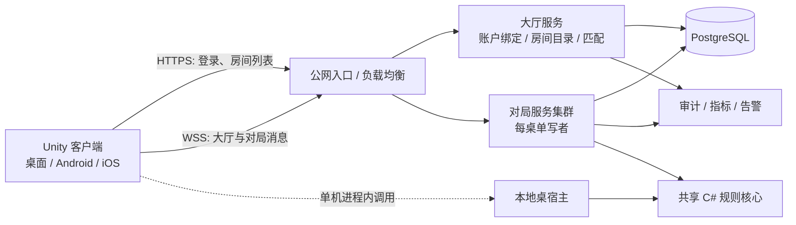

# 千术麻将 V5 架构设计草案：Unity + 共享 C# 规则核心 + .NET 公网服务

日期：2026-10-22  
状态：**供评审的目标设计，尚未实施或验收**  
范围：四人日麻、三大绝技、单机、私人房、公网大厅与匹配、玩家和观战；桌面、Android、iOS 客户端。

> 当前生产基线仍是 V4：Kotlin/JVM + libGDX + MJ-TCP/1。V4 已完成自动化验收，但跨物理网络与 Android 真机/模拟器的 T4 实测仍是已记录缺口。本文描述 V5 的新目标，不表示其中的账户、TLS、数据库恢复、匹配或 Unity 客户端已经存在。V4 事实以 [AGENTS.md](../../AGENTS.md)、[TCP 迁移验收](../v4-重构/CODEX-TCP-MIGRATION-ACCEPTANCE.md) 为准。

## 1. 设计结论

| 决策 | V5 方案 | 主要理由 |
|---|---|---|
| 表现层 | Unity，全部 UI/动画使用 C# | 统一桌面和移动端表现、资源与交互开发 |
| 规则核心 | 独立纯 C# 类库，目标 API 边界为 .NET Standard 2.1 | 同一份规则在 Unity 本地宿主和 .NET 服务端运行 |
| 线上权威 | 独立 .NET 服务进程，不运行 Unity Player | 每桌串行裁决，按实例承载多桌，避免渲染运行时开销 |
| 公网入口 | HTTPS + WSS；WSS 内使用有版本的二进制业务消息 | 适配常见代理/443 端口，保留双向长连接 |
| 持久化 | PostgreSQL 保存账户、房间元数据、请求回执、对局事件和结算；桌内热状态驻内存 | 崩溃后可重放恢复，副作用有持久化依据 |
| 本地对局 | Unity 进程内运行同一 C# 规则核心与桌面宿主 | 离线可玩，交互路径与线上尽量同构 |
| 安全边界 | 线上客户端仅提交意图；服务端保存隐藏状态、随机数、时限和结算 | 客户端副本可修改，不能作为线上权威 |

本方案面向回合制麻将。选择 C# 主要为了**共用规则、减少跨语言接口和降低维护成本**；性能容量必须经对局负载测试确认，不以语言或框架名称推算单机承载人数。

## 2. 目标和边界

### 2.1 必须满足

1. V4 已验证的四人日麻规则、41 种役种算分、136 张实体牌守恒、整场/单局生命周期、码牌、计时、三大绝技及出千账本在 V5 行为等价。规则调整要单独版本化，不能混入技术迁移。
2. 线上桌由服务器持有唯一可写权威状态。身份、席位、牌、点棒、绝技成本、随机过程与 deadline 均在服务器校验。
3. 客户端只获得其有权看到的投影；观战者只获得公开投影。单机存档与本地运行结果不能直接写入线上排位或经济账户。
4. 玩家动作、AI 决策、超时和控制权切换在同桌串行提交；不同桌可并行。
5. 已受理副作用在断线、重试、超时和服务重启后可对账，不能因回包丢失重复出牌、扣费、建房或结算。
6. 公网账户、匹配、加密连接、持久化恢复和可观测性作为 V5 实施范围；未完成前不宣称可公网正式运营。

### 2.2 本期不承诺

- 三人麻将、实时跨主机无感迁移、全球单房间跨地域运行、端到端防串通/防代打，以及对被修改的本地单机客户端的防作弊。
- V4 客户端与 V5 服务器混连，或正在进行的 V4 对局在线迁入 V5。版本切换按房间排空处理。
- 固定的“单机支持 N 万人”容量数字；第 12 节给出负载模型和实测门槛。

## 3. 运行拓扑与信任边界

**边界 A：客户端是不可信进程。**Unity 内即使包含完整的本地规则库，线上服务器仍独立运行规则。客户端不能提交“我摸到的牌”“最终分数”“牌山顺序”或自己选择的席位身份。

**边界 B：大厅与对局服务分工。**大厅负责账户、匹配、房间目录和入桌凭证；对局服务负责席位控制、规则裁决、隐藏信息、时限、快照和结算。大厅读不到无需使用的牌局私有明文，对局服务不依赖客户端提供的大厅权限声明。

**边界 C：存储是恢复依据。**线上已确认的命令对应持久事件和回执；服务重启后从检查点与事件恢复，再开放玩家重连。Redis 若后续引入，仅用于可重建的在线状态、限流或缓存，不作牌局权威库。

初期可把大厅和对局服务部署在同一环境，但代码与持久化所有权必须保持分离。单桌在任意时刻仅有一个对局服务实例拥有写权限；房间分配记录带 `ownerEpoch`，**每次持久化命令提交也必须核验该代次**。实例重启或重新分配时废止旧拥有者，防止旧实例在失去租约后继续写入。

## 4. 代码工程与依赖

建议的工程边界如下。项目名为设计名，实施时可以调整；依赖方向不可反转。

| 工程 | 目标运行时 | 职责与依赖 |
|---|---|---|
| `Mahjong.Domain` | `.NET Standard 2.1` | 牌实体、规则、算分、绝技、账本、局与整场状态机；不依赖 Unity、协议、数据库、Socket 或墙钟 |
| `Mahjong.Contracts` | Unity 可用的共享 C# 目标 | 二进制线路 DTO、版本、错误码和客户端可见视图；不暴露领域状态对象 |
| `Mahjong.TableRuntime` | Unity 可用的共享 C# 目标 | 每桌命令处理、领域到投影的映射、串行调度契约、控制权与快照语义；依赖 `Domain` 和 `Contracts`，外部资源以接口注入 |
| `Mahjong.Client` | Unity 可用的共享 C# 目标 | 会话门面、WSS/本地绑定、回执待定、缓冲、重连、视图缓存；仅依赖 `Contracts` |
| `Mahjong.LocalHost` | Unity 可用的共享 C# 目标 | 进程内桌宿主、可注入时钟与本地存档；依赖 `TableRuntime` |
| `Mahjong.Unity` | Unity | 菜单、牌桌、观战、动画、输入、资源及平台适配；业务画面只消费 `Client` 视图和命令门面 |
| `Mahjong.LobbyService` | 受支持的 .NET LTS | 认证接入、匹配、房间目录、凭证签发；依赖 `Contracts` 与服务端基础设施 |
| `Mahjong.TableService` | 受支持的 .NET LTS | WSS 接入、房间分配、持久化、远端桌宿主；依赖 `TableRuntime`、`Contracts` 与服务端基础设施 |
| `Mahjong.Infrastructure` | 服务端 .NET | PostgreSQL、密钥、消息出口、监控与运维适配；不得被共享领域库引用 |

共享库按 Unity 支持的 .NET API 边界编译；服务端可以使用更新的 .NET 功能，但这些类型不得渗入共享库公开接口。Unity 官方当前列出的跨平台 API 配置是 .NET Standard 2.1，不能把仅为 .NET 服务端编译的程序集直接当作 Unity 插件。[Unity .NET 配置文档](https://docs.unity3d.com/cn/6000.0/Manual/dotnet-profile-support.html)

统一规则逻辑并不要求把全部服务端代码编进移动包。`Domain` 与 `TableRuntime` 用于本地对局；线上 UI 通过 `Client` 调用远端，不能通过本地宿主更新线上状态。

## 5. 规则核心与确定性

### 5.1 领域职责

- 保留三层生命周期：`Room` 的大厅/准备/进行/结算/关闭、`MatchSession` 的整场、`RoundStateMachine` 的单局。终局状态不可复活，下一局创建新 `roundId`。
- 136 张牌使用稳定实体 ID `0..135`；牌山、死山、手牌、河、鸣牌、袖里藏花保管位等位置形成闭环，转换前后均校验守恒。
- 绝技 `TileMark`、`SleeveBloom`、`BeamSwap` 是**规则允许的操作**，只能由权威引擎在有效阶段、有效身份与足额出千点下执行。引擎产出私有/公开可见性标签，投影器据此下发。
- 规则核心只接受显式输入，例如 `state + command + authoritativeTime + randomState`，返回候选新状态、领域事件与错误；不直接读系统时间、网络、数据库或 Unity 对象。

### 5.2 跨 .NET 与 IL2CPP 一致性

同一份 C# 源码仍可能因运行时和平台差异得到不同结果。V5 对会影响权威结果的路径要求：

1. 算分、点棒和牌 ID 使用整数；避免浮点舍入参与裁决。
2. 随机数算法和版本固定；由线上服务生成高熵秘密种子，客户端不提前获得种子或整副牌顺序。本地可用本地种子；规则回放显式记录随机输入或结果。
3. 不依赖未规定顺序的集合遍历、线程完成顺序、区域设置、默认时区、当前时间或运行时对象哈希。
4. 领域事件采用稳定顺序；同一输入在服务端 .NET、Unity 编辑器、Android 与 iOS IL2CPP 回放后的状态摘要必须一致。
5. 版本变更产生新的 `rulesetVersion`。活动房间固定规则版本，旧回放保留可执行版本或明确的迁移器，不以新规则悄悄重算旧结算。

iOS 使用 IL2CPP 的 AOT 编译路径；反射注册、动态代码生成、序列化裁剪和第三方库兼容性需要在真实设备构建中验证。[Unity IL2CPP 文档](https://docs.unity3d.com/jp/current/Manual/il2cpp-introduction.html)

## 6. 线上桌的权威处理

### 6.1 单桌串行、跨桌并行

每桌有一个**有界命令邮箱**，玩家命令、超时、AI 结果、控制权切换、重连基线建立和结算依序处理。多个房间共享服务端线程池与调度器；不为每桌永久占用一个操作系统线程。网络读写、数据库等待和用户回调不得在桌状态修改期间持有全局锁。有界通道可提供明确的背压。[.NET Channels 文档](https://learn.microsoft.com/en-us/dotnet/core/extensions/channels)

处理顺序：

1. WSS 接入层完成身份、大小、版本、频率与基本语法校验，生成服务器接收时间和入队序号。
2. 桌邮箱验证 `roomId / seatId / bindingEpoch / roundId / decisionId / controlEpoch` 与权威 deadline。
3. 规则核心计算候选转移；非法动作返回稳定错误，不改变状态。
4. 已受理副作用的事件、回执与必要的消息出口记录在同一事务中持久化；提交成功后切换内存状态并排队推送。写库失败不得先向客户端确认成功，也不得让内存状态独自前进。
5. 响应和玩家/观战投影在提交之后发送；网络发送失败不会撤销已提交动作，客户端据请求 ID 对账。

同一逻辑决策有多个席位响应时，保留每座位的提交记录与最终选择规则。到 deadline 的超时事件与玩家输入采用可复现的排序：服务器记录输入接收时间，超过期限的输入拒绝；同一时刻冲突按冻结的决策优先级处理。队列拥堵不能无限延长思考时限。

### 6.2 AI 和计时

- AI 在桌邮箱之外异步计算，只取得允许该座位看到的决策上下文；返回时再校验 `roundId`、`decisionId`、`controlEpoch` 和截止时间。过期结果丢弃。
- 权威时间由服务端提供，使用单调时钟处理运行中的期限。初始玩法参数沿用 V4 的每座位每局 20 秒储备与每次 3 秒思考时间，调整须另立规则版本。客户端动画不改变 deadline。本地宿主使用可注入时钟，以相同规则推进。
- 断线、宽限期、AI 托管与显式 `claimControl` 延续 V4 语义；重连本身不自动收回控制权，收回时增加控制代次。公网心跳与房间的出牌时限彼此独立。
- 服务故障恢复时不直接信任新进程的单调时钟起点。恢复对局的停机时间、剩余用时和重新开放时间必须由持久化恢复策略裁决并记录；不能在故障期间静默判定玩家超时。

## 7. 公网身份、大厅和匹配

1. 认证采用标准 OIDC 接入或兼容身份提供者；服务端验证短期访问令牌，长期凭据由安全存储与刷新流程管理。匿名/游客可进入受限房间，但排位及跨设备资产绑定要求正式账户。
2. 大厅保存账户 ID、房间摘要、匹配队列、已分配桌节点和当前版本。列表与匹配可以缓存，但席位归属以服务端持久记录为准。
3. 建房、加入、观战或匹配成功后签发短期入桌凭证，绑定 `accountId + roomId + role + seatId(若为玩家) + ownerEpoch + expiry + nonce`。对局服务验证凭证，并在每条命令上核对当前绑定；客户端不可自选席位或升级为玩家。凭证过期后的重连须先凭账户身份取得新凭证，不能靠旧 WSS 连接或旧凭证延长权限。
4. 同席位只允许一个有效控制绑定。新连接替换旧连接时提升 `bindingEpoch`，旧连接已经排队的命令在桌邮箱内再次核验。
5. 公开房匹配遵循地区、玩法版本、排位条件和等待时间；初版采用中心化队列与可解释规则。匹配公平性、机器人补位、好友组队和排位分算法分别版本化。

排位对局的作弊防线是服务端权威、最小信息投递和审计；串通、多账号、代打及外部辅助决策仍需要行为检测与运营处理。正常的三大绝技按规则执行，不计为非法客户端作弊。

## 8. WSS 业务协议

### 8.1 分层与格式

- HTTPS 承担登录与普通查询；WSS 承担大厅实时变化、房间命令、回执和推送。对局采用二进制 WebSocket 消息，建议 `Protocol Buffers` 的显式 DTO；消息版本固定于连接协商和房间创建时，不按运行时类名反射分发。
- 大厅通知与对局分别使用 `lobby`、`table` 两类 WSS 会话。大厅会话只接受目录/匹配相关消息；入桌后以短期凭证连接房间所属对局节点，玩家或观战的席位权限仅在 `table` 会话内建立。断开大厅会话不自动结束进行中的牌局。
- 一个业务封包对应一个完整 WebSocket **消息**。接收器必须处理 WebSocket 分帧、分片、Close 和半途断开；不假设一次 `ReceiveAsync` 等于一个完整业务消息。
- 不沿用 MJ-TCP/1 的 `MJTC` 魔数与 12 字节长度帧头。WebSocket 已提供消息边界；需要保留的是业务版本、类型、请求关联、代次和载荷大小约束。
- `Envelope` 包含 `protocolMajor`、`protocolMinor`、`messageType`、`correlationId`、`requestScopeId`、`requestId`、`roomId`、`sessionId`、`payload`。仅对适用消息填字段，字段语义由 schema 冻结。Unity/IL2CPP 端的生成代码、AOT 与裁剪兼容性必须在协议冻结前做最小实机构建。
- 初始最大完整消息 1 MiB、每连接收发队列同时受**条数与字节数**限制。上限是设计初值，需由真实最大快照和恶意输入测试确定；超过上限应拒绝或断连，不能静默截断。
- 协议主版本不兼容时明确拒绝。新增可选字段按兼容规则演进；已开始的房间固定 `protocolMajor`、`rulesetVersion` 和投影版本，不混用语义。

建议的消息族：`HELLO/WELCOME`、`COMMAND/RECEIPT`、`PLAYER_SNAPSHOT`、`PUBLIC_SNAPSHOT`、`ROOM_UPDATE`、`SYNC_REQUEST`、`RECEIPT_QUERY`、`HEARTBEAT`、`ERROR/CLOSE`。具体 Protobuf tag、错误码与版本协商应在协议冻结阶段单独列为规范和生成代码，不由此概要代替线路契约。

### 8.2 连接、心跳和限制

- 只开放 `wss://`；TLS 在边缘或服务端终止，边缘到对局节点也须是受控可信通道。认证材料不放 URL 查询串；日志屏蔽令牌和私有牌数据。
- 初始连接参数建议为 10 秒心跳、30 秒无有效入站判定连接失活；**这些不是已验收值**。移动端后台、代理空闲超时与弱网实测后调整。权威出牌时限照常独立处理。
- 限制握手时间、连接数、消息大小、入站速率、每连接队列和观战订阅数；慢客户端停止接纳新请求并断开，用快照恢复，不能阻塞其他房间。
- WSS 的可靠有序传输不等于业务恰好执行一次。网络回包丢失后结果可能未知，必须继续使用业务回执对账。

WebSocket 帧与客户端掩码由标准定义；WSS 是在 TLS 上运行 WebSocket，不能把掩码视为加密。[RFC 6455](https://www.rfc-editor.org/rfc/rfc6455.html)。ASP.NET Core 对心跳与代理空闲连接有专门配置；部署时要与入口代理的超时一致。[ASP.NET Core WebSocket 文档](https://learn.microsoft.com/en-us/aspnet/core/fundamentals/websockets)

## 9. 回执、同步与隐藏信息

### 9.1 幂等和未知结果

- 所有有副作用命令携带服务端颁发的 `requestScopeId` 与客户端稳定生成的 `requestId`。幂等键为 `(accountId, requestScopeId, requestId)`，并记录规范化业务载荷摘要；同键不同语义返回冲突。
- 回执与领域事件在同一数据库事务提交。执行成功但回包丢失时，原请求 ID 可查询或安全重放原回执；过期请求绝不自动分配新 ID 再做一次。连接断开不释放在途副作用身份。
- scope 绑定账户、角色、房间及有效期。设计初值为覆盖整场对局及结算后 24 小时的对账期；存储量、清理条件和失效错误码由实测与协议冻结确定。无回执且过期时返回“需要人工/业务对账”，不尝试猜测结果。
- 在线排位结果和出千点变更由服务端生成。结算写入唯一 `(matchId, resultVersion)` 的账本记录，重复消费不会重复发奖或扣费。

### 9.2 可见性和恢复

投影流水线为 `Domain 全状态 → TableRuntime 按席位/观战投影 → Contracts DTO → WSS/本地绑定 → Client 只读视图 → Unity`。

- 玩家只看到自己的手牌、私有绝技信息与公共桌面；观战只看到公开视图。不能先序列化完整状态再指望客户端隐藏字段。
- 初版保持 V4 已验证的**完整快照 + 可见事件**语义。每个座位独立递增游标，观战公开流有独立游标，且与 `(sessionId, syncEpoch)` 绑定；游标随事件持久化或从事件确定性重建。首个基线与订阅在桌邮箱内原子建立。
- 推送可能与响应交错；客户端按 `bindingEpoch`、`syncEpoch` 和游标拒绝旧响应、重复、回退与缺口。缺口或超出缓冲预算时请求新完整基线；不推断丢失的隐藏事件。
- 本地客户端维持有界早期缓冲；候选初值沿用 V4 的 64 条 / 4 MiB，但要按 Unity 端实际内存与快照体积复核。
- 重连保留身份、原请求与未确认副作用，重新认证后恢复基线，再查询未决回执。托管期间已生效的动作不可回滚，真人显式收回控制权。

完整快照会放大观战与高并发广播成本。V5 首版优先确保正确性；如压测确认其成为瓶颈，再设计**单独版本化**的增量投影与周期全量校验，不在同一协议版本里暗改恢复语义。

## 10. 持久化、故障与部署

### 10.1 数据所有权

PostgreSQL 至少分清以下逻辑数据：账户和会话、房间及拥有者代次、对局事件、周期检查点、幂等回执、结算/资产账本、消息出口。事件与检查点可能包含暗牌、随机种子和绝技私有信息，应加密存储并限制读取权限；日志与追踪只记录必要的 ID、状态码和耗时。

处理一条已受理命令时，先根据当前状态计算候选转移，再在事务内核验 `ownerEpoch` 并写事件、请求回执和必要的结算/出口记录；提交后发布内存新状态。若账户资产由另一服务独立持有，通过持久出口消息投递，并以 `matchId + resultVersion` 幂等入账。数据库不可用时停止权威推进并进入可恢复的暂停状态。对局事件不能只留在内存、结束时才一次性写库。

检查点按局结束或事件数阈值写入；恢复时读取匹配版本的检查点并重放后续事件，校验状态摘要、136 张守恒、账本和游标。新实例取得更高 `ownerEpoch` 并隔离旧实例后，才开放重连。V5 首版目标是**故障后的冷恢复**，不是运行中无感迁移。

### 10.2 基础设施与运维

- 入口：支持 TLS/WSS 的负载均衡器或反向代理，配置连接排空、最大消息、空闲超时和限流。房间定位返回目标区域/节点，或由网关按房间路由。
- 服务：大厅无状态横向扩展；对局节点按房间分配、负载和故障域扩展。主动发布先停止分配新房，允许现有桌结束或走受控冷恢复。
- 存储：PostgreSQL 备份、恢复演练与必要的高可用配置。Redis 可用于在线态缓存，丢失后可从权威数据重建。
- 观测：连接数、活跃桌数、每桌邮箱深度、动作裁决与持久化耗时、p95/p99 延迟、快照大小、推送字节、慢客户端、GC 暂停、AI 耗时、超时动作、幂等命中/冲突、恢复失败率。
- 审计：按 `matchId + roomId + roundId + decisionId + requestId` 关联操作、领域事件和结算；私有内容在审计系统中分权访问。

## 11. Unity 客户端与本地对局

- Unity 分为大厅、牌桌、观战、共享资源与平台适配程序集。UI 订阅不可变视图并提交命令，不自行判断权威役种、出千支付或隐藏牌位置。
- 网络线程将结果派发回 Unity 主线程后更新画面；动画队列消费已确认状态与可见事件。动画可以延后显示，不能延后服务器时限或覆写更新版本。
- 本地模式由 `LocalHost` 通过与远端同形的 `Client` 门面交互，运行相同 `Domain/TableRuntime`。本地可存档和回放，但结果标记为 `localOnly`，线上服务拒绝将其作为排位、账户资产或公平性证据。
- iOS/Android 使用 IL2CPP 构建验证共享 DLL、AOT、裁剪、网络库和后台恢复；桌面构建验证输入、资源、断网和显示适配。真实设备性能要测启动、常驻内存、发热和动画帧时间。
- Unity 包中存在规则代码不改变线上信任模型：客户端可能被逆向或改写；线上秘密从不下发。

## 12. 性能模型与验收指标

### 12.1 容量计算方式

按活跃桌数、每桌动作频率、每动作投影数和平均投影大小计算。**示例假设而非容量承诺**：10,000 名对局玩家约 2,500 桌；若每桌平均 2 秒一个动作，约 1,250 次动作/秒、至少 5,000 次玩家推送/秒，尚不含观战、心跳、AI 搜索和房间列表。若每条投影平均为 `S` 字节，则仅玩家状态推送带宽约为 `5,000 × S` 字节/秒，此外还有 TLS、WebSocket、协议和网络开销。

### 12.2 首轮压测门槛（目标值，待基线测量后冻结）

1. 使用真实四人回放、三绝技、AI 托管、重连、观战和结算混合负载；分别测 100、1,000、2,500 桌，至少做峰值测试与长时间稳定性测试。记录每个硬件规格和容器限制，不能只报总在线数。
2. 在选定集群容量下，从服务接收命令到**持久化回执排队发送**的 p99 初始目标为 200 ms（排除客户端网络 RTT、玩家思考时间和 AI 决策计算）；到期裁决不能因其他桌的慢网络或 AI 丢失。
3. 测量每桌常驻内存、每连接内存、每动作分配字节、GC 暂停、数据库写入延迟、WSS 出站带宽、快照分位大小和慢端积压。任何队列、缓冲或在途请求都必须有上限。
4. 注入数据库慢写、节点宕机、WSS 断线、代理切断、客户端后台挂起与观战风暴，确认不会出现双写、重复结算、私有信息泄露或不可恢复的未知副作用。

ASP.NET Core 的性能建议重点包括避免阻塞热路径、控制大对象分配以及优化数据库 I/O；实际瓶颈应由本项目回放和剖析数据确定。[Microsoft 性能实践](https://learn.microsoft.com/aspnet/core/performance/performance-best-practices)

## 13. V4 → V5 迁移路径

| 阶段 | 交付物 | 放行条件 |
|---|---|---|
| V5-0 契约盘点 | V4 规则用例与回放清单、客户端可见性矩阵、真实快照大小、硬件/网络基线、未完成 T4 环境实测清单 | 每个现有有效规则和绝技都有迁移归属；不把 V4 未实测项记作 V5 通过 |
| V5-1 共享核心 | C# `Domain`、确定性随机/时钟接口、领域回放及跨运行时测试 | 136 张守恒、算分、局/整场、三绝技、计时与控制代次行为对齐 V4 黄金样本 |
| V5-2 桌宿主与本地客户端 | `TableRuntime/LocalHost/Client`、Unity 单机牌桌与菜单 | 完整单机场次、存档/回放、桌面与 Android/iOS 实机冒烟；UI 不绕过门面改权威状态 |
| V5-3 远端与协议 | WSS/Protobuf、账户、房间、观战、幂等、持久事件与冷恢复 | 故障点注入、私有投影、重连对账、版本拒绝、慢端背压和权限测试通过 |
| V5-4 公网大厅 | 匹配、房间分配、TLS、监控、限流、运营审计 | 弱网/跨物理网络/移动后台实测与容量压测达标，安全与恢复演练通过 |
| V5-5 发布切换 | 独立 V5 客户端和服务发布，V4 活动房排空 | 不热迁移活动房；回退与数据保全演练通过，迁移报告列明仍未覆盖项目 |

V4 的 1,275 项标准自动化用例是旧实现验收证据，不能直接算作 V5 已通过。迁移时应抽取**输入、随机种子或随机结果、预期事件和状态摘要**为语言中立黄金样本；C# 重新实现后做差分回放，再增加 V5 的 WSS、数据库、Unity 与真实设备测试。历史 V4 源码和文档保留为核对依据，不通过改写旧验收记录宣布 V5 完成。

## 14. 主要风险与评审点

| 风险 | 设计控制 |
|---|---|
| Kotlin → C# 重写引入规则差异 | 先冻结黄金样本，分领域迁移，按整场回放差分，不与规则改动合并 |
| Unity 与服务器运行时行为不同 | 共享 API 下限、显式随机/时钟/排序、IL2CPP 真机构建与状态摘要对比 |
| 客户端包含本地规则库 | 线上仍独立权威，隐藏状态、随机种子和私有事件仅保存在服务器 |
| 全量快照消耗带宽 | 先测投影大小和观战扇出；需要优化时新建版本化增量协议 |
| 事务写入拖慢桌邮箱 | 异步 I/O、按桌隔离、数据库基线与背压；不以未持久化的成功回执换取延迟 |
| 服务故障造成重复动作或双写 | 持久请求回执、唯一约束、事件重放、`ownerEpoch` 隔离与故障注入 |
| 移动弱网及后台使心跳误判 | 心跳与规则 deadline 分离、可恢复基线、实机/跨物理网络验收 |

评审时需冻结的产品参数：游客能否进入排位、排位是否允许观战及延迟、掉线宽限期、单机存档格式、各玩法规则版本，以及目标地区和首期并发规模。以上选择不会改变服务器权威和隐藏信息边界，但会改变容量与运营策略。

## 15. 设计资料

- [V4 当前架构与约束](../../AGENTS.md)
- [V4 TCP 迁移设计](../v4-重构/TCP-MIGRATION-DESIGN.md)
- [V4 TCP 自动化验收与环境实测缺口](../v4-重构/CODEX-TCP-MIGRATION-ACCEPTANCE.md)
- [V4 规则与协议设计索引](../GAME_ARCHITECTURE_V4.md)
- [Unity .NET API 兼容性](https://docs.unity3d.com/cn/6000.0/Manual/dotnet-profile-support.html)
- [Unity IL2CPP](https://docs.unity3d.com/jp/current/Manual/il2cpp-introduction.html)
- [WebSocket 协议 RFC 6455](https://www.rfc-editor.org/rfc/rfc6455.html)
- [ASP.NET Core WebSocket 支持](https://learn.microsoft.com/en-us/aspnet/core/fundamentals/websockets)
