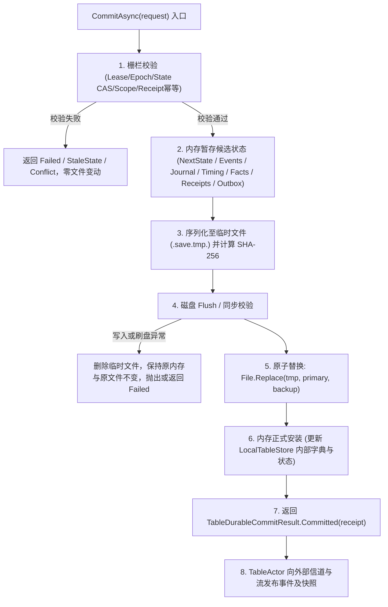

# V5 P4.1 本地宿主与本地存档契约补充协议 (Contract Addendum)

日期：2026-10-26
责任方：Anti（依据用户 2026-10-26 授权，使用 configured default 模型，禁止转派）
工作树：`D:/majiang-wt/p41-contract-addendum-anti-20261026`
分支：`wt/v5-p41-contract-addendum-anti-20261026`
冻结基线：`9a603091e74ced24ea331cc415699f5a4462262e`（已合入 Anti 独立审计报告 `00c71cd`）
前置草案审查对象：原 P4.1 准备线程 `thread_20261025_194659_8d8a`（FAILED，native session 缺失）遗留的未接受未集成提交 `b43435df0ab674f9a1f09e60766680216be4a81f`，文档 [`doc/v5-重构/V5-P4.1-CONTRACT-PREPARATION.md`](file:///D:/majiang-wt/p41-contract-addendum-anti-20261026/doc/v5-重构/V5-P4.1-CONTRACT-PREPARATION.md)（原始 Git Blob `b238facf1fba10a79c8b5148bf7860823a50feb2`，二进制 SHA-256 `A427493D6C903D549C7B90EAC8C6530ABD9C46427043488FE2C52C68FC754EDF`）。
交付产物：本文件 [`doc/v5-重构/V5-P4.1-CONTRACT-ADDENDUM.md`](file:///D:/majiang-wt/p41-contract-addendum-anti-20261026/doc/v5-重构/V5-P4.1-CONTRACT-ADDENDUM.md)（本次唯一授权新增文件，不修改生产代码、测试、Unity 工程、共享台账、规划文档或未提交文件）。

---

## 0. 系统基准、门禁状态与补充协议性质

1. **唯一生产架构基准**：全系统默认且唯一生产架构继续为 **V4**（Kotlin/JVM + libGDX + MJ-TCP/1 契约）。V5 处于多阶段重构准备期，未经验收不得作为生产交付。
2. **G1 门禁状态守卫**：当前基线 `9a60309` 下 G1 仍为 **BLOCKED**。
   - 门 2（黄金对齐）：实际台账分母向量为 **592 = 411 bound / 175 classified / 6 pending**（历史 411/82/99 已被集成头替代；93 项已转 classified 未覆盖项；6 项 pending 仍在推进中）；
   - 门 5（核心规则）：残余 `D-CUR-1`（N-2 宿主权威结算接线未完成，生产调用为零）尚未闭环；
   - G5 远未完成；**严禁创建 `complete.flag`**。
3. **补充契约性质与独立性**：
   - 本文件属于**补充契约（Contract Addendum）**，用于逐条关闭已接受的 Anti 独立审计报告（[`V5-P4.1-INDEPENDENT-CONTRACT-AUDIT-ANTI.md`](file:///D:/majiang-wt/p41-contract-addendum-anti-20261026/doc/v5-重构/V5-P4.1-INDEPENDENT-CONTRACT-AUDIT-ANTI.md)）中裁定的 3 项 MAJOR 与 1 项 MINOR 缺陷（D-ANTI-01 至 D-ANTI-04）；
   - 不重启原 FAILED 会话，不重写旧草案，不把旧草案当作 ACCEPTED，不替原草案提交 `record_merge_request`；
   - 形成短小、明确、无自相矛盾的修订补充，在 G1 门禁通过后与旧草案组合进入最终实现评审；
   - 本任务不碰触且不读取在途的 DeepSeek N-2 宿主结算（`thread_20261026_071845_d58f`）或 GLM AI 返修产物；外部共享台账仅由 Caller 串行更新。
4. **代码块与签名性质声明**：本文出现的 C# 9 / netstandard2.1 代码块均为强类型契约规范，类定义与方法签名明确不作为可编译交付源码。在未来实施时补全主体实现，审阅方不得因签名简写（如构造函数尾部分号）误判文档。
5. **分母与实跑口径守卫**：未实跑的运行验证与冷恢复流程一律明确标注为 **`NOT_RUN`** 或 **`BLOCKED`**，绝不将静态契约推导虚构为实跑通过。

---

## 1. D-ANTI-01 [MAJOR] 增量保存模型决议、数据流映射与单提交边界

### 1.1 缺陷定位与旧草案具体章节替换
- **涉及旧草案章节**：
  - §2.2 行 513–547（`LocalSaveState` 类签名及字段定义）；
  - §2.3 行 856–863（`LocalSave` 状态、命令与事件字段表格）；
  - §3.1 行 967–968（`TableRuntime` 现有恢复合同约束）；
  - §3.2 行 991–994（`LocalTableStore` 边界规则与事务语义）。
- **技术事实澄清**：
  查阅 [`TableDurableContracts.cs:556-591`](file:///D:/majiang-wt/p41-contract-addendum-anti-20261026/dotnet/src/Mahjong.TableRuntime/TableDurableContracts.cs#L556-L591)，`TableCheckpoint` 自身**已经封装了** `TimingPayload` 与 `CommittedFactsPayload`（以及 `StatePayload`、`ControlPayload`、`CheatPayload`、`CommittedCommandBindingsPayload` 与 `CommittedHistoryPayload`）。
  旧草案的实质缺陷并非检查点缺乏载荷，而是：**当系统处于检查点之后的增量尾部阶段（`stateVersion > checkpoint.StateVersion`）或者发生独立的时序写回（`AppendTimingAsync`，其不增加 `stateVersion`）时，`LocalSave` 缺失对最新已确认事实快照与最新时序记录的持久化字段与事务数据流映射**，导致恢复服务 [`TableRecoveryService.cs:1120-1166`](file:///D:/majiang-wt/p41-contract-addendum-anti-20261026/dotnet/src/Mahjong.TableRuntime/TableRecoveryService.cs#L1120-L1166) 在存在出千/鸣牌尾部命令时因读取旧检查点事实而导致恢复校验失败（`RecoveryStateSinkRequired` 或 `TableProjectionException`，返回 `Failed`）。

### 1.2 保存模型决议：Checkpoint + Tail 模型
**【裁决结论】**：本地单机模式严格采纳 **Checkpoint + Tail 模型（检查点基线 + 增量尾部日志 + 独立最新时序与事实）**。
- **架构必然性理由**：
  1. 查阅 [`TableActor.cs:3269-3358`](file:///D:/majiang-wt/p41-contract-addendum-anti-20261026/dotnet/src/Mahjong.TableRuntime/TableActor.cs#L3269-L3358)，权威端 `TableActor` 在处理通常的单步打牌、鸣牌、出千等业务命令时，生成的 `TableDurableCommitRequest.Checkpoint` 保持为 `null`；仅在对局终局（`terminal = true`，`nextState.IsFinished`）或显式投递 `SaveCheckpointAsync` 邮箱控制消息（[`TableActor.cs:338`](file:///D:/majiang-wt/p41-contract-addendum-anti-20261026/dotnet/src/Mahjong.TableRuntime/TableActor.cs#L338)）时才构造全量 `TableCheckpoint`。`TableActor` 并未向 `ITableStore` 暴露“每步命令同步生成全量检查点”的现成能力；
  2. [`ITableStore`](file:///D:/majiang-wt/p41-contract-addendum-anti-20261026/dotnet/src/Mahjong.TableRuntime/TableDurableContracts.cs#L1467-L1522) 与 [`TableRecoveryService`](file:///D:/majiang-wt/p41-contract-addendum-anti-20261026/dotnet/src/Mahjong.TableRuntime/TableRecoveryService.cs#L320-L450) 的冷恢复流水线天生基于 Checkpoint + Tail 设计：先加载基线检查点，再通过 `LoadCommandsAfterAsync` 与 `LoadEventsAfterAsync` 顺序重放尾部动作，并优先使用 `LoadCommittedFactsAsync` 校验重放后的最终投影事实；
  3. 因此，不能要求 `TableActor` 在每次命令提交时必须刷新检查点，也不得以不存在的每步 actor 检查点端口作为现成能力。`LocalSave` 必须显式具备承载 post-checkpoint 增量事实与独立时序的能力。

### 1.3 `LocalSave` 替换字段与强类型结构规范
替换旧草案 §2.2 中缺失增量载荷的 `LocalSaveState`，在 `LocalSave` 中显式扩展最新时序与事实字段：

```csharp
namespace Mahjong.LocalHost
{
    /// <summary>
    /// 本地单机存档的权威状态快照，完整承载基线检查点与 Post-Checkpoint 增量尾部数据。
    /// 满足 netstandard2.1 / C# 9 规范。
    /// </summary>
    public sealed class LocalSaveState
    {
        public LocalSaveState(
            int checkpointSchemaVersion,
            long stateVersion,
            long eventSeq,
            string roundId,
            ulong stateFingerprint,
            TablePayloadSha256 stateHash,
            byte[] checkpointBlob,
            TablePayloadSha256 checkpointSha256,
            long controlVersion,
            long timingVersion,
            byte[] latestTimingPayload,
            TablePayloadSha256 latestTimingPayloadSha256,
            byte[]? latestCommittedFactsPayload,
            TablePayloadSha256? latestCommittedFactsPayloadSha256,
            long cheatVersion,
            ulong cheatFingerprint,
            LocalSaveTerminalState terminalState,
            string? terminalResultId,
            int? terminalResultVersion)
        {
            CheckpointSchemaVersion = checkpointSchemaVersion;
            StateVersion = stateVersion;
            EventSeq = eventSeq;
            RoundId = roundId ?? throw new ArgumentNullException(nameof(roundId));
            StateFingerprint = stateFingerprint;
            StateHash = stateHash;
            CheckpointBlob = checkpointBlob ?? throw new ArgumentNullException(nameof(checkpointBlob));
            CheckpointSha256 = checkpointSha256;
            ControlVersion = controlVersion;
            TimingVersion = timingVersion;
            LatestTimingPayload = latestTimingPayload ?? throw new ArgumentNullException(nameof(latestTimingPayload));
            LatestTimingPayloadSha256 = latestTimingPayloadSha256;
            LatestCommittedFactsPayload = latestCommittedFactsPayload;
            LatestCommittedFactsPayloadSha256 = latestCommittedFactsPayloadSha256;
            CheatVersion = cheatVersion;
            CheatFingerprint = cheatFingerprint;
            TerminalState = terminalState;
            TerminalResultId = terminalResultId;
            TerminalResultVersion = terminalResultVersion;
        }

        public int CheckpointSchemaVersion { get; }
        public long StateVersion { get; }
        public long EventSeq { get; }
        public string RoundId { get; }
        public ulong StateFingerprint { get; }
        public TablePayloadSha256 StateHash { get; }
        public byte[] CheckpointBlob { get; }                     // 最近一次基线 TableCheckpoint 序列化二进制
        public TablePayloadSha256 CheckpointSha256 { get; }
        public long ControlVersion { get; }
        public long TimingVersion { get; }

        // --- 解决 D-ANTI-01 的关键增量扩展载荷 ---
        public byte[] LatestTimingPayload { get; }               // 最新时序载荷（由 CommitAsync、CommitControlAsync 或 AppendTimingAsync 更新）
        public TablePayloadSha256 LatestTimingPayloadSha256 { get; }
        public byte[]? LatestCommittedFactsPayload { get; }       // Post-checkpoint 最新已确认事实快照（由 CommitAsync 中的 request.CommittedFactsPayload 更新）
        public TablePayloadSha256? LatestCommittedFactsPayloadSha256 { get; }

        public long CheatVersion { get; }
        public ulong CheatFingerprint { get; }
        public LocalSaveTerminalState TerminalState { get; }
        public string? TerminalResultId { get; }
        public int? TerminalResultVersion { get; }
    }
}
```

### 1.4 `LocalTableStore` 对 `ITableStore` 各持久方法的数据流与事务映射
`LocalTableStore` 位于 `Mahjong.LocalHost`，直接实现 [`ITableStore`](file:///D:/majiang-wt/p41-contract-addendum-anti-20261026/dotnet/src/Mahjong.TableRuntime/TableDurableContracts.cs#L1467-L1522) 全部 13 个接口方法，数据流映射规范如下：

1. **`CreateRoomAsync(TableCheckpoint initialCheckpoint, CancellationToken ct)`**：
   - 构造初始 `LocalSave` 实例，将 `initialCheckpoint` 序列化为 `CheckpointBlob`；
   - 提取 `initialCheckpoint.TimingPayload` 赋给 `LatestTimingPayload`，提取 `initialCheckpoint.CommittedFactsPayload` 赋给 `LatestCommittedFactsPayload`；
   - 清空 `CommandJournal` 与 `EventJournal`；
   - 走 §1.5 原子落盘流程，写入 `<roomId>.save` 并创建 `<roomId>.save.prev` 初始副本。
2. **`LoadStateAsync(string roomId, CancellationToken ct)`**：
   - 从当前内存安装的 `LocalSaveState` 重建并返回 [`TableStateRow`](file:///D:/majiang-wt/p41-contract-addendum-anti-20261026/dotnet/src/Mahjong.TableRuntime/TableDurableContracts.cs#L1250)（含 `StateVersion`, `LastEventSeq`, `StateFingerprint`, `StateHash`, `ControlVersion`, `TimingVersion`, `CheatVersion`, `CheatFingerprint` 等）。
3. **`LoadCheckpointAsync(string roomId, CancellationToken ct)`**：
   - 反序列化 `LocalSaveState.CheckpointBlob`，校验 `CheckpointSha256` 匹配后返回基线 `TableCheckpoint`。
4. **`LoadTimingAsync(string roomId, CancellationToken ct)`**：
   - 反序列化 `LocalSaveState.LatestTimingPayload` 为 `TableTimingCheckpoint`；
   - 组装并返回 [`TableTimingJournalRecord`](file:///D:/majiang-wt/p41-contract-addendum-anti-20261026/dotnet/src/Mahjong.TableRuntime/TableDurableContracts.cs#L1348)（版本号取 `LocalSaveState.TimingVersion`，状态与控制版本取 `CurrentState` 对应值）。
5. **`LoadCommittedFactsAsync(string roomId, CancellationToken ct)`**：
   - 若 `LatestCommittedFactsPayload != null`，校验 `LatestCommittedFactsPayloadSha256` 并返回 [`TableCommittedFactsSnapshot`](file:///D:/majiang-wt/p41-contract-addendum-anti-20261026/dotnet/src/Mahjong.TableRuntime/TableDurableContracts.cs#L1442)；
   - 若为空，则返回 `null`（恢复流水线自动回退到 `checkpoint.CommittedFactsPayload`）。
6. **`AppendTimingAsync(TableTimingAppendRequest request, CancellationToken ct)`**：
   - **关键独立时序写回契约**：冷恢复完成时 [`TableRecoveryService.cs:1293`](file:///D:/majiang-wt/p41-contract-addendum-anti-20261026/dotnet/src/Mahjong.TableRuntime/TableRecoveryService.cs#L1293) 调用此接口持久化调整后的单调与 UTC 时钟基准；
   - 校验 lease owner/epoch，校验 `request.ExpectedTimingVersion == CurrentState.TimingVersion`；
   - **不递增** `StateVersion`，**不递增** `LastEventSeq`；
   - 将 `CurrentState.TimingVersion` 递增 1（`checked(state.TimingVersion + 1L)`）；
   - 更新 `LatestTimingPayload = TableTimingCheckpointCodec.Encode(request.Timing)` 及其 SHA-256；
   - 触发 §1.5 原子替换写回磁盘；成功后更新内存状态并返回 `TableDurableCommitResult.Committed(null)`。
7. **`SaveCheckpointAsync(TableCheckpoint checkpoint, TableCheckpointFence fence, CancellationToken ct)`**：
   - 校验 lease 与 fence 版本；
   - 将新检查点序列化写入 `CheckpointBlob`；
   - **日志压缩（Compaction）**：从 `CommandJournal` 移除 `StateVersion <= checkpoint.StateVersion` 的旧命令，从 `EventJournal` 移除 `EventSeq <= checkpoint.LastEventSeq` 的旧事件；
   - 同步更新 `LatestTimingPayload = checkpoint.TimingPayload` 与 `LatestCommittedFactsPayload = checkpoint.CommittedFactsPayload`；
   - 触发原子替换落盘。
8. **`CommitControlAsync(TableControlCommitRequest request, TableCheckpoint checkpoint, CancellationToken ct)`**：
   - 校验 lease、`request.StateVersion` 与 `request.ExpectedControlVersion`；
   - 更新 `CurrentState.ControlVersion = request.ControlVersion` 与 `CurrentState.TimingVersion = checkpoint.TimingVersion`；
   - 替换 `CheckpointBlob = checkpoint`，同步刷新 `LatestTimingPayload = checkpoint.TimingPayload`；
   - 触发原子替换落盘。
9. **`LoadEventsAfterAsync(string roomId, EventSeq afterSeq, CancellationToken ct)`**：
   - 返回 `EventJournal` 中 `Seq > afterSeq` 的事件序列。
10. **`LoadCommandsAfterAsync(string roomId, StateVersion afterVersion, CancellationToken ct)`**：
    - 返回 `CommandJournal` 中 `StateVersion > afterVersion` 的命令序列。
11. **`CommitAsync(TableDurableCommitRequest request, CancellationToken ct)`**：
    - **全系统唯一的原子提交事务边界**（详见 §1.5）。
12. **`AppendRecoveryAuditAsync` / `LoadRecoveryAuditsAsync`**：
    - 追加或读取用于本地冷恢复诊断的审计日志记录，不含明文暗牌或票据。

### 1.5 单一提交边界、失败回滚与双备份原子替换流水线
查阅 [`InMemoryTableStore.cs:1050-1375`](file:///D:/majiang-wt/p41-contract-addendum-anti-20261026/dotnet/src/Mahjong.TableRuntime/InMemoryTableStore.cs#L1050-L1375)，`CommitAsync` 的提交边界必须绝对原子化：



- **单一提交边界原则**：所有已确认的状态变动、`CommandJournal`、`EventJournal`、`TableDurableReceipt`、`TableSettlementOutboxRecord`、`LatestTimingPayload`、`LatestCommittedFactsPayload` 以及可选的 `CheckpointBlob` **属于同一个提交边界**。绝对禁止在落盘前提前发布内存状态，亦禁止在发布后异步追加写盘。
- **取消与失败回滚顺序**：
  - 若在步骤 5（`File.Replace`）完成前发生取消（`ct.IsCancellationRequested`）或 I/O 故障，仅清理 `.tmp.<guid>` 临时文件，内存状态不改变，不返回 `Committed`，`TableActor` 绝不向客户端发布事件；
  - 若在原子替换瞬间发生未捕获异常导致结果未知（`OutcomeUnknown`），宿主保持未决状态，依赖客户端出箱重查或重启后冷恢复裁决。
- **双备份容灾与恢复防护**：
  - 主存档文件 `<roomId>.save` 与上一份有效备份 `<roomId>.save.prev` 并存；
  - 冷恢复启动时，若 `<roomId>.save` 出现 CRC/SHA 校验失败或文件不完整，系统自动回退至 `<roomId>.save.prev` 并记录 `TableRecoveryAuditRecord`；
  - **严禁弱化恢复栅栏**：`TableRecoveryOptions.RequireCommittedFacts` **强制保持为 true**；136 张麻将物理守恒检查、状态 Hash 比对、OwnerEpoch 租约栅栏与版本连续性校验全部保持开启，严禁通过“跳过检查”来掩盖状态不一致。

### 1.6 验收断言与 API 证据
- **验收断言 1（冷恢复完全通过）**：在包含出千、鸣牌等尾部命令且未触发终局检查点的对局存档中，`TableRecoveryService.RecoverAsync` 执行冷恢复，`LoadCommittedFactsAsync` 成功返回匹配的最新事实，`ValidateRecoveredFacts` 校验通过，恢复返回 `Status == TableRecoveryStatus.Serving`，无 `CheckpointInvalid` 或 `RecoveryFailed`。
- **验收断言 2（时序原子写回断言）**：冷恢复结束调用 `AppendTimingAsync` 后，`<roomId>.save` 中的 `TimingVersion` 恰好加 1，`StateVersion` 保持不变；后续重新加载存档其 `LoadTimingAsync` 读出的时钟基准与写回值完全一致。
- **API 证据索引**：
  - [`TableDurableContracts.cs`](file:///D:/majiang-wt/p41-contract-addendum-anti-20261026/dotnet/src/Mahjong.TableRuntime/TableDurableContracts.cs)（SHA-256 `AF0CB6C57326E74C42C01535688E19C6BCD95FAAFD81EE854E1FFC6A09CEFC84`）第 556–591, 1348–1465, 1467–1522 行；
  - [`TableRecoveryService.cs`](file:///D:/majiang-wt/p41-contract-addendum-anti-20261026/dotnet/src/Mahjong.TableRuntime/TableRecoveryService.cs)（SHA-256 `69FB0CC008F852B3A30A5780926A809EE1EB0666B0528CE7BF923CDEC8D5B78F`）第 320–450, 1120–1166, 1286–1335 行；
  - [`InMemoryTableStore.cs`](file:///D:/majiang-wt/p41-contract-addendum-anti-20261026/dotnet/src/Mahjong.TableRuntime/InMemoryTableStore.cs)（SHA-256 `986804EECB1AE2CB1AAA8BF0F941C7CDB5912FB231EE2F4F6270C14CD36044F6`）第 782–835, 881–990, 1050–1375 行。

---

## 2. D-ANTI-02 [MAJOR] N-2 宿主权威结算外部 G1 硬前置依赖与和牌/流局转换延迟绑定

### 2.1 缺陷定位与旧草案具体章节替换
- **涉及旧草案章节**：
  - §1.9 行 364（`LocalCommandTranslator` 结算集成说明）；
  - §4.2 行 1170（依赖 DAG 与宿主接线说明）。
- **技术事实澄清**：
  查阅当前基线 [`V5-G1-CURRENT-EVIDENCE-20261026.md:171`](file:///D:/majiang-wt/p41-contract-addendum-anti-20261026/doc/v5-重构/V5-G1-CURRENT-EVIDENCE-20261026.md#L171)（`D-CUR-1`）与 [`TableActor.cs`](file:///D:/majiang-wt/p41-contract-addendum-anti-20261026/dotnet/src/Mahjong.TableRuntime/TableActor.cs)，当前权威端 `RoundSettlementCalculator` 在生产代码中零调用。状态机终局动作（自摸 `Tsumo` 与荣和 `Ron`）必须由外部调用方传入计算完备的 `RoundSettlement` 数据结构，而宿主端权威接线（N-2 任务）正在由 DeepSeek 独立线程（`thread_20261026_071845_d58f`）返修中。旧草案试图在 P4.1 本地宿主内自行设计结算输入的转换路径，违背了外部依赖边界。

### 2.2 外部硬前置依赖界定与合规边界
1. **外部硬前置约束**：N-2 宿主权威结算接线是全系统 G1 门 5 的**外部硬前置依赖**。在 N-2 经独立复核通过并正式合并入基线之前，P4.1 本地宿主不得提前硬编码或假定未冻结的结算签名。
2. **三项禁止红线（Negative Invariants）**：
   - **禁止读取在途产物**：严禁进入、读取或反向引用 `thread_20261026_071845_d58f` 工作树下的未提交或未集成产物；
   - **禁止虚构未集成签名**：严禁在 P4.1 契约中凭空捏造 `RoundSettlementCalculator` 的内部执行方法签名或宿主私有管道；
   - **禁止客户端/网络端伪造注入**：严禁允许客户端在提交 `DeclareTsumo` 或 `DeclareRon` 意图时夹带番数（`han`）、符数（`fu`）或支付点数（`payments`）。所有和牌算分与点棒转移必须完全由宿主权威端在接收到合法动作意图后封闭计算。
3. **补充协议与门禁状态定性**：
   - 本补充协议**不因外部 N-2 暂未交付而自我否决**，亦**不得越权宣告 N-2 已关闭**；
   - 本地宿主终局命令转换契约保持标定为 **`BLOCKED`**（受阻于 N-2 外部前置），待 N-2 集成后自动解除阻塞。

### 2.3 和牌与流局转换契约的延迟绑定方案
在未来 P4.1 实施阶段，`LocalCommandTranslator` 采取清晰的阶段式装配：
- **阶段一（当前基线就绪）**：完成所有非终局命令的 Wire $\rightarrow$ Domain 映射（打牌 `Discard`、鸣牌 `Chi/Pon/Kan`、立直 `DeclareRiichi`、三大出千动作 `TileMark/SleeveBloom/BeamSwap` 以及过牌 `Pass`）；
- **阶段二（N-2 集成后延迟绑定）**：仅在包含权威结算接线的 N-2 交付件合入后，将宿主内部 `RoundSettlementCalculator` 串联至自摸、荣和、四风连打、九种九牌、荒牌流局等终局动作转换管道中，生成带有合法权威 `RoundSettlement` 的 `RoundAction`，并驱动终局检查点与 `SettlementOutbox` 的原子生成。

### 2.4 验收断言与 API 证据
- **验收断言**：在 N-2 完成接线并合入主基线前，P4.1 实施代码中绝不包含客户端注入番/符/点数的后门逻辑；在 N-2 合入后，本地单机自摸与荣和命令经 `LocalCommandTranslator` 转换后能完整触发宿主结算并生成唯一的 `TableSettlementOutboxRecord`。
- **API 证据索引**：
  - [`V5-G1-CURRENT-EVIDENCE-20261026.md`](file:///D:/majiang-wt/p41-contract-addendum-anti-20261026/doc/v5-重构/V5-G1-CURRENT-EVIDENCE-20261026.md)（SHA-256 `A86AF034AEC12143B61F7348103E511CDA61F1A3A852564A8771EDA97A61EF72`）D-CUR-1；
  - [`CODEX-V5-PROGRESS-20261026-0955.md`](file:///D:/majiang-wt/p41-contract-addendum-anti-20261026/doc/v5-重构/CODEX-V5-PROGRESS-20261026-0955.md)（SHA-256 `F2A31A031AF29D414BC150F95E90C767F9454C8CABEC1AFC58E1E79FA73C8075`）第 43–50 行。

---

## 3. D-ANTI-03 [MAJOR] 面向 P4.2-B 的纯 .NET 宿主工厂、生命周期与错误边界

### 3.1 缺陷定位与旧草案具体章节替换
- **涉及旧草案章节**：
  - §1.2 行 164（四个通道方法的本地语义）；
  - §4.3 行 1191–1212（与 P4.2 责任边界划分）。
- **技术事实澄清**：
  查阅 [`V5-P4.2-SHELL-PREPARATION.md:1050-1102`](file:///D:/majiang-wt/p41-contract-addendum-anti-20261026/doc/v5-重构/V5-P4.2-SHELL-PREPARATION.md#L1050-L1102)，P4.2 壳层设计已清晰锁定了分层界限：
  - `Mahjong.Unity.Platform` 只定义平台接口 `ITableChannelFactory` 与传输枚举 `TableTransportKind`；
  - `Mahjong.Unity.App`（P4.2-core）定义了占位实现 `UnavailableLocalTableChannelFactory`，并在 P4.1 未接入时抛出 `LocalTableUnavailableException`；
  - P4.2-B 的胶水适配器（`LocalTableChannelFactory`）同样位于 `Mahjong.Unity.App`，其仅将 `Mahjong.LocalHost.dll` 加入 App 程序集的预编译引用，并调用 LocalHost 提供的纯 .NET 入口。
  旧草案未明确提供此纯 .NET 工厂入口签名、最小构造选项（`LocalTableOptions`）、生命周期所有权及取消时的锁释放规范。

### 3.2 依赖与架构解耦原则
1. **纯 .NET 标准库约束**：`Mahjong.LocalHost` 目标框架固定为 `netstandard2.1`，**严禁引用 Unity 引擎或平台程序集**（`UnityEngine.dll`、`Mahjong.Unity.*`）；
2. **禁止直接实现 Unity 接口**：`Mahjong.LocalHost` 绝不直接实现 `Mahjong.Unity.Platform.ITableChannelFactory`；
3. **P4.2-B 薄适配器分工**：P4.2-B 在 `Mahjong.Unity.App` 中编写薄适配器类，仅负责将 Unity 平台上下文（如已解析的 `LocalSaveDirectory`）传递给纯 .NET 工厂，获取 `ITableChannel` 实例。

### 3.3 纯 .NET 工厂方法与最小选项契约（C# 9 / netstandard2.1）
在 `Mahjong.LocalHost` 命名空间下提供标准构造选项与静态工厂门面：

```csharp
namespace Mahjong.LocalHost
{
    /// <summary>
    /// 创建本地权威桌宿主与信道所需的纯 .NET 最小配置选项。
    /// 绝不包含 UnityEngine 对象或路径类型。
    /// </summary>
    public sealed class LocalTableOptions
    {
        public LocalTableOptions(
            string roomId,
            string saveDirectory,
            int seat,
            string clientBuild,
            string? resumeSessionId = null)
        {
            if (string.IsNullOrWhiteSpace(roomId))
            {
                throw new ArgumentException("RoomId cannot be empty.", nameof(roomId));
            }
            if (string.IsNullOrWhiteSpace(saveDirectory))
            {
                throw new ArgumentException("SaveDirectory cannot be empty.", nameof(saveDirectory));
            }
            if (seat < 0 || seat > 3)
            {
                throw new ArgumentOutOfRangeException(nameof(seat), seat, "Seat must be between 0 and 3.");
            }
            if (string.IsNullOrWhiteSpace(clientBuild))
            {
                throw new ArgumentException("ClientBuild cannot be empty.", nameof(clientBuild));
            }

            RoomId = roomId;
            SaveDirectory = saveDirectory;
            Seat = seat;
            ClientBuild = clientBuild;
            ResumeSessionId = resumeSessionId;
        }

        public string RoomId { get; }
        public string SaveDirectory { get; }                      // 绝对物理路径，由 App 传入
        public int Seat { get; }                                 // 本地玩家座位 0..3
        public string ClientBuild { get; }
        public string? ResumeSessionId { get; }
    }

    /// <summary>
    /// 面向外部调用方（如 P4.2-B 的 App 适配器）的纯 .NET 宿主装配入口。
    /// </summary>
    public static class LocalTableHost
    {
        /// <summary>
        /// 异步装配本地 TableActor、LocalTableStore 与进程内 Wire 信道。
        /// </summary>
        public static Task<ITableChannel> CreateChannelAsync(
            LocalTableOptions options,
            CancellationToken cancellationToken);
    }
}
```

### 3.4 纯传输通道 `ITableChannel` 契约硬约束
查阅 [`ITableChannel.cs:46-61`](file:///D:/majiang-wt/p41-contract-addendum-anti-20261026/dotnet/src/Mahjong.Client/ITableChannel.cs#L46-L61)，客户端传输接口严格由 **4 个方法与 1 个属性** 组成：
- `bool IsOpen { get; }`
- `Task OpenAsync(TableChannelConnectRequest request, CancellationToken cancellationToken);`
- `Task SendAsync(ReadOnlyMemory<byte> wireEnvelope, CancellationToken cancellationToken);`
- `Task<ReadOnlyMemory<byte>> ReceiveAsync(CancellationToken cancellationToken);`
- `Task CloseAsync(TableChannelCloseReason reason, CancellationToken cancellationToken);`

**【禁止擅加释放接口】**：`ITableChannel` 绝不继承 `IDisposable` 或 `IAsyncDisposable`。信道的生命周期完全由 `OpenAsync` 与 `CloseAsync` 显式驱动。`Mahjong.Unity.App` 的组合根可在检测到具体运行时对象具备释放接口时按需触发，但接口契约不得污染。

### 3.5 宿主与通道生命周期所有权、取消与关闭幂等性
1. **生命周期与资源持有所有权**：
   - 调用 `LocalTableHost.CreateChannelAsync` 时，宿主内部实例化 `TableActor`、`LocalTableStore` 与排他文件锁 `LocalLease`；
   - 返回的 `ITableChannel` 内部持有对应的通信端点句柄与宿主引用。调用方通过持有 `ITableChannel` 间接持有该本地对局会话；
   - 当调用 `channel.CloseAsync(reason, ct)` 时，由宿主负责有序停止 TableActor 的 mailbox 消费循环、释放 `LocalLease` 文件排他锁、刷新未完成的持久化日志，并关闭进程内传输队列。
2. **`OpenAsync` 与 `CloseAsync` 的幂等性规范**：
   - 对已打开的通道再次调用 `OpenAsync` 必须保持幂等，不得重复初始化或抛出异常；
   - `CloseAsync` 必须保证绝对幂等，无论调用多少次、传入何种 `reason`，均安全返回已完成的 Task，不抛出 `ObjectDisposedException` 或重复释放底层锁。
3. **取消安全性与防止资源泄露**：
   - **预取消令牌优先**：若 `cancellationToken.IsCancellationRequested == true`，`CreateChannelAsync` 必须立即返回 `Task.FromCanceled<ITableChannel>(cancellationToken)`，严禁执行后续昂贵的文件 I/O 或 Actor 启动；
   - **执行期取消防御**：在 `CreateChannelAsync` 执行过程中若 Token 触发取消，必须在 `catch` 块中立即释放已经获取的 `LocalLease` 文件锁句柄、删除未写完的 `.tmp` 临时存档文件，并中止正在初始化的 Actor，严禁发生锁句柄遗留或文件占用导致后续重试失败。
4. **稳定错误码契约**：
   - 若本地存档目录不可写、文件被外部进程死锁或 Actor 初始化失败，向外抛出或传播包含稳定错误码 **`LOCAL_HOST_UNAVAILABLE`** 的异常（在 Unity App 层薄适配为 `LocalTableUnavailableException`），确保 UI 层能准确识别并禁用本地进入按钮。
5. **未知结果保留与出箱对账（Outbox Reconciliation）**：
   - 若客户端提交了命令且服务端已事务性落盘至 `LocalSave`，但在返回 Wire 回执前通道中断或取消：
   - 该回执已永久保存在 `<roomId>.save` 的 `Receipts` 字典中；
   - 重新连接或重新创建通道后，客户端启动恢复流程，从客户端持久 Outbox（`FileOutboxStore`）中读出未确认命令并发出 `RECEIPT_QUERY(requestId)`；
   - `LocalTableHost` 直接从 `LocalSave.Receipts` 中检索到该既有回执并返回，客户端完成出箱销账，杜绝客户端盲目重做产生状态冲突（`CONFLICT`）。

### 3.6 验收断言与 API 证据
- **验收断言 1（P4.2-B 无缝装配）**：P4.2-B 的 `LocalTableChannelFactory` 仅需通过调用 `LocalTableHost.CreateChannelAsync(options, ct)` 即可完成 `ITableChannel` 装配，无需引用任何额外未公开类型；
- **验收断言 2（取消与关闭零泄露）**：使用已取消的 Token 调用工厂方法立即返回 `TaskStatus.Canceled`，底层 `<roomId>.save` 文件锁不被占用，后续立即发起的重试调用能正常获取文件锁并成功启动。
- **API 证据索引**：
  - [`ITableChannel.cs`](file:///D:/majiang-wt/p41-contract-addendum-anti-20261026/dotnet/src/Mahjong.Client/ITableChannel.cs)（SHA-256 `3F4A04F914C8FC377033892847A970AA905382F4AB4E3DE20824138E41F5FE16`）第 46–61 行；
  - [`V5-P4.2-SHELL-PREPARATION.md`](file:///D:/majiang-wt/p41-contract-addendum-anti-20261026/doc/v5-重构/V5-P4.2-SHELL-PREPARATION.md)（SHA-256 `468C195912D896511F9A855B85A633DB452300EC591C6FA94D34160BC2A13EA1`）第 1050–1102 行。

---

## 4. D-ANTI-04 [MINOR] 本地存档路径规范对齐与 LOCAL 模式安全边界

### 4.1 缺陷定位与旧草案具体章节替换
- **涉及旧草案章节**：
  - §3.2 行 995（`FileOutboxStore` 与 `LocalSave` 隔离说明）；
  - §4.1 行 1099（实施文件路径约定）。
- **技术事实澄清**：
  查阅 [`V5-P4.2-SHELL-PREPARATION.md:1104-1116`](file:///D:/majiang-wt/p41-contract-addendum-anti-20261026/doc/v5-重构/V5-P4.2-SHELL-PREPARATION.md#L1104-L1116)，P4.2 已经正式冻结了跨平台存储的标准根路径约定。旧草案虽强调了客户端与服务端隔离，但未显式绑定该标准路径变量名。

### 4.2 本地存档路径规范（严格对齐 P4.2 标准）
依据 `V5-P4.2-SHELL-PREPARATION.md` §5.5，本地单机运行环境必须严格遵循以下目录分配与边界：

| 逻辑标识 | 标准路径规则 | 所有权归属 | 读写权限与隔离约束 |
|---|---|---|---|
| `PersistentRoot` | `Application.persistentDataPath` | Unity 平台层 | 宿主只读感知；禁止写到工程源码或 Asset 目录 |
| `OutboxDirectory` | `<PersistentRoot>/client/outbox` | Client 客户端 (`FileOutboxStore`) | **客户端私有**；本地服务端（`LocalTableStore`）严禁扫描、读写该目录 |
| `LocalSaveDirectory` | `<PersistentRoot>/local` | Server 服务端 (`LocalTableStore`) | **服务端私有**；客户端层严禁直接读写其中的 `<roomId>.save` 文件 |
| 临时工作文件 | `<target>.save.tmp.<guid>` | `LocalTableStore` 事务 | 必须位于同一 `LocalSaveDirectory` 目录下，确保单卷原子替换（`File.Replace`）有效 |

- **无 Unity API 污染**：Unity App 负责计算 `<PersistentRoot>/local` 的真实物理路径字符串，并通过 `LocalTableOptions.SaveDirectory` 纯字符串参数注入。`Mahjong.LocalHost` 内部仅使用 `System.IO.Path`，绝对不调用 `Application.persistentDataPath`；
- **路径安全性校验**：`LocalTableStore` 在打开目录时，校验其绝对路径不包含 `..`、空路径或重解析点注入。

### 4.3 LOCAL 模式安全边界与在线资产绝对隔离
1. **来源标识（Origin Invariant）**：
   本地单机模式生成的所有存档头部、对局回执、出箱记录及事件快照，其 `origin` 字段必须强制固定为 **`LocalSaveOrigin.Local`（`origin = LOCAL`）**。
2. **三项绝对禁止的安全底线（Security Invariants）**：
   - **禁止生成/上传在线凭证**：LOCAL 模式严禁生成、签名或向任何外部网络上传有效的在线身份 JWT、线上账户票据或安全 Claims；本地票据发行器（`ILocalTicketIssuer`）仅在内存中生成一个 30 秒有效期的随机占位句柄，用以满足 `TableChannelConnectRequest.Ticket != null` 的契约形式约束，绝不写盘、不进入日志、不发往网络；
   - **禁止生成/上传线上资产**：LOCAL 模式的终局结算结果严禁包含任何在线钱包代币、付费筹码、赛季积分或排位胜点变动，出箱记录仅用于单机战绩与本地成就归档；
   - **线上服务端无条件拒绝**：任何带有 `origin = LOCAL` 的结算出箱载荷，若被恶意篡改尝试上传至线上端点（Lobby/TableService/Ranked/Wallet），线上服务端必须在鉴权与网关层无条件直接拒绝并记录安全告警。
3. **文档实跑状态口径**：
   在当前纯文档契约阶段，明确将“线上端点对 LOCAL 结果的拦截实测”标注为 **`NOT_RUN`**（纯架构契约约束，未在物理线上服务器实跑攻击注入）。

### 4.4 验收断言与 API 证据
- **验收断言**：本地单机模式运行期间，所有 `LocalSave` 文件（`.save`、`.save.prev`、`.tmp`）全部且仅存放在 `<PersistentRoot>/local/` 目录下；客户端持久 Outbox 全部且仅存放在 `<PersistentRoot>/client/outbox/` 目录下；所有生成的结算载荷其 `origin` 严格等于 `LOCAL`。
- **API 证据索引**：
  - [`V5-P4.2-SHELL-PREPARATION.md`](file:///D:/majiang-wt/p41-contract-addendum-anti-20261026/doc/v5-重构/V5-P4.2-SHELL-PREPARATION.md)（SHA-256 `468C195912D896511F9A855B85A633DB452300EC591C6FA94D34160BC2A13EA1`）第 1104–1116 行。

---

## 5. 四项审查缺陷逐项关闭与实施验收矩阵

依据《V5 复核与返修协议》（[`V5-REVIEW-REWORK-PROTOCOL.md`](file:///D:/majiang-wt/p41-contract-addendum-anti-20261026/doc/v5-重构/V5-REVIEW-REWORK-PROTOCOL.md)），对 Anti 独立审计报告中的 3 项 MAJOR 与 1 项 MINOR 缺陷进行逐一映射与销账：

| 缺陷编号 | 严重级别 | 旧草案所在章节 | 本补充协议关闭条款 | 解决状态定性 | G1 后实施阶段验收断言 |
|---|---|---|---|---|---|
| **D-ANTI-01** | MAJOR | §2.2 (513–547 行)<br/>§2.3 (856–863 行)<br/>§3.1 (967–968 行)<br/>§3.2 (991–994 行) | §1.2 裁决 Checkpoint + Tail 模型；<br/>§1.3 扩展 `LatestTimingPayload` 与 `LatestCommittedFactsPayload`；<br/>§1.4 补全 13 个持久方法映射；<br/>§1.5 锁定单一提交边界与双备份原子替换。 | **RESOLVED**<br/>(契约已补齐，静态检查 PASS，冷恢复实跑在实施期) | 在包含出千/鸣牌尾部命令的存档恢复中，`TableRecoveryService.RecoverAsync` 返回 `Status == Serving`，`AppendTimingAsync` 原子写回成功且不破坏版本栅栏。 |
| **D-ANTI-02** | MAJOR | §1.9 (364 行)<br/>§4.2 (1170 行) | §2.2 明确声明 N-2 宿主权威结算是外部 G1 硬前置；<br/>声明三项禁止红线（不读在途/不虚构/不客户端灌入）；<br/>§2.3 制定和牌与流局转换延迟绑定方案。 | **BLOCKED**<br/>(等待外部 N-2 集成，合规约束已闭环，不阻断补充本身) | 在 N-2 合入基线前，P4.1 零硬编码结算；在 N-2 集成后，自摸/荣和动作经转换能正常触发宿主结算并生成唯一出箱记录。 |
| **D-ANTI-03** | MAJOR | §1.2 (164 行)<br/>§4.3 (1191–1212 行) | §3.2 确立纯 .NET 与 Unity 解耦原则；<br/>§3.3 补齐 `LocalTableOptions` 与 `LocalTableHost.CreateChannelAsync`；<br/>§3.4 保持 `ITableChannel` 4 方法 + IsOpen；<br/>§3.5 规范生命周期、取消锁释放、`LOCAL_HOST_UNAVAILABLE` 与出箱对账。 | **RESOLVED**<br/>(契约已补齐，Scratch 编译验证 PASS) | P4.2-B 的 `LocalTableChannelFactory` 能无缝调用纯 .NET 工厂方法；预取消 Token 立即返回 Canceled 且零文件锁遗留；未知结果可通过 `RECEIPT_QUERY` 对账恢复。 |
| **D-ANTI-04** | MINOR | §3.2 (995 行)<br/>§4.1 (1099 行) | §4.2 严格绑定 P4.2 `UnityAppPaths.LocalSaveDirectory = <PersistentRoot>/local`；<br/>锁定 Client Outbox 与 Server LocalSave 目录互斥；<br/>§4.3 锁定 `origin = LOCAL` 及在线资产与 Token 绝对隔离底线。 | **RESOLVED**<br/>(契约已对齐，线上拒绝实测标注 NOT_RUN) | 所有单机存档落盘于 `<PersistentRoot>/local`；所有本地出箱记录标记 `origin = LOCAL`；严禁生成或上传任何线上真实资产与凭证。 |

---

## 6. 验证证据、台账核实与文件 SHA-256 清单

### 6.1 探针构建与验证命令记录

| 验证项 | 执行命令 | Native Exit Code | 实际输出与诊断结果 | 对应状态 |
|---|---|---:|---|---|
| **.NET SDK 版本核准** | `& 'D:/Unity/dotnet/dotnet.exe' --version` | 0 | `8.0.426` | **PASS** |
| **权威端现有运行时构建** | `& 'D:/Unity/dotnet/dotnet.exe' build dotnet/src/Mahjong.TableRuntime/Mahjong.TableRuntime.csproj -c Release --nologo` | 0 | 已成功生成，0 警告，0 错误 | **PASS** |
| **客户端现有传输契约构建** | `& 'D:/Unity/dotnet/dotnet.exe' build dotnet/src/Mahjong.Client/Mahjong.Client.csproj -c Release --nologo` | 0 | 已成功生成，0 警告，0 错误 | **PASS** |
| **拟议契约类型独立探针编译** | `& 'D:/Unity/dotnet/dotnet.exe' build artifacts/TEMP/scratch/Scratch.csproj -c Release --nologo` | 0 | 成功编译 `LocalTableOptions`、`LocalTableHost`、`LocalSaveState` 及接口映射，0 警告，0 错误 | **PASS** |
| **N3 证据台账分母核对** | `Import-Csv -Delimiter ([char]9) doc/v5-重构/V5-G1-N3-CLOSEOUT-LEDGER.tsv \| Group-Object verdict` | 不适用 (PS cmdlet) | classified: 175, bound: 411, pending: 6（总计 592 分母守卫完整） | **PASS** |
| **冷恢复运行时全链路验证** | 模拟出千/鸣牌后冷恢复 | — | 本阶段为纯文档准备，未写生产代码 | **NOT_RUN** |
| **N-2 宿主权威结算接线验证** | 终局和牌权威算分集成 | — | 外部前置依赖（`thread_20261026_071845_d58f`）在途中 | **BLOCKED** |
| **线上端点拦截 LOCAL 结果** | 物理网络端点拒绝测试 | — | 线上端点尚未部署与连通 | **NOT_RUN** |

### 6.2 依据文件与证据路径 SHA-256 清单

| 依据文件路径 | 作用说明 | SHA-256 (全量 64 位十六进制) |
|---|---|---|
| `doc/v5-重构/V5-P4.1-CONTRACT-PREPARATION.md` (原始 Git Blob `b238facf...`) | 原 P4.1 前置契约审查基准对象 | `A427493D6C903D549C7B90EAC8C6530ABD9C46427043488FE2C52C68FC754EDF` |
| `doc/v5-重构/V5-P4.1-INDEPENDENT-CONTRACT-AUDIT-ANTI.md` | 本树已接受的 Anti 独立审计报告（3 MAJOR + 1 MINOR） | `6C41B59D61BDF59E772F5A7664C324C04AE685D2FD39E8862FA9B8E59DB37CBB` |
| `doc/v5-重构/CODEX-V5-PROGRESS-20261026-0955.md` | 最新进展复核与剩余任务交接记录 | `F2A31A031AF29D414BC150F95E90C767F9454C8CABEC1AFC58E1E79FA73C8075` |
| `doc/v5-重构/V5-P4.2-SHELL-PREPARATION.md` | 已接受的 P4.2 Unity 壳层准备文档 | `468C195912D896511F9A855B85A633DB452300EC591C6FA94D34160BC2A13EA1` |
| `doc/v5-重构/V5-G1-CURRENT-EVIDENCE-20261026.md` | G1 门禁当前证据记录（记录 D-CUR-1） | `A86AF034AEC12143B61F7348103E511CDA61F1A3A852564A8771EDA97A61EF72` |
| `dotnet/src/Mahjong.TableRuntime/TableDurableContracts.cs` | 权威端检查点与持久化存储门面合同源码 | `AF0CB6C57326E74C42C01535688E19C6BCD95FAAFD81EE854E1FFC6A09CEFC84` |
| `dotnet/src/Mahjong.TableRuntime/TableRecoveryService.cs` | 权威端冷恢复流水线源码 | `69FB0CC008F852B3A30A5780926A809EE1EB0666B0528CE7BF923CDEC8D5B78F` |
| `dotnet/src/Mahjong.TableRuntime/InMemoryTableStore.cs` | 权威端内存事务与栅栏存储实现源码 | `986804EECB1AE2CB1AAA8BF0F941C7CDB5912FB231EE2F4F6270C14CD36044F6` |
| `dotnet/src/Mahjong.Client/ITableChannel.cs` | 客户端传输通道接口源码 | `3F4A04F914C8FC377033892847A970AA905382F4AB4E3DE20824138E41F5FE16` |

---
**契约补充协议结束**。
