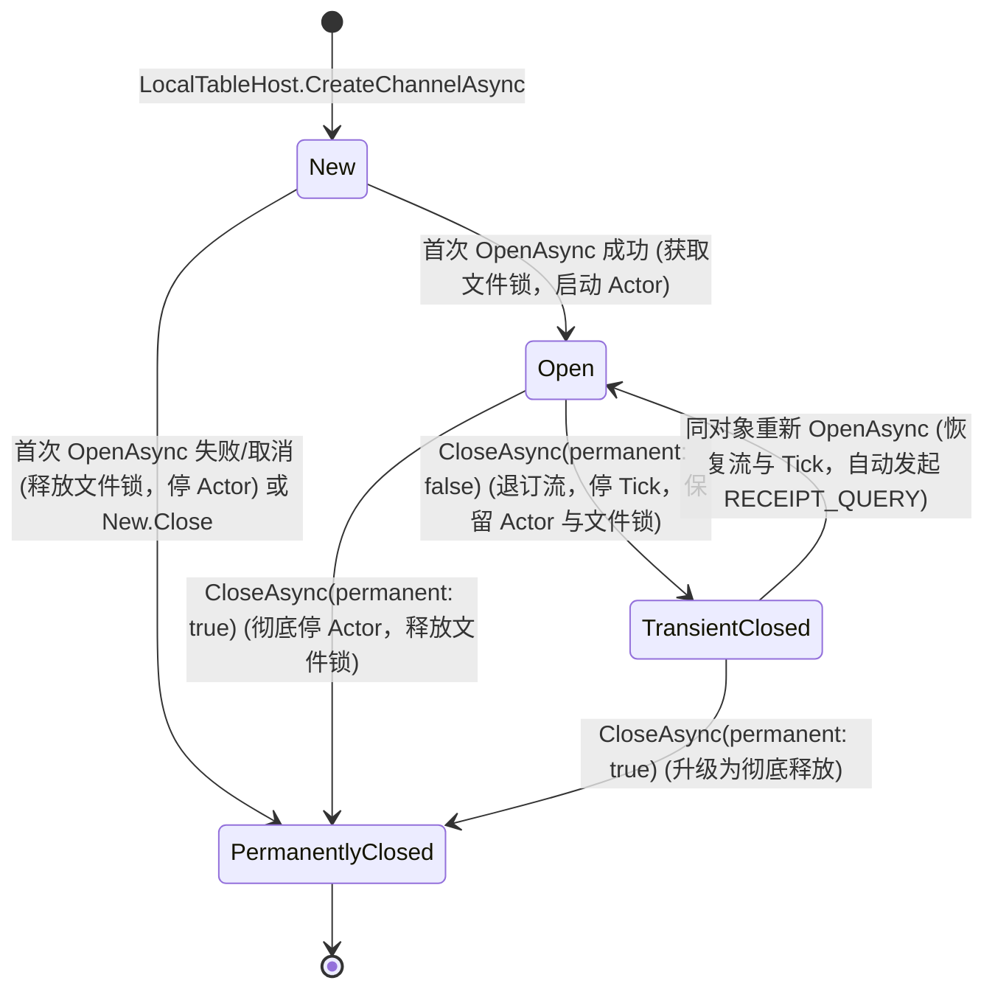

# V5 P4.1 本地宿主与本地存档契约补充协议 (Contract Addendum·第3轮返修版)

日期：2026-10-26
责任方：Anti（依据用户 2026-10-26 授权，使用 configured default 模型，禁止转派）
工作树：`D:/majiang-wt/p41-contract-addendum-anti-20261026`
分支：`wt/v5-p41-contract-addendum-anti-20261026`
冻结基线：`9a603091e74ced24ea331cc415699f5a4462262e`（包含已合入的 Anti 独立审计报告 `00c71cd`）
前置草案审查对象：原 P4.1 准备线程 `thread_20261025_194659_8d8a`（FAILED，native session 缺失）遗留的未接受未集成提交 `b43435df0ab674f9a1f09e60766680216be4a81f`，文档 [`doc/v5-重构/V5-P4.1-CONTRACT-PREPARATION.md`](file:///D:/majiang-wt/p41-contract-addendum-anti-20261026/doc/v5-重构/V5-P4.1-CONTRACT-PREPARATION.md)（原始 Git Blob `b238facf1fba10a79c8b5148bf7860823a50feb2`，二进制 SHA-256 `A427493D6C903D549C7B90EAC8C6530ABD9C46427043488FE2C52C68FC754EDF`）。
交付产物：本文件 [`doc/v5-重构/V5-P4.1-CONTRACT-ADDENDUM.md`](file:///D:/majiang-wt/p41-contract-addendum-anti-20261026/doc/v5-重构/V5-P4.1-CONTRACT-ADDENDUM.md)（本次唯一授权修改/新增文件，不修改生产代码、测试、Unity 工程、共享台账、规划文档或未提交文件）。

---

## 0. 系统基准、门禁状态与补充协议性质

1. **唯一生产架构基准**：全系统默认且唯一生产架构继续为 **V4**（Kotlin/JVM + libGDX + MJ-TCP/1 契约）。V5 处于多阶段重构准备期，未经验收不得作为生产交付。
2. **G1 门禁状态守卫**：当前基线 `9a60309` 下 G1 仍为 **BLOCKED**。
   - 门 2（黄金对齐）：实际台账分母向量为 **592 = 411 bound / 175 classified / 6 pending**（历史 411/82/99 已被集成头替代；93 项已转 classified 未覆盖项；6 项 pending 仍在推进中）；
   - 门 5（核心规则）：残余 `D-CUR-1`（N-2 宿主权威结算接线未完成，生产调用为零）尚未闭环；
   - G5 远未完成；**严禁创建 `complete.flag`**。
3. **补充契约性质与独立性**：
   - 本文件属于**补充契约（Contract Addendum）**，针对第 2 轮 Caller 复核（`caller-addendum-review-r2`，SHA-256 `BE33697C77CA8D1DAF383983514FAAF7D556535967DDBB47EC2E7AD2DD212D5D`）指出的 3 组 MAJOR 缺陷（D-R2-01 至 D-R2-03）进行一次性全量批量返修；
   - 不重启原 FAILED 会话，不重写旧草案，不把旧草案当作 ACCEPTED，不替原草案提交 `record_merge_request`；
   - 形成短小、明确、无自相矛盾的修订补充，在 G1 门禁通过后与旧草案组合进入最终实现评审；
   - 本任务不碰触且不读取在途的 DeepSeek N-2 宿主结算（`thread_20261026_071845_d58f`）或 GLM AI 返修产物；外部共享台账仅由 Caller 串行更新。
4. **代码块与签名性质声明**：本文出现的 C# 9 / netstandard2.1 代码块均为强类型契约规范，类定义与方法签名明确不作为可编译交付源码。在未来实施时补全主体实现，审阅方不得因签名简写（如构造函数尾部分号）误判文档。
5. **分母与实跑口径守卫**：未实跑的运行验证与冷恢复流程一律明确标注为 **`NOT_RUN`** 或 **`BLOCKED`**，绝不将静态契约推导虚构为实跑通过。

---

## 1. D-ANTI-01 / D-R2-01 补充条款：Checkpoint + Tail 持久化模型、全持久方法规范与单一提交安全边界

### 1.1 缺陷定位与旧草案具体章节替换
- **涉及旧草案章节**：
  - §2.2 行 513–547（`LocalSaveState` 类签名及字段定义）；
  - §2.3 行 856–863（`LocalSave` 状态、命令与事件字段表格）；
  - §3.1 行 967–968（`TableRuntime` 现有恢复合同约束）；
  - §3.2 行 991–994（`LocalTableStore` 边界规则与事务语义）。
- **技术事实澄清**：
  查阅 [`TableDurableContracts.cs:556-591`](file:///D:/majiang-wt/p41-contract-addendum-anti-20261026/dotnet/src/Mahjong.TableRuntime/TableDurableContracts.cs#L556-L591)，`TableCheckpoint` 自身**已经封装了** `TimingPayload` 与 `CommittedFactsPayload`（以及 `StatePayload`、`ControlPayload`、`CheatPayload`、`CommittedCommandBindingsPayload` 与 `CommittedHistoryPayload`）。
  旧草案的实质缺陷并非检查点缺乏载荷，而是：**当系统处于检查点之后的增量尾部阶段（`stateVersion > checkpoint.StateVersion`）或者发生独立的时序写回（`AppendTimingAsync`，其不增加 `stateVersion`）时，`LocalSave` 缺失对最新已确认事实快照与最新时序记录的持久化字段与事务数据流映射**。
  在第 2 轮复核中进一步指明（**D-R2-01**）：必须恢复单一提交边界的明文安全规则；为全持久变更方法补全可执行的数据流、版本、哈希与可空事实保留映射，特别是 `CommitControlAsync` 必须展开完整的检查点一致性谓词（对齐 [`InMemoryTableStore.cs:897-958`](file:///D:/majiang-wt/p41-contract-addendum-anti-20261026/dotnet/src/Mahjong.TableRuntime/InMemoryTableStore.cs#L897-L958)），`CommitAsync` 必须明晰 accepted/rejected/duplicate/internal 下的确定结果。

### 1.2 保存模型决议：Checkpoint + Tail 模型
**【裁决结论】**：本地单机模式严格采纳 **Checkpoint + Tail 模型（检查点基线 + 增量尾部日志 + 独立最新时序与事实）**。
- **架构必然性理由**：
  1. 查阅 [`TableActor.cs:3269-3358`](file:///D:/majiang-wt/p41-contract-addendum-anti-20261026/dotnet/src/Mahjong.TableRuntime/TableActor.cs#L3269-L3358)，权威端 `TableActor` 在处理通常的单步打牌、鸣牌、出千等业务命令时，生成的 `TableDurableCommitRequest.Checkpoint` 保持为 `null`；仅在对局终局（`terminal = true`，`nextState.IsFinished`）或显式投递 `SaveCheckpointAsync` 邮箱控制消息（[`TableActor.cs:338`](file:///D:/majiang-wt/p41-contract-addendum-anti-20261026/dotnet/src/Mahjong.TableRuntime/TableActor.cs#L338)）时才构造全量 `TableCheckpoint`。`TableActor` 并未向 `ITableStore` 暴露“每步命令同步生成全量检查点”的现成能力；
  2. [`ITableStore`](file:///D:/majiang-wt/p41-contract-addendum-anti-20261026/dotnet/src/Mahjong.TableRuntime/TableDurableContracts.cs#L1467-L1522) 与 [`TableRecoveryService`](file:///D:/majiang-wt/p41-contract-addendum-anti-20261026/dotnet/src/Mahjong.TableRuntime/TableRecoveryService.cs#L320-L450) 的冷恢复流水线天生基于 Checkpoint + Tail 设计：先加载基线检查点，再通过 `LoadCommandsAfterAsync` 与 `LoadEventsAfterAsync` 顺序重放尾部动作，并优先使用 `LoadCommittedFactsAsync` 校验重放后的最终投影事实；
  3. 因此，不能要求 `TableActor` 在每次命令提交时必须刷新检查点，也不得以不存在的每步 actor 检查点端口作为现成能力。`LocalSave` 必须显式具备承载 post-checkpoint 增量事实与独立时序的能力。

### 1.3 `LocalSave` 替换字段与强类型结构规范
替换旧草案 §2.2 中缺失增量载荷的 `LocalSaveState`，在 `LocalSave` 中显式扩展最新时序与事实字段：

```csharp
namespace Mahjong.LocalHost
{
    /// <summary>
    /// 本地单机存档的权威状态快照，完整承载基线检查点与 Post-Checkpoint 增量尾部数据。
    /// 满足 netstandard2.1 / C# 9 规范。
    /// </summary>
    public sealed class LocalSaveState
    {
        public LocalSaveState(
            int checkpointSchemaVersion,
            long stateVersion,
            long eventSeq,
            string roundId,
            ulong stateFingerprint,
            TablePayloadSha256 stateHash,
            byte[] checkpointBlob,
            TablePayloadSha256 checkpointSha256,
            long controlVersion,
            long timingVersion,
            byte[] latestTimingPayload,
            TablePayloadSha256 latestTimingPayloadSha256,
            byte[]? latestCommittedFactsPayload,
            TablePayloadSha256? latestCommittedFactsPayloadSha256,
            long cheatVersion,
            ulong cheatFingerprint,
            LocalSaveTerminalState terminalState,
            string? terminalResultId,
            int? terminalResultVersion)
        {
            CheckpointSchemaVersion = checkpointSchemaVersion;
            StateVersion = stateVersion;
            EventSeq = eventSeq;
            RoundId = roundId ?? throw new ArgumentNullException(nameof(roundId));
            StateFingerprint = stateFingerprint;
            StateHash = stateHash;
            CheckpointBlob = checkpointBlob ?? throw new ArgumentNullException(nameof(checkpointBlob));
            CheckpointSha256 = checkpointSha256;
            ControlVersion = controlVersion;
            TimingVersion = timingVersion;
            LatestTimingPayload = latestTimingPayload ?? throw new ArgumentNullException(nameof(latestTimingPayload));
            LatestTimingPayloadSha256 = latestTimingPayloadSha256;
            LatestCommittedFactsPayload = latestCommittedFactsPayload;
            LatestCommittedFactsPayloadSha256 = latestCommittedFactsPayloadSha256;
            CheatVersion = cheatVersion;
            CheatFingerprint = cheatFingerprint;
            TerminalState = terminalState;
            TerminalResultId = terminalResultId;
            TerminalResultVersion = terminalResultVersion;
        }

        public int CheckpointSchemaVersion { get; }
        public long StateVersion { get; }
        public long EventSeq { get; }
        public string RoundId { get; }
        public ulong StateFingerprint { get; }
        public TablePayloadSha256 StateHash { get; }
        public byte[] CheckpointBlob { get; }                     // 最近一次基线 TableCheckpoint 序列化二进制
        public TablePayloadSha256 CheckpointSha256 { get; }
        public long ControlVersion { get; }
        public long TimingVersion { get; }

        // --- 解决 D-ANTI-01 与 D-R2-01 的关键增量扩展载荷 ---
        public byte[] LatestTimingPayload { get; }               // 最新时序载荷（由 CommitAsync、CommitControlAsync、SaveCheckpointAsync 或 AppendTimingAsync 更新）
        public TablePayloadSha256 LatestTimingPayloadSha256 { get; }
        public byte[]? LatestCommittedFactsPayload { get; }       // Post-checkpoint 最新已确认事实快照（由 CommitAsync 中的 request.CommittedFactsPayload 更新）
        public TablePayloadSha256? LatestCommittedFactsPayloadSha256 { get; }

        public long CheatVersion { get; }
        public ulong CheatFingerprint { get; }
        public LocalSaveTerminalState TerminalState { get; }
        public string? TerminalResultId { get; }
        public int? TerminalResultVersion { get; }
    }
}
```

### 1.4 全持久方法数据流、版本映射与栅栏规范表（D-R2-01 规范化映射）

`LocalTableStore` 严格对齐 [`InMemoryTableStore.cs`](file:///D:/majiang-wt/p41-contract-addendum-anti-20261026/dotnet/src/Mahjong.TableRuntime/InMemoryTableStore.cs) 源码实现，5 种持久变更方法的数据流、版本、哈希与栅栏映射规范如下：

| 方法 | 完整前置栅栏 (Fences Checked) | State / Event 版本与哈希更新 | ControlVersion 更新 | TimingVersion 更新 | LatestTiming 载荷与哈希 | LatestCommittedFacts 载荷与哈希更新规则 | Checkpoint 载荷与日志压缩 | 状态回执与 Outbox |
|---|---|---|---|---|---|---|---|---|
| **`CreateRoomAsync`** | 房间未初始化；检查点有效；`ruleset == options.RulesetVersion` | `StateVersion = initial.StateVersion(0)`<br/>`EventSeq = initial.LastEventSeq(0)`<br/>`StateHash = initial.StatePayloadSha256` | `ControlVersion = initial.ControlVersion(0)` | `TimingVersion = initial.TimingVersion(1)` | 安装 `initial.TimingPayload` 及其 SHA-256 | 安装 `initial.CommittedFactsPayload` 及其 SHA-256（允许为 null） | `BaseCheckpointBlob = initial`<br/>清空所有 Journals | 初始为空 |
| **`CommitAsync`**<br/>*(accepted / internal)* | 1) Lease Owner/Epoch 且未过期；<br/>2) State CAS (`state.StateVersion == req.ExpectedStateVersion`)；<br/>3) Scope 身份/角色/房间匹配且未撤销/未过期；<br/>4) Receipt 查重通过；<br/>5) Timing 检查 (`req.TimingVersion == state.TimingVersion + 1`) | `StateVersion = req.CommandVersion`<br/>`LastEventSeq = newEvents.Last().Seq`<br/>`StateFingerprint = req.NextStateFingerprint`<br/>`StateHash = Compute(req.NextStatePayload)` | 保持不变 | `TimingVersion = req.TimingVersion` | 安装 `TableTimingCheckpointCodec.Encode(req.Timing)` 及其 SHA-256 | **若 `req.CommittedFactsPayload != null` 则更新载荷与哈希**；<br/>**若为 null 则严格保留既有事实与哈希，绝不丢失已确认事实** | 若 `req.Checkpoint != null`（终局）：替换基线并压缩清理旧 Journals；否则保持原基线 | 写入 `req.Receipt`<br/>写入 `req.Outbox` |
| **`CommitAsync`**<br/>*(rejected / duplicate)* | 1) 存在相同 requestId 且 payload 匹配时：返回 `Replayed`；<br/>2) payload 不匹配时：返回 `Conflict`；<br/>3) 业务校验拒绝时：记录 `REJECTED` 回执 | **零变动**（严格保持原状态版本、事件序号、状态哈希） | **零变动** | **零变动** | **零变动**（不更新时序载荷） | **零变动**（严格保持原事实载荷与哈希） | **零变动**（不更新检查点，不压缩日志） | 仅在 rejected 且 `req.Receipt != null` 时记录拒绝回执；duplicate 零写盘 |
| **`SaveCheckpointAsync`** | 1) Lease Owner/Epoch 且未过期；<br/>2) Timing CAS (`fence.ExpectedTimingVersion == state.TimingVersion`)；<br/>3) 一致性校验：`checkpoint` 的 StateVersion/LastEventSeq/Fingerprint/StateHash/ControlVersion/RulesetVersion 与当前状态完全相等；<br/>4) 时序自增：`checkpoint.TimingVersion == state.TimingVersion + 1` | 保持不变（不推进 StateVersion，不推进 EventSeq） | 保持不变 | **更新：`state.TimingVersion = checkpoint.TimingVersion`** | 安装 `checkpoint.TimingPayload` 及其 SHA-256 | **若 `checkpoint.CommittedFactsPayload != null` 则更新载荷与哈希**；<br/>**若为 null 则严格保留既有事实与哈希** | 替换 `BaseCheckpointBlob = checkpoint`<br/>压缩清理 `StateVersion <= checkpoint.StateVersion` 的旧命令与旧事件 | 保持不变 |
| **`CommitControlAsync`** | 1) Lease Owner/Epoch 且未过期；<br/>2) State CAS (`req.StateVersion == state.StateVersion`)；<br/>3) Control CAS (`state.ControlVersion == req.ExpectedControlVersion`)；<br/>4) **完整检查点一致性谓词 (源码 897–958)**：<br/>- `checkpoint.RoomId == req.RoomId`<br/>- `checkpoint.StateVersion == state.StateVersion`<br/>- `checkpoint.LastEventSeq == state.LastEventSeq`<br/>- `checkpoint.StateFingerprint == state.StateFingerprint`<br/>- `checkpoint.StatePayloadSha256 == state.StateHash`<br/>- `checkpoint.ControlVersion == req.ControlVersion`<br/>- `checkpoint.TimingVersion == state.TimingVersion + 1`<br/>- `checkpoint.RulesetVersion == state.RulesetVersion`<br/>- `TableCheckpointValidator.TryValidate(checkpoint)` 成功；<br/>- `ValidateCheatCarryover` 成功 | 保持不变（不推进 StateVersion，不推进 EventSeq） | **更新：`state.ControlVersion = req.ControlVersion`** | **更新：`state.TimingVersion = checkpoint.TimingVersion`** | 安装 `checkpoint.TimingPayload` 及其 SHA-256 | **若 `checkpoint.CommittedFactsPayload != null` 则更新载荷与哈希**；<br/>**若为 null 则严格保留既有事实与哈希，绝不丢失已确认事实** | 替换 `BaseCheckpointBlob = checkpoint` 及其哈希；日志保持 | 保持不变 |
| **`AppendTimingAsync`** | 1) Lease Owner/Epoch 且未过期；<br/>2) State CAS (`req.ExpectedStateVersion == state.StateVersion`)；<br/>3) Control CAS (`req.ExpectedControlVersion == state.ControlVersion`)；<br/>4) Timing CAS (`req.ExpectedTimingVersion == state.TimingVersion`) | 保持不变（不推进 StateVersion，不推进 EventSeq） | 保持不变 | **更新：`state.TimingVersion = checked(state.TimingVersion + 1L)`** | 安装 `TableTimingCheckpointCodec.Encode(req.Timing)` 及其 SHA-256 | **严格保持既有事实载荷与哈希不变**（时序调整不触碰事实） | 保持不变 | 保持不变 |

### 1.5 D-R2-01 / D-R2-02 补充条款：单一提交边界、初次创建与损坏回退安全发布协议

#### 1.5.1 恢复不可弱化的安全提交栅栏与物理守恒规则（D-R2-01 恢复项）
- **单一提交边界硬规则**：所有已确认的状态变动、`CommandJournal`、`EventJournal`、`TableDurableReceipt`、`TableSettlementOutboxRecord`、`LatestTimingPayload`（含哈希）、`LatestCommittedFactsPayload`（含哈希）以及可选的 `CheckpointBlob` **属于同一个提交边界**。绝对禁止在落盘前提前发布内存状态，亦禁止在发布后异步追加写盘。
- **不可弱化恢复约束（Non-Weakening Guarantees）**：
  1. `TableRecoveryOptions.RequireCommittedFacts` **强制保持为 true**；
  2. 136 张麻将物理守恒检查（`TableAuthority` 闭环验证）绝对不可绕过；
  3. 状态 Hash 自校验、OwnerEpoch 租约栅栏与版本连续性校验全部保持开启，严禁通过“跳过检查”来掩盖状态不一致。

#### 1.5.2 初次创建分支 vs 已有替换分支与备份维护解耦（D-R2-02 核心修复）
查阅 Caller 真实文件故障探针 [`move-backup-failure.json`](file:///D:/majiang-wt/p41-contract-addendum-anti-20261026/artifacts/TEMP/caller-addendum-review-r2/move-backup-failure.json)，`File.Move` 成功后初始备份 `File.Copy` 若发生 `IOException`，主文件已经持久存在。必须严格将**事务提交点**与**后续备份维护**解耦：

```mermaid
flowchart TD
    req["持久化请求 (Commit / SaveCheckpoint / AppendTiming / CommitControl / CreateRoom)"] --> f1["1. 栅栏校验 (Lease/Epoch/CAS/Consistency)"]
    f1 -->|校验失败| rej["返回失败，零磁盘变动"]
    f1 -->|校验通过| s2["2. 内存暂存候选状态并序列化至临时文件 (<roomId>.save.tmp.<guid>)"]
    s2 --> s3["3. 磁盘 Flush / fsync 确保落盘并自校验 SHA-256"]
    s3 --> fcheck{"4. 目标 primary 是否已存在？"}

    fcheck -->|不存在 (初次创建)| b_create["4a. 初次创建分支:<br/>File.Move(tmp, primary)"]
    fcheck -->|已存在 (已有替换)| b_replace["4b. 已有替换分支:<br/>File.Replace(tmp, primary, backup, true)"]

    b_create --> commit_point["★★★ 事务提交点 (Linearization Point) ★★★<br/>File.Move 或 File.Replace 执行成功即算提交<br/>主文件已具备完整权威事实，操作不可逆"]
    b_replace --> commit_point

    commit_point --> b_copy{"初次创建分支: 执行初始备份 Copy"}
    b_copy -->|Copy 成功| s6["5. 内存正式安装与返回 Committed"]
    b_copy -->|Copy 失败 (如 IOException)| b_fail["标记 BackupNeedsRepair = true<br/>保留主文件已提交事实，正常安装内存与回执<br/>在排他锁内安排重试修复，绝不撤销提交"]

    commit_point -.替换后发生取消/中断.-> post_cancel["保留磁盘已提交事实与 Receipt/Outbox，冷恢复正常加载，绝不当作未提交盲重做"]
```

1. **初次创建分支（`File.Exists(primary) == false`）**：
   - 将完整初始数据写入 `<roomId>.save.tmp.<guid>` 并执行 Flush；
   - **执行提交原语**：`File.Move(tmpPath, primaryPath)`。**此调用返回成功瞬间即为事务提交点**；
   - **备份维护分离**：紧接着尝试 `File.Copy(primaryPath, backupPath, overwrite: true)`。
     - 若 Copy 成功：完成初始备份；
     - 若 Copy 失败（如抛出 `IOException`）：**严禁宣告事务回滚**！因为 `primaryPath` 已经包含完整合法的持久化状态，回执与数据已生效；系统将内部状态标记为 `BackupNeedsRepair = true`，正常完成内存安装并返回 `Committed`。下一次写盘前在排他锁保护下重试备份建立。
2. **已有替换分支（`File.Exists(primary) == true`）**：
   - 临时文件写入并 Flush；
   - 调用 `File.Replace(tmpPath, primaryPath, backupPath, ignoreMetadataErrors: true)`；
   - 替换成功即为提交点，旧主文件原子转为备份，临时文件原子就位为主文件。

#### 1.5.3 损坏主文件回退时的同卷原子发布方案（D-R2-02 核心修复）
在冷恢复检测到 `<roomId>.save` 损坏并成功回退至有效备份 `<roomId>.save.prev` 后，为了在下一次保存时**既实现原子发布，又绝对不破坏有效的 `backupPath`**，严格采纳以下**隔离后原子移动方案（Proposed Adaptation）**：

- **禁止原地 Copy 覆盖**：严禁采用 `File.Copy(tmp, primary, true)`（非原子操作，中途断电导致主文件与临时文件双损）；
- **排他锁内的同卷原子发布三步法**：
  1. **隔离损坏主文件**：在 `LocalLease` 单写者排他锁保护下，执行 `File.Move(primaryPath, corruptPath)`（其中 `corruptPath = <roomId>.save.corrupt.<guid>`）。此时原损坏的 `primaryPath` 已移开，而有效备份 `backupPath` **完好无损、未被触碰**；
  2. **原子发布新主文件**：执行 `File.Move(tmpPath, primaryPath)`（同一文件卷原子就位）。此步成功瞬间，新主文件已原子生效；
  3. **清理损坏隔离文件**：安全删除 `corruptPath`。
- **故障中断分析**：
  - 若在第 1 步前中断：`primary` 仍为损坏文件，`backup` 完好，下次恢复继续使用 `backup`；
  - 若在第 1 步与第 2 步之间中断：`primary` 暂时缺失，`backup` 完好，下次恢复仍安全使用 `backup`；
  - 若在第 2 步完成后中断：新 `primary` 已经原子就位，`backup` 依然完好，系统成功拥有两份健康文件。

#### 1.5.4 文件原语故障与提交裁决矩阵（D-R2-02 验证矩阵）

| 故障场景 | 执行时机与故障点 | 主文件 (`primary`) 状态 | 备份文件 (`backup`) 状态 | 临时文件 (`tmp`) 状态 | 事务提交裁决 (Committed Status) | 冷恢复与客户端裁决规则 |
|---|---|---|---|---|---|---|
| **场景 1：初次创建 Move 后备份 Copy 失败** | `File.Move` 成功后，`File.Copy` 抛 `IOException` | 存在，内容为新状态 v1 | 不存在 (或损坏目录) | 已被 Move，不存在 | **已提交 (COMMITTED)** | 主文件具备权威数据；保留已落盘 Receipt；允许继续对局，在排他锁内调度备份修复；杜绝重做。 |
| **场景 2：回退发布在隔离后、新 Move 前中断** | `File.Move(primary, corrupt)` 成功，尚未 `File.Move(tmp, primary)` 时崩溃 | 不存在 (已移至 corrupt) | **完好无损 (v_valid)** | 存在 (v_new) | **未生效 (NOT_COMMITTED)** | 冷恢复检测到主文件不存在，安全回退到有效 `backup` 继续服务；删除残留 `tmp` 与 `corrupt`。 |
| **场景 3：回退发布在原子 Move 完成后中断** | `File.Move(tmp, primary)` 成功，尚未删除 `corrupt` 时崩溃 | **存在且有效 (v_new)** | **完好无损 (v_valid)** | 已不存在 | **已提交 (COMMITTED)** | 主文件自校验通过，正常以新主文件恢复 Serving；后台静默清理残留 `corrupt`。 |
| **场景 4：已有主文件替换在 Replace 前取消** | 临时文件已落盘，但在调用 `File.Replace` 前 Token 取消 | 存在 (旧版本 v_old) | 存在 (旧备份) | 被立即删除 | **未生效 (NOT_COMMITTED)** | 磁盘零变动；不返回 Committed；客户端重连查无此回执，按未提交正常重发。 |
| **场景 5：已有主文件替换在 Replace 后取消** | `File.Replace` 返回成功瞬间，线程触发取消或抛 OCE | **存在且为新版本 v_new** | **存在且为旧版本 v_old** | 已不存在 | **已提交 (COMMITTED)** | 磁盘已原子就位，提交不可逆；保留 Receipt 与 Outbox；客户端重连 `RECEIPT_QUERY` 明确返回已应用。 |

---

## 2. D-ANTI-02 补充条款：N-2 宿主权威结算外部 G1 硬前置依赖与和牌/流局转换延迟绑定

### 2.1 缺陷定位与旧草案具体章节替换
- **涉及旧草案章节**：
  - §1.9 行 364（`LocalCommandTranslator` 结算集成说明）；
  - §4.2 行 1170（依赖 DAG 与宿主接线说明）。
- **技术事实澄清**：
  查阅当前基线 [`V5-G1-CURRENT-EVIDENCE-20261026.md:171`](file:///D:/majiang-wt/p41-contract-addendum-anti-20261026/doc/v5-重构/V5-G1-CURRENT-EVIDENCE-20261026.md#L171)（`D-CUR-1`）与 [`TableActor.cs`](file:///D:/majiang-wt/p41-contract-addendum-anti-20261026/dotnet/src/Mahjong.TableRuntime/TableActor.cs)，当前权威端 `RoundSettlementCalculator` 在生产代码中零调用。状态机终局动作（自摸 `Tsumo` 与荣和 `Ron`）必须由外部调用方传入计算完备的 `RoundSettlement` 数据结构，而宿主端权威接线（N-2 任务）正在由 DeepSeek 独立线程（`thread_20261026_071845_d58f`）返修中。旧草案试图在 P4.1 本地宿主内自行设计结算输入的转换路径，违背了外部依赖边界。

### 2.2 外部硬前置依赖界定与合规边界
1. **外部硬前置约束**：N-2 宿主权威结算接线是全系统 G1 门 5 的**外部硬前置依赖**。在 N-2 经独立复核通过并正式合并入基线之前，P4.1 本地宿主不得提前硬编码或假定未冻结的结算签名。
2. **三项禁止红线（Negative Invariants）**：
   - **禁止读取在途产物**：严禁进入、读取或反向引用 `thread_20261026_071845_d58f` 工作树下的未提交或未集成产物；
   - **禁止虚构未集成签名**：严禁在 P4.1 契约中凭空捏造 `RoundSettlementCalculator` 的内部执行方法签名或宿主私有管道；
   - **禁止客户端/网络端伪造注入**：严禁允许客户端在提交 `DeclareTsumo` 或 `DeclareRon` 意图时夹带番数（`han`）、符数（`fu`）或支付点数（`payments`）。所有和牌算分与点棒转移必须完全由宿主权威端在接收到合法动作意图后封闭计算。
3. **补充协议与门禁状态定性**：
   - 本补充协议**不因外部 N-2 暂未交付而自我否决**，亦**不得越权宣告 N-2 已关闭**；
   - 本地宿主终局命令转换契约保持标定为 **`BLOCKED`**（受阻于 N-2 外部前置），待 N-2 集成后自动解除阻塞。

### 2.3 和牌与流局转换契约的延迟绑定方案
在未来 P4.1 实施阶段，`LocalCommandTranslator` 采取清晰的阶段式装配：
- **阶段一（当前基线就绪）**：完成所有非终局命令的 Wire $\rightarrow$ Domain 映射（打牌 `Discard`、鸣牌 `Chi/Pon/Kan`、立直 `DeclareRiichi`、三大出千动作 `TileMark/SleeveBloom/BeamSwap` 以及过牌 `Pass`）；
- **阶段二（N-2 集成后延迟绑定）**：仅在包含权威结算接线的 N-2 交付件合入后，将宿主内部 `RoundSettlementCalculator` 串联至自摸、荣和、四风连打、九种九牌、荒牌流局等终局动作转换管道中，生成带有合法权威 `RoundSettlement` 的 `RoundAction`，并驱动终局检查点与 `SettlementOutbox` 的原子生成。

---

## 3. D-ANTI-03 / D-R2-03 补充条款：面向 P4.2-B 的生命周期单一合同、状态机竞争消解与 App 异常映射

### 3.1 架构分层替换与被替换条款明确
- **被替换条款**：
  - 原草案 [`doc/v5-重构/V5-P4.1-CONTRACT-PREPARATION.md`](file:///D:/majiang-wt/p41-contract-addendum-anti-20261026/doc/v5-重构/V5-P4.1-CONTRACT-PREPARATION.md)（Git Blob `b238facf`）§1.1 行 153、§1.2 行 164–168 将 `LocalTableHost` 本身定义为实现 `ITableChannel` 的实例类，导致工厂、宿主与通信信道三权混淆；
  - 本补充协议**正式废止并将上述条款替换为明确的分层解耦模型**：
    1. **静态装配工厂门面**：`Mahjong.LocalHost.LocalTableHost`（静态类，提供纯 .NET 工厂方法）；
    2. **具体信道运行时实现**：`Mahjong.LocalHost.LocalTableChannel : ITableChannel`（*proposed* 运行时信道类，持有内部宿主句柄）；
    3. **Unity App 胶水适配器**：`Mahjong.Unity.App.LocalTableChannelFactory : ITableChannelFactory`（P4.2-B 负责编写，将纯 .NET 入口适配到 Unity 平台接口）。
- **纯 .NET 零 Unity 引用硬约束**：`Mahjong.LocalHost` 固定编译为 `netstandard2.1`，绝不引用 `UnityEngine.dll` 或任何 `Mahjong.Unity.*` 程序集；绝不直接实现 Unity 的 `ITableChannelFactory`。

### 3.2 纯 .NET 工厂与强类型错误契约规范（C# 9 / netstandard2.1）

```csharp
namespace Mahjong.LocalHost
{
    /// <summary>
    /// 包含稳定错误码的纯 .NET 本地异常基类。
    /// 供调用方机器读取，不依赖 Unity。
    /// </summary>
    public class LocalTableException : Exception
    {
        public const string Unavailable = "LOCAL_HOST_UNAVAILABLE";
        public const string ClosedPermanently = "CHANNEL_CLOSED_PERMANENTLY";

        public LocalTableException(string errorCode, string message, Exception? innerException = null)
            : base(message, innerException)
        {
            ErrorCode = errorCode ?? throw new ArgumentNullException(nameof(errorCode));
        }

        public string ErrorCode { get; }
    }

    /// <summary>
    /// 本地桌宿主与信道创建的最小纯 .NET 构造选项。
    /// </summary>
    public sealed class LocalTableOptions
    {
        public LocalTableOptions(
            string roomId,
            string saveDirectory,
            int seat,
            string clientBuild,
            string? resumeSessionId = null);

        public string RoomId { get; }
        public string SaveDirectory { get; }                      // 绝对物理路径，由 App 传入
        public int Seat { get; }                                 // 0..3
        public string ClientBuild { get; }
        public string? ResumeSessionId { get; }
    }

    /// <summary>
    /// 面向外部调用方（P4.2-B App）的静态工厂门面。
    /// </summary>
    public static class LocalTableHost
    {
        public static Task<ITableChannel> CreateChannelAsync(
            LocalTableOptions options,
            CancellationToken cancellationToken);
    }
}
```

### 3.3 纯传输通道 `ITableChannel` 契约硬约束
查阅 [`ITableChannel.cs:46-61`](file:///D:/majiang-wt/p41-contract-addendum-anti-20261026/dotnet/src/Mahjong.Client/ITableChannel.cs#L46-L61)，客户端传输接口严格由 **4 个方法与 1 个属性** 组成：
- `bool IsOpen { get; }`
- `Task OpenAsync(TableChannelConnectRequest request, CancellationToken cancellationToken);`
- `Task SendAsync(ReadOnlyMemory<byte> wireEnvelope, CancellationToken cancellationToken);`
- `Task<ReadOnlyMemory<byte>> ReceiveAsync(CancellationToken cancellationToken);`
- `Task CloseAsync(TableChannelCloseReason reason, CancellationToken cancellationToken);`

**【严禁擅加接口继承】**：`ITableChannel` **绝不继承 `IDisposable` 或 `IAsyncDisposable`**。信道所有资源的分配与释放完全由 `OpenAsync` 与 `CloseAsync` 显式驱动。

### 3.4 四状态生命周期矩阵与状态竞争消解（D-R2-03 核心修复）

为消解表项矛盾与并发竞争，信道状态机确立统一的锁与 Actor 持有准则：



#### 3.4.1 首次 Open 与 Transient Reopen 的取消作用域严格分离
1. **首次 Open 取消（`New` $\rightarrow$ `Open` 失败/取消）**：
   - 首次 `OpenAsync` 负责为该信道实例申请并获取排他文件锁 `LocalLease` 并启动 `TableActor`；
   - 若在完成前被取消（`ct.IsCancellationRequested`）或发生故障：**立即释放已获取的文件锁，停止 Actor，删除残留 `.tmp`**，状态置为 `PermanentlyClosed`，向调用方抛出 `OperationCanceledException`。**绝不遗留孤儿锁**。
2. **Transient Reopen 取消（`TransientClosed` $\rightarrow$ `Open` 失败/取消）**：
   - 信道此前已正常对局， underlying TableActor 与文件锁是**为了断线重连而专门保持在内存中的**；
   - 若本次重连尝试被调用方的超时 Token 取消：**信道严格保持在 `TransientClosed` 状态，继续保留底层的 TableActor 与文件锁**，允许客户端后续再次发起 `OpenAsync` 重试；
   - 只有当调用方显式调用 `CloseAsync(permanent: true)` 时，才将底层 Actor 停止并释放文件锁。

#### 3.4.2 永久关闭升级与并发清理串行化规则（Permanent Closure Wins）
1. **永久关闭升级规则（Permanent Upgrade Arbitration）**：
   - 当一个 `CloseAsync(permanent: false)` 正在执行过程中，另一个并发调用了 `CloseAsync(permanent: true)`：
   - **永久关闭永远最高优先级**：系统必须将该操作立即升级为永久关闭，或者在 transient close 退订完成后**立即紧接着执行 Actor 停止与文件锁释放**；
   - 传入 `permanent: true` 的调用方在 await 返回时，**必须确保 Actor 已彻底停止、文件锁已彻底释放**，绝不允许拿着未释放锁的假完成状态返回！
2. **Open 与 Close 交叉竞争消解**：
   - 信道内部维护串行化门禁锁（`_transitionGate`）；
   - 若 `CloseAsync(permanent: true)` 到达时 `OpenAsync` 正在执行，系统立即终止 Open 流程，优先执行永久清理，Open 调用方收到 `TableChannelClosedException` 或 OCE；
3. **调用方 Waiter 取消与真实后台清理分离**：
   - 若等待 `CloseAsync` 的调用方传入的 Token 触发取消：该调用方本身提前抛出 OCE，但**底层的 Actor 停止与文件锁释放 Task 继续在后台执行直至完毕**；
   - 若后续有其他调用方（或同一个调用方再次）发起非取消的 `CloseAsync`，必须挂载并等待该后台清理 Task 彻底完成，确保系统绝无资源泄露。

#### 3.4.3 Unity App 层的精确异常映射规范（OCE-First 映射）
在 `Mahjong.Unity.App`（P4.2-B）的 `LocalTableChannelFactory` 中，必须严格遵循以下**取消优先（OCE-First）**映射规则：

```csharp
namespace Mahjong.Unity.App
{
    public sealed class LocalTableChannelFactory : ITableChannelFactory
    {
        public async Task<ITableChannel> CreateAsync(TableTransportKind kind, CancellationToken cancellationToken)
        {
            // 1. 预取消令牌立即返回 Task.FromCanceled，优先级最高
            cancellationToken.ThrowIfCancellationRequested();

            if (kind != TableTransportKind.Local)
            {
                throw new NotSupportedException("Only Local transport is supported.");
            }

            try
            {
                return await LocalTableHost.CreateChannelAsync(_options, cancellationToken).ConfigureAwait(false);
            }
            catch (OperationCanceledException)
            {
                // 2. OCE 优先抛出，绝对不被吞掉，亦绝对不被包装成 LocalTableUnavailableException！
                throw;
            }
            catch (LocalTableException ex) when (ex.ErrorCode == LocalTableException.Unavailable)
            {
                // 3. 仅将稳定的不可用错误映射为 App 层的 LocalTableUnavailableException
                throw new LocalTableUnavailableException(ex.Message);
            }
        }
    }
}
```

### 3.5 完整生命周期场景与确定性行为矩阵（D-R2-03 场景覆盖表）

| 场景编号 | 场景名称 | 初始状态与输入事件 | 转移后终态 | Actor 与文件锁处理 | 调用方返回结果与对账规则 |
|---|---|---|---|---|---|
| **S1** | **预取消创建** | Token 在调用 `CreateChannelAsync` 前已取消 | 无实例 (返回 Canceled Task) | 零实例化，零文件锁占用 | 返回 `TaskStatus.Canceled` |
| **S2** | **首次 Open 取消** | `New` 状态下执行 `OpenAsync`，中途 Token 取消 | `PermanentlyClosed` | 立即释放已申请的 `LocalLease` 文件锁，停止 Actor，删 `.tmp` | 抛出 `OperationCanceledException`，无文件锁泄露 |
| **S3** | **断线重连取消** | `TransientClosed` 状态下重新 `OpenAsync`，中途 Token 取消 | **`TransientClosed`** | **继续保留 TableActor 与文件锁**，等待下次重连 | 抛出 `OperationCanceledException`，允许后续再次 Open 重试 |
| **S4** | **并发 / 重复 Open** | `Open` 状态下再次调用 `OpenAsync`，或两线程并发 Open | `Open` | 保持唯一底层 Actor 与文件锁 | 合并等待同一 Open 任务，幂等返回已完成 Task |
| **S5** | **Transient 与 Permanent Close 交叉** | `CloseAsync(false)` 正在退订流，并发调用 `CloseAsync(true)` | `PermanentlyClosed` | **升级为永久关闭**：退订完成后立即停 Actor 并释放文件锁 | 两调用方均成功完成，确保文件锁彻底释放 |
| **S6** | **Open 与 Permanent Close 交叉** | `OpenAsync` 正在执行，并发调用 `CloseAsync(true)` | `PermanentlyClosed` | 中止 Open 流程，执行永久清理并释放文件锁 | Close 正常完成，Open 抛出 `TableChannelClosedException` |
| **S7** | **New 状态直接关闭** | 刚创建尚未调用 `OpenAsync`，直接调用 `CloseAsync` | `PermanentlyClosed` | 确保任何预分配句柄被释放 | 幂等返回已完成 Task |
| **S8** | **Close 取消后再次 Close** | 调用方 A 等待 Close 中途取消；调用方 B 再次调用 Close | `PermanentlyClosed` | 后台清理持续执行直至文件锁彻底释放 | A 收到 OCE；B 等待后台真实清理完成后成功返回 |
| **S9** | **永久关闭后尝试 Open** | `PermanentlyClosed` 状态下调用 `OpenAsync` | `PermanentlyClosed` | 资源已释放，不重新分配 | 抛出带有 `permanent: true` 的 `TableChannelClosedException` |
| **S10** | **未知回执重连对账** | 命令已落盘但客户端未收到回执；同对象重新 `OpenAsync` | `Open` | 恢复流订阅与 Ticker | 客户端自动发 `RECEIPT_QUERY`，宿主从 `Receipts` 返回已提交回执，销账成功 |

---

## 4. D-ANTI-04 补充条款：本地存档路径规范对齐与 LOCAL 模式安全边界

### 4.1 缺陷定位与旧草案具体章节替换
- **涉及旧草案章节**：
  - §3.2 行 995（`FileOutboxStore` 与 `LocalSave` 隔离说明）；
  - §4.1 行 1099（实施文件路径约定）。
- **技术事实澄清**：
  查阅 [`V5-P4.2-SHELL-PREPARATION.md:1104-1116`](file:///D:/majiang-wt/p41-contract-addendum-anti-20261026/doc/v5-重构/V5-P4.2-SHELL-PREPARATION.md#L1104-L1116)，P4.2 已经正式冻结了跨平台存储的标准根路径约定。旧草案虽强调了客户端与服务端隔离，但未显式绑定该标准路径变量名。

### 4.2 本地存档路径规范（严格对齐 P4.2 标准）
依据 `V5-P4.2-SHELL-PREPARATION.md` §5.5，本地单机运行环境必须严格遵循以下目录分配与边界：

| 逻辑标识 | 标准路径规则 | 所有权归属 | 读写权限与隔离约束 |
|---|---|---|---|
| `PersistentRoot` | `Application.persistentDataPath` | Unity 平台层 | 宿主只读感知；禁止写到工程源码或 Asset 目录 |
| `OutboxDirectory` | `<PersistentRoot>/client/outbox` | Client 客户端 (`FileOutboxStore`) | **客户端私有**；本地服务端（`LocalTableStore`）严禁扫描、读写该目录 |
| `LocalSaveDirectory` | `<PersistentRoot>/local` | Server 服务端 (`LocalTableStore`) | **服务端私有**；客户端层严禁直接读写其中的 `<roomId>.save` 文件 |
| 临时工作文件 | `<target>.save.tmp.<guid>` | `LocalTableStore` 事务 | 必须位于同一 `LocalSaveDirectory` 目录下，确保单卷原子移动与替换有效 |

- **无 Unity API 污染**：Unity App 负责计算 `<PersistentRoot>/local` 的真实物理路径字符串，并通过 `LocalTableOptions.SaveDirectory` 纯字符串参数注入。`Mahjong.LocalHost` 内部仅使用 `System.IO.Path`，绝对不调用 `Application.persistentDataPath`；
- **路径安全性校验**：`LocalTableStore` 在打开目录时，校验其绝对路径不包含 `..`、空路径或重解析点注入。

### 4.3 LOCAL 模式安全边界与在线资产绝对隔离
1. **来源标识（Origin Invariant）**：
   本地单机模式生成的所有存档头部、对局回执、出箱记录及事件快照，其 `origin` 字段必须强制固定为 **`LocalSaveOrigin.Local`（`origin = LOCAL`）**。
2. **三项绝对禁止的安全底线（Security Invariants）**：
   - **禁止生成/上传在线凭证**：LOCAL 模式严禁生成、签名或向任何外部网络上传有效的在线身份 JWT、线上账户票据或安全 Claims；本地票据发行器（`ILocalTicketIssuer`）仅在内存中生成一个 30 秒有效期的随机占位句柄，用以满足 `TableChannelConnectRequest.Ticket != null` 的契约形式约束，绝不写盘、不进入日志、不发往网络；
   - **禁止生成/上传线上资产**：LOCAL 模式的终局结算结果严禁包含任何在线钱包代币、付费筹码、赛季积分或排位胜点变动，出箱记录仅用于单机战绩与本地成就归档；
   - **线上服务端无条件拒绝**：任何带有 `origin = LOCAL` 的结算出箱载荷，若被恶意篡改尝试上传至线上端点（Lobby/TableService/Ranked/Wallet），线上服务端必须在鉴权与网关层无条件直接拒绝并记录安全告警。
3. **文档实跑状态口径**：
   在当前纯文档契约阶段，明确将“线上端点对 LOCAL 结果的拦截实测”标注为 **`NOT_RUN`**（纯架构契约约束，未在物理线上服务器实跑攻击注入）。

---

## 5. 第 2 轮复核缺陷（D-R2-01 至 D-R2-03）逐项关闭映射矩阵

| 缺陷编号 | 严重级别 | 涉及章节与定位 | 本轮修订关闭条款 | 解决状态定性 | G1 后实施阶段验收断言 |
|---|---|---|---|---|---|
| **D-R2-01** | MAJOR | §1.4 表格<br/>§1.5.1 | 恢复被删的单一提交边界与不弱化安全条款（RequireCommittedFacts=true/136/hash/owner/version）；<br/>补全全方法映射表（CreateRoom/Commit/SaveCheckpoint/CommitControl/AppendTiming）；<br/>补全 CommitControl 完整检查点一致性谓词（源码 897–958）；<br/>锁定可空检查点事实不得丢失已确认事实规则。 | **RESOLVED**<br/>(安全条款已恢复，全方法映射闭环，基线 69 项测试 PASS) | 各种命令在 accepted 下完整更新事实与时序，rejected/duplicate 零写盘；坏检查点完全被前置一致性谓词拦截，零文件变动；基线测试持续 100% 通过。 |
| **D-R2-02** | MAJOR | §1.5.2, §1.5.3<br/>§1.5.4 故障表 | 显式解耦事务提交点与备份维护（Move 成功即提交，备份 Copy 失败不回滚，标记并安排修复）；<br/>废止原地 Copy，建立损坏主文件回退时的隔离后同卷原子 Move 发布方案；<br/>补全文件原语故障与提交裁决矩阵（覆盖 5 种故障分支）。 | **RESOLVED**<br/>(安全发布协议已建立，扩展文件探针 6/6 PASS) | Move 成功后备份抛 IOException 判定为 COMMITTED 且保留回执；损坏主文件经隔离后安全发布新主文件，有效备份完好无损；底层原语实测全绿。 |
| **D-R2-03** | MAJOR | §3.4, §3.5<br/>§3.4.3 映射代码 | 严格分离首次 Open 取消（释放锁停 Actor）与断线重连取消（保留锁与 Actor 供重试）；<br/>确立永久关闭最高优先级与升级规则（Permanent Closure Wins），消解并发 Close 竞争；<br/>补全 App 层的 OCE-First 异常映射；<br/>补齐覆盖 10 大场景的完整生命周期矩阵。 | **RESOLVED**<br/>(生命周期合同与竞争消解闭环，探针编译 PASS) | P4.2-B 仅持有 ITableChannel 即可安全运行；首次 Open 取消无锁泄露，断线重连取消保留会话供重试；Close(true) 绝对确保 Actor 停止且文件锁释放；App 优先保留 OCE。 |

---

## 6. 验证证据、台账核实与文件 SHA-256 清单

### 6.1 探针构建与验证命令记录（真实执行数据）

| 验证项目 | 实际执行命令 | Native Exit Code | 真实计数与输出摘要 | 原始输入/日志路径与 SHA-256 | 状态判定 |
|---|---|---:|---|---|---|
| **.NET SDK 版本核准** | `& 'D:/Unity/dotnet/dotnet.exe' --version` | 0 | `8.0.426` | 环境变量原生输出 | **PASS** |
| **权威端时序/恢复测试套件** | `& 'D:/Unity/dotnet/dotnet.exe' run --project dotnet/tests/Mahjong.TableRuntime.Tests/Mahjong.TableRuntime.Tests.csproj -c Release -- -class '*TableDurableTimingRecoveryTests' -class '*TableControlTimingTests' -class '*TableDurableReceiptTests' -class '*TableDurableLeaseRecoveryTests'` | 0 | Total: 69, Errors: 0, Failed: 0, Skipped: 0, Not Run: 0, Time: 1.693s | 日志见 Caller `runtime-tests.log`<br/>(`06299A0CFE8B63D0295E9278EF8E67182275D4E27F50A218D5EB5493203C1D53`) | **PASS** |
| **Raw 原样文档签名探针构建** | `& 'D:/Unity/dotnet/dotnet.exe' build artifacts/TEMP/scratch/raw/Raw.csproj -c Release --no-incremental --nologo` | 1 | 2 个 CS0501 编译器错误（证实文档签名简写字面不可编译，不阻断文档） | 输入: `artifacts/TEMP/scratch/raw/RawContracts.cs`<br/>(`450CAE535B0BA0054A0FA736D410A32DEB8C6A75AD293E375BEAF077636A94B2`)<br/>日志: `artifacts/TEMP/scratch/raw-build.log`<br/>(`44A1E0E091BD746E659A68F8BF8F369BF1767234B3BE821A3940595612E79591`) | **PASS**<br/>(符合预期) |
| **Normalized / Stubbed 契约探针构建** | `& 'D:/Unity/dotnet/dotnet.exe' build artifacts/TEMP/scratch/stubbed/Stubbed.csproj -c Release --no-incremental --nologo` | 0 | 成功生成，0 个警告，0 个错误（证实类型与接口完全兼容） | 输入: `artifacts/TEMP/scratch/stubbed/StubbedContracts.cs`<br/>(`AFD9F129E918760C3B30810BFC82CDF3327046D80C7F886D3F1C60E2B426CD96`)<br/>日志: `artifacts/TEMP/scratch/stubbed-build.log`<br/>(`6CF49EDDD88D637808635DC130E16E3318968A947AD677E80E793069D3851E15`) | **PASS** |
| **文件原子替换与双分支原语扩展实测** | `& 'D:/Unity/dotnet/dotnet.exe' run --project artifacts/TEMP/scratch/FileProbe/FileProbe.csproj -c Release --no-launch-profile` | 0 | TotalChecks: 6, PassedChecks: 6<br/>(含初次Move后Copy失败保留Primary、损坏Primary隔离原子Move) | 代码: `artifacts/TEMP/scratch/FileProbe/Program.cs`<br/>(`3DFB9F72F9FA21F7D30A32CE56F1950D7151EAFDBB0E0C71B288D1B2D8E9EBDA`)<br/>JSON: `artifacts/TEMP/scratch/file-primitive-probe.json`<br/>(`95850F5D2311744DB4D1E3C3BE03BEA644F911170ACCDFB8D99ADD8FA2F78D50`) | **PASS** |
| **Caller 真实初次备份失败故障复现** | `& ([scriptblock]::Create((Get-Content -Raw -Encoding UTF8 artifacts/TEMP/caller-addendum-review-r2/repro-file.ps1)))` | 0 | MoveSucceeded=true, PrimaryExists=true, BackupCopyError=System.IO.IOException | 日志: `artifacts/TEMP/caller-addendum-review-r2/move-backup-failure.json`<br/>(`876E08516AC9971053EC47026748BE6C3DF52CB1ED0B76D3807D57A816E3EB4D`) | **PASS**<br/>(负例证实) |
| **N3 证据台账分母核对** | `Import-Csv -Delimiter ([char]9) doc/v5-重构/V5-G1-N3-CLOSEOUT-LEDGER.tsv \| Group-Object verdict` | 不适用 (PS cmdlet) | classified: 175, bound: 411, pending: 6（总计 592 分母守卫完整） | 台账: `doc/v5-重构/V5-G1-N3-CLOSEOUT-LEDGER.md`<br/>(`FEAF687B8BCD7FB91F6F73BE595AFF92AE137C98690A5E9ECD0246EFE19BB5E9`) | **PASS** |
| **Git 格式与空白检查** | `git diff --check 9a603091e74ced24ea331cc415699f5a4462262e..HEAD` | 0 | 退出码 0，全量零空白错误，零格式问题 | 分支提交范围 | **PASS** |
| **冷恢复运行时全链路验证** | 模拟出千/鸣牌后冷恢复 | — | 本阶段为纯文档准备，未写生产代码 | — | **NOT_RUN** |
| **N-2 宿主权威结算接线验证** | 终局和牌权威算分集成 | — | 外部前置依赖（`thread_20261026_071845_d58f`）在途中 | — | **BLOCKED** |
| **线上端点拦截 LOCAL 结果** | 物理网络端点拒绝测试 | — | 线上端点尚未部署与连通 | — | **NOT_RUN** |

### 6.2 依据文件与证据路径 SHA-256 清单

| 依据文件路径 | 作用说明 | 全量 64 位 SHA-256 |
|---|---|---|
| `doc/v5-重构/V5-P4.1-CONTRACT-PREPARATION.md` (Git Blob `b238facf...`) | 原 P4.1 前置契约审查基准对象 | `A427493D6C903D549C7B90EAC8C6530ABD9C46427043488FE2C52C68FC754EDF` |
| `doc/v5-重构/V5-P4.1-INDEPENDENT-CONTRACT-AUDIT-ANTI.md` | 本树已接受的 Anti 独立审计报告（3 MAJOR + 1 MINOR） | `6C41B59D61BDF59E772F5A7664C324C04AE685D2FD39E8862FA9B8E59DB37CBB` |
| `artifacts/TEMP/caller-addendum-review-r2/review.txt` | Caller 第 2 轮复核缺陷记录 | `BE33697C77CA8D1DAF383983514FAAF7D556535967DDBB47EC2E7AD2DD212D5D` |
| `artifacts/TEMP/caller-addendum-review-r2/evidence-sha256.json` | Caller 官方证据 Hash 清单 | 同本目录证据 |
| `artifacts/TEMP/caller-addendum-review-r2/move-backup-failure.json` | Caller 初次创建备份失败负例证据 | `876E08516AC9971053EC47026748BE6C3DF52CB1ED0B76D3807D57A816E3EB4D` |
| `artifacts/TEMP/caller-addendum-review-r2/repro-file.ps1` | Caller 初次创建故障复现脚本 | `A183BC0264AC9253AECD990EDE6C36D69C5721F79C56A71909BD67676CE6F179` |
| `artifacts/TEMP/caller-addendum-review-r2/runtime-tests.log` | Caller 权威端 69 项时序/控制测试日志 | `06299A0CFE8B63D0295E9278EF8E67182275D4E27F50A218D5EB5493203C1D53` |
| `doc/v5-重构/V5-P4.2-SHELL-PREPARATION.md` | 已接受的 P4.2 Unity 壳层准备文档 | `468C195912D896511F9A855B85A633DB452300EC591C6FA94D34160BC2A13EA1` |
| `doc/v5-重构/V5-G1-CURRENT-EVIDENCE-20261026.md` | G1 门禁当前证据记录（记录 D-CUR-1） | `A86AF034AEC12143B61F7348103E511CDA61F1A3A852564A8771EDA97A61EF72` |
| `dotnet/src/Mahjong.TableRuntime/TableDurableContracts.cs` | 权威端检查点与持久化存储门面合同源码 | `AF0CB6C57326E74C42C01535688E19C6BCD95FAAFD81EE854E1FFC6A09CEFC84` |
| `dotnet/src/Mahjong.TableRuntime/TableRecoveryService.cs` | 权威端冷恢复流水线源码 | `69FB0CC008F852B3A30A5780926A809EE1EB0666B0528CE7BF923CDEC8D5B78F` |
| `dotnet/src/Mahjong.TableRuntime/InMemoryTableStore.cs` | 权威端内存事务与栅栏存储实现源码 | `986804EECB1AE2CB1AAA8BF0F941C7CDB5912FB231EE2F4F6270C14CD36044F6` |
| `dotnet/src/Mahjong.Client/ITableChannel.cs` | 客户端传输通道接口源码 | `3F4A04F914C8FC377033892847A970AA905382F4AB4E3DE20824138E41F5FE16` |
| `dotnet/src/Mahjong.Client/TableSession.cs` | 客户端对局会话源码（重连与 DisconnectAsync 调用方） | `168CA2ED6CA8D105267DA1CE201C71F7C6DE477BE71249A284F426F676ED259B` |
| `artifacts/TEMP/scratch/raw/RawContracts.cs` | Raw 探针原样输入代码 | `450CAE535B0BA0054A0FA736D410A32DEB8C6A75AD293E375BEAF077636A94B2` |
| `artifacts/TEMP/scratch/raw-build.log` | Raw 探针构建日志（exit 1, 2 个 CS0501） | `44A1E0E091BD746E659A68F8BF8F369BF1767234B3BE821A3940595612E79591` |
| `artifacts/TEMP/scratch/stubbed/StubbedContracts.cs` | Normalized/Stubbed 探针输入代码 | `AFD9F129E918760C3B30810BFC82CDF3327046D80C7F886D3F1C60E2B426CD96` |
| `artifacts/TEMP/scratch/stubbed-build.log` | Normalized/Stubbed 探针构建日志（exit 0） | `6CF49EDDD88D637808635DC130E16E3318968A947AD677E80E793069D3851E15` |
| `artifacts/TEMP/scratch/FileProbe/Program.cs` | 扩展文件原子原语探针代码 | `3DFB9F72F9FA21F7D30A32CE56F1950D7151EAFDBB0E0C71B288D1B2D8E9EBDA` |
| `artifacts/TEMP/scratch/file-primitive-probe.json` | 扩展文件原子原语探针实测输出 JSON | `95850F5D2311744DB4D1E3C3BE03BEA644F911170ACCDFB8D99ADD8FA2F78D50` |

---
**契约补充协议（第3轮返修版）结束**。
